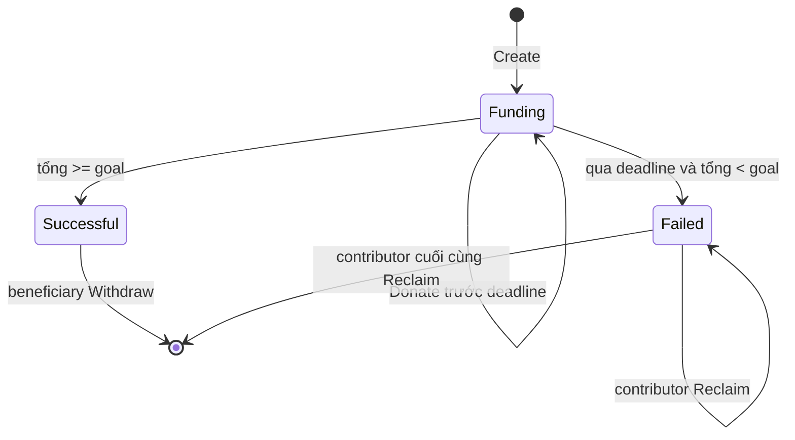
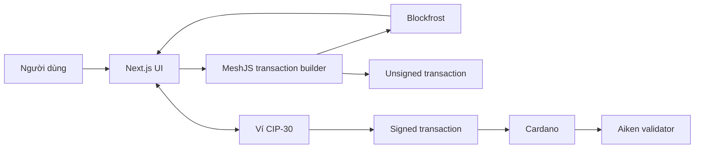

# Bài 1: Kiến trúc Crowdfund và các pattern cốt lõi

> Video: [Building with Aiken - Bài 10.1: Kiến trúc Crowdfunding và các pattern cốt lõi](https://www.youtube.com/watch?v=EGWiRgjYDo0)

## Mục tiêu bài học

Sau bài này, học viên có thể:

1. Giải thích bài toán gây quỹ có điều kiện và vai trò của từng bên tham gia.
2. Phân biệt UTxO giữ state với datum mô tả state của một campaign.
3. Tính tổng contribution, progress và xác định trạng thái campaign từ dữ liệu on-chain.
4. Giải thích vì sao campaign có identity token và cách token được tạo từ seed UTxO.
5. Phân biệt trách nhiệm frontend, off-chain builder, wallet, provider và validator.
6. Đọc được cấu trúc datum và theo dõi một transaction donate qua input/output.

## 1. Bài toán: quỹ cộng đồng với điều kiện hoàn tiền

Một chiến dịch crowdfunding nhận ADA từ nhiều người để đạt một mục tiêu trong một thời hạn. Hợp đồng cần trả lời trước những câu hỏi sau:

- Ai là người sẽ nhận tiền nếu chiến dịch thành công?
- Thế nào được xem là thành công?
- Đóng góp có được nhận sau hạn không?
- Nếu không đạt mục tiêu, mỗi người lấy lại khoản tiền của mình bằng cách nào?
- Điều gì ngăn người dùng đổi beneficiary, goal hoặc khoản đóng góp trong transaction?

Trong demo này, campaign lưu các tham số `beneficiary`, `goal`, `deadline` và danh sách `contributions`. Luật chính là:

1. Contributor donate trước deadline.
2. Khi tổng contribution đạt hoặc vượt goal, beneficiary có thể withdraw số ADA đang khóa.
3. Nếu deadline đã qua và tổng contribution vẫn dưới goal, từng contributor có thể reclaim khoản đã ghi nhận cho payment key hash của họ.
4. Khi withdraw hoặc contributor cuối cùng reclaim, campaign UTxO bị đóng và identity token bị burn.

### Vai trò

| Vai trò | Trách nhiệm | Bằng chứng quan trọng |
|---|---|---|
| Campaign creator | Chọn beneficiary, goal, deadline và tạo campaign | Beneficiary ký transaction `Create` |
| Beneficiary | Nhận tiền khi campaign đạt goal | Payment key hash phải ký `Withdraw` |
| Contributor | Gửi ADA vào campaign | Payment key hash phải ký `Donate`; có thể ký `Reclaim` nếu campaign thất bại |
| Frontend | Nhập liệu, hiển thị campaign và điều khiển trải nghiệm | Không phải nguồn quyết định tính hợp lệ |
| Off-chain builder | Query UTxO, giải mã datum, dựng transaction | Tạo unsigned transaction theo state hiện tại |
| Validator | Kiểm tra luật của transaction | Chấp nhận hoặc từ chối khi transaction được xác minh on-chain |

Ở giao diện, creator hiện phải là beneficiary: builder so sánh payment key hash của địa chỉ beneficiary với ví đang kết nối. Đây là quy tắc của luồng tạo campaign trong ứng dụng, không phải yêu cầu tổng quát của crowdfunding.

## 2. State của campaign nằm ở đâu?

Cardano dùng mô hình EUTxO. Có thể hình dung một UTxO như một “hộp” bất biến chứa:

```text
UTxO = địa chỉ nhận + value (ADA/token) + datum (dữ liệu state)
```

Khi một transaction tiêu campaign UTxO, nó tạo một UTxO mới đại diện cho state tiếp theo, hoặc kết thúc campaign mà không tạo state script tiếp nối.

```text
Campaign UTxO cũ
   ├─ input bị tiêu trong transaction
   ├─ validator đọc datum cũ và redeemer
   └─ transaction tạo:
        ├─ continuing campaign UTxO (nếu campaign còn mở)
        ├─ payout/refund (tùy hành động)
        └─ change
```

Điều quan trọng: transaction không “sửa” một UTxO đang tồn tại. Nó tiêu UTxO cũ và tạo output mới. Vì thế, campaign state mới có một `txHash#outputIndex` khác. Các giao dịch đồng thời dùng cùng một input UTxO sẽ cạnh tranh; chỉ giao dịch đầu tiên tiêu thành công input đó, giao dịch còn lại phải query state mới rồi dựng lại.

## 3. Mô hình dữ liệu

Kiểu dữ liệu thực tế được khai báo trong [types.ak](../onchain/lib/types.ak):

```aiken
use aiken/crypto.{VerificationKeyHash}
use cardano/address.{Address}
use cardano/transaction.{OutputReference}

pub type Datum {
  contributions: Pairs<VerificationKeyHash, Int>,
  beneficiary: Address,
  goal: Int,
  deadline: Int,
}

pub type Redeemer {
  Donate
  Reclaim
  Withdraw
}

pub type MintAction {
  Create(OutputReference)
  Close
}
```

| Trường | Kiểu | Ý nghĩa |
|---|---|---|
| `contributions` | `Pairs<VerificationKeyHash, Int>` | Cặp payment key hash → tổng lovelace đã donate |
| `beneficiary` | `Address` | Địa chỉ public-key nhận tiền khi withdraw |
| `goal` | `Int` | Mục tiêu, tính bằng lovelace |
| `deadline` | `Int` | Thời điểm Unix tính bằng milliseconds |
| `Redeemer` | `Donate`, `Reclaim`, `Withdraw` | Hành động tiêu campaign UTxO |
| `MintAction` | `Create(seed)`, `Close` | Hành động mint hoặc burn identity token |

`contributions` lưu **payment key hash**, không lưu địa chỉ làm khóa. Vì vậy, khi contributor donate nhiều lần từ cùng một payment key hash, các khoản tiền được cộng vào một entry. UI cũng tra contribution cá nhân bằng payment key hash của ví, thay vì so sánh chuỗi địa chỉ.

### Tính tổng đóng góp

Không có trường `total` riêng trong datum. Validator và frontend tính tổng từ danh sách:

```aiken
fn sum_contributions(
  contributions: Pairs<VerificationKeyHash, Int>,
) -> Int {
  pairs.foldl(contributions, 0, fn(_key, value, acc) { acc + value })
}
```

Ở frontend, phép tính tương đương là:

```ts
const total = datum.contributions.reduce(
  (sum, contribution) => sum + contribution.quantity,
  0,
);
const goalMet = total >= datum.goal;
```

Việc tính lại từ entries làm cho tổng có thể được đối chiếu trực tiếp với từng contributor. Đổi lại, mỗi state transition phải giữ danh sách nhất quán với số ADA trong UTxO.

### Đơn vị tiền và thời gian

```text
1 ADA = 1_000_000 lovelace
10 ADA = 10_000_000 lovelace
```

- `goal`, `contributions`, `campaignDeposit` và số ADA trong UTxO được biểu diễn bằng lovelace.
- Frontend nhập goal/deposit theo ADA rồi nhân `1_000_000` trước khi gọi builder.
- `deadline` được lưu dưới dạng Unix milliseconds. Builder chuyển thời điểm đó sang slot của network để thiết lập validity range.
- Khoản `campaignDeposit` khi tạo campaign tối thiểu 2 ADA trong builder. Nó là ADA nằm trong output campaign nhưng không thuộc contribution và không được cộng vào `total`.
- Wallet cần UTxO collateral ADA-only tối thiểu 5 ADA để dựng giao dịch Plutus theo adapter hiện tại. Collateral không phải deposit campaign và cũng không phải contribution.

### Ví dụ tính trạng thái

Giả sử datum đang có:

```text
goal = 100_000_000 lovelace        (100 ADA)
contributions:
  Alice = 60_000_000               (60 ADA)
  Bob   = 25_000_000               (25 ADA)
total = 85_000_000                 (85 ADA)
```

Campaign chưa đạt goal. Nếu Alice donate thêm 15 ADA, datum trở thành:

```text
Alice = 75_000_000
Bob   = 25_000_000
total = 100_000_000
```

Campaign đạt goal. Beneficiary có thể withdraw. Nếu chỉ donate thêm 10 ADA, tổng là 95 ADA; campaign chưa đạt goal. Nếu đến sau deadline mà vẫn 95 ADA, contributor có thể reclaim riêng khoản của mình. ADA deposit ban đầu không tham gia các phép tính trên.

## 4. Trạng thái là kết quả suy ra, không phải enum

Code không lưu các giá trị như `Funding`, `Successful` hay `Failed` trong datum. Chúng được suy ra từ tổng contribution và thời điểm:

```text
goalMet = total >= goal
expired = currentTime > deadline

if goalMet:
    campaign có thể Withdraw
else if expired:
    contributor có thể Reclaim
else:
    campaign đang mở nhận Donate
```

Đây là mô hình state machine, nhưng state được xác định bởi dữ liệu thay vì một trường `status` cập nhật riêng. Cách này tránh phải đồng bộ thêm một enum với contribution và deadline. Validator vẫn kiểm tra điều kiện thực tế của từng action; UI chỉ trình bày cách diễn giải thuận tiện.



Một chi tiết implementation cần nhớ: UI ưu tiên hiển thị goal đã đạt nếu tổng đạt mục tiêu. Reclaim thì không được phép nếu goal đã đạt, kể cả deadline đã qua. Withdraw hiện không yêu cầu campaign vẫn còn trong deadline; điều kiện chính là goal đã đạt và beneficiary ký.

## 5. Identity token: định danh state campaign

Campaign không chỉ được nhận diện bằng địa chỉ script vì nhiều campaign có thể cùng nằm tại cùng một script address. Mỗi campaign có một identity token riêng.

1. Builder chọn một wallet UTxO làm `seed`.
2. `OutputReference` gồm transaction hash và output index của seed.
3. Tên token được tạo từ hash của serialized reference.
4. Minting policy yêu cầu seed phải là input của transaction tạo campaign.
5. Một identity token được đặt vào campaign UTxO.
6. Token được giữ trong các continuing output, rồi bị burn khi campaign đóng.

Hàm on-chain trong [crowdfund.ak](../onchain/validators/crowdfund.ak):

```aiken
fn campaign_id(seed: OutputReference) -> ByteArray {
  blake2b_256(cbor.serialise(seed))
}
```

Vì một UTxO seed chỉ có thể bị tiêu một lần, cùng seed không thể được dùng lại để mint identity token lần nữa. Khi đọc campaign list, frontend lọc UTxO có asset thuộc policy ID campaign và xác nhận mỗi UTxO mang đúng một identity token hợp lệ.

Identity token không đại diện cho số tiền đã quyên góp và cũng không thay thế datum. Nó đóng vai trò định danh campaign và giúp validator đảm bảo state tiếp tục hoặc kết thúc đúng cách.

## 6. Vòng đời giao dịch nhìn từ state

### 6.1 Tạo campaign

```text
Wallet UTxO seed + wallet funding
  └─ Create:
       mint identity token
       tạo script UTxO:
         ADA = campaignDeposit (tối thiểu 2 ADA)
         datum = contributions rỗng, beneficiary, goal, deadline
```

### 6.2 Donate

```text
Campaign UTxO cũ: 10 ADA deposit + 20 ADA contributions
Donate 5 ADA:
  ├─ Campaign UTxO mới: 10 ADA deposit + 25 ADA contributions
  ├─ Datum mới ghi contributor + 5 ADA
  └─ Identity token vẫn bằng 1
```

Số trên chỉ mô tả cách phân biệt deposit với contribution trong bài giảng. Trên chain, ADA trong UTxO là một lượng tổng; validator tính delta giữa script input/output và đối chiếu với thay đổi trong datum.

### 6.3 Reclaim

Nếu campaign thất bại, một lần reclaim xóa đúng một contributor khỏi datum và hoàn amount đã ghi:

```text
Trước:
  contributions = {Alice: 10 ADA, Bob: 5 ADA}
  script ADA     = deposit + 15 ADA

Bob Reclaim:
  refund Bob     = 5 ADA
  contributions  = {Alice: 10 ADA}
  script ADA     = deposit + 10 ADA
  identity token = 1
```

Khi Alice reclaim cuối cùng, không còn continuing script output và identity token bị burn.
Trong builder hiện tại, ADA còn lại của campaign UTxO (bao gồm phần deposit chưa bị dùng trả phí) đi vào change của contributor cuối cùng vì `changeAddress` được đặt là ví đang reclaim. Đây là kết quả của transaction balancing/builder; validator không có một nhánh payout riêng mang tên “hoàn deposit”.

Khi withdraw thành công, validator yêu cầu beneficiary nhận ít nhất toàn bộ ADA trong campaign input. Vì vậy, lượng này gồm cả ADA deposit ban đầu và contributions đang khóa, không chỉ riêng `total` dùng để so với goal.

## 7. Ranh giới tin cậy giữa các lớp



| Thành phần | Có thể làm | Không thể làm |
|---|---|---|
| UI | Hiển thị tiến độ, kiểm tra đầu vào, disable nút | Buộc validator chấp nhận transaction |
| Builder | Query UTxO, giải mã datum, chọn input/output, tạo unsigned transaction | Ký thay người dùng hoặc tạo ra state đáng tin chỉ bằng dữ liệu client |
| Wallet | Giữ khóa, trả chữ ký, gửi transaction đã ký | Thay đổi luật trong validator |
| Provider | Cung cấp dữ liệu UTxO và evaluator | Là nơi lưu luật chính thức của campaign |
| Validator | Kiểm tra signer, datum, token, value và thời gian | Tự query campaign list hoặc cập nhật UI |

Ẩn nút donate trên UI tạo trải nghiệm tốt nhưng không phải security boundary. Một client khác có thể tự dựng transaction; vì thế mọi điều kiện có ảnh hưởng tới tính hợp lệ phải được kiểm tra bởi validator, không chỉ bởi giao diện.

## 8. Giới hạn cần nhận biết khi học code

- Đây là demo gây quỹ bằng ADA trên Preprod; chưa phải một giao thức production đã được kiểm toán.
- Datum không chứa tên campaign, mô tả, ảnh hay metadata; UI cần một hệ thống khác nếu muốn lưu nội dung này.
- Một campaign state dùng một UTxO; nhiều giao dịch đồng thời có thể xung đột trên cùng state.
- Tổng được tính từ danh sách contributions; builder và validator phải thay đổi danh sách cùng số ADA tương ứng.
- Builder từ chối donate nếu tổng đã đạt goal, nhưng nhánh Donate trong validator hiện không kiểm tra `total_in < goal`. Điều này sẽ được phân tích ở Bài 2.
- Chữ ký là payment key hash của ví; ứng dụng không gửi seed phrase lên server.

## 9. Đọc code thật: Plutus datum thành dữ liệu TypeScript

Datum được lưu theo Plutus Data, không trực tiếp dưới dạng object JavaScript như sau:

```ts
{
  beneficiary: "addr_test1...",
  goal: 100_000_000,
  deadline: 1790000000000,
  contributions: [...]
}
```

Blockfrost trả về inline datum đã serialize. Ứng dụng phải decode nó rồi mới đưa vào UI. Hàm thực tế nằm trong [utils.ts](../frontend/src/lib/utils.ts). Phần dưới đây là trích đoạn chính:

```ts
const datum = deserializeDatum(plutusData) as PlutusDataNode;

const contributionsDatum = datum.fields?.[0];
const beneficiaryDatum = datum.fields?.[1];
const beneficiary = parseAddress(beneficiaryDatum);
const goal = Number(datum.fields?.[2]?.int);
const deadline = Number(datum.fields?.[3]?.int);

const contributions = [];
for (const item of contributionsDatum?.map ?? []) {
    const paymentKeyHash = item.k?.bytes;
    const quantity = Number(item.v?.int);

    contributions.push({
        address: buildAddress(paymentKeyHash),
        paymentKeyHash,
        quantity,
    });
}
```

Đây là thứ tự datum khớp với kiểu Aiken:

```text
fields[0] = contributions (Map payment key hash -> amount)
fields[1] = beneficiary
fields[2] = goal
fields[3] = deadline
```

Giải thích theo từng bước:

1. `deserializeDatum` chuyển CBOR/Plutus Data thành cấu trúc node có `fields`, `map`, `bytes` và `int`.
2. `fields[0]` là map contribution. Mỗi `k` là bytes của payment key hash, mỗi `v` là số lovelace.
3. `fields[1]` là beneficiary được mã hóa thành Plutus Address; hàm `parseAddress` đọc payment/stake credential.
4. `fields[2]` và `fields[3]` là số nguyên goal và deadline.
5. Ứng dụng dựng lại chuỗi địa chỉ Cardano để UI hiển thị và chuẩn hóa số contribution thành number.
6. Nếu datum sai định dạng, thiếu credential hoặc có số không hợp lệ, hàm báo lỗi thay vì hiển thị state như thể nó hợp lệ.

Không nên nhầm `paymentKeyHash` với địa chỉ đầy đủ. Datum contribution được khóa theo payment key hash; address ở object TypeScript là dữ liệu tiện lợi để hiển thị. Beneficiary, ngược lại, được lưu như `Address`.

## 10. Đọc code thật: tạo campaign và state ban đầu

Builder `createCampaign()` nằm trong [mesh.txbuilder.ts](../frontend/src/txbuilders/mesh.txbuilder.ts). Sau khi xác thực goal/deposit/deadline và chọn seed, builder tạo reference, hash token name rồi dựng output:

```ts
const seedRef = mOutputReference(seed.input.txHash, seed.input.outputIndex);
const serializedSeed = serializeData(seedRef);
const assetName = blake2b.hash(
    serializedSeed as Parameters<typeof blake2b.hash>[0],
    32,
);

return await this.meshTxBuilder
    .txIn(seed.input.txHash, seed.input.outputIndex)
    .mintPlutusScriptV3()
    .mint("1", this.policyId, assetName)
    .mintingScript(this.mintScriptCbor)
    .mintRedeemerValue(mConStr0([seedRef]))
    .txOut(this.spendAddress, [
        { unit: "lovelace", quantity: String(campaignDeposit) },
        { unit: `${this.policyId}${assetName}`, quantity: "1" },
    ])
    .txOutInlineDatumValue(
        mConStr0([
            new Map(),
            mPubKeyAddress(
                beneficiaryAddress.pubKeyHash,
                beneficiaryAddress.stakeCredentialHash,
            ),
            BigInt(goal),
            BigInt(deadline),
        ]),
    )
    .invalidHereafter(Number(resolveSlotNo(APP_NETWORK, deadline)))
    .requiredSignerHash(beneficiaryAddress.pubKeyHash)
    .txInCollateral(collateral.input.txHash, collateral.input.outputIndex)
    .setNetwork(APP_NETWORK)
    .complete();
```

Đọc đoạn builder theo đúng thứ tự chain:

1. `.txIn(seed...)` đưa UTxO seed vào transaction. Minting policy sẽ kiểm tra reference này thật sự bị tiêu.
2. `.mint("1", ...)` yêu cầu mint đúng một identity token dưới campaign policy.
3. `.mintRedeemerValue(mConStr0([seedRef]))` mã hóa hành động `Create(seedRef)` cho minting policy.
4. `.txOut(this.spendAddress, ...)` tạo script output và chuyển `campaignDeposit` lovelace cùng identity token vào đó.
5. `.txOutInlineDatumValue(...)` ghi state khởi tạo: map contribution rỗng, beneficiary, goal và deadline.
6. `.invalidHereafter(...)` giới hạn transaction không được hợp lệ sau deadline.
7. `.requiredSignerHash(...)` yêu cầu beneficiary ký.
8. `.txInCollateral(...)` khai báo collateral dùng cho script transaction.
9. `.complete()` hoàn thành việc dựng unsigned transaction; bước này chưa phải chữ ký hay submit.

Lưu ý phần funding UTxO: đoạn đầy đủ trong builder loại seed và collateral khỏi `selectUtxosFrom`. Nhờ đó, một UTxO không bị dùng đồng thời làm seed/collateral/funding input theo cách builder chủ động tránh.

## 11. Đọc code thật: tính trạng thái trên UI

Trong [CampaignList.tsx](../frontend/src/components/CampaignList.tsx), progress và status được suy ra từ datum:

```ts
function progressPercent(datum: Campaign["datum"]): number {
    const total = datum.contributions.reduce(
        (sum, contribution) => sum + contribution.quantity,
        0,
    );
    if (datum.goal === 0) return 0;
    return Math.min(100, Number((total * 100) / datum.goal));
}

const total = datum.contributions.reduce(
    (sum, contribution) => sum + contribution.quantity,
    0,
);
const isExpired = currentTime !== null && currentTime > datum.deadline;
const goalMet = total >= datum.goal;
```

Ví dụ goal 100 ADA và total 125 ADA:

```text
progress thô = 125 / 100 * 100 = 125%
progress hiển thị = min(100, 125) = 100%
goalMet = true
```

`progressPercent` chỉ giới hạn thanh progress ở 100%; nó không làm mất phần contribution vượt goal. Các action và validator vẫn dùng số lovelace thật trong datum.

Giao diện có thể chọn nhãn `Goal Met`, `Expired` hoặc `Active`, nhưng đó chỉ là presentation logic. Validator không đọc nhãn UI; nó tính lại `total_in` từ datum và áp dụng điều kiện riêng cho từng redeemer.

## Bài tập tự kiểm tra

1. Goal là 100 ADA, contribution là 30, 25 và 45 ADA. Tính total và xác định action có thể thực hiện.
2. Nếu datum ghi Bob đã góp 5 ADA nhưng script UTxO không có phần ADA tương ứng, thành phần nào phải từ chối transaction?
3. Vì sao campaign cần identity token nếu tất cả campaign cùng dùng một script address?
4. Mô tả input và output của transaction khi contributor cũ donate thêm.
5. Phân biệt `campaignDeposit`, `contribution`, `collateral` và wallet funding UTxO.

## Gợi ý đáp án

1. Tổng là 100 ADA; campaign đạt goal và beneficiary có thể withdraw nếu ký đúng.
2. Validator cần đối chiếu datum với chênh lệch ADA của script UTxO; transaction không khớp phải bị từ chối.
3. Token phân biệt từng campaign và cho validator/frontend xác định identity của state.
4. Input là campaign UTxO cũ; output là script UTxO mới với ADA tăng đúng delta, contribution cũ được cộng dồn, các trường bất biến giữ nguyên và identity token còn một bản.
5. Deposit là ADA khởi tạo trong campaign; contribution là tiền được ghi công cho donor; collateral phục vụ giao dịch Plutus; funding UTxO trả phí và các phần ADA cần thiết từ ví.
