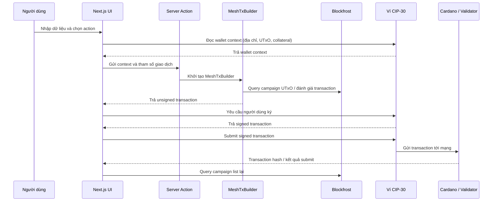

# Bài 3: Off-chain, frontend và vòng đời dApp

> Video: [Building with Aiken - Bài 10.3: Off-chain, Frontend và vòng đời dApp](https://www.youtube.com/watch?v=mwDCVm0FRd4)

## Mục tiêu bài học

Sau bài này, học viên có thể:

1. Theo dõi dữ liệu campaign từ provider tới object mà UI sử dụng.
2. Phân biệt server action, adapter, transaction builder, ví và validator.
3. Đọc code MeshJS cho `Create`, `Donate`, `Reclaim` và `Withdraw`.
4. Hiểu cách chọn campaign UTxO, wallet funding UTxO và collateral.
5. Mô tả vòng đời unsigned transaction → ký → submit → refresh.
6. Chẩn đoán lỗi stale state, thiếu collateral, thiếu seed hoặc chưa đủ điều kiện campaign.

## 1. Bản đồ ứng dụng

Frontend Next.js chịu trách nhiệm hiển thị và gọi action; Aiken validator chịu trách nhiệm xác thực luật. Các file chính:

| Thành phần | File | Công việc |
|---|---|---|
| Server actions | [crowdfund.action.ts](../frontend/src/actions/crowdfund.action.ts) | Khởi tạo builder rồi gọi API create/donate/reclaim/withdraw |
| Adapter Mesh | [mesh.adapter.ts](../frontend/src/adapters/mesh.adapter.ts) | Đọc script, tính policy/address, khởi tạo provider, lấy wallet UTxO/collateral |
| Transaction builder | [mesh.txbuilder.ts](../frontend/src/txbuilders/mesh.txbuilder.ts) | Query campaign và dựng transaction |
| Giải mã datum | [utils.ts](../frontend/src/lib/utils.ts) | Plutus Data → object TypeScript cho UI |
| Wallet context | [wallet.ts](../frontend/src/lib/wallet.ts) | Đọc change address, UTxO, collateral từ ví CIP-30 |
| UI điều phối | [page.tsx](../frontend/src/app/page.tsx) | Chọn tab, campaign và component tương ứng |
| Validator | [crowdfund.ak](../onchain/validators/crowdfund.ak) | Kiểm tra transaction thực tế trên chain |



Server action không ký transaction thay người dùng. Wallet được gọi ở phía client để ký và submit. Builder chuẩn bị body giao dịch; validator vẫn là nơi kiểm tra cuối cùng.

## 2. Bước 1: đọc wallet context

Hàm thực tế trong [wallet.ts](../frontend/src/lib/wallet.ts):

```ts
export const getWalletContext = async (
    wallet: Pick<BrowserWallet, "getChangeAddress" | "getUtxos" | "getCollateral">,
): Promise<WalletContext> => {
    const [changeAddress, utxos, collaterals] = await Promise.all([
        wallet.getChangeAddress(),
        wallet.getUtxos(),
        wallet.getCollateral(),
    ]);

    return {
        changeAddress,
        utxos,
        collaterals,
    };
};
```

Giải thích:

1. `getChangeAddress()` lấy địa chỉ mặc định nhận tiền thừa.
2. `getUtxos()` lấy các UTxO mà wallet cho phép dùng trong transaction.
3. `getCollateral()` lấy danh sách ứng viên collateral.
4. `Promise.all` gọi ba API độc lập cùng lúc.
5. Object trả về không chứa private key hoặc seed phrase.

Đây là dữ liệu builder cần để chọn input và dựng change. Ví vẫn giữ quyền ký cuối cùng.

## 3. Bước 2: khởi tạo MeshAdapter và script address

`MeshTxBuilder` kế thừa từ `MeshAdapter`. Adapter đọc validator đã compile trong `plutus.json`, áp dụng tham số (dự án hiện truyền danh sách tham số rỗng), tính policy ID và script address. Sau đó builder được khởi tạo với provider Blockfrost làm fetcher/evaluator.

Luồng khái quát:

```text
plutus.json
  ├─ crowdfund spending script
  └─ crowdfund mint script
       ↓
applyParamsToScript
       ↓
resolveScriptHash → policy ID
serializePlutusScript → script address
       ↓
MeshTxBuilder(fetcher, evaluator)
```

Các phương thức khởi tạo được gọi từ server action:

```ts
const meshTxBuilder = new MeshTxBuilder({ walletContext });
await meshTxBuilder.initalize();

return await meshTxBuilder.createCampaign({
    beneficiary,
    deadline,
    goal,
    campaignDeposit,
});
```

Tên method trong source là `initalize` (cách viết đang có trong repository). Phương thức này tạo `MeshTxBuilder` với fetcher và evaluator. Builder không giữ state giao dịch lâu dài; mỗi action tạo một instance rồi query dữ liệu cần thiết.

## 4. Bước 3: query campaign UTxO và giải mã datum

### 4.1 Tìm campaign

`getCampaigns()` query các UTxO ở script address, lọc UTxO có asset thuộc policy ID, kiểm tra identity token và giải mã inline datum:

```ts
getCampaigns = async () => {
    const utxos = await this.fetcher.fetchAddressUTxOs(this.spendAddress);
    const campaignUtxos = utxos.filter((utxo) =>
        utxo.output.amount.some(
            (asset) =>
                asset.unit.startsWith(this.policyId) &&
                asset.unit.length > this.policyId.length,
        ),
    );

    return campaignUtxos.map((utxo) => {
        if (!utxo.output.plutusData) {
            throw new Error("Campaign UTxO is missing its inline datum.");
        }

        this.getCampaignIdentity(utxo);
        return {
            utxo,
            datum: this.convertDatum({
                plutusData: utxo.output.plutusData,
            }),
        };
    });
};
```

`getCampaignIdentity()` xác nhận có đúng một asset thuộc policy, quantity bằng `"1"` và asset name có dạng hash 64 ký tự hex. Nếu thiếu inline datum hoặc token sai dạng, builder báo lỗi thay vì hiển thị campaign không đầy đủ.

### 4.2 Campaign reference

Một campaign UTxO được xác định bằng:

```ts
type CampaignRef = {
    txHash: string;
    outputIndex: number;
};
```

UI giữ reference của campaign được chọn. Trước khi dựng action, `findCampaign()` query script address lần nữa và tìm input có đúng `txHash` + `outputIndex`. Nếu input đã bị người khác tiêu hoặc bị provider loại khỏi kết quả, builder throw lỗi “selected campaign UTxO was not found” để yêu cầu refresh.

### 4.3 Decode Plutus datum

Hàm trong [utils.ts](../frontend/src/lib/utils.ts) chuyển inline datum thành object UI:

```ts
const datum = deserializeDatum(plutusData) as PlutusDataNode;

const contributionsDatum = datum.fields?.[0];
const beneficiaryDatum = datum.fields?.[1];
const beneficiary = parseAddress(beneficiaryDatum);
const goal = Number(datum.fields?.[2]?.int);
const deadline = Number(datum.fields?.[3]?.int);

const contributions = [];
for (const item of contributionsDatum?.map ?? []) {
    const paymentKeyHash = item.k?.bytes;
    const quantity = Number(item.v?.int);

    contributions.push({
        address: buildAddress(paymentKeyHash),
        paymentKeyHash,
        quantity,
    });
}
```

Mapping từ Aiken sang TypeScript:

```text
Datum.contributions → fields[0].map
Datum.beneficiary   → fields[1]
Datum.goal          → fields[2].int
Datum.deadline      → fields[3].int
```

Hàm đầy đủ kiểm tra payment/stake credential dài 56 ký tự hex, goal dương, deadline hợp lệ và từng contribution có payment key hash cùng số nguyên hợp lệ. Nếu decode lỗi, exception được trả về với thông tin `Invalid Plutus datum`, không giả lập dữ liệu mặc định.

## 5. Bước 4: tạo campaign

### 5.1 Kiểm tra đầu vào và chọn UTxO

Trong `createCampaign()`:

```ts
if (!Number.isSafeInteger(goal) || goal <= 0) {
    throw new Error("Campaign goal must be a positive safe integer in lovelace.");
}
if (!Number.isSafeInteger(campaignDeposit) || campaignDeposit < 2_000_000) {
    throw new Error("Campaign deposit must be at least 2 ADA.");
}
if (!Number.isSafeInteger(deadline) || deadline <= Date.now()) {
    throw new Error("Campaign deadline must be in the future.");
}

const { utxos, walletAddress, collateral } = await this.getWalletForTx();
const collateralRef = collateral.input;
const seed = utxos.find(
    ({ input }) =>
        input.txHash !== collateralRef.txHash ||
        input.outputIndex !== collateralRef.outputIndex,
);
if (!seed) {
    throw new Error(
        "A wallet UTxO separate from collateral is required to seed the campaign identity token.",
    );
}
```

Builder cần:

- Goal là số nguyên dương an toàn, đơn vị lovelace.
- Deposit ít nhất 2 ADA.
- Deadline vẫn ở tương lai.
- Collateral hợp lệ.
- Một seed UTxO riêng biệt với collateral.
- UTxO khác để funding phí và phần value còn thiếu.

Adapter chọn collateral là UTxO chỉ chứa ADA và có ít nhất 5 ADA. Nếu ví chỉ có đúng một UTxO phù hợp và UTxO đó đang làm collateral, builder không thể dùng nó làm seed; cần thêm UTxO khác.

### 5.2 Tạo seed và datum

```ts
const seedRef = mOutputReference(seed.input.txHash, seed.input.outputIndex);
const serializedSeed = serializeData(seedRef);
const assetName = blake2b.hash(
    serializedSeed as Parameters<typeof blake2b.hash>[0],
    32,
);
const fundingUtxos = utxos.filter(
    ({ input }) =>
        (input.txHash !== seed.input.txHash ||
            input.outputIndex !== seed.input.outputIndex) &&
        (input.txHash !== collateralRef.txHash ||
            input.outputIndex !== collateralRef.outputIndex),
);

const beneficiaryAddress = deserializeAddress(beneficiary);
if (!beneficiaryAddress.pubKeyHash) {
    throw new Error("Beneficiary must be a public-key address.");
}
if (
    beneficiaryAddress.pubKeyHash !==
    deserializeAddress(walletAddress).pubKeyHash
) {
    throw new Error(
        "The connected wallet must be the campaign beneficiary to create this campaign.",
    );
}
```

Seed reference được serialize rồi hash để tạo asset name. Tiếp đó builder xác nhận beneficiary là public-key address và thuộc payment key hash của ví đang tạo campaign.

### 5.3 Dựng transaction

```ts
return await this.meshTxBuilder
    .txIn(seed.input.txHash, seed.input.outputIndex)
    .mintPlutusScriptV3()
    .mint("1", this.policyId, assetName)
    .mintingScript(this.mintScriptCbor)
    .mintRedeemerValue(mConStr0([seedRef]))
    .txOut(this.spendAddress, [
        { unit: "lovelace", quantity: String(campaignDeposit) },
        { unit: `${this.policyId}${assetName}`, quantity: "1" },
    ])
    .txOutInlineDatumValue(
        mConStr0([
            new Map(),
            mPubKeyAddress(
                beneficiaryAddress.pubKeyHash,
                beneficiaryAddress.stakeCredentialHash,
            ),
            BigInt(goal),
            BigInt(deadline),
        ]),
    )
    .invalidHereafter(Number(resolveSlotNo(APP_NETWORK, deadline)))
    .selectUtxosFrom(fundingUtxos)
    .changeAddress(walletAddress)
    .requiredSignerHash(beneficiaryAddress.pubKeyHash)
    .txInCollateral(collateral.input.txHash, collateral.input.outputIndex)
    .setNetwork(APP_NETWORK)
    .complete();
```

Kết quả `.complete()` là unsigned transaction CBOR/hex để UI đưa cho ví ký. Đây chưa phải transaction đã có chữ ký, chưa submit và chưa xác nhận.

## 6. Bước 5: donate và cập nhật contribution

### 6.1 Validate và tìm campaign state

```ts
if (!Number.isSafeInteger(quantity) || quantity <= 0) {
    throw new Error("Donation must be a positive safe integer in lovelace.");
}

const { utxos, walletAddress, collateral } = await this.getWalletForTx();
const { utxo, datum } = await this.findCampaign(campaignRef);
const totalContributions = datum.contributions.reduce(
    (sum, contribution) => sum + contribution.quantity,
    0,
);

if (Date.now() >= datum.deadline || totalContributions >= datum.goal) {
    throw new Error("Campaign is expired or has already reached its goal.");
}
```

Đây là kiểm tra off-chain để báo lỗi sớm. Dù builder kiểm tra client-side, validator vẫn cần tự xác nhận điều kiện của nó khi transaction được submit.

### 6.2 Cộng dồn contribution

```ts
const walletPaymentKeyHash = deserializeAddress(walletAddress).pubKeyHash;
const existingContribution = datum.contributions.find(
    (contribution) =>
        contribution.paymentKeyHash === walletPaymentKeyHash,
);

const contributions = datum.contributions.map((contribution) =>
    contribution.paymentKeyHash === walletPaymentKeyHash
        ? {
              ...contribution,
              quantity: contribution.quantity + quantity,
          }
        : contribution,
);

if (!existingContribution) {
    contributions.push({
        address: walletAddress,
        paymentKeyHash: walletPaymentKeyHash,
        quantity,
    });
}
```

Đi từng dòng:

1. Lấy payment key hash từ địa chỉ wallet.
2. Tìm xem key đã có trong datum chưa.
3. Nếu có, tạo entry mới với amount cũ cộng `quantity`.
4. Nếu chưa, append entry mới với amount ban đầu bằng `quantity`.
5. Không sửa entry của contributor khác.

`map` tạo list mới thay vì sửa datum cũ trong place. Đây là cách rõ ràng để builder giữ nguyên các entry không liên quan.

### 6.3 Tăng ADA script và dựng validity range

```ts
const campaignAssets = utxo.output.amount.map((asset) =>
    asset.unit === "lovelace"
        ? {
              ...asset,
              quantity: String(Number(asset.quantity) + quantity),
          }
        : asset,
);
if (!campaignAssets.some((asset) => asset.unit === "lovelace")) {
    throw new Error("Campaign UTxO does not contain lovelace.");
}

const plutusContributions = new Map<string, number>();
contributions.forEach(({ paymentKeyHash, quantity: contribution }) => {
    plutusContributions.set(paymentKeyHash, contribution);
});

return await this.meshTxBuilder
    .spendingPlutusScriptV3()
    .txIn(utxo.input.txHash, utxo.input.outputIndex)
    .txInInlineDatumPresent()
    .txInRedeemerValue(mConStr0([]))
    .txInScript(this.spendScriptCbor)
    .txOut(this.spendAddress, campaignAssets)
    .txOutInlineDatumValue(
        mConStr0([
            plutusContributions,
            mPubKeyAddress(
                deserializeAddress(datum.beneficiary).pubKeyHash,
                deserializeAddress(datum.beneficiary).stakeCredentialHash,
            ),
            BigInt(datum.goal),
            BigInt(datum.deadline),
        ]),
    )
    .invalidBefore(Number(resolveSlotNo(APP_NETWORK, Date.now() - 60_000)))
    .invalidHereafter(
        Number(
            resolveSlotNo(
                APP_NETWORK,
                Math.min(Date.now() + 300_000, datum.deadline),
            ),
        ),
    )
    .selectUtxosFrom(utxos)
    .changeAddress(walletAddress)
    .requiredSignerHash(walletPaymentKeyHash)
    .txInCollateral(collateral.input.txHash, collateral.input.outputIndex)
    .setNetwork(APP_NETWORK)
    .complete();
```

Code rút gọn ở trên giữ lại các phần quan trọng; source dựng Map Plutus từ `contributions` và serialize beneficiary cùng credential. Luồng:

- Tiêu campaign UTxO cũ.
- Đặt redeemer `Donate`.
- Tạo campaign output mới với ADA tăng bằng quantity.
- Ghi datum mới.
- Chọn validity range từ xấp xỉ hiện tại đến tối đa 5 phút sau hoặc deadline, lấy mốc sớm hơn.
- Yêu cầu contributor ký.
- Khai báo collateral, network và hoàn thành transaction.

Validator tính delta của ADA script và xác nhận nó bằng lượng contribution tăng. Nếu datum mới và value mới không khớp, transaction fail.

## 7. Bước 6: reclaim sau deadline

### 7.1 Chọn entry của ví và kiểm tra điều kiện

```ts
const walletPaymentKeyHash = deserializeAddress(walletAddress).pubKeyHash;
const totalContributions = datum.contributions.reduce(
    (sum, contribution) => sum + contribution.quantity,
    0,
);
const ownContribution = datum.contributions.find(
    (contribution) =>
        contribution.paymentKeyHash === walletPaymentKeyHash,
);

if (
    Date.now() <= datum.deadline ||
    totalContributions >= datum.goal ||
    !ownContribution
) {
    throw new Error(
        "Cannot reclaim: the deadline has not passed, the goal has been reached, or this wallet did not contribute.",
    );
}
```

Ba điều kiện cùng phải đúng để đi tiếp:

1. Thời điểm hiện tại đã sau deadline.
2. Campaign chưa đạt goal.
3. Datum có contribution của ví đang kết nối.

### 7.2 Xóa đúng contributor

```ts
const remainingContributions = datum.contributions.filter(
    (contribution) =>
        contribution.paymentKeyHash !== walletPaymentKeyHash,
);
```

Sau đó builder tạo spending transaction với `Reclaim`, đặt lower bound sau deadline và thêm payout:

```ts
const unsignedTx = this.meshTxBuilder
    .spendingPlutusScriptV3()
    .txIn(utxo.input.txHash, utxo.input.outputIndex)
    .txInInlineDatumPresent()
    .txInRedeemerValue(mConStr1([]))
    .txInScript(this.spendScriptCbor)
    .invalidBefore(
        Number(resolveSlotNo(APP_NETWORK, datum.deadline)) + 1,
    )
    .txOut(walletAddress, [
        {
            unit: "lovelace",
            quantity: String(ownContribution.quantity),
        },
    ]);
```

### 7.3 Hai nhánh: còn donor hay donor cuối

```ts
if (remainingContributions.length > 0) {
    const plutusContributions = new Map<string, number>();
    remainingContributions.forEach(({ paymentKeyHash, quantity }) => {
        plutusContributions.set(paymentKeyHash, quantity);
    });

    const campaignAssets = utxo.output.amount.map((asset) =>
        asset.unit === "lovelace"
            ? {
                  ...asset,
                  quantity: String(
                      Number(asset.quantity) - ownContribution.quantity,
                  ),
              }
            : asset,
    );

    unsignedTx
        .txOut(this.spendAddress, campaignAssets)
        .txOutInlineDatumValue(
            mConStr0([
                plutusContributions,
                mPubKeyAddress(
                    deserializeAddress(datum.beneficiary).pubKeyHash,
                    deserializeAddress(datum.beneficiary).stakeCredentialHash,
                ),
                BigInt(datum.goal),
                BigInt(datum.deadline),
            ]),
        );
} else {
    unsignedTx
        .mintPlutusScriptV3()
        .mint("-1", this.policyId, identity.assetName)
        .mintingScript(this.mintScriptCbor)
        .mintRedeemerValue(mConStr1([]));
}
```

Đoạn trên bám sát nhánh có thật trong builder. Ở nhánh còn donor, `campaignAssets` là value cũ nhưng ADA giảm `ownContribution.quantity`; datum mới chỉ chứa `remainingContributions`. Ở nhánh cuối, campaign đóng: không còn datum tiếp diễn, identity bị burn.

Ở lần reclaim cuối, output payout được builder tạo rõ ràng chỉ bằng amount contribution. Phần ADA campaign còn dư (thường là deposit, trừ phí transaction) đi vào change vì `changeAddress(walletAddress)` ở cuối builder. Validator không có trường `campaignDeposit` riêng và cũng không trực tiếp ra lệnh trả deposit cho donor cuối; đây là kết quả cân bằng transaction của builder hiện tại.

Vì mỗi transaction tiêu UTxO state trước đó, hai contributor không thể đồng thời reclaim dựa trên cùng một UTxO. Người thứ hai phải sử dụng continuing UTxO mới, với datum đã xóa contributor thứ nhất.

## 8. Bước 7: withdraw khi đạt goal

### 8.1 Điều kiện trước khi build

```ts
const totalContributions = datum.contributions.reduce(
    (sum, contribution) => sum + contribution.quantity,
    0,
);

if (totalContributions < datum.goal) {
    throw new Error("Campaign goal has not been reached.");
}

const beneficiaryPaymentKeyHash =
    deserializeAddress(datum.beneficiary).pubKeyHash;

if (
    !beneficiaryPaymentKeyHash ||
    beneficiaryPaymentKeyHash !==
        deserializeAddress(walletAddress).pubKeyHash
) {
    throw new Error(
        "The connected wallet must match the campaign beneficiary to withdraw.",
    );
}
```

Builder cũng chọn một wallet UTxO khác collateral, có tối thiểu 2 ADA, để funding phí withdraw. Nếu không có UTxO riêng, nó báo lỗi rõ ràng thay vì dùng nhầm collateral làm fee input.

### 8.2 Dựng withdrawal transaction

```ts
return await this.meshTxBuilder
    .spendingPlutusScriptV3()
    .txIn(utxo.input.txHash, utxo.input.outputIndex)
    .txInInlineDatumPresent()
    .txInRedeemerValue(mConStr2([]), undefined, {
        mem: 5_000_000,
        steps: 1_000_000_000,
    })
    .txInScript(this.spendScriptCbor)
    .mintPlutusScriptV3()
    .mint("-1", this.policyId, identity.assetName)
    .mintingScript(this.mintScriptCbor)
    .mintRedeemerValue(mConStr1([]), undefined, {
        mem: 1_000_000,
        steps: 500_000_000,
    })
    .txIn(fundingRef.txHash, fundingRef.outputIndex)
    .selectUtxosFrom(remainingUtxos)
    .changeAddress(datum.beneficiary)
    .requiredSignerHash(beneficiaryPaymentKeyHash)
    .txInCollateral(collateral.input.txHash, collateral.input.outputIndex)
    .setNetwork(APP_NETWORK)
    .complete();
```

Trong transaction:

- Campaign UTxO bị tiêu với redeemer `Withdraw`.
- Identity token bị burn.
- Một wallet UTxO funding phí được thêm làm input.
- Change address là beneficiary; ADA từ campaign có thể đi tới beneficiary như change.
- Beneficiary phải ký; collateral được khai báo riêng.

Validator kiểm tra có đúng một payout output tới địa chỉ beneficiary, lượng ADA payout tối thiểu bằng ADA campaign input và không có script output tiếp diễn. Số ADA campaign input gồm cả deposit ban đầu và contributions; `goal` chỉ dùng để quyết định đủ điều kiện withdraw, không giới hạn payout ở đúng số goal.

## 9. Bước 8: UI gọi builder, ký và submit

Một luồng UI sau khi nhận unsigned transaction có dạng:

```ts
const unsignedTx = await donate({
    walletContext: await getWalletContext(wallet),
    quantity: donationLovelace,
    campaignRef: campaignUtxo.input,
});

const signedTx = await wallet.signTx(unsignedTx);
const txHash = await wallet.submitTx(signedTx);

setTxHash(txHash);
onSuccess(txHash);
```

Các bước này khác nhau:

1. `donate(...)`: server action/builder trả transaction chưa ký.
2. `wallet.signTx(...)`: ví hiển thị yêu cầu và ký bằng khóa người dùng.
3. `wallet.submitTx(...)`: gửi transaction đã ký tới mạng.
4. `txHash`: định danh giao dịch được submit; chưa phải bằng chứng mọi provider đã index state mới.
5. `onSuccess(...)`: UI tăng `refreshTrigger` để query list lại.

Trong `page.tsx`, `handleTxSuccess()` kích hoạt refresh và sau một khoảng ngắn chuyển về tab campaign. Không nên hiểu việc hiện transaction hash là giao dịch đã được xác nhận đầy đủ; trạng thái phải được kiểm tra trên explorer/provider.

## 10. Stale state, cạnh tranh UTxO và xử lý lỗi

Giả sử Alice và Bob cùng nhìn thấy campaign UTxO `T#0`:

```text
Alice build Donate dùng T#0
Bob   build Donate dùng T#0

Alice submit trước → tiêu T#0, tạo UTxO mới A#0
Bob submit sau    → transaction của Bob tham chiếu UTxO đã tiêu
                    nên cần bị từ chối / không thể hoàn tất
```

Cách xử lý:

1. Query campaign list lại.
2. Chọn UTxO state mới.
3. Đọc datum mới để tính contribution.
4. Build transaction mới.
5. Ký và submit lại.

Không nên chỉ lặp lại submit cùng unsigned transaction cũ vì input UTxO vẫn stale. `findCampaign()` trong adapter báo lỗi nếu selected campaign reference không còn trong danh sách.

### Các lỗi thường gặp

| Lỗi | Nguyên nhân thường gặp | Hướng xử lý |
|---|---|---|
| Không có collateral | Ví không có UTxO ADA-only tối thiểu 5 ADA | Chuẩn bị UTxO ADA thuần phù hợp |
| Không có seed riêng | Chỉ có UTxO đang làm collateral | Thêm UTxO wallet riêng làm seed |
| Goal/deposit không hợp lệ | Goal không dương hoặc deposit dưới 2 ADA | Nhập đúng đơn vị, xác nhận chuyển ADA → lovelace |
| Campaign UTxO không tìm thấy | State cũ đã bị tiêu hoặc provider chưa cập nhật | Refresh và chọn campaign state mới |
| Thiếu inline datum | UTxO không đúng dạng campaign của ứng dụng | Không dùng UTxO đó; kiểm tra script address/provider |
| Goal chưa đạt | Total contribution nhỏ hơn goal | Chỉ withdraw sau khi đạt mục tiêu |
| Không thể reclaim | Chưa qua deadline, goal đã đạt hoặc ví không có entry | Kiểm tra deadline, total và contributor key hash |
| Thiếu UTxO funding phí withdraw | Không có UTxO khác collateral với ít nhất 2 ADA | Nạp/tạo UTxO funding riêng |
| Validator từ chối | Datum, signer, value, token hoặc interval không khớp | Đọc redeemer/UTxO trên explorer và so với invariant Bài 2 |

## 11. Thực hành end-to-end có bước kiểm tra

### Chuẩn bị

1. Dùng Cardano Preprod và ví có tADA.
2. Đảm bảo có collateral ADA-only theo yêu cầu adapter.
3. Đảm bảo có thêm UTxO để seed/funding khi tạo campaign.
4. Cấu hình Blockfrost trong môi trường frontend theo [SETUP.md](./SETUP.md).

### Thực hành Create

1. Mở tab Create.
2. Nhập địa chỉ beneficiary tương ứng ví đang kết nối.
3. Nhập goal theo ADA; nhập deposit tối thiểu 2 ADA; đặt deadline trong tương lai.
4. Quan sát thông tin ví yêu cầu ký.
5. Sau submit, lấy transaction hash và mở explorer.
6. Tìm output script: kiểm tra inline datum, ADA deposit và identity token.
7. Xác nhận `contributions` ban đầu rỗng.

### Thực hành Donate

1. Chọn campaign.
2. Donate từ contributor Alice; ghi lại tx hash và script UTxO mới.
3. Kiểm tra datum có payment key hash Alice và quantity đúng lovelace.
4. Donate lần hai từ Alice; xác nhận cùng entry được cộng dồn.
5. Kết nối Bob và donate; xác nhận có entry mới, Alice không đổi.

### Thực hành thất bại và Reclaim

1. Dùng campaign có total thấp hơn goal.
2. Chờ sau deadline.
3. Reclaim từ Alice; kiểm tra refund và continuing UTxO.
4. Kiểm tra datum mới không còn Alice nhưng vẫn có Bob.
5. Bob query state mới rồi reclaim.
6. Nếu Bob là contributor cuối, kiểm tra identity token bị burn và không còn campaign UTxO.

### Thực hành thành công và Withdraw

1. Tạo campaign khác, donate để total bằng hoặc lớn hơn goal.
2. Thử withdraw bằng contributor không phải beneficiary; UI/builder phải từ chối.
3. Kết nối beneficiary và withdraw.
4. Kiểm tra token burn, script UTxO bị đóng, payout tới beneficiary.

## 12. Câu hỏi ôn tập

1. Vì sao wallet context được đọc ở client nhưng validator không cần biết ví nào đã mở UI?
2. Phân biệt `campaignRef`, seed reference và identity token.
3. Tại sao builder cần một wallet UTxO funding riêng khi withdraw?
4. Đâu là sự khác nhau giữa `complete()`, `signTx()` và `submitTx()`?
5. Vì sao reclaim tuần tự cần query state sau mỗi contributor?
6. Nếu UI đã disable Donate nhưng ai đó tạo transaction thủ công, validator kiểm tra được những gì?

## Tóm tắt

Off-chain code điều phối dữ liệu và tạo transaction phù hợp với state hiện tại; wallet giữ quyền ký; provider cung cấp dữ liệu/evaluation; chain thực thi validator. Khi học một action, hãy luôn trace theo thứ tự:

```text
query UTxO
→ decode datum
→ validate input phía builder
→ dựng inputs / outputs / datum / redeemer / validity range
→ wallet ký
→ submit
→ query lại state mới
```

Nếu một bước trong luồng này bị nhầm, transaction có thể bị từ chối hoặc UI có thể hiển thị state cũ. Hãy xem transaction trên explorer và đối chiếu trực tiếp với invariant on-chain, thay vì chỉ dựa vào thông báo “success” trên giao diện.
