# 🔨 Cardano English Auction DApp (Aiken Plutus V3 + MeshJS + Next.js)

Dự án triển khai nền tảng **Đấu giá kiểu Anh phi tập trung (Decentralized English Auction)** dành cho tài sản số (NFT / Native Tokens) trên blockchain Cardano. Hệ thống được xây dựng toàn diện từ hợp đồng thông minh on-chain viết bằng **Aiken (Plutus V3)**, thư viện giao dịch off-chain tích hợp **MeshJS SDK**, đến giao diện người dùng web phân tán bằng **Next.js 16 (App Router) & Tailwind CSS v4**.

---

## 🌟 Tính Năng Nổi Bật (Key Features)

- **Cơ chế Đấu giá chuẩn Anh (English Auction Lifecycle)**:
  - **Khởi tạo đấu giá (`startAuction`)**: Khóa NFT và đặt mức giá khởi điểm (`min_bid`), bước giá tối thiểu (`min_increment`), cùng thời hạn chót (`deadline`).
  - **Đặt giá (`MkBid`)**: Người tham gia đặt mức giá cao hơn; số tiền của người bị trả giá thấp hơn (outbid) được hoàn trả tự động và tức thì 100% trong cùng giao dịch (Atomic Refund).
  - **Cập nhật giá sàn (`Update`)**: Người bán được quyền cập nhật giá khởi điểm khi chưa có ai tham gia đặt giá trước hạn chót.
  - **Hủy đấu giá (`Cancel`)**: Người bán có thể hủy phiên và rút lại toàn bộ NFT cùng tiền cọc ban đầu nếu phiên đấu giá chưa có lượt đặt giá nào (áp dụng cả trước hoặc sau deadline).
  - **Chốt phiên & Thanh toán (`Close`)**: Sau khi quá hạn chót, kích hoạt chuyển giao tài sản: NFT về ví người thắng cuộc và tiền trúng đấu giá về ví người bán.

- **Bảo mật On-chain chuẩn EUTxO (Security Hardened)**:
  - **Chống Double Satisfaction**: Ngăn chặn tấn công gom nhiều script inputs trong một giao dịch bằng kiểm tra nghiêm ngặt `expect [_] = inputs_at(tx.inputs, own_address)` trên toàn bộ các nhánh hành động.
  - **Chống Thất Thoát min-ADA**: Chuyển hoàn toàn quyền thu hồi tài sản khi không có bid về `Cancel` (cần chữ ký người bán), loại bỏ nguy cơ kẻ gian lợi dụng `Close` khi không có bid để chiếm đoạt tiền đặt cọc min-ADA dôi dư.
  - **Bảo toàn Tài sản Đấu giá trong `Update`**: Kiểm tra tường minh `value_geq(continuing_output.value, from_asset_list(datum.nft))` đảm bảo người bán không thể rút trộm NFT khi đổi giá khởi điểm.
  - **Chống Giả Mạo Output**: Sử dụng `expect [continuing_output] = list.filter(...)` thay vì `list.find`, triệt tiêu khả năng kẻ tấn công đính kèm thêm các output giả mạo nhằm lũng đoạn trạng thái.
  - **Bước Giá Tối Thiểu (`min_increment`)**: Ngăn chặn tấn công quấy rối (chỉ tăng 1 Lovelace để cản trở người khác).
  - **Hoàn Cọc Người Bán Tại First Bid**: Lượt bid đầu tiên hoàn trả ngay khoản min-ADA cọc ban đầu cho Seller, giúp UTxO trên script luôn ở trạng thái tinh khiết (chỉ gồm `NFT + 100% Tiền Bidder cao nhất`).

---

## 🛠️ Công Nghệ Sử Dụng (Tech Stack)

| Thành phần | Công nghệ / Thư viện | Phiên bản | Mô tả |
| :--- | :--- | :--- | :--- |
| **Smart Contract** | [Aiken](https://aiken-lang.org/) | `v1.1.0` (Plutus V3) | Ngôn ngữ phát triển smart contract thế hệ mới cho Cardano |
| **Standard Library** | `aiken-lang/stdlib` | `v2` | Thư viện tiêu chuẩn cho Aiken |
| **On-chain Helpers** | `sidan-lab/vodka` | `0.1.0-beta` | Tiện ích bảo mật và thao tác EUTxO on-chain |
| **Off-chain SDK** | [@meshsdk/core](https://meshjs.dev/) | `^1.9.1` | Thư viện xây dựng transaction Cardano chuyên sâu |
| **Web3 Connector** | [@meshsdk/react](https://meshjs.dev/) | `^1.9.0-beta.101` | React hooks & CIP-30 Wallet Connectors |
| **Frontend Framework**| [Next.js](https://nextjs.org/) | `16.1.6` (App Router) | React Framework tối ưu cho môi trường SSR/Static |
| **UI Library** | [React](https://react.dev/) | `19.2.3` | Thư viện giao diện người dùng |
| **Styling** | [Tailwind CSS](https://tailwindcss.com/) | `^4.0.0` | Framework CSS hiện đại |
| **Cardano Network** | Preprod Testnet | Conway Era | Mạng thử nghiệm Cardano thông qua nhà cung cấp Blockfrost |

---

## 📁 Cấu Trúc Dự Án (Project Structure)

```text
11.Auction/
├── aiken.toml                     # Cấu hình dự án Aiken & dependencies
├── plutus.json                    # Blueprint Plutus V3 đã biên dịch từ Aiken
├── validators/                    # Mã nguồn Smart Contract
│   ├── auction.ak                 # Validator chính cho English Auction
│   └── tests/
│       └── auction.ak             # Bộ 19 Unit Tests on-chain toàn diện
├── frontend_app/                  # Ứng dụng Web DApp (Next.js)
│   ├── app/
│   │   ├── layout.tsx             # Root layout cấu hình MeshProvider & fonts
│   │   └── page.tsx               # Giao diện chính tương tác phiên đấu giá
│   ├── lib/
│   │   ├── offchain.ts            # Lớp AuctionContract điều phối MeshTxBuilder
│   │   ├── common.ts              # Các tiện ích chuyển đổi Slot/POSIX, Plutus Data JSON
│   │   ├── plutus.json            # Bản sao Blueprint phục vụ khởi tạo contract
│   │   └── test_auction.ts        # Bộ 6 kịch bản kiểm thử tích hợp off-chain
│   ├── package.json               # Cấu hình dependencies frontend
│   └── .env.example               # Mẫu biến môi trường Blockfrost API Key
├── docs/                          # Tài liệu kỹ thuật bổ sung
├── AUCTION_ONCHAIN_ANALYSIS.md    # Bản phân tích chi tiết logic on-chain ban đầu
└── README.md                      # Tài liệu hướng dẫn dự án (File này)
```

---

## 📋 Yêu Cầu Cài Đặt (Prerequisites)

Trước khi bắt đầu, hãy đảm bảo máy tính của bạn đã cài đặt các công cụ sau:

1. **Aiken Compiler** (`>= v1.1.0`):
   ```bash
   curl -sSfL https://install.aiken-lang.org | bash
   aiken --version
   ```
2. **Node.js** (`>= 20.0.0`) & **npm** (`>= 10.0.0`):
   ```bash
   node --version
   npm --version
   ```
3. **Cardano Browser Wallet**:
   - Cài đặt tiện ích mở rộng ví hỗ trợ CIP-30: [Eternl](https://eternl.io/), [Vespr](https://vespr.xyz/), [Lace](https://www.lace.io/), hoặc [Nami](https://namiwallet.io/).
   - Chuyển mạng của ví sang **Cardano Preprod Testnet**.
   - Nhận ADA thử nghiệm từ [Cardano Preprod Faucet](https://docs.cardano.org/cardano-testnets/tools/faucet/).
4. **Blockfrost API Key**:
   - Đăng ký tài khoản miễn phí tại [Blockfrost.io](https://blockfrost.io/) và tạo dự án cho mạng **Cardano Preprod**.

---

## 🚀 Hướng Dẫn Khởi Chạy (Getting Started)

### Bước 1: Biên dịch Smart Contract & Chạy On-chain Tests

Tại thư mục gốc dự án:

```bash
# Tải dependencies của Aiken
aiken check

# Biên dịch smart contract ra blueprint plutus.json
aiken build
```

Kết quả biên dịch sẽ cập nhật file [`plutus.json`](file:///media/nvhieu/Data/git/AI_code/3.Aiken-Course-2026/11.Auction/plutus.json). Hãy đồng bộ blueprint này sang thư mục frontend nếu có thay đổi:
```bash
cp plutus.json frontend_app/lib/plutus.json
```

### Bước 2: Cấu Hình Biến Môi Trường Frontend

Di chuyển vào thư mục [`frontend_app`](file:///media/nvhieu/Data/git/AI_code/3.Aiken-Course-2026/11.Auction/frontend_app):

```bash
cd frontend_app
cp .env.example .env
```

Mở file `.env` và điền API Key Blockfrost Preprod của bạn:
```env
NEXT_PUBLIC_BLOCKFROST_KEY=preprodYourApiKeyHere
```

### Bước 3: Cài Đặt Dependencies & Chạy Off-chain Tests

Cài đặt các gói thư viện Node.js:
```bash
npm install
```

Chạy bộ kiểm thử mô phỏng giao dịch off-chain (không tốn phí gas mạng):
```bash
npx -y tsx lib/test_auction.ts
```

### Bước 4: Khởi Chạy Giao Diện Web DApp

Khởi động máy chủ phát triển Next.js:
```bash
npm run dev
```

Mở trình duyệt và truy cập: [http://localhost:3000](http://localhost:3000).

---

## 📐 Kiến Trúc Hợp Đồng & Mô Hình EUTxO

### Cấu Trúc Dữ Liệu On-chain ([`validators/auction.ak`](file:///media/nvhieu/Data/git/AI_code/3.Aiken-Course-2026/11.Auction/validators/auction.ak))

```aiken
pub type BidState {
  bidder: Address,
  amount: Int,
}

pub type AuctionDatum {
  seller: Address,
  deadline: Int,           // Mốc kết thúc (POSIX time ms)
  min_bid: Int,            // Giá khởi điểm tối thiểu (Lovelace)
  min_increment: Int,      // Bước giá tối thiểu mỗi lượt trả giá (Lovelace)
  nft: Value,              // Tài sản định danh đưa lên đấu giá
  highest_bid: Option<BidState>,
}

pub type AuctionRedeemer {
  MkBid { bidder: Address, amount: Int } // Index 0
  Update { new_price: Int }             // Index 1
  Cancel                                 // Index 2
  Close                                  // Index 3
}
```

### Sơ Đồ Chuyển Đổi Trạng Thái (State Transition Diagram)

```mermaid
stateDiagram-v2
    [*] --> StartAuction: Seller gửi NFT + min-ADA vào Script (highest_bid = None)
    
    StartAuction --> Update: Seller đổi min_bid (trước deadline, chưa có bid)
    Update --> StartAuction: Cập nhật InlineDatum mới
    
    StartAuction --> Cancel: Seller hủy phiên (khi chưa có bid, bất kể trước hay sau deadline)
    Cancel --> [*]: Hoàn trả 100% NFT + tiền cọc về ví Seller
    
    StartAuction --> FirstBid: Bidder đặt giá (>= min_bid)
    FirstBid --> ActiveBidding: Hoàn trả tiền cọc ban đầu cho Seller; Script giữ (NFT + Bid đầu)
    
    ActiveBidding --> Outbid: Bidder mới đặt giá (>= Giá cũ + min_increment)
    Outbid --> ActiveBidding: Hoàn 100% tiền cũ cho Bidder trước (Atomic Refund); Script giữ Bid mới
    
    ActiveBidding --> Close: Sau deadline (bất kỳ ai kích hoạt)
    Close --> [*]: Chuyển NFT cho Winner & chuyển tiền bid cao nhất cho Seller
```



---

## 🧪 Kiểm Thử Toàn Diện (Testing & Verification)

### 1. Bộ 19 Test Cases On-Chain ([`validators/tests/auction.ak`](file:///media/nvhieu/Data/git/AI_code/3.Aiken-Course-2026/11.Auction/validators/tests/auction.ak))

Chạy kiểm thử bằng lệnh `aiken check`:

| Nhóm Kiểm Thử | Tên Test Case | Mô tả Kịch Bản | Kết Quả |
| :--- | :--- | :--- | :---: |
| **MkBid** | `test_mk_bid_first_bid_success` | Lượt bid đầu tiên hợp lệ & hoàn cọc min-ADA cho Seller | ✅ PASS |
| | `test_mk_bid_first_bid_fail_no_seller_refund` | Bị từ chối nếu không hoàn cọc ban đầu cho Seller | ✅ PASS |
| | `test_mk_bid_outbid_success` | Outbid thành công, nâng giá đủ bước giá & hoàn tiền cho bidder cũ | ✅ PASS |
| | `test_mk_bid_fail_outbid_increment_too_low` | Bị từ chối nếu mức tăng giá thấp hơn `min_increment` | ✅ PASS |
| | `test_mk_bid_fail_bid_too_low` | Bị từ chối nếu giá bid thấp hơn `min_bid` sàn | ✅ PASS |
| | `test_mk_bid_fail_after_deadline` | Bị từ chối nếu gửi giao dịch bid sau hạn chót | ✅ PASS |
| | `test_mk_bid_fail_multiple_continuing_outputs`| Bị chặn ngay lập tức nếu kẻ gian đính kèm nhiều script output | ✅ PASS |
| **Update** | `test_update_min_bid_success` | Seller cập nhật giá khởi điểm thành công trước hạn chót | ✅ PASS |
| | `test_update_fail_when_nft_missing` | Bị từ chối nếu output cập nhật không bảo lưu tài sản NFT | ✅ PASS |
| | `test_update_fail_when_bids_exist` | Bị từ chối nếu đã có người tham gia đặt giá | ✅ PASS |
| | `test_update_fail_double_satisfaction` | Bị từ chối nếu gộp nhiều script UTxO trong tx cập nhật | ✅ PASS |
| **Cancel** | `test_cancel_success_before_deadline` | Seller hủy phiên thành công trước hạn chót khi chưa có bid | ✅ PASS |
| | `test_cancel_success_after_deadline` | Seller hủy phiên thành công sau hạn chót khi chưa có bid | ✅ PASS |
| | `test_cancel_fail_when_bids_exist` | Bị từ chối nếu phiên đã có người đặt giá | ✅ PASS |
| | `test_cancel_fail_double_satisfaction` | Bị từ chối nếu gộp nhiều script UTxO trong tx hủy | ✅ PASS |
| **Close** | `test_close_with_winner_success` | Chốt phiên thành công: chuyển NFT cho Winner & tiền cho Seller | ✅ PASS |
| | `test_close_fail_no_bids` | Bị từ chối tại Close nếu không có ai bid (phải dùng Cancel) | ✅ PASS |
| | `test_close_fail_before_deadline` | Bị từ chối nếu kích hoạt đóng phiên trước hạn chót | ✅ PASS |
| | `test_close_fail_double_satisfaction` | Bị từ chối nếu cố tình khai thác gom nhiều script input tại Close | ✅ PASS |

### 2. Bộ 6 Kịch Bản Off-Chain ([`frontend_app/lib/test_auction.ts`](file:///media/nvhieu/Data/git/AI_code/3.Aiken-Course-2026/11.Auction/frontend_app/lib/test_auction.ts))

Chạy kiểm thử bằng lệnh `npx -y tsx lib/test_auction.ts`:

- `testStartAuctionScenario`: Khởi tạo và tuần tự hóa Datum 6 trường chuẩn xác.
- `testStartAuctionTxBuilding`: Dựng `txHex` đưa tài sản lên sàn kèm thiết lập bước giá.
- `testUpdateTxBuilding`: Dựng `txHex` cập nhật giá sàn bảo toàn tài sản NFT.
- `testCancelTxBuilding`: Dựng `txHex` hủy phiên trước hạn chót rút lại đầy đủ UTxO.
- `testCancelAfterDeadlineScenario`: Dựng `txHex` hủy phiên sau hạn chót khi chưa có ai bid.
- `testBidTxBuilding`: Dựng `txHex` đặt giá đấu kèm lệnh tự động hoàn trả cọc ban đầu cho Seller.
- `testCloseWithWinner`: Dựng `txHex` chốt phiên phân bổ tài sản chính xác cho cả 2 bên.

---

## 📜 Danh Mục Lệnh Thao Tác (Available Scripts)

### Trong thư mục gốc (`11.Auction`):
- `aiken check`: Chạy toàn bộ unit test suite của hợp đồng on-chain.
- `aiken build`: Biên dịch validator và cập nhật file `plutus.json`.

### Trong thư mục giao diện (`frontend_app`):
- `npm run dev`: Chạy frontend ở chế độ Development (Webpack dev server).
- `npm run build`: Kiểm tra toàn bộ mã nguồn TypeScript, ESLint và biên dịch bản dựng Production.
- `npm run start`: Khởi chạy bản dựng Production.
- `npm run lint`: Chạy ESLint kiểm tra quy chuẩn mã nguồn.
- `npx tsc --noEmit`: Kiểm tra tính toàn vẹn kiểu dữ liệu tĩnh (Static Type Checking).
- `npx -y tsx lib/test_auction.ts`: Chạy bộ integration test cho các hành động off-chain.

---

## 🔍 Khắc Phục Sự Cố Phổ Biến (Troubleshooting)

1. **Lỗi `Evaluate redeemers failed: Tx evaluation failed (Empty ScriptFailures)`**:
   - *Nguyên nhân*: Khoảng thời gian hiệu lực (`validity_range`) lệch quá xa so với slot hiện tại của mạng Cardano, hoặc hàm đánh giá redeemer tự động của MeshJS bị xung đột định dạng.
   - *Cách khắc phục*: Hệ thống đã tích hợp sẵn cơ chế **Manual Budget Assignment** và tính toán khoảng hiệu lực động (`invalidBefore(lowerBound)` / `invalidHereafter(upperBound)`) bám sát `currentSlot`.

2. **Lỗi `Code 3116 (MalformedScripts)`**:
   - *Nguyên nhân*: Plutus Script bytecode từ `plutus.json` chỉ được bọc một lớp CBOR (Single-CBOR), trong khi mạng Cardano Conway Ledger yêu cầu định dạng Double-CBOR bên trong Witness Set.
   - *Cách khắc phục*: Lớp `AuctionContract` trong [`frontend_app/lib/offchain.ts`](file:///media/nvhieu/Data/git/AI_code/3.Aiken-Course-2026/11.Auction/frontend_app/lib/offchain.ts) tự động chuẩn hóa bytecode qua hàm `applyParamsToScript(code, [], "JSON")` trước khi tính hash và khởi tạo script address.

3. **Ví không hiển thị tài sản NFT để đưa lên đấu giá**:
   - Đảm bảo ví đang kết nối đúng mạng **Preprod Testnet**.
   - Kiểm tra xem ví của bạn đã sở hữu NFT/Native Asset nào chưa. Nếu chưa, bạn có thể tự mint một asset thử nghiệm trên Preprod hoặc nhận từ các vòi testnet.

---

## 📄 Bản Quyền & Giấy Phép (License)

Dự án được phân phối dưới giấy phép mã nguồn mở **Apache-2.0 License**. Chi tiết tham khảo tại [`aiken.toml`](file:///media/nvhieu/Data/git/AI_code/3.Aiken-Course-2026/11.Auction/aiken.toml).

