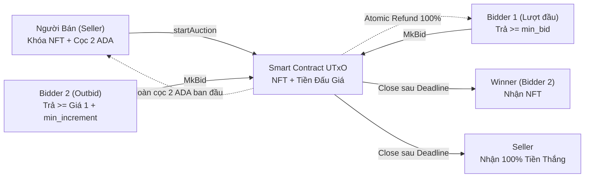
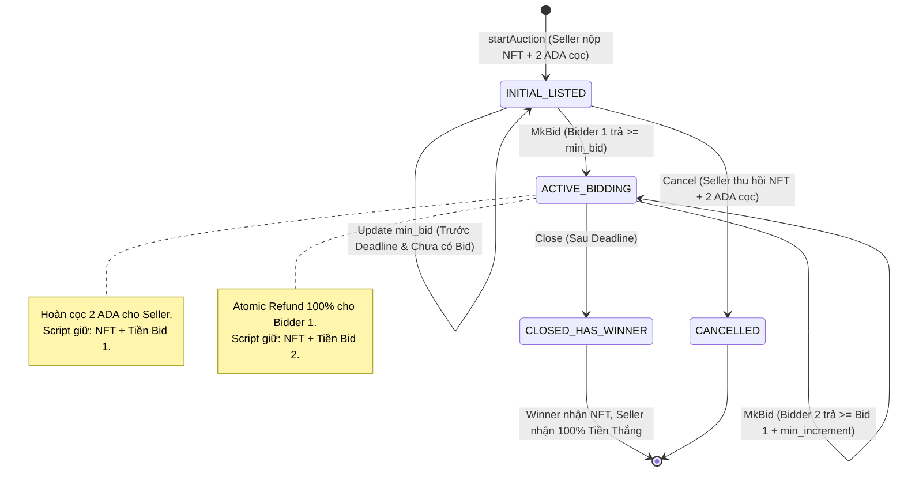
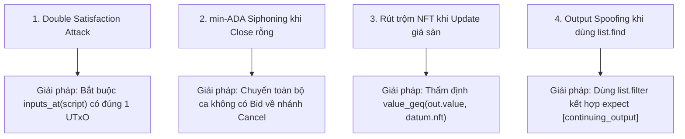

# Module 11: English Auction dApp — Sàn Đấu Giá NFT Kiểu Anh Trên Cardano

# Bài 11.1: Kiến Trúc English Auction dApp & Các Quyết Định Thiết Kế Quan Trọng

> ### 📌 Mục lục bài giảng
> 1. [Tổng quan Mô hình Đấu giá kiểu Anh (English Auction)](#1-tổng-quan-mô-hình-đấu-giá-kiểu-anh-english-auction)
> 2. [So sánh Kiến trúc: Ethereum (Account Model) vs Cardano (EUTxO Model)](#2-so-sánh-kiến-trúc-ethereum-account-model-vs-cardano-eutxo-model)
> 3. [Vòng đời Phiên Đấu Giá & Mô hình EUTxO State Machine](#3-vòng-đời-phiên-đấu-giá--mô-hình-eutxo-state-machine)
> 4. [Thiết kế Cấu trúc Dữ liệu On-Chain (Datum & Redeemer)](#4-thiết-kế-cấu-trúc-dữ-liệu-on-chain-datum--redeemer)
> 5. [Các Quyết định Kinh tế Token & Game Theory](#5-các-quyết-định-kinh-tế-token--game-theory)
>    - 5.1. [Cơ chế Atomic Refund: Hoàn tiền tức thì, không giam vốn](#51-cơ-chế-atomic-refund-hoàn-tiền-tức-thì-không-giam-vốn)
>    - 5.2. [Bước giá tối thiểu (Minimum Increment) chống tấn công quấy rối](#52-bước-giá-tối-thiểu-minimum-increment-chống-tấn-công-quấy-rối)
>    - 5.3. [Cơ chế hoàn cọc min-ADA ban đầu của Seller tại First Bid](#53-cơ-chế-hoàn-cọc-min-ada-ban-đầu-của-seller-tại-first-bid)
> 6. [Phân Tích 4 Lỗ Hổng Bảo Mật EUTxO Trọng Yếu & Giải Pháp Triệt Tiêu](#6-phân-tích-4-lỗ-hổng-bảo-mật-eutxo-trọng-yếu--giải-pháp-triệt-tiêu)
>    - 6.1. [Lỗ hổng Double Satisfaction](#61-lỗ-hổng-double-satisfaction)
>    - 6.2. [Lỗ hổng min-ADA Siphoning khi đóng phiên không có Bid](#62-lỗ-hổng-min-ada-siphoning-khi-đóng-phiên-không-có-bid)
>    - 6.3. [Lỗ hổng Tráo đổi / Thất thoát NFT khi cập nhật giá sàn](#63-lỗ-hổng-tráo-đổi--thất-thoát-nft-khi-cập-nhật-giá-sàn)
>    - 6.4. [Lỗ hổng Output Spoofing khi dùng list.find](#64-lỗ-hổng-output-spoofing-khi-dùng-listfind)
> 7. [Khung Checklist 5 Bước Thẩm Định Giao Dịch On-Chain An Toàn](#7-khung-checklist-5-bước-thẩm-định-giao-dịch-on-chain-an-toàn)
> 8. [Thuật ngữ bài học (Glossary) & Tổng kết](#8-thuật-ngữ-bài-học-glossary--tổng-kết)

---

## 1. Tổng quan Mô hình Đấu giá kiểu Anh (English Auction)

Trong các mô hình sàn giao dịch thương mại điện tử Web3 (như Module 6 Marketplace), cơ chế mua bán giá cố định (**Fixed-Price Listing**) phát huy hiệu quả rất cao cho các tài sản đã có giá thị trường rõ ràng (ví dụ: token tiện ích, vật phẩm game đại trà). Tuy nhiên, đối với các tài sản số có tính độc bản cao (1-of-1 NFT, tác phẩm nghệ thuật kỹ thuật số, tên miền quý hiếm, hoặc tài sản thanh lý nợ thế chấp), việc người bán tự định ra một mức giá cố định thường dẫn đến 2 tình huống bất lợi:
1. **Định giá quá cao**: Tài sản bị "chôn chân" trên sàn, không có thanh khoản.
2. **Định giá quá thấp**: Người bán bị mất giá trị (underpriced), trong khi người mua đầu cơ mua rẻ rồi bán lại chênh lệch trên thị trường thứ cấp.

Mô hình **Đấu giá kiểu Anh (English Auction)** giải quyết triệt để bài toán này bằng cách mở một cuộc cạnh tranh công khai: giá bắt đầu từ mức sàn tối thiểu (`min_bid`) và tăng dần theo từng lượt trả giá cho đến khi thời hạn kết thúc (`deadline`). Người trả giá cao nhất khi hết hạn sẽ giành quyền sở hữu tài sản.



---

## 2. So sánh Kiến trúc: Ethereum (Account Model) vs Cardano (EUTxO Model)

Hiểu được sự khác biệt kiến trúc giữa hai nền tảng là chìa khóa để thiết kế Smart Contract Cardano bảo mật và tối ưu chi phí:

| Tiêu chí | Mô hình Tài khoản (Ethereum / EVM) | Mô hình EUTxO (Cardano / Aiken) |
| :--- | :--- | :--- |
| **Lưu trữ số dư đấu giá** | Lưu trong biến trạng thái hợp đồng `mapping(address => uint256) balances`. | Lưu trực tiếp trong giá trị Value của Script UTxO trên blockchain. |
| **Cơ chế hoàn tiền** | Bắt buộc dùng **Pull Pattern** (người bị trả giá cao hơn phải tự gửi giao dịch `withdraw()` để rút tiền về) nhằm chống tấn công Reentrancy. | Áp dụng **Push Pattern (Atomic Refund)**: Tiền được hoàn trả trực tiếp về ví của bidder cũ ngay trong transaction của bidder mới. |
| **Trải nghiệm người dùng (UX)** | Tệ: Người tham gia bị giam vốn, phải tốn thêm phí gas và thao tác gửi giao dịch rút tiền. | Tối ưu: Người bị outbid nhận lại tiền ngay lập tức mà không cần làm gì, không tốn gas. |
| **Bảo đảm giao dịch** | Dễ gặp lỗi Front-running / Sandwich attack do miner có thể đảo thứ tự giao dịch trong mempool. | Deterministic (Xác định trước): Chi phí gas, kết quả thực thi và tính toàn vẹn được tính toán cục bộ trước khi gửi lên mạng. |

Trên EVM, vì nỗi sợ tấn công Reentrancy (tái nhập), hợp đồng đấu giá không bao giờ dám tự động gửi tiền trả lại cho người bị trả giá thấp hơn. Họ buộc phải dùng mô hình "Pull Pattern": nghĩa là tiền của người dùng bị giam lại trong hợp đồng, người dùng phải tự bỏ tiền túi trả phí gas để gửi một giao dịch `withdraw` rút tiền về. Trải nghiệm đó cực kỳ phiền toái và làm giảm thanh khoản.  

Trong khi đó, trên Cardano EUTxO, chúng ta có thể thực hiện **Atomic Push Refund**: Khi Bob đặt mức giá cao hơn Alice, chính transaction của Bob sẽ chi tiêu UTxO cũ, nạp tiền mới vào script, và trích trả ngay 100% tiền của Alice về tận ví của cô ấy trong cùng một block duy nhất. Alice không bị giam vốn, không mất một đồng phí gas nào. Đây chính là sức mạnh vượt trội của mô hình EUTxO.

---

## 3. Vòng đời Phiên Đấu Giá & Mô hình EUTxO State Machine

Trong Cardano, một phiên đấu giá là một **Máy trạng thái hữu hạn (Finite State Machine)** được biểu diễn thông qua một chuỗi các UTxO nối tiếp nhau tại Script Address:



### Bảng Ma Trận Các Trạng Thái Phái Sinh (Derived States)

Các trạng thái của phiên đấu giá được tính toán động (Derived State) dựa trên dữ liệu trong Datum (`highest_bid`) và thời gian thực so với `deadline`:

| Trạng thái | Điều kiện On-chain & Thời gian | Ý nghĩa nghiệp vụ | Hành động khả dụng |
| :--- | :--- | :--- | :--- |
| **`INITIAL_LISTED`** | `highest_bid == None` và `now < deadline` | Phiên mới tạo, đang chờ lượt trả giá đầu tiên. | `MkBid` (Bidder), `Update` (Seller), `Cancel` (Seller). |
| **`ACTIVE_BIDDING`** | `highest_bid == Some(prev)` và `now < deadline` | Đã có người đặt giá, đang trong giai đoạn cạnh tranh. | `MkBid` (Bidder khác với giá cao hơn). |
| **`EXPIRED_NO_BIDS`**| `highest_bid == None` và `now >= deadline` | Hết hạn nhưng không có bất kỳ ai tham gia đặt giá. | `Cancel` (Duy nhất Seller thu hồi NFT và cọc). |
| **`EXPIRED_HAS_WINNER`**| `highest_bid == Some(winner)` và `now >= deadline` | Hết hạn và đã xác định được người trả giá cao nhất. | `Close` (Bất kỳ ai kích hoạt kết toán). |
| **`FINALIZED`** | UTxO script đã được chi tiêu trọn vẹn | Phiên đấu giá hoàn tất, tài sản đã phân bổ xong. | Không còn UTxO tại Script. |

Trong Cardano EUTxO, trạng thái không được lưu trữ tập trung trong biến toàn cục, mà được biểu diễn thông qua chính các UTxO đang nằm tại Script Address. Khi quan sát một UTxO, dApp có thể ngay lập tức suy ra phiên đấu giá đang ở giai đoạn nào dựa trên 2 yếu tố:  
1. Trường `highest_bid` trong Datum là `None` hay `Some(...)`?  
2. Thời gian hiện tại đã vượt qua `deadline` hay chưa?  

Bằng cách mô hình hóa tường minh 5 trạng thái này, giao diện người dùng và hợp đồng on-chain luôn luôn đồng nhất logic tuyệt đối.

---

## 4. Thiết kế Cấu trúc Dữ liệu On-Chain (Datum & Redeemer)

```rust
// Trạng thái người dẫn đầu phiên đấu giá
pub type BidState {
  bidder: Address, // Địa chỉ ví người trả giá cao nhất
  amount: Int,     // Mức giá tương ứng (Lovelace)
}

// Datum lưu trữ trên UTxO
pub type AuctionDatum {
  seller: Address,             // Người bán nhận tiền
  deadline: POSIXTime,         // Thời điểm kết thúc
  min_bid: Int,                // Giá sàn tối thiểu ban đầu
  min_increment: Int,          // Bước giá tối thiểu bắt buộc
  nft: MValue,                 // Định danh NFT đấu giá
  highest_bid: Option<BidState>, // None (chưa có bid) hoặc Some(BidState)
}

// 4 Hành động của Redeemer
pub type AuctionRedeemer {
  MkBid { bidder: Address, amount: Int }
  Update { new_price: Int }
  Cancel
  Close
}
```

Cấu trúc Datum và Redeemer chính là hợp đồng cam kết giữa người dùng và blockchain.  
Thay vì lưu trữ danh sách lịch sử của tất cả các lượt bid (sẽ làm phình to kích thước Datum và tiêu tốn phí lưu trữ của mạng), hợp đồng chỉ lưu duy nhất **trạng thái người đang dẫn đầu** (`Option<BidState>`). Mỗi khi có người mới trả giá cao hơn, người cũ được hoàn tiền ngay lập tức và Datum chỉ ghi đè người mới. Thiết kế này vừa tối ưu chi phí lưu trữ on-chain, vừa đảm bảo tốc độ thẩm định cực nhanh.

---

## 5. Các Quyết định Kinh tế Token & Game Theory

### 5.1. Cơ chế Atomic Refund: Hoàn tiền tức thì, không giam vốn
Trong lý thuyết trò chơi (Game Theory), một rào cản lớn nhất khiến người dùng ngại tham gia đấu giá là nỗi sợ "bị giam vốn". Giả sử người dùng tham gia đấu giá 5 bức tranh NFT khác nhau cùng một lúc, mỗi bức cọc 1,000 ADA. Nếu tiền bị giam cho đến tận khi phiên đấu giá kết thúc, người dùng sẽ bị mất cơ hội đầu tư ở nơi khác.  
Với cơ chế Atomic Push Refund trên Cardano, ngay giây phút có người trả giá cao hơn, số tiền 1,000 ADA được trả về ví ngay trong block đó. Người dùng có thể lập tức dùng số tiền đó để tiếp tục trả giá ở phiên đấu giá khác. Điều này kích thích thanh khoản toàn sàn tăng vọt.

### 5.2. Bước giá tối thiểu (Minimum Increment) chống tấn công quấy rối
Trường `min_increment` trong Datum đóng vai trò là vũ khí phòng vệ kinh tế. Nếu không có bước giá tối thiểu, kẻ xấu có thể quấy rối bằng cách tăng giá chỉ thêm 1 Lovelace (0.000001 ADA) để spam và làm nản lòng những người tham gia chân chính. Hợp đồng bắt buộc mỗi lượt bid mới phải cao hơn mức cũ tối thiểu một bước giá xác định (ví dụ: 1 ADA hoặc 5 ADA). Kẻ muốn dẫn đầu bắt buộc phải cam kết một lượng tài chính thực sự.

### 5.3. Cơ chế hoàn cọc min-ADA ban đầu của Seller tại First Bid
Khi người bán đưa NFT lên sàn, theo quy định của Cardano Ledger, một UTxO chứa NFT bắt buộc phải kèm theo khoảng 2 ADA cọc min-UTxO. Ở thiết kế cũ, 2 ADA này bị kẹt lại trong script cho đến tận cuối phiên, dẫn đến nguy cơ người tạo giao dịch Close có thể chiếm dụng mất lượng ADA dôi dư này.  
Giải pháp: **Ngay ở lượt đặt giá đầu tiên, Smart contract bắt buộc giao dịch phải hoàn trả toàn bộ khoản cọc min-ADA này về ví của Seller**. Từ lượt bid đầu tiên trở đi, UTxO của sàn chỉ còn chứa đúng NFT và 100% tiền của người đặt giá, giúp sổ sách kế toán trong sáng và minh bạch tuyệt đối.

---

## 6. Phân Tích 4 Lỗ Hổng Bảo Mật EUTxO Trọng Yếu & Giải Pháp Triệt Tiêu



Bảo mật trên mô hình EUTxO đòi hỏi một tư duy hoàn toàn khác so với EVM:
1. **Chống Double Satisfaction**: Không bao giờ cho phép một transaction chi tiêu 2 UTxO từ cùng một script nếu logic giao dịch có kiểm tra hoàn tiền. Phải dùng `inputs_at` ép buộc đúng 1 UTxO.
2. **Chống thất thoát min-ADA**: Nếu phiên đấu giá không có ai bid, tuyệt đối không dùng nhánh Close chung chạ. Phải bắt buộc dùng nhánh Cancel có chữ ký chính chủ người bán để nhận lại 100% tài sản và tiền cọc.
3. **Bảo toàn NFT khi Update**: Khi người bán cập nhật giá sàn, output tiếp nối gửi về script bắt buộc phải chứa đủ NFT cũ. Ngăn chặn kịch bản người bán tráo NFT rác vào sàn.
4. **Chống Output Spoofing**: Không được dùng `list.find` để tìm output tiếp nối vì kẻ gian có thể tạo thêm output thứ 2 giả mạo. Phải dùng `list.filter` kết hợp `expect [out]` để bảo đảm tính duy nhất tuyệt đối.

---

## 7. Khung Checklist 5 Bước Thẩm Định Giao Dịch On-Chain An Toàn

1. **Kiểm tra đầu vào (Inputs Validation)**: Xác thực UTxO đang được chi tiêu và đảm bảo không có UTxO script thứ hai bị gộp vào transaction (`inputs_at`).
2. **Kiểm tra thời gian (Validity Range)**: Đảm bảo khoảng thời gian hiệu lực `tx.validity_range` nằm hoàn toàn trước deadline (`is_entirely_before`) hoặc sau deadline (`is_entirely_after`).
3. **Kiểm tra chữ ký (Signers Validation)**: Thẩm định chữ ký số của người bán thông qua `key_signed` đối với các hành động nhạy cảm (`Update`, `Cancel`).
4. **Kiểm tra dòng tiền hoàn trả (Refunds Validation)**: Xác thực các output trả tiền về cho Seller (ở lượt đầu) hoặc hoàn tiền tức thời cho bidder cũ (khi outbid).
5. **Kiểm tra UTxO tiếp nối (Continuing Output Validation)**: Xác thực tính duy nhất của output script mới, tính toàn vẹn của Datum và bảo toàn tài sản NFT.

---

## 8. Thuật ngữ bài học (Glossary) & Tổng kết

| Thuật ngữ | Ý nghĩa kỹ thuật trong Cardano EUTxO |
| :--- | :--- |
| **Atomic Push Refund** | Cơ chế hoàn trả tiền trực tiếp và tức thì cho người dùng ngay trong giao dịch của người khác mà không cần rút tiền thủ công. |
| **Minimum Increment** | Bước giá tối thiểu bắt buộc giữa các lượt đặt giá nhằm ngăn chặn tấn công spam quấy rối. |
| **Double Satisfaction** | Lỗ hổng bảo mật khi kẻ tấn công gộp nhiều UTxO vào cùng một transaction để gian lận điều kiện thanh toán. |
| **Continuing Output** | UTxO đầu ra mới được gửi ngược lại về chính Script Address để lưu giữ trạng thái tiếp theo của Smart Contract. |
| **Validity Range** | Khoảng thời gian hiệu lực được khai báo trên giao dịch, dùng để thẩm định mốc thời gian một cách tất định. |
