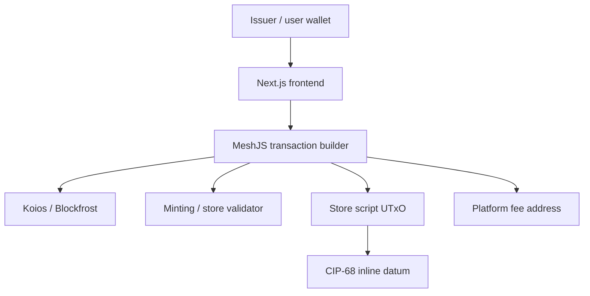

# Kiến trúc Tổng thể (System Architecture)

CIP-68 Minting tách tài sản người dùng khỏi reference asset chứa metadata. On-chain validator và transaction builder nằm trong `onchain/` và `frontend/`; frontend dùng MeshJS để tạo giao dịch.

## 1. Kiến trúc

- **Validator** kiểm tra đúng một cặp token, author signature, state transition và platform fee.
- **Frontend transaction builder** parameterize validator, mã hóa metadata CIP-68, tạo cặp token và query metadata.
- **Issuer model**: payment key hash của ví kết nối được parameterize vào policy. Vì vậy mỗi issuer có policy ID và store address riêng; đây là mô hình nhiều issuer độc lập, không phải một bộ sưu tập/policy dùng chung. Asset name chỉ duy nhất trong một policy; cùng tên ở policy khác là asset unit khác.

## 2. Cặp tài sản CIP-68

Một asset name có hai dạng:

- `100 + name`: reference token quantity 1, nằm tại store UTxO cùng metadata datum.
- `222 + name`: user token quantity 1, nằm trong ví người nhận và đại diện cho tài sản có thể chuyển.

Cả hai dùng cùng policy ID và cùng phần tên logic sau prefix. Reference token giữ metadata; user token là tài sản mà người dùng sở hữu.

## 3. Luồng nghiệp vụ

1. **Mint**: issuer ký, mint đúng một reference token và một user token, đặt reference token cùng datum tại store, trả phí platform.
2. **Update**: tiêu store UTxO, tạo lại reference token cùng metadata mới và trả phí.
3. **Burn**: author ký và người ký giữ user token duy nhất; giao dịch burn đồng thời cả hai token và remove store UTxO. Không hỗ trợ partial burn.
4. **Query**: frontend lấy asset tại store, giải mã CIP-68 datum và ghép với asset info để hiển thị.

## 4. Tách quyền

Author được ghi trong datum lúc mint cũng là issuer của asset. Chỉ author đó được update hoặc remove; người giữ user token không nhận quyền quản trị metadata. Giao diện kiểm tra author hash trước khi mở các thao tác này, còn validator là lớp bảo vệ cuối cùng.
