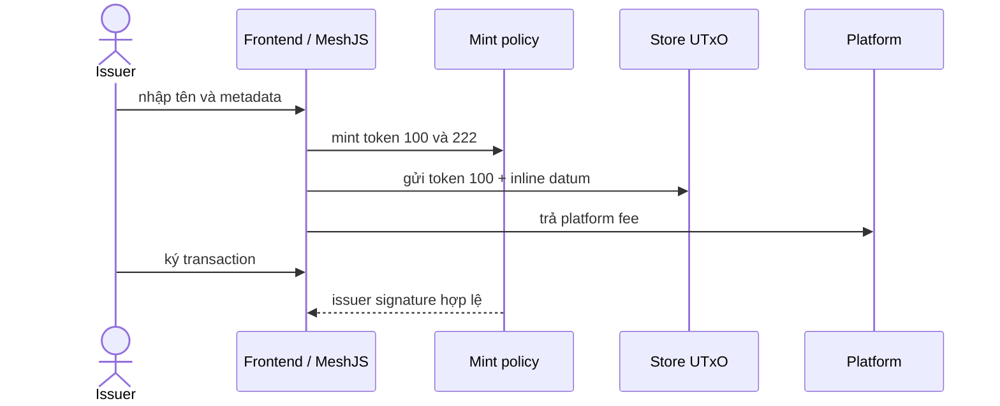

# Module: CIP-68 Minting

## Bài 1: Vì sao tách reference token và user token?

NFT truyền thống thường gắn metadata với token một lần. CIP-68 dùng reference token ở store UTxO để metadata có thể cập nhật mà không cần phát hành lại user token. User token vẫn có thể chuyển giữa các ví; ứng dụng đọc metadata từ reference UTxO.

## Bài 2: Một transaction mint

Mỗi lần mint tạo đúng một cặp: `100name` quantity 1 nằm trong store cùng datum, và `222name` quantity 1 được gửi tới ví nhận. Payment key hash của ví kết nối là issuer parameter; vì vậy mỗi issuer có policy ID và store address riêng. Cùng asset name dưới policy của issuer khác sẽ là asset unit khác; mô hình này không có đăng ký tên toàn mạng.

## Bài 3: Update và burn

Update tiêu reference UTxO rồi tạo output store mới với cùng reference token và author trong datum; chỉ author đã ghi khi mint mới được ký cập nhật. Burn chỉ thực hiện toàn phần: author phải ký, người ký phải giữ user token duy nhất, đồng thời burn cả `222name` và `100name` và remove store UTxO. Không hỗ trợ burn một phần hay giữ reference token lại.

## Bài tập

1. Mint một cặp token rồi thử mint lại cùng tên dưới cùng policy.
2. Update metadata nhưng không ký bằng issuer.
3. Thay prefix `100`/`222` hoặc quantity reference.
4. Thử burn thiếu một token trong cặp hoặc không có author signature; cả hai giao dịch phải bị validator từ chối.
