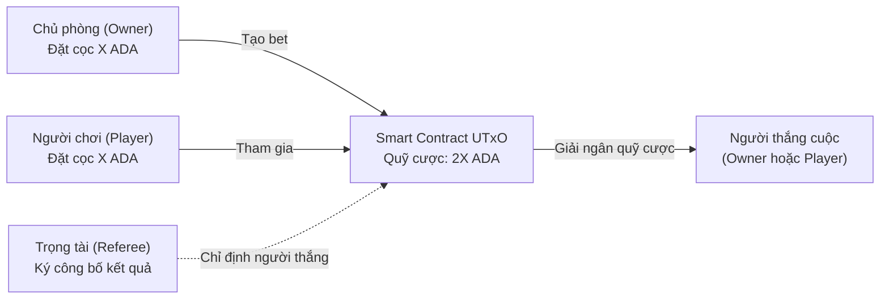
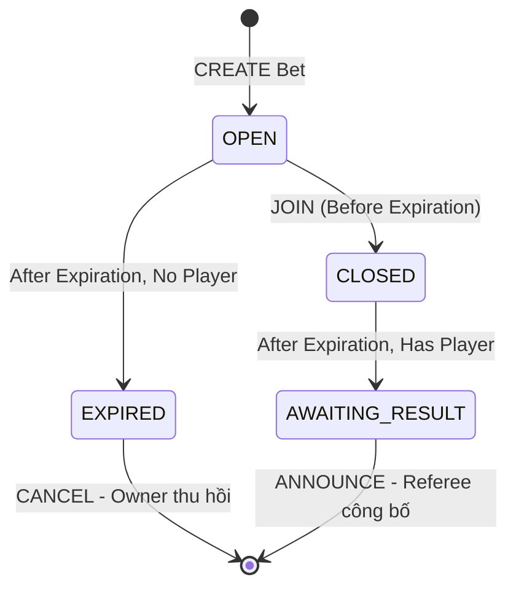
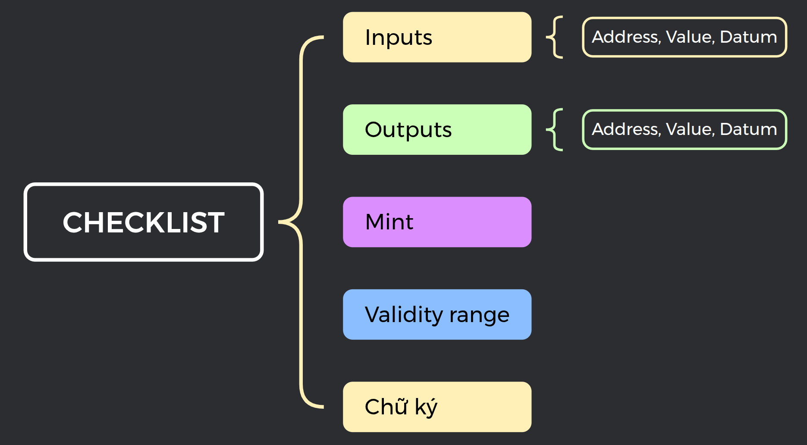
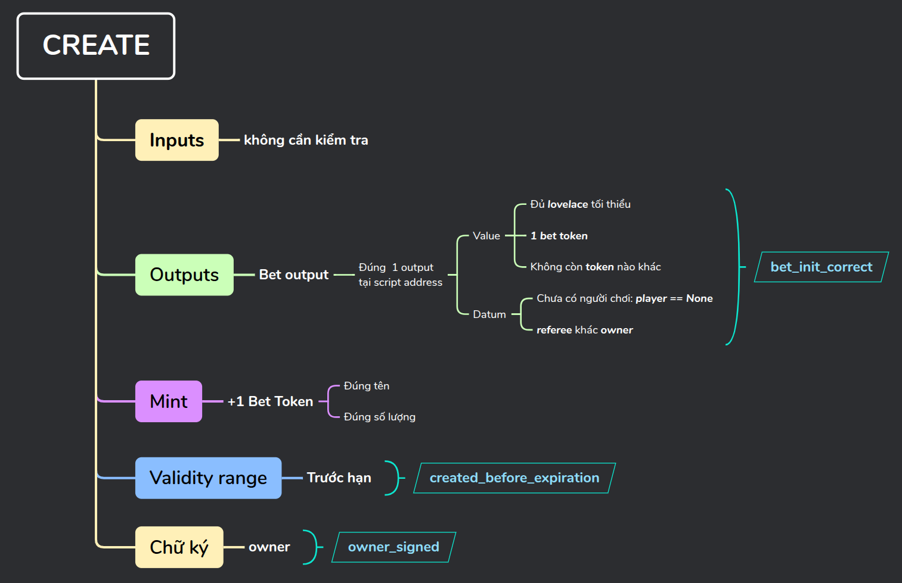
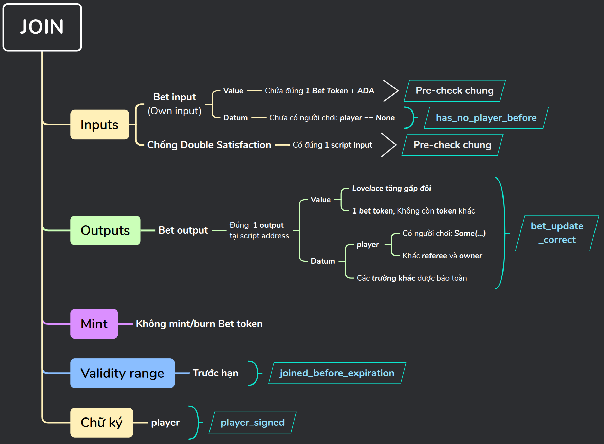
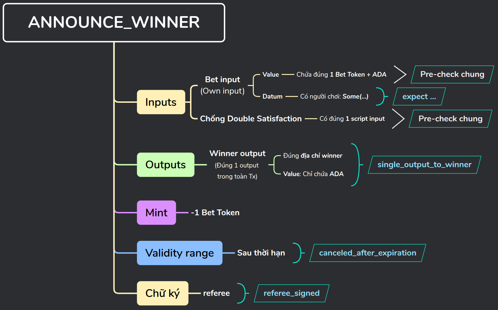
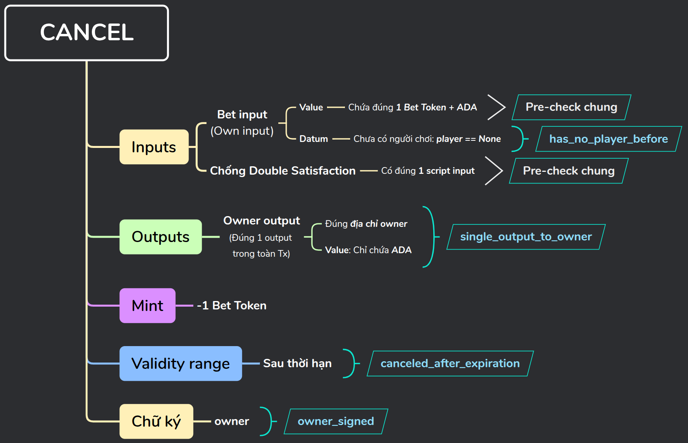
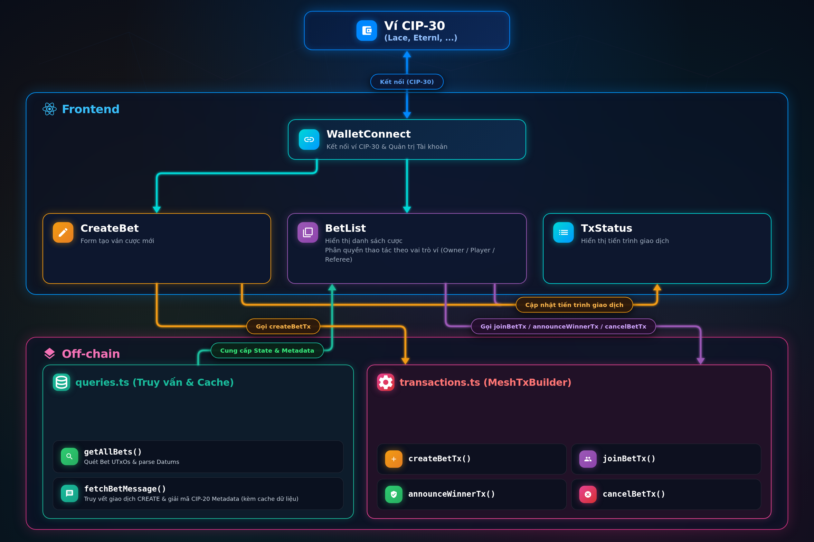
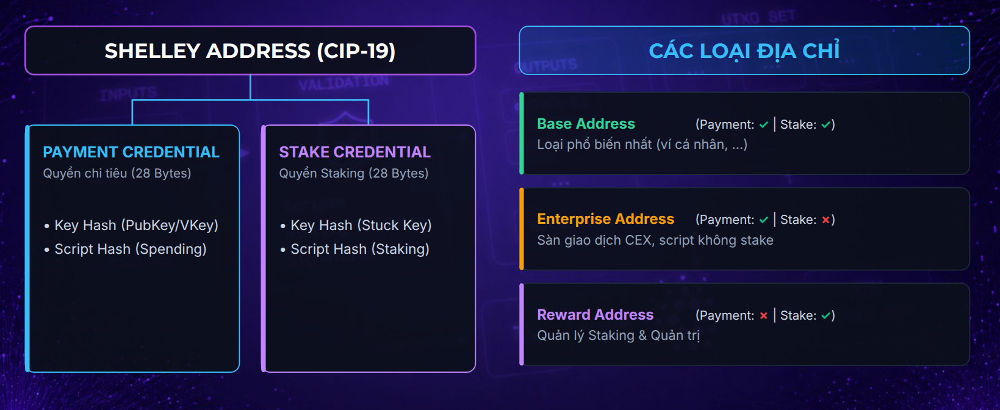
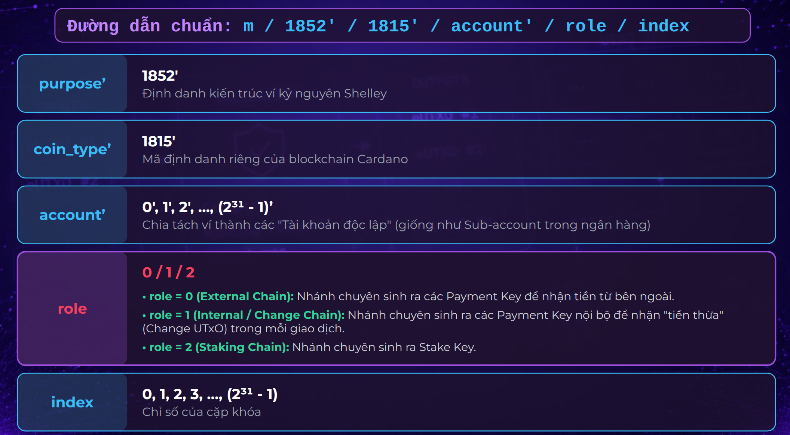

# Module 07: Betting dApp — Sàn Cá cược Ngang hàng P2P

# Bài 1: Kiến trúc Betting DApp & Các Quyết định Thiết kế Quan trọng

> ### Mục lục bài học
> 1. [Tổng quan & Quy tắc Trò chơi P2P Betting](#1-tổng-quan--quy-tắc-trò-chơi-p2p-betting)
> 2. [Trải nghiệm Trò chơi](#2-trải-nghiệm-trò-chơi)
> 3. [Các Quyết định Thiết kế Quan trọng](#3-các-quyết-định-thiết-kế-quan-trọng)

---

## 1. Tổng quan & Quy tắc Trò chơi P2P Betting

### 1.1. Mô hình cá cược ngang hàng (Peer-to-Peer)

Trong các hệ thống cá cược truyền thống, người chơi thường phải gửi tiền cược vào một tài khoản tập trung của nhà cái. Nhà cái vừa đóng vai trò giữ tiền, vừa phân xử kết quả và quyết định việc trả thưởng. Mô hình này đi kèm một số rủi ro về tính minh bạch: tiền của người chơi nằm trong tay bên thứ ba, dữ liệu cược có thể bị chỉnh sửa, và chi phí vận hành thường cao.

Betting dApp trong module này triển khai ứng dụng **Cá cược Ngang hàng** dựa trên mô hình eUTxO của Cardano. Cơ chế như sau:

- **Hai người chơi trực tiếp đối đầu theo mô hình dự đoán nhị phân (Binary Prediction):** Người tạo bet (**Owner**) đặt ra số tiền cược ban đầu, nội dung cược và thời hạn kết thúc. Người thứ hai (**Player**) nếu đồng ý với điều kiện cược sẽ nạp đúng số tiền tương ứng vào quỹ cược chung, và lựa chọn của người này mặc định là đối lập với Owner. Người thắng cuộc sẽ nhận toàn bộ quỹ cược sau khi trừ phí giao dịch mạng.
- **Hợp đồng thông minh giữ tiền:** Toàn bộ tiền cược của cả hai bên được khóa tại địa chỉ của Smart Contract. Không người chơi nào, và cũng không phải trọng tài, có thể đơn phương chiếm đoạt khoản tiền này nếu không thỏa mãn các điều kiện định sẵn.
- **Trọng tài độc lập công bố kết quả:** Trọng tài (**Referee**) được chỉ định từ đầu bằng địa chỉ ví on-chain. Sau khi bet hết hạn, trọng tài có nhiệm vụ ký giao dịch công bố người chiến thắng để ván cược được giải ngân.



---

### 1.2. Vòng đời của một bet (Game Lifecycle & State Machine)

Một lượt chơi trong dApp trải qua các trạng thái rõ ràng, tương ứng với vòng đời của Bet UTxO trên blockchain Cardano:



| Trạng thái | Điều kiện xác định (trên UI) | Ý nghĩa nghiệp vụ | Hành động hợp lệ |
|---|---|---|---|
| `OPEN` | `player == None` và `now < expiration` | Bet vừa được tạo, đang mở chờ người chơi tham gia | `JOIN` (Bất kỳ ai khác Trọng tài và Chủ phòng) |
| `CLOSED` | `player != None` và `now < expiration` | Đã có người chơi tham gia, chờ đến thời điểm hết hạn | _(Chờ hết hạn, không ai được can thiệp)_ |
| `EXPIRED` | `player == None` và `now >= expiration` | Hết thời gian mà không có ai tham gia cược | `CANCEL` (Chỉ Chủ phòng / Owner) |
| `AWAITING_RESULT` | `player != None` và `now >= expiration` | Hết thời gian và đã đủ 2 người chơi, chờ phân định | `ANNOUNCE_WINNER` (Chỉ Trọng tài / Referee) |

> [!NOTE]
> **Trạng thái suy diễn (Derived State):** Các trạng thái trên là trạng thái của ứng dụng được front-end tính toán và ghi nhận dựa trên dữ liệu on-chain (trường `player` trong Datum) và thời gian thực (`now < expiration` hay `now >= expiration`). Chúng không phải là các enum trạng thái được lưu cứng on-chain.

Vòng đời của bet có 4 hành động chính tương ứng với 4 loại giao dịch:

1. **CREATE (Tạo bet):**
   - Chủ phòng (Owner) chọn mức tiền cược (tối thiểu là 5 ada theo quy định hợp đồng), thời hạn kết thúc (`expiration`), chỉ định ví Trọng tài (`referee`), và nhập mô tả nội dung bet.
   - Tiền cược ban đầu `X ADA` được khóa vào địa chỉ Script.
   - Trạng thái ban đầu: `OPEN` - sẵn sàng nhận người chơi tham gia.

2. **JOIN (Tham gia bet):**
   - Người chơi thứ hai (Player) tham gia trước mốc thời gian hết hạn.
   - Người tham gia gửi thêm đúng `X ADA` vào hợp đồng, tổng quỹ cược (Pot) tăng gấp đôi thành `2X ADA`.
   - Trạng thái bet chuyển sang: `CLOSED` - chờ đến khi hết hạn, không ai có quyền tham gia nữa.

3. **Sau mốc thời gian Expiration:**
   Việc chuyển trạng thái sau mốc Expiration được front-end tự động nhận diện theo thời gian thực:
     - Bet đang ở trạng thái `OPEN` sau khi qua thời điểm `expiration` sẽ chuyển sang trạng thái `EXPIRED`. 
     - Bet đang ở trạng thái `CLOSED` sau khi qua thời điểm `expiration` sẽ chuyển sang trạng thái `AWAITING_RESULT`. 

4. **CANCEL (Hủy bet & Hoàn cọc):**
   - Khi bet ở trạng thái `EXPIRED` (quá hạn và chưa có ai tham gia), duy nhất Chủ phòng có quyền gửi giao dịch CANCEL để thu hồi lại tiền cọc ban đầu.
   - Toàn bộ số tiền cược trong Script (sau khi trừ phí mạng) được hoàn trả về ví Owner.
   - Bet kết thúc và biến mất khỏi danh sách các ván cược đang hoạt động.

5. **ANNOUNCE_WINNER (Công bố người chiến thắng & Trao thưởng):**
   - Khi bet ở trạng thái `AWAITING_RESULT` (hết hạn và đã đủ người chơi), chỉ duy nhất Trọng tài có quyền ký giao dịch xác nhận ai là người chiến thắng.
   - Hợp đồng giải ngân toàn bộ quỹ cược `2X ADA` (sau khi trừ phí mạng) chuyển thẳng cho người thắng cuộc, ván cược kết thúc.

---

## 2. Trải nghiệm Trò chơi

> [!TIP]
> **Khởi chạy dApp:** Chi tiết các bước cài đặt, cấu hình được hướng dẫn trong tệp [`README.md`](../../README.md). Hãy mở dApp và trực tiếp trải nghiệm.

## 3. Các Quyết định Thiết kế Quan trọng

### 3.1. Định danh trạng thái bằng Bet Token (State Thread Token)

Như chúng ta đã biết, một UTxO nằm tại địa chỉ Smart Contract không đảm bảo nó là một Bet UTxO hợp lệ. Bất kỳ ai cũng có thể gửi một UTxO rác vào địa chỉ hợp đồng. 

Giải pháp chúng ta lựa chọn để định danh Bet UTxO là **State Thread Token (STT)** nhưng có một điều chỉnh quan trọng:
- **Bản chất token:** Token này không nhất thiết phải là NFT. Nó là một **fungible token** của hệ thống, được đúc ra giống nhau cho tất cả các bet. Chúng ta gọi nó là **Bet Token**.
- **Vòng đời token:** Mỗi khi một ván cược được tạo ra, giao dịch bắt buộc phải đúc ra đúng `1` Bet Token. Token này được khóa cùng tiền cược tại địa chỉ Script và đồng hành cùng UTxO đó qua các trạng thái (từ `OPEN`, `CLOSED` cho đến khi kết thúc).
- **Tiêu hủy bắt buộc:** Ở hành động cuối cùng (`CANCEL` hoặc `ANNOUNCE_WINNER`), Bet Token bắt buộc phải bị đốt đi (`mint = -1`) để không thể bị tái sử dụng hay tẩu tán.
- **Lợi ích off-chain:** Nhờ có token này, ứng dụng off-chain chỉ cần truy vấn các UTxO tại địa chỉ hợp đồng có chứa Bet Token tương ứng là có thể xác định chính xác danh sách các ván cược đang hoạt động.

---

### 3.2. Multi-Purpose Validator

Để quản lý việc đúc và đốt Bet Token, chúng ta cần một **Minting Policy**. Đồng thời, để quản lý việc giữ tiền cược, chuyển đổi trạng thái và giải ngân, chúng ta cần một **Spending Validator**.

Hai logic này cần liên lạc và kiểm tra chéo lẫn nhau:
- Khi đúc token, **logic mint** phải đảm bảo token được gửi đúng vào địa chỉ giữ tiền cược.
- Khi chi tiêu Bet UTxO, **logic spend** phải chắc chắn rằng UTxO đó chứa Bet Token. Token này phải được bảo toàn qua các trạng thái và bị đốt hoàn toàn khi công bố kết quả hoặc hủy bet.

Ở **Module 04 (Membership NFT)**, chúng ta đã sử dụng kỹ thuật **Multi-Validator**: hai hợp đồng tách biệt tham chiếu đến nhau. Trong module này, chúng ta sử dụng **Multi-Purpose Validator** — một hợp đồng duy nhất xử lý đồng thời cả hai vai trò:

#### Ưu điểm vượt trội của Multi-Purpose Validator:
- **Tham chiếu 2 chiều tự nhiên:** Hai handler nằm chung trong một script, chia sẻ cùng một Script Hash (hay Policy ID). Nhờ đó, cả hai handler có thể kiểm tra chéo nhau hai chiều một cách tự nhiên mà không gặp vấn đề phụ thuộc vòng tròn (Circular Dependency).
- **Đơn giản hóa triển khai on-chain và off-chain:** 
  - Toàn bộ logic tập trung tại một nơi, giúp theo dõi luồng nghiệp vụ dễ dàng.
  - Phía off-chain không phải quản lý phân tán nhiều script hash, policy ID hay địa chỉ script khác nhau.
  - Khi triển khai và sử dụng script bằng **Reference Script**, chỉ cần lưu trữ và gọi trên **một UTxO duy nhất**.

---

### 3.3. Tách biệt dữ liệu: Tại sao không lưu nội dung bet vào Datum?

Nội dung mô tả bet là một chuỗi văn bản tự do, có thể ngắn hoặc dài (ví dụ: *"Manchester United sẽ vô địch giải bóng đá Ngoại Hạng Anh mùa giải 2026/2027"*).

Nếu đưa chuỗi văn bản này vào trong `BetDatum` của UTxO on-chain:
- **Lãng phí tài nguyên sổ cái:** Trình xác thực on-chain chỉ cần xác minh chữ ký phán quyết của trọng tài mà không quan tâm đến nội dung bet để quyết định logic đúng sai.
- **Tăng chi phí lưu trữ min ADA:** Kích thước byte của Datum càng lớn thì lượng ADA tối thiểu (min ADA) phải khóa trong UTxO càng cao (dù trong dApp này tiền cược tối thiểu 5 ADA đã dư sức bù đắp). 

Tuy nhiên, để tối ưu thiết kế dữ liệu và làm quen với chuẩn CIP-20 Metadata, chúng ta quyết định tách dữ liệu làm hai phần:
1. **Dữ liệu logic (lưu trong Datum on-chain):** Chỉ lưu các trường thiết yếu để xác thực: `owner`, `player`, `referee`, `expiration`.
2. **Dữ liệu hiển thị (lưu bằng Transaction Metadata):** Toàn bộ nội dung văn bản mô tả bet được đính kèm vào giao dịch CREATE với nhãn `674` (chuẩn [CIP-20 Transaction Message](https://cips.cardano.org/cip/CIP-0020)). Dữ liệu này được lưu vĩnh viễn trên sổ cái Cardano nhưng không nằm trong UTxO, giúp tiết kiệm kích thước trạng thái UTxO mà vẫn đảm bảo tính minh bạch.

---

### 3.4. Khác biệt của eUTxO: Cơ chế Trọng tài không trả phí

Trong mô hình hiện tại của dApp, Trọng tài chưa được hưởng lợi ích kinh tế. Họ cũng không nên bị mất phí mạng khi thực hiện giao dịch công bố kết quả.

- Trên hệ thống Ethereum (Account-based), ai là người phát lệnh gửi giao dịch thì tài khoản đó bắt buộc phải có ETH để trả phí Gas.
- Trên hệ thống Cardano (eUTxO), một giao dịch có thể tự tài trợ phí cho chính nó từ chính UTxO mà nó đang tiêu thụ, nhờ sự tách biệt hoàn toàn giữa **người ký xác thực** và **nguồn tài trợ phí**.

Do đó, chúng ta có thể triển khai tính năng **Trọng tài không trả phí** một cách tự nhiên trên Cardano:
- Toàn bộ phí mạng của giao dịch `ANNOUNCE_WINNER` được khấu trừ trực tiếp từ số ADA đang có trong Script UTxO.
- Ví của trọng tài chỉ cần cung cấp chữ ký xác thực mà không cần đưa bất kỳ UTxO nào vào làm input để trả phí và cũng không nhận về output nào.
- Người thắng nhận về toàn bộ số tiền quỹ cược sau khi đã trừ đi phần phí giao dịch này.

Đây là một giao dịch đặc biệt: trọng tài là người ký giao dịch, nhưng không cần đóng góp bất kỳ input nào và cũng không nhận về output nào. 

Giao dịch CANCEL của Chủ phòng cũng được thực hiện tương tự.

---

### 3.5. Hỗ trợ ví đa địa chỉ (Multi-Address Mode)

Cardano sử dụng mô hình ví phân cấp (HD Wallet theo chuẩn BIP-32/44). Để tăng cường bảo mật và quyền riêng tư, các ví web3 hiện đại (như Eternl, Lace, Yoroi...) thường tự động thay đổi địa chỉ nhận tiền thừa (Change Address) sau mỗi giao dịch phát sinh nếu ví đang bật chế độ đa địa chỉ.

Điều này đặt ra một bài toán kinh điển về mặt trải nghiệm người dùng (UX) cho các dApp Cardano:
- Giả sử bạn dùng một địa chỉ trong ví để tạo bet, địa chỉ đó sẽ được ghi nhận vào Datum trên blockchain.
- Sau giao dịch tạo bet, ví của bạn tự động chuyển sang một địa chỉ nhận tiền thừa hoàn toàn mới.
- Khi bạn tải lại trang hoặc kết nối lại, nếu dApp chỉ so sánh địa chỉ hiển thị hiện tại với địa chỉ lưu trong Datum, ứng dụng sẽ nhận định nhầm bạn là "khách lạ" và ẩn mất các nút chức năng quan trọng (như Hủy cược của Chủ phòng hay Công bố kết quả của Trọng tài).

**Giải pháp:** Sử dụng **địa chỉ stake (Stake Address / Stake Credential)** để nhận diện người dùng thay vì dùng địa chỉ thanh toán đơn lẻ. Chúng ta sẽ cùng tìm hiểu chi tiết trong bài số 03.

---

Như vậy, chúng ta đã hoàn thành Bài học số 1, và có được cái nhìn tổng thể về dự án. dApp này cũng tuân thủ kiến trúc 3 lớp quen thuộc gồm: on-chain, off-chain và front-end.

Trong Bài học tiếp theo, chúng ta sẽ trực tiếp bắt tay vào xây dựng thành phần on-chain với một validator đa mục đích. Xin chào và Hẹn gặp lại các bạn ở bài số 2!

---

# Bài 2: Xây dựng Smart Contract với Aiken Multi-Purpose Validator

Ở Bài 1, chúng ta đã tìm hiểu luật chơi và vòng đời của một bet. Trong bài này, ta sẽ chuyển các quy tắc đó thành mã on-chain bằng Aiken.

> ### Mục lục bài học
> 1. [Thiết kế Multi-Purpose Validator](#1-thiết-kế-multi-purpose-validator)
> 2. [Triển khai Logic On-chain](#2-triển-khai-logic-on-chain)
>    - 2.1. [Khung checklist 5 thành phần giao dịch](#21-khung-checklist-5-thành-phần-giao-dịch)
>    - 2.2. [CREATE: Khởi tạo Bet](#22-create-khởi-tạo-bet)
>    - 2.3. [JOIN: Người chơi tham gia](#23-join-người-chơi-tham-gia)
>    - 2.4. [ANNOUNCE_WINNER: Công bố người thắng](#24-announce_winner-công-bố-người-thắng)
>    - 2.5. [CANCEL: Hủy cược và hoàn tiền cho Owner](#25-cancel-hủy-cược-và-hoàn-tiền-cho-owner)
> 3. [Unit Testing](#3-unit-testing)
> 4. [Bài tập và Tổng kết](#4-bài-tập-và-tổng-kết)

---

## 1. Thiết kế Multi-Purpose Validator

### 1.1. Phân chia nhiệm vụ giữa Mint handler và Spend handler

Vòng đời của một ván cược, có 4 loại hành động tương tác với validator. Để xác định trách nhiệm của từng handler đối với mỗi hành động, trước hết hãy xem hành động đó có tiêu thụ Bet UTxO hoặc mint/burn Bet Token hay không.

| Hành động | Tiêu thụ Bet UTxO? | Mint/Burn Bet Token? | Nhiệm vụ | Handler được kích hoạt |
|---|---|---|---|---|
| `CREATE` | Không | Mint | Tạo Bet UTxO tại Script | `mint` |
| `JOIN` | Có | Không | Tạo Bet UTxO tiếp nối | `spend` |
| `ANNOUNCE_WINNER` | Có | Burn | Đóng bet và trả thưởng | `spend` và `mint` |
| `CANCEL` | Có | Burn | Đóng bet và hoàn tiền cho Owner | `spend` và `mint` |

`CREATE` không tiêu thụ Bet UTxO, nó mint Bet Token và tạo trạng thái ban đầu trong một Bet UTxO mới. Do đó, mint handler kiểm tra cả thao tác mint lẫn tính hợp lệ của Bet UTxO mới.

Ba hành động còn lại đều tiêu thụ Bet UTxO nên đều kích hoạt spend handler. 
`JOIN` được kiểm tra hoàn toàn bởi spend handler.
Riêng `ANNOUNCE_WINNER` và `CANCEL` còn burn Bet Token nên cũng kích hoạt cả mint handler. Với 2 hành động này, các logic kiểm tra chính, chúng ta đặt tại spend handler; còn mint handler chỉ thuần túy kiểm tra việc đốt token.

Sau khi xác định trách nhiệm của từng handler, ta chuyển sang thiết kế các dữ liệu on-chain.

### 1.2. Bet Datum

Trong dApp này, **mỗi Bet UTxO đại diện cho một ván cược độc lập**. Datum lưu những dữ liệu validator cần để kiểm tra các hành động của bet:

| Trường | Kiểu | Ý nghĩa |
|---|---|---|
| `owner` | `Address` | Địa chỉ của người tạo bet |
| `player` | `Option<Address>` | `None` trước khi có người tham gia; `Some(address)` sau JOIN |
| `referee` | `Address` | Địa chỉ người được quyền công bố kết quả |
| `expiration` | `Int` | Thời điểm hết hạn, tính bằng POSIX milliseconds |

```rust
pub type BetDatum {
  owner: Address,
  player: Option<Address>,
  referee: Address,
  expiration: Int,
}
```

Trạng thái ứng dụng được suy ra từ `player` và thời gian hiện tại. Frontend tính các trạng thái này, vì vậy Datum không cần lưu thêm trường trạng thái riêng.

| `player` | Thời gian | Trạng thái |
|---|---|---|
| `None` | `< expiration` | OPEN |
| `None` | `>= expiration` | EXPIRED |
| `Some(...)` | `< expiration` | CLOSED |
| `Some(...)` | `>= expiration` | AWAITING_RESULT |

### 1.3. Redeemer và tham số hợp đồng

Redeemer của spend handler biểu diễn ba hành động mà nó xử lý:

```rust
pub type Action {
  JOIN
  ANNOUNCE_WINNER { is_owner_win: Bool }
  CANCEL
}
```

Riêng `ANNOUNCE_WINNER` cần thêm thông tin để xác định người thắng. Bet chỉ có hai người chơi, nên chỉ cần một trường Boolean `is_owner_win` cho biết Owner có thắng hay không; không cần truyền trực tiếp địa chỉ người thắng. Với `JOIN`, địa chỉ Player được ghi vào Datum mới nên Redeemer không cần chứa địa chỉ này.

Mint handler phân biệt thao tác đúc/đốt dựa vào số lượng trong trường `mint`. Vì vậy, để cho đơn giản chúng ta không tạo thêm kiểu redeemer riêng cho mint handler.

Validator nhận hai tham số cấu hình:

- `bet_token_name: ByteArray`: tên token, dùng để xác định chính xác bet token.
- `minimum_bet_amount: Int`: số lovelace tối thiểu Owner phải đặt khi tạo bet.

Sau khi đã xác định xong các dữ liệu, ta bắt đầu xây dựng logic cho từng nhánh.

---

## 2. Triển khai Logic On-chain

### 2.1. Khung checklist

Để tránh bỏ sót các logic cần kiểm tra, chúng ta thiết lập một khung **Checklist** gồm 5 thành phần cơ bản:



Áp dụng checklist này cho từng hành động để xây dựng logic của nhánh code tương ứng, cụ thể như sau:

- **Inputs:** Có đầu vào giao dịch nào validator cần phải có mặt không? Với mỗi đầu vào này, có 3 yếu tố cần kiểm tra: địa chỉ, Value và Datum.
- **Outputs:** Tương tự, validator cần kiểm soát các output nào? Mỗi output cần quan tâm đến 3 yếu tố: địa chỉ, Value và Datum.
- **Mint/Burn:** Bet Token được mint, giữ nguyên hay burn? Token name và quantity nào được chấp nhận?
- **Validity range:** Khoảng hợp lệ của giao dịch phải trước hay sau `expiration`?
- **Chữ ký:** Giao dịch bắt buộc phải ký bởi ai?

### 2.2. CREATE: Khởi tạo Bet

#### 2.2.1. Phân tích



Hành động `CREATE` mint đúng một Bet Token và tạo Bet UTxO tại Script address. Bet UTxO này chứa token vừa mint cùng Datum khởi tạo.

- **Inputs:** Không có đầu vào nào cần kiểm tra đặc biệt.
- **Outputs:** Chú ý đến 1 đầu ra duy nhất - Bet UTxO:
    - **Address**: Đúng 1 output tại Script address.
    - **Value**: Chứa ít nhất `minimum_bet_amount` lovelace và đúng một Bet Token; không chứa thêm token nào khác. Điều này đảm bảo output sạch, không chứa các token rác.
    - **Datum**: Là `BetDatum` khởi tạo, trong đó `player == None` và Payment Key Hash của Referee và Owner khác nhau.
- **Mint:** Mint đúng một Bet Token với token name đã cấu hình.
- **Validity range:** Giao dịch phải hợp lệ trước thời điểm hết hạn `expiration` trong Datum.
- **Chữ ký:** Owner phải ký giao dịch.

#### 2.2.2. Chi tiết code

Mint handler lấy các token thuộc policy hiện tại từ trường `mint`. Pattern matching đảm bảo có đúng một cặp token name/quantity thoả mãn. Sau đó xác nhận token name khớp với tham số `bet_token_name`:

```rust
expect [Pair(token_name, quantity)] = dict.to_pairs(tokens(mint, policy_id))
expect token_name == bet_token_name
```

Handler phân nhánh theo `quantity`:

```rust
when quantity is {
  1 -> {
    // Kiểm tra giao dịch tạo bet
    ...
  }
  -1 -> True
  _ -> False
}
```

`quantity == 1`: Đây chính là nhánh xử lý hành động CREATE.

Nhánh `quantity == -1` cho phép burn đúng một Bet Token. Khi rơi vào nhánh này, mint handler chỉ đơn giản trả về `True`. Lý do là toàn bộ điều kiện nghiệp vụ đóng bet đã được kiểm duyệt bởi spend handler (ở hai nhánh `ANNOUNCE_WINNER` và `CANCEL`). Mint handler hoàn toàn yên tâm vì theo thiết kế, Bet Token luôn bị khóa tại địa chỉ Script — muốn đốt nó bắt buộc phải kích hoạt spend handler để giải phóng UTxO. Ở chiều ngược lại, spend handler cũng thiết lập ràng buộc để chắc chắn rằng Bet Token buộc phải bị đốt ở hai nhánh kết thúc cược, và được giữ nguyên vẹn khi người chơi JOIN. Điều này tạo nên sự phối hợp và **giám sát hai chiều** chặt chẽ giữa hai handler.

##### Chi tiết nhánh CREATE (`quantity == 1`)

Tiếp theo, validator tìm Bet UTxO mới và giải mã inline Datum:

```rust
expect [bet_output] = outputs_at(outputs, from_script(policy_id))

let Output { value: output_value, datum, .. } = bet_output
expect InlineDatum(bet_datum_data) = datum
expect BetDatum { owner, player, referee, expiration } = bet_datum_data
let owner_phk = address_payment_key(owner)
```

> Lợi thế của Multi-purpose validator: `policy_id` chính là script hash của validator này. Bằng cách gọi `from_script(policy_id)`, ta tạo được địa chỉ của hợp đồng. Hàm `outputs_at` lọc các output gửi về địa chỉ này, và pattern `[bet_output]` đảm bảo có đúng một output duy nhất như vậy.

Các điều kiện về Value và Datum được gom vào biến `bet_init_correct`:

```rust
let bet_init_correct = and {
  (lovelace_of(output_value) >= minimum_bet_amount)?,
  has_nft_strict(output_value, policy_id, bet_token_name)?,
  (player == None)?,
  (address_payment_key(referee) != owner_phk)?,
}
```

`has_nft_strict` yêu cầu output có đúng một Bet Token và không có native token nào khác ngoài ADA.

> [!NOTE]
> **Chữ "NFT" trong `has_nft_strict`:**
> Tên hàm có chữ `NFT` có thể khiến bạn băn khoăn vì Bet Token vốn không phải là NFT độc bản trên toàn mạng lưới. Ở đây, chữ `NFT` được hiểu theo **nghĩa hẹp" trên một phạm vi cục bộ: đại diện cho một tài sản độc bản trong một tập hợp nhỏ. Cụ thể, Bet Token là tài sản độc bản khi xét riêng trên output này (số lượng chính xác bằng 1 và không có thêm token nào khác).

Điều kiện Referee khác Owner được kiểm tra bằng Payment Key Hash (PKH). 
> [!NOTE] Trên thực tế, phép kiểm tra này chỉ mang tính ước lệ, không đảm bảo rằng Owner và Referee là hai người khác nhau ngoài đời thực. Để đảm bảo trọng tài thực sự là một bên thứ ba khách quan, hệ thống cần kết hợp với một giải pháp định danh phù hợp hoặc cơ chế Oracle phi tập trung.

Tiếp theo, giao dịch phải hợp lệ trước `expiration` và Owner phải ký:

```rust
let created_before_expiration = valid_before(validity_range, expiration)
let owner_signed = key_signed(extra_signatories, owner_phk)
```

Cuối cùng, CREATE chỉ hợp lệ khi cả ba nhóm điều kiện đều đạt:

```rust
bet_init_correct? && created_before_expiration? && owner_signed?
```

---

### 2.3. JOIN: Người chơi tham gia

#### 2.3.1. Phân tích



JOIN tiêu thụ Bet UTxO hiện tại và tạo một Bet UTxO tiếp nối. Hãy dùng 5 nhóm checklist để rà các điều kiện của nhánh này:

- **Input:** 
  - Own input (script input đang được chi tiêu): Phải chứa đúng một Bet Token và ADA. Datum phải có Player trống; 
  - Chống Double Satisfaction: Giao dịch chỉ được tiêu thụ một script UTxO
- **Output:** 
  Own output: là output duy nhất trả về địa chỉ Script. 
    - Value phải có lượng ADA gấp đôi input, giữ đúng một Bet Token và không chứa token nào khác. 
    - Datum mới có Player, đảm bảo khác Owner và Referee; các trường Owner, Referee và expiration được giữ nguyên.
- **Mint/Burn:** không mint hoặc burn Bet Token.
- **Validity range:** Giao dịch phải hợp lệ trước `expiration`.
- **Chữ ký:** Player phải ký giao dịch.

#### 2.3.2. Pre-check chung trong spend handler

Trước khi xử lý từng `Action` (`JOIN`, `ANNOUNCE_WINNER` hoặc `CANCEL`), spend handler thực hiện các bước tiền kiểm tra chung cho các hành động:

```rust
expect Some(own_input) = find_input(inputs, own_output_ref)
let Output { value: input_value, address: own_address, .. } = own_input.output

// Lấy script hash từ UTxO đang xử lý; trong multi-purpose validator,
// script hash này cũng là policy ID của Bet Token
expect Script(policy_id) = own_address.payment_credential

// Input chỉ chứa đúng một Bet Token và ADA
expect has_nft_strict(input_value, policy_id, bet_token_name)

// Mỗi giao dịch chỉ được xử lý một Bet UTxO từ địa chỉ Script này
expect list.count(inputs, i_at(own_address)) == 1
```

> [!TIP]
> **Lợi thế của Multi-Purpose Validator:** Từ `payment_credential` của `own_address`, validator lấy được script hash, đồng thời là policy ID của Bet Token, mà không cần truyền thêm từ bên ngoài vào.

#### 2.3.3. Chi tiết nhánh JOIN

Trong nhánh JOIN, code kiểm tra bốn nhóm điều kiện.

##### Kiểm tra ghế Player còn trống

```rust
let has_no_player_before = current_datum.player == None
```

##### Tìm và giải mã Bet UTxO tiếp nối

Validator lấy output duy nhất tại địa chỉ script và giải mã Datum mới:

```rust
expect [own_output] = outputs_at(outputs, own_address)

let Output { value: output_value, datum: updated_datum, .. } = own_output
expect InlineDatum(updated_datum) = updated_datum
expect new_datum: BetDatum = updated_datum
expect Some(player) = new_datum.player
let player_payment_key = address_payment_key(player)
```

Các điều kiện kiểm tra output được gom vào `bet_update_correct`:

```rust
let bet_update_correct = and {
  (lovelace_of(output_value) == 2 * lovelace_of(input_value))?,
  has_nft_strict(output_value, policy_id, bet_token_name)?,
  (player_payment_key != address_payment_key(current_datum.referee))?,
  (player_payment_key != address_payment_key(current_datum.owner))?,
  (new_datum == BetDatum { ..current_datum, player: Some(player) })?,
}
```

##### Kiểm tra thời gian và chữ ký

```rust
let joined_before_expiration = valid_before(validity_range, current_datum.expiration)
let player_signed = key_signed(extra_signatories, player_payment_key)
```

##### Kết hợp các điều kiện của JOIN

```rust
has_no_player_before? && bet_update_correct? && joined_before_expiration? && player_signed?
```

---

### 2.4. ANNOUNCE_WINNER: Công bố người thắng

#### 2.4.1. Phân tích



Hành động này chỉ diễn ra khi bet đã có Player và hết hạn. Referee công bố người thắng; quỹ cược được chuyển đến người đó.

- **Inputs:** Ngoài các điều kiện pre-check, validator cần đảm bảo Bet đã có Player.
- **Outputs:** Giới hạn toàn bộ giao dịch chỉ tạo ra đúng một output. Output phải gửi đến người thắng và chỉ chứa ADA. Điều này gián tiếp đảm bảo người thắng nhận toàn bộ tiền cược (sau khi trừ phí tx).
- **Mint/Burn:** Burn đúng một Bet Token.
- **Validity range:** Giao dịch chỉ hợp lệ sau `expiration`.
- **Chữ ký:** Referee phải ký giao dịch.

#### 2.4.2. Chi tiết code

Trước hết, validator xác nhận bet đã có Player. Sau đó, dựa vào `is_owner_win` trong Redeemer để xác định người nhận tiền:

```rust
let BetDatum { owner, player, referee, expiration } = current_datum

// Bet phải có Player mới được công bố kết quả
expect Some(player_addr) = player

// Chọn Owner hoặc Player làm người thắng
let winner =
  if is_owner_win {
    owner
  } else {
    player_addr
  }
```

Tiếp theo, validator kiểm tra output trả thưởng:

```rust
let single_output_to_winner = {
  expect [output_to_winner] = outputs
  (output_to_winner.address == winner)? && (output_to_winner.value
    |> without_lovelace
    |> is_zero)?
}
```

Pattern `[output_to_winner]` yêu cầu toàn giao dịch chỉ có duy nhất một output. Output phải gửi đến `winner` và chỉ chứa ADA (dùng pipeline `without_lovelace |> is_zero`).

Ràng buộc "chỉ đúng 1 output" này mang lại sự đơn giản cho mã off-chain: Off-chain SDK không cần phải tự tính toán số Lovelace chính xác sau khi trừ phí giao dịch để tạo output cố định. Thay vào đó, off-chain chỉ cần đặt địa chỉ người thắng vào `changeAddress`. Toàn bộ số dư tiền cược sau khi tự động khấu trừ phí mạng sẽ chảy thẳng về ví người thắng dưới dạng change output hợp lệ duy nhất của giao dịch!

> [!NOTE]
> **Tại sao không kiểm tra trường `mint`?** 
>
> Thông thường, validator phải kiểm tra trường `mint` để chắc chắn rằng mint handler cũng được kích hoạt để kiểm duyệt việc đốt token. Nhưng trong trường hợp này:
> - Input từ Script có **1 Bet Token**.
> - Output duy nhất của giao dịch chỉ chứa **ADA**.
>
> Để cân bằng tài sản, giao dịch **buộc phải burn token** $\rightarrow$ `mint` handler chắc chắn sẽ được kích hoạt để kiểm duyệt.

Kiểm tra chữ ký của Trọng tài và thời gian giao dịch:

```rust
let referee_signed = key_signed(
  extra_signatories,
  address_payment_key(referee),
)

let announced_after_expiration = valid_after(validity_range, expiration)
```

Biểu thức kiểm tra cuối cùng:

```rust
single_output_to_winner? && referee_signed? && announced_after_expiration?
```

### 2.5. CANCEL: Hủy cược và hoàn tiền cho Owner

#### 2.5.1. Phân tích



Nếu hết hạn mà bet vẫn chưa có Player, Owner có thể hủy bet và nhận lại khoản tiền đã đặt. Các điều kiện kiểm tra gần giống với hành động `ANNOUNCE_WINNER`:

- **Input:** Ngoài các điều kiện pre-check, Bet input phải chưa có Player (`player == None`).
- **Output:** Toàn giao dịch chỉ có đúng một output, output này gửi đến Owner và chỉ chứa ADA.
- **Mint/Burn:** Burn đúng một Bet Token.
- **Validity range:** Giao dịch chỉ hợp lệ sau `expiration`. Owner không thể hủy bet khi người khác vẫn còn cơ hội tham gia.
- **Chữ ký:** Owner phải ký giao dịch.

#### 2.5.2. Chi tiết code

Bet chưa có Player:

```rust
let has_no_player_before = player == None
```

Output refund phải là output duy nhất của giao dịch, gửi về Owner và chỉ chứa ADA:

```rust
let single_output_to_owner = {
  expect [output_to_owner] = outputs
  (output_to_owner.address == owner)? && (output_to_owner.value
    |> without_lovelace
    |> is_zero)?
}
```

Tương tự như `ANNOUNCE_WINNER`, phần kiểm tra trường `mint` được bỏ qua. Các kiểm tra inputs và outputs đã gián tiếp đảm bảo giao dịch phải kích hoạt mint handler để burn Bet Token.

Cuối cùng, giao dịch phải sau expiration và có chữ ký Owner:

```rust
let canceled_after_expiration = valid_after(validity_range, expiration)

let owner_signed = key_signed(
  extra_signatories,
  address_payment_key(owner),
)
```

Nhánh CANCEL thành công khi cả bốn điều kiện đều đạt:

```rust
has_no_player_before? && single_output_to_owner? && canceled_after_expiration? && owner_signed?
```

---

## 3. Unit Testing

Bộ test trong `onchain/validators/tests/bet.test.ak` gồm 45 test case cho toàn bộ các nhánh hành động:

| Nhóm | Positive Test Cases | Negative Test Cases |
|---|---|---|
| **CREATE** (13 tests) | `create_the_bet` | `fail_create_owner_is_referee`<br/>`fail_create_invalid_token_name`<br/>`fail_create_below_minimum_bet`<br/>`fail_create_after_expiration`<br/>`fail_create_missing_owner_signature`<br/>`fail_create_wrong_script_address`<br/>`fail_create_output_contains_extra_token`<br/>`fail_create_when_player_not_none`<br/>`fail_create_multiple_script_outputs`<br/>`fail_create_mint_more_than_one`<br/>`fail_create_missing_inline_datum`<br/>`fail_create_missing_token_in_script_output` |
| **JOIN** (12 tests) | `join_the_bet` | `fail_join_player_is_referee`<br/>`fail_join_player_is_owner`<br/>`fail_join_missing_player_signature`<br/>`fail_join_wrong_amount`<br/>`fail_join_after_expiration`<br/>`fail_join_two_bets_at_once`<br/>`fail_join_invalid_output_token`<br/>`fail_join_when_already_joined`<br/>`fail_join_changes_owner`<br/>`fail_join_changes_referee`<br/>`fail_join_changes_expiration` |
| **CANCEL** (8 tests) | `cancel_the_bet` | `fail_cancel_before_expiration`<br/>`fail_cancel_when_player_joined`<br/>`fail_cancel_missing_owner_signature`<br/>`fail_cancel_multiple_outputs`<br/>`fail_cancel_output_contains_token`<br/>`fail_cancel_invalid_input_token`<br/>`fail_cancel_wrong_destination_address` |
| **ANNOUNCE_WINNER** (9 tests) | `announce_owner_win`<br/>`announce_player_win` | `fail_announce_before_expiration`<br/>`fail_announce_missing_referee_signature`<br/>`fail_announce_multiple_outputs`<br/>`fail_announce_output_contains_token`<br/>`fail_announce_invalid_input_token`<br/>`fail_announce_when_no_player`<br/>`fail_announce_wrong_winner_address` |
| **BURN** (3 tests) | `burn_the_bet` | `fail_burn_more_than_one`<br/>`fail_burn_wrong_token_name` |

Tổng số theo nhóm là CREATE 13, JOIN 12, CANCEL 8, ANNOUNCE_WINNER 9 và BURN 3, tổng cộng **45 test case** (`45 passed | 0 failed`). Chạy lệnh sau từ thư mục `onchain` để chạy toàn bộ:

```bash
aiken check
```

Hoặc lọc chạy riêng từng nhóm bằng cờ `-m`:

```bash
aiken check -m create     # Chạy 13 test nhóm CREATE
aiken check -m join       # Chạy 12 test nhóm JOIN
aiken check -m cancel     # Chạy 8 test nhóm CANCEL
aiken check -m announce   # Chạy 9 test nhóm ANNOUNCE_WINNER
aiken check -m burn       # Chạy 3 test nhóm BURN
```

> Toán tử `?` giúp trace chỉ ra điều kiện không đạt trong quá trình kiểm thử.

---

## 4. Bài tập và Tổng kết

**Bài tập 1. Gộp giao dịch**

Hiện tại mỗi lần hủy bet tạo ra một giao dịch riêng biệt. Hãy cho phép owner hủy nhiều bet hết hạn của mình trong cùng một giao dịch để tối ưu phí mạng.

**Bài tập 2. Cải thiện cơ chế trọng tài**

Trọng tài hiện là điểm tập trung rủi ro lớn trong thiết kế hiện tại. Giải pháp triệt để là thay thế bằng **Oracle** on-chain độc lập. Bạn hãy thử nghiên cứu và cải thiện. Nhưng nếu vẫn giữ mô hình con người, hãy thử hai cải tiến sau:

- 2a. Hệ thống có **chứng chỉ trọng tài** - dưới dạng **NFT**. Chỉ những địa chỉ sở hữu NFT chứng chỉ này mới được công nhận là trọng tài hợp lệ và đủ tin cậy (hợp đồng `membership-nft` có thể ứng dụng để triển khai loại NFT này). 
  Cơ chế thực hiện như sau:
  - Validator nhận thêm `policy_id` của NFT chứng chỉ làm tham số cấu hình.
  - Khi tạo bet: Thay vì đính kèm địa chỉ ví trọng tài, Datum lưu tên NFT của vị trọng tài được chọn.
  - Khi công bố kết quả: Validator kiểm tra người ký giao dịch có đang thực sự sở hữu NFT chứng chỉ đó hay không.
  
  ***Gợi ý***: Đưa UTxO chứa NFT này vào giao dịch bằng `reference_inputs` và kiểm tra quyền sở hữu của người ký với input này.

- 2b. Với thiết kế hiện tại, nếu trọng tài trì hoãn việc công bố kết quả, ván cược sẽ bị treo ở đó mà không có cách nào giải quyết. Hãy thêm cơ chế FORCE_REFUND cho phép người chơi lấy lại tiền cược sau khi bet hết hạn 1 khoảng thời gian nhất định (ví dụ: 2 ngày) mà trọng tài chưa công bố kết quả. Người chơi nào (owner/player) cũng có quyền tạo yêu cầu này, giao dịch trả về cho mỗi người chơi số tiền đặt cược ban đầu ( = 50% tổng quỹ cược), người tạo giao dịch trả phí.

**Bài tập 3. Bổ sung cơ chế phí**

DApp hiện không thu bất kỳ khoản phí nào. Hãy thiết kế và triển khai cơ chế phí cho hai bên liên quan:

- **Nhà phát triển:** Phí cố định 1 ADA mỗi bet, thu ngay tại thời điểm tạo bet.
- **Trọng tài:** 10% tổng pot, khấu trừ trực tiếp vào pot và thanh toán tại thời điểm công bố kết quả.

---

Như vậy trong bài này, chúng ta đã cùng xây dựng luật chơi on-chain của DApp với các handler phối hợp hoạt động trong cùng một validator.

Trong bài tiếp theo, chúng ta sẽ hoàn thiện trò chơi với các thành phần còn lại. Xin chào và hẹn gặp lại các bạn!

---

# Bài 3: Frontend & Off-chain - CIP-20 Message & HD Wallet

> ### Mục lục bài học
> 1. [Kiến trúc & Luồng Tương tác giữa Frontend và Off-chain](#1-kiến-trúc--luồng-tương-tác-giữa-frontend-và-off-chain)
>    - 1.1. [Các Component Giao diện (Frontend Next.js)](#11-các-component-giao-diện-frontend-nextjs)
>    - 1.2. [Tầng Xử lý Ngoài chuỗi (Off-chain SDK - MeshJS)](#12-tầng-xử-lý-ngoài-chuỗi-off-chain-sdk---meshjs)
>    - 1.3. [Chu trình Phối hợp Điều phối Dữ liệu](#13-chu-trình-phối-hợp-điều-phối-dữ-liệu)
> 2. [Triển khai Chi tiết (Frontend ↔ SDK)](#2-triển-khai-chi-tiết-frontend--sdk)
>    - 2.1. [CREATE: Tạo cược & Chuẩn hóa CIP-20 Metadata](#21-create-tạo-cược--chuẩn-hóa-cip-20-metadata)
>    - 2.2. [Bảng cược BetList: Quản lý Trạng thái, Phân quyền & Địa chỉ Ví HD](#22-bảng-cược-betlist-trung-tâm-quản-lý-trạng-thái-phân-quyền--điều-phối-giao-dịch)
>    - 2.3. [JOIN: Người chơi tham gia cược & Continuing Output](#23-join-người-chơi-tham-gia-cược--cơ-chế-continuing-output)
>    - 2.4. [ANNOUNCE_WINNER: Trọng tài công bố kết quả & Ấn định Ex-Units tĩnh](#24-announce_winner-trọng-tài-công-bố-kết-quả--ấn-định-ex-units-tĩnh)
>    - 2.5. [CANCEL: Hủy cược & Hoàn tiền cho Owner](#25-cancel-hủy-cược--hoàn-tiền-cho-owner)
> 3. [Bài tập Thực hành](#3-bài-tập-thực-hành)
> 4. [Tài liệu Tham khảo & Đọc thêm](#4-tài-liệu-tham-khảo--đọc-thêm)
> 5. [Tổng kết Module 7: P2P Betting dApp](#5-tổng-kết-module-7-p2p-betting-dapp)

---

## 1. Kiến trúc & Luồng Tương tác giữa Frontend và Off-chain

Để hoàn thiện dApp P2P Betting, toàn bộ hệ thống được module hóa thành các tầng chuyên biệt, phối hợp nhịp nhàng theo sơ đồ dưới đây:



### 1.1. Các Component Giao diện (Frontend Next.js)

Kiến trúc giao diện dApp được module hóa thành các component chuyên biệt:

1. **`WalletConnect` (Kết nối ví & Quản trị phiên làm việc):**
   - **Tương tác Ví:** Thiết lập kết nối hai chiều với các ví Web3 CIP-30 (Lace, Eternl...).
   - **Cung cấp Context:** Quản lý và lưu trữ trạng thái kết nối ví vào React Context, cung cấp phiên làm việc dùng chung cho `CreateBet` và `BetList`.

2. **`CreateBet` (Khởi tạo ván cược):**
   - **Thu thập & Tiền kiểm tra dữ liệu đầu vào:** Form nhập liệu số tiền cược (>= 5 ADA), địa chỉ Trọng tài (định dạng địa chỉ hợp lệ), thời điểm hết hạn (trong tương lai) và nội dung ván cược (tối đa 250 ký tự).
   - **Điều phối Giao dịch:** Kích hoạt hàm `createBetTx` từ tầng Off-chain để tạo giao dịch, khóa tiền cọc ADA và đính kèm nội dung cược dưới dạng CIP-20 metadata.
   - **Cập nhật Tiến trình:** Truyền trạng thái giao dịch sang `TxStatus` để hiển thị tiến độ và lưu `pending_create_bet` vào LocalStorage chống mất trạng thái khi reload.

3. **`BetList` (Danh sách ván cược & Điều phối Hành động):**
   - **Hiển thị State:** Nhận dữ liệu ván cược và nội dung câu hỏi đã giải mã từ `queries.ts` để hiển thị danh sách trực quan kèm phân trang.
   - **Phân quyền Hành động:** Tự động nhận diện vai trò của ví đang kết nối (`Owner` / `Player` / `Referee`) để mở khóa các nút thao tác tương ứng:
     - **Join Bet** (Người chơi tham gia, nạp tiền đối ứng qua `joinBetTx`).
     - **Announce Result** (Trọng tài công bố kết quả qua `announceWinnerTx`).
     - **Cancel Bet** (Chủ phòng hủy bet quá hạn qua `cancelBetTx`).
   - **Lưu trữ Tiến trình:** Quản lý `pending_bet_action` trong LocalStorage để tự động tiếp tục polling khi người dùng F5 trang.

4. **`TxStatus` (Lớp phủ Trạng thái Giao dịch & Quản lý Khóa Toàn cục):**
   - Đóng vai trò lớp phủ giao diện (modal overlay), phản hồi trực quan 8 trạng thái xuyên suốt vòng đời giao dịch (`idle` $\rightarrow$ `building` $\rightarrow$ `signing` $\rightarrow$ `submitting` $\rightarrow$ `confirming` $\rightarrow$ `success` / `submitted` / `failed`).
   - **Cơ chế Khóa 2 lớp (`isLocked = isProcessing || isTxBusy`):** Khi giao dịch đang dựng, ký hoặc gửi lên mạng, cờ toàn cục `isTxBusy` được kích hoạt để vô hiệu hóa đồng loạt tất cả các nút bấm trên giao diện (`CreateBet`, `Join`, `Announce`, `Cancel`). Cơ chế này loại trừ triệt để nguy cơ người dùng click đúp (double-click) hoặc gửi giao dịch chồng chéo gây lỗi xung đột UTxO.
   - **Truy vết On-chain:** Tích hợp bộ đếm thời gian xác thực on-chain và cung cấp liên kết tra cứu trực tiếp TxHash trên Cardanoscan ngay khi giao dịch được submit thành công.

---

### 1.2. Tầng Xử lý Ngoài chuỗi (Off-chain - MeshJS)

Lớp Off-chain đóng vai trò cầu nối logic giữa giao diện người dùng và hợp đồng thông minh on-chain, thực hiện 2 nhóm nhiệm vụ cốt lõi:

1. **`queries.ts` (Truy vấn Dữ liệu & Bộ nhớ đệm):**
   - **`getAllBets()`:** Quét toàn bộ Bet UTxOs tại script address và giải mã Datums on-chain $\rightarrow$ Cung cấp State danh sách ván cược cho `BetList`.
   - **`fetchBetMessage()`:** Truy vết ngược về giao dịch `CREATE` ban đầu để giải mã nội dung cược theo chuẩn CIP-20 Metadata, tích hợp cơ chế Cache 2 tầng (RAM + LocalStorage) nhằm loại bỏ hoàn toàn nguy cơ dính Rate Limit của Blockfrost.

2. **`transactions.ts` (Xây dựng & Điều phối Giao dịch MeshTxBuilder):**
   - **`createBetTx()`:** Khởi tạo ván cược, mint 1 Bet Thread Token và khóa tiền cọc kèm CIP-20 metadata vào Script.
   - **`joinBetTx()`:** Người chơi nạp tiền đối ứng, cập nhật địa chỉ Player vào Datum với Expiration slot bảo vệ.
   - **`announceWinnerTx()`:** Trọng tài công bố người thắng, giải phóng toàn bộ pot về ví Winner theo mô hình 0 phí và ấn định Execution Units tĩnh (+30% Buffer).
   - **`cancelBetTx()`:** Chủ phòng rút lại tiền cọc và burn Bet Thread Token khi bet hết hạn mà không có người tham gia.

---

### 1.3. Chu trình Phối hợp Điều phối Dữ liệu

Bốn luồng tương tác chính diễn ra xuyên suốt vòng đời ứng dụng:
1. **Kết nối & Quản trị Phiên (`Ví CIP-30` $\leftrightarrow$ `WalletConnect`):** Thiết lập kết nối hai chiều theo chuẩn CIP-30, lưu giữ trạng thái ví và chia sẻ phiên làm việc cho `CreateBet` và `BetList`.
2. **Cung cấp State & Metadata (`queries.ts` $\rightarrow$ `BetList`):** Quét trạng thái on-chain, giải mã Datum và truy vết nội dung CIP-20 có cache để cung cấp dữ liệu nhanh chóng cho `BetList` hiển thị bảng cược.
3. **Kích hoạt Giao dịch (`CreateBet` / `BetList` $\rightarrow$ `transactions.ts` $\rightarrow$ `Ví`):** UI thu thập form/hành động, gọi các hàm dựng giao dịch tương ứng trong SDK, sau đó chuyển giao dịch thô sang ví để người dùng ký và phát tán lên Cardano.
4. **Đồng bộ Tiến trình Giao dịch (`UI` $\rightarrow$ `TxStatus`):** Cập nhật thời gian thực qua 8 trạng thái vòng đời, tự động lưu `pendingTxStorage` và khôi phục polling mượt mà ngay cả khi người dùng reload / F5 trang.

---

## 2. Triển khai Chi tiết (Frontend ↔ SDK)

Trong phần này, chúng ta sẽ theo dõi hành trình của từng giao dịch từ khi người dùng thao tác trên giao diện, đi qua logic tiền kiểm tra, đến hàm tạo giao dịch ngoài chuỗi (Off-chain SDK) và gửi lên blockchain.

---

### 2.1. CREATE: Tạo cược & Chuẩn hóa CIP-20 Metadata

#### 2.1.1. Form nhập tạo bet & pre-check dữ liệu (`CreateBet.tsx`)

Component `CreateBet.tsx` chịu trách nhiệm thu thập các thông số ban đầu của ván cược từ người tạo phòng (Owner). Giao diện thực hiện tiền kiểm tra (client-side validation) ngay khi người dùng nhập liệu:

1. **Số tiền cược (`betAmount`):** Tối thiểu 5 ADA theo tham số quy định của hợp đồng (`MINIMUM_BET_AMOUNT`).
2. **Địa chỉ trọng tài (`refereeAddr`):** Là địa chỉ ví hợp lệ, bắt đầu bằng `addr_test1...`.
3. **Thời điểm hết hạn (`expirationDatetime`):** Là một mốc thời gian trong tương lai.
4. **Nội dung ván cược (`betMessage`):** Tối đa 250 ký tự.

```typescript
// Đảm bảo toàn bộ dữ liệu nhập đều thỏa mãn trước khi mở khóa nút nhấn Tạo bet
const isFormValid =
  betAmountNum >= 5 &&
  isValidCardanoAddress(refereeAddr) &&
  isExpirationValid;
```

Khi tất cả các trường dữ liệu hợp lệ, nút **"Initialize Bet"** sẽ sẵn sàng để người dùng kích hoạt.

---

#### 2.1.2. CIP-20 Metadata & Xử lý Cắt chuỗi An toàn

Nội dung ván cược được lưu dưới dạng metadata theo chuẩn CIP-20. Vậy nó được triển khai thế nào?

##### Đặc tả chuẩn CIP-0020 (Label `674`):
[CIP-0020](https://cips.cardano.org/cip/CIP-20) quy định cách đính kèm tin nhắn/ghi chú vào giao dịch Cardano:
* **Metadata Label:** CIP-20 sử dụng nhãn `674`. Con số này được chọn vì nó tương ứng với mã hóa T9 của chuỗi **"msg"** (message).
* **Cấu trúc dữ liệu:** Nội dung tin nhắn bắt buộc sử dụng khóa **"msg"** và chứa một mảng (array) các chuỗi ký tự (strings).
* **Giới hạn:** Mỗi phần tử chuỗi trong mảng có kích thước **tối đa 64 byte** khi mã hóa UTF-8.

```json
{
  "674": {
    "msg": [
      "Invoice-No: 1234567890",
      "Customer-No: 555-1234", 
      "P.S.: i will shop again at your store :-)"
    ]
  }
}
```

##### Rủi ro tiềm ẩn khi xử lý chuỗi UTF-8 đa byte:
* Ký tự tiếng Việt có dấu (`ệ`, `ờ`, `đ`, `ư`...) chiếm từ 2 đến 3 bytes UTF-8.
* **Rủi ro 1 (Cắt theo ký tự `slice(0, 64)`):** 64 ký tự tiếng Việt có thể nặng tới $64 \times 3 = 192$ bytes $\rightarrow$ Node từ chối giao dịch ngay lập tức vì vượt quá 64 bytes.
* **Rủi ro 2 (Cắt theo byte thô `Uint8Array.slice(0, 64)`):** Nếu cắt ngang lưng một ký tự 3 byte, bộ giải mã `TextDecoder` sẽ chèn ký tự lỗi `\uFFFD` (chiếm 3 bytes) $\rightarrow$ làm chuỗi phình to thành 65–66 bytes.

##### Giải pháp: Thuật toán cắt chuỗi an toàn (`formatCip20Message`):
Hàm duyệt nguyên vẹn từng ký tự, dùng `TextEncoder` đo độ dài byte thực tế trước khi ghép vào chunk, đảm bảo kết quả luôn trả về mảng các chuỗi (`string[]`) không quá 64 bytes theo đúng đặc tả CIP-20:

```typescript
// Trích từ offchain/src/transactions.ts:
export const formatCip20Message = (message: string): string[] => {
  if (!message) return [];
  const encoder = new TextEncoder();
  const chunks: string[] = [];
  let currentChunk = "";
  let currentBytes = 0;

  for (const char of message) {
    const charBytes = encoder.encode(char).length;
    if (currentBytes + charBytes > 64) {
      if (currentChunk) {
        chunks.push(currentChunk);
      }
      currentChunk = char;
      currentBytes = charBytes;
    } else {
      currentChunk += char;
      currentBytes += charBytes;
    }
  }

  if (currentChunk) {
    chunks.push(currentChunk);
  }
  return chunks;
};
```

---

#### 2.1.3. Chuỗi thực thi Tạo cược: `handleCreate` → `createBetTx` → Polling & Lưu state

Khi người dùng nhấn nút **"Initialize Bet"**, chuỗi xử lý diễn ra như sau:

##### Kích hoạt `handleCreate` tại giao diện
Sau khi vượt qua lớp bảo vệ kiểm tra dữ liệu và khóa an toàn (`if (!wallet || !isFormValid || isLocked) return;`), hàm `handleCreate` khởi tạo `BlockfrostProvider`, `MeshTxBuilder`, bật cờ bận xử lý giao dịch (`setTxBusy(true)`), và gọi hàm `createBetTx` trong offchain:

```typescript
// Trích từ frontend/src/components/CreateBet.tsx:
const provider = new BlockfrostProvider(apiKey);
setTxStatus("building");
setTxBusy(true);

const txBuilder = new MeshTxBuilder({
  fetcher: provider,
  evaluator: provider,
  submitter: provider,
});
const betAmountLovelace = BigInt(Math.round(betAmountNum * 1_000_000));

const unsignedTx = await createBetTx(
  txBuilder,
  wallet,
  refereeAddr,
  expPosixTime,
  betAmountLovelace,
  betMessage
);
```

##### Dựng giao dịch `createBetTx` (`transactions.ts`)

* **Khởi tạo Datum ban đầu, mảng chuỗi metadata & tính toán Slot hết hạn:**
  ```typescript
  // Datum với player = null (tương ứng Option::None trong Aiken)
  const datum = buildBetDatum(ownerPubKeyAddr, null, refPubKeyAddr, expirationPosix);
  const cip20Msg = formatCip20Message(betMessage);
  const expirationSlot = unixTimeToEnclosingSlot(Number(expirationPosix), SLOT_CONFIG);
  ```

* **Xây dựng giao dịch CREATE với 4 phần chính:**

  * Mint đúng 1 Bet Token làm Thread Token định danh ván cược:
    ```typescript
    txBuilder
      .mintPlutusScriptV3()
      .mint("1", POLICY_ID, TOKEN_NAME_HEX)
      .mintingScript(SCRIPT_CBOR)
      .mintRedeemerValue(mConStr0([]))
    ```

  * Khóa tiền cọc cùng Bet Token vào địa chỉ Script kèm theo Datum khởi tạo:
    ```typescript
    //txBuilder
      .txOut(SCRIPT_ADDRESS, [
        { unit: "lovelace", quantity: betAmountLovelace.toString() },
        { unit: TOKEN_UNIT, quantity: "1" },
      ])
      .txOutInlineDatumValue(datum)
    ```

  * Gắn metadata CIP-20 với nhãn 674:
    ```typescript
    //txBuilder
      .metadataValue("674", { msg: cip20Msg })
    ```

  * Các thông tin hoàn thiện giao dịch (yêu cầu chữ ký người tạo, ấn định hạn chót hiệu lực trước khi hết hạn 1 slot và trả tiền thừa):
    ```typescript
    //txBuilder
      .changeAddress(ownerAddr)
      .requiredSignerHash(ownerPkh)
      .invalidHereafter(expirationSlot - 1) // Hợp lệ trước khi hết hạn 1 slot
      .complete();
    ```

##### Ký, phát tán, Polling xác nhận và Lưu trữ tiến trình
Sau khi dựng xong giao dịch (`unsignedTx`), giao diện cập nhật trạng thái và yêu cầu ví ký xác thực, sau đó gửi giao dịch lên mạng qua Blockfrost:

```typescript
// Trích từ frontend/src/components/CreateBet.tsx:
setTxStatus("signing");
const signedTx = await wallet.signTx(unsignedTx);

setTxStatus("submitting");
const hash = await provider.submitTx(signedTx);
setTxHash(hash);
```

Để bảo vệ người dùng không bị mất dấu trạng thái nếu lỡ bấm F5 tải lại trang trong lúc chờ xác nhận giao dịch (thường mất 20–40 giây trên Cardano), ứng dụng lưu tạm `hash` vào LocalStorage:

```typescript
pendingTxStorage.save("pending_create_bet", { hash });

// Chờ xác nhận giao dịch 
setTxStatus("confirming");
const isConfirmed = await waitForTxConfirmation(provider, hash);

// dọn dẹp bộ nhớ và giải phóng khóa khi hoàn tất
pendingTxStorage.clear("pending_create_bet");
setTxStatus(isConfirmed ? "success" : "submitted");
setTxBusy(false);
onSuccess();
```

Khi trang web tải lại, hook `useEffect` trong `CreateBet.tsx` sẽ tự động đọc `pendingTxStorage.get("pending_create_bet")`. Nếu phát hiện giao dịch đang chờ, giao diện lập tức khôi phục trạng thái `confirming` và tiếp tục gọi `waitForTxConfirmation` để nối lại tiến trình mà không làm gián đoạn người dùng.

---

### 2.2. Bảng cược BetList: Trung tâm Quản lý trạng thái, Phân quyền & Điều phối giao dịch

Component `BetList.tsx` chịu trách nhiệm hiển thị danh sách toàn bộ các ván cược đang hoạt động trên hệ thống, phân định trạng thái theo thời gian thực, nhận diện vai trò ví kết nối và điều phối các giao dịch tương tác (`Join`, `Announce Winner`, `Cancel`).

#### 2.2.1. Nạp Dữ liệu và Quản lý trạng thái (`queries.ts` & `BetList.tsx`)

* **Quét dữ liệu on-chain & Giải mã Datum:**
  Hàm `getAllBets` quét toàn bộ UTxO đang nằm tại `SCRIPT_ADDRESS`, lọc các UTxO chứa Bet Token và giải mã Datum sang cấu trúc `ParsedBetDatum`.

* **Trạng thái bet (`getBetStatus`):**
  Trạng thái của một ván cược không được lưu trữ cố định trên blockchain mà được suy luận động tại client dựa trên 2 yếu tố: đã có người tham gia hay chưa (`datum.playerAddress !== null`) và mốc thời gian hết hạn (`now >= datum.expiration`):

| Trạng thái | Người tham gia | Thời hạn |
|---|---|---|
| **`OPEN`** | `datum.playerAddress === null` | `now < datum.expiration` |
| **`CLOSED`** | `datum.playerAddress !== null` | `now < datum.expiration` |
| **`EXPIRED`** | `datum.playerAddress === null` | `now >= datum.expiration` |
| **`AWAITING_RESULT`** | `datum.playerAddress !== null` | `now >= datum.expiration` |

```typescript
// Trích từ frontend/src/components/BetList.tsx:
function getBetStatus(datum: ParsedBetDatum, currentTime: number = Date.now()): BetStatus {
  const isNoPlayer = datum.playerAddress === null;
  const isExpired = currentTime >= Number(datum.expiration);

  if (!isExpired) return isNoPlayer ? "OPEN" : "CLOSED";
  return isNoPlayer ? "EXPIRED" : "AWAITING_RESULT";
}
```

Để giao diện tự động chuyển trạng thái ngay khi vừa bước qua mốc `expiration` (ví dụ từ `CLOSED` sang `AWAITING_RESULT`) mà không bắt người dùng phải F5 tải lại trang, `BetList` sử dụng một timer định kỳ 5 giây để cập nhật biến thời gian thực `now`:
```typescript
useEffect(() => {
  const timer = setInterval(() => setNow(Date.now()), 5000);
  return () => clearInterval(timer);
}, []);
```

* **Truy vấn nội dung ván cược `fetchBetMessage`:**
  Nội dung cược (CIP-20) chỉ được đính kèm duy nhất tại giao dịch khởi tạo (`CREATE`). Xuyên suốt vòng đời bet, nó trải qua chuỗi giao dịch tiếp nối nhưng không mang theo metadata này. Vì vậy, để lấy lại nội dung cược, ta phải truy vết về đúng transaction tạo lập ban đầu căn cứ theo trạng thái ván cược hiện tại:
  * **Ván cược OPEN / EXPIRED (`datum.playerAddress === null`):** Bet UTxO hiện tại chính là output của giao dịch `CREATE`. Ta chỉ cần lấy `betUtxo.input.txHash`.
  * **Ván cược CLOSED / AWAITING_RESULT (`datum.playerAddress !== null`):** Bet UTxO hiện tại lại là output sinh ra từ giao dịch `JOIN`. Bản thân giao dịch `JOIN` không hề đính kèm lại nội dung cược.
    ```typescript
    let createTxHash: string | null;

    if (datum.playerAddress === null) {
      // Ván OPEN / EXPIRED: UTxO là output của CREATE tx → đọc trực tiếp
      createTxHash = currentTxHash;
    } else {
      // Ván CLOSED / AWAITING_RESULT: UTxO là output của JOIN tx -> Tìm lại CREATE tx
      createTxHash = await resolveCreateTxHash(currentTxHash, apiKey, BASE_URL);
      if (!createTxHash) return null; // Dừng dứt khoát nếu không tìm thấy script input
    }
    ```

  * **Hàm `resolveCreateTxHash`: Query ngược tìm CREATE tx**
    
    Gọi API `/txs/{joinTxHash}/utxos` để lấy danh sách inputs của giao dịch `JOIN`.
    ```typescript
    const res = await fetch(`${baseUrl}/txs/${joinTxHash}/utxos`, {
      headers: { project_id: apiKey },
    });
    if (!res.ok) return null;
    const txUtxos = await res.json();
    ```
    Lọc tìm input đến từ địa chỉ Script $\rightarrow$ trích xuất `tx_hash` của input đó (đây chính là **`createTxHash`** ban đầu).
    ```typescript
    const scriptInput = txUtxos.inputs?.find(
      (inp: any) => inp.address === SCRIPT_ADDRESS
    );
    return scriptInput?.tx_hash ?? null;
    ```
  * **Gọi hàm `fetchCip20Metadata` để  lấy nội dung cược gốc.**
    ```typescript
    const message = await fetchCip20Metadata(createTxHash, apiKey, BASE_URL);
    ```

* **Vấn đề Blockfrost Rate Limit & Chiến lược Cache 2 tầng:**
  * **Vấn đề:** Gói miễn phí của Blockfrost cung cấp 50.000 requests/ngày nhưng chỉ cho phép **10 requests/giây (Burst limit)**. Nếu ván cược có 10 ván, việc gọi đồng loạt hơn 20 requests có thể dẫn đến lỗi **`HTTP 429 Too Many Requests`**, làm treo giao diện!
  * **Giải pháp:** Vì Transaction Metadata trên Cardano là **bất biến** (Immutable), ta xây dựng bộ đệm 2 tầng để lưu trữ dữ liệu metadata: Tầng 1 lưu trong RAM (`Map<string, string>`) và Tầng 2 lưu thẳng lên `localStorage` của trình duyệt. Sau mỗi thao tác đọc metadata từ API, dữ liệu được lưu lại gắn với key là `txHash` để dùng cho lần đọc sau.

    ```typescript
    // offchain/src/queries.ts
    // In-memory cache trong RAM phiên chạy: key là txHash, value là message
    const messageMemoryCache = new Map<string, string>();

    /** Đọc message từ bộ nhớ đệm (RAM hoặc localStorage trên trình duyệt) */
    const getCachedMessage = (txHash: string): string | null => {
      if (messageMemoryCache.has(txHash)) return messageMemoryCache.get(txHash)!;
      if (typeof window !== "undefined" && typeof localStorage !== "undefined") {
        try {
          const item = localStorage.getItem(`bet_msg_${txHash}`);
          if (item) {
            messageMemoryCache.set(txHash, item);
            return item;
          }
        } catch {}
      }
      return null;
    };

    /** Ghi message vào cả RAM và localStorage */
    const setCachedMessage = (txHash: string, msg: string) => {
      messageMemoryCache.set(txHash, msg);
      if (typeof window !== "undefined" && typeof localStorage !== "undefined") {
        try { localStorage.setItem(`bet_msg_${txHash}`, msg); } catch {}
    }
  
#### 2.2.2. Giải phẫu Địa chỉ Cardano, Kiến trúc Ví HD & Cơ chế Phân quyền dApp

##### 1. Giải phẫu Địa chỉ Kỷ nguyên Shelley – Cơ chế "Tách quyền" Độc đáo

* **1.1. Đặt vấn đề: Vì sao Cardano Staking không cần khóa cứng tài sản?**  
  Trên phần lớn các blockchain Proof-of-Stake truyền thống (Ethereum, Solana hay Cosmos), khi người dùng ủy quyền Staking, tài sản bắt buộc phải gửi vào pool/validator, bị khóa cứng và cần thời gian chờ giải phóng khi muốn rút.  
  Trên Cardano, bạn vừa có thể ủy quyền (Delegate) toàn bộ số dư ADA cho Stake Pool nhận lãi mỗi 5 ngày (1 Epoch), nhưng cùng lúc đó **vẫn có thể tự do chi tiêu mua NFT, chuyển khoản hoặc tương tác dApp bất cứ lúc nào**.  
  Điều kỳ diệu này xuất phát từ kiến trúc địa chỉ kỷ nguyên Shelley: **Quyền Chi tiêu (Payment)** và **Quyền Ủy quyền/Rút thưởng (Staking)** được tách bạch hoàn toàn thành hai thành phần độc lập nhưng được ghép chung vào một địa chỉ duy nhất.

* **1.2. Hai mảnh ghép cấu thành Địa chỉ Shelley (Credentials):**  
  Một địa chỉ ví Cardano tiêu chuẩn (Base Address) là sự lắp ráp có cấu trúc từ 2 thành phần định danh (Credentials):




  1. **Payment Credential (Quyền định đoạt tài sản - 28 bytes):** Quyết định *ai có quyền ký mở khóa và chi tiêu các UTxO* tại địa chỉ này. Có thể là **KeyHash** (VerificationKeyHash/PublicKeyHash) hoặc **ScriptHash** (mã băm của Validator loại Spending).
  2. **Stake Credential (Quyền ủy quyền & Nhận thưởng - 28 bytes):** Quyết định *số dư ADA nằm trong địa chỉ sẽ được tính gộp sức mạnh biểu quyết (delegation) cho Stake Pool nào và ai có quyền rút phần thưởng*. Có thể là **Stake KeyHash** hoặc **Stake ScriptHash**.

* **1.3. Phân loại địa chỉ: Base Address vs. Enterprise Address vs. Reward Address:**  
  Tùy vào cách lắp ghép 2 thành phần trên, Cardano định nghĩa các loại địa chỉ phục vụ từng mục đích chuyên biệt:

| Tiêu chí | Base Address (Địa chỉ Cơ sở) | Enterprise Address (Địa chỉ Doanh nghiệp) | Reward Address (Địa chỉ Trả thưởng) |
|---|---|---|---|
| **Cấu trúc lắp ghép** | `[Header] + [Payment] + [Stake]` | `[Header] + [Payment]` *(Không có Stake)* | `[Header] + [Stake]` *(Không có Payment)* |
| **Độ dài Payload** | **57 bytes** (1 Header + 28 Payment + 28 Stake) | **29 bytes** (1 Header + 28 Payment) | **29 bytes** (1 Header + 28 Stake) |
| **Tiền tố Bech32** | `addr1q...` (Mainnet) / `addr_test1q...` (Testnet) | `addr1v...` (Mainnet) / `addr_test1v...` (Testnet) | `stake1u...` (Mainnet) / `stake_test1u...` (Testnet) |
| **Tham gia Staking?** | **Có.** Tự động cộng dồn số dư ADA vào Stake Key để nhận thưởng mỗi Epoch. | **Không.** Hoàn toàn không tham gia Staking. ADA nằm ở đây không sinh lãi. | Nơi ghi nhận và tích lũy phần thưởng staking nhận về từ pool. |
| **Ứng dụng thực tế** | Ví người dùng cá nhân (Lace, Eternl, Yoroi), các dApp DeFi tối ưu lợi tức. | Các sàn giao dịch tập trung (Binance, Coinbase), cổng thanh toán, Địa chỉ script no-stake. | Dùng để ủy quyền Stake Pool và rút phần thưởng staking về ví chính. |

  **Trực quan hóa giải mã nhị phân Địa chỉ Shelley (Chuẩn CIP-19):**  
  Quy chuẩn địa chỉ Cardano được đặc tả trong **CIP-19 (Cardano Addresses)**. Khi giải mã Bech32 của một Base Address, chúng ta thu được chuỗi nhị phân 57 bytes:

```
Bech32 Base Address (57 bytes payload):
addr1q9vcd07vpjluvr0v3hu8w9wvjhgrs9a2cwrtp6wn8ksrkw0huxhcddgxx8tgem6nzumzssgqzsqxhs6rjk0ma28f3s5sjnclgr
                                              │
                               [ Giải mã Bech32 sang Hex ]
                                              ▼
Hex:     01      5986bfcc0cbfc60dec8df87715cc95d03817aac386b0e9d33da03b39   f7e1af86b50631d68cef53173628410014006bc343959fbea8e98c29
    (Header Byte)          (Payment Credential: PubKey Hash - 28B)                 (Stake Credential: Stake Key Hash - 28B)
    ├─ 0: Base Address                        │                                                       │
    └─ 1: Mainnet                             ▼                                                       ▼
                          [ Gắn Header 61 + Mã hóa Bech32 ]                       [ Gắn Header e1 + Mã hóa Bech32 ]
                                              │                                                       │
                                              ▼                                                       ▼
                    Enterprise Address (Chỉ có Payment - 29B):              Stake / Reward Address (Chỉ có Stake - 29B):
                    addr1v9vcd07vpjluvr0v3hu8w9wvjhgrs9a2cwrtp6wn8ksrkw...   stake1u8m7rtuxk5rrr45vaaf3wd3ggyqpgqrtcdpet8a74r5...
```

  **Giải phẫu chi tiết cấu trúc 1 Byte Header (8 bits) theo CIP-19:**
  * **4 bit đầu (Bit 7..4 - Header Type):** Xác định cấu trúc lắp ghép:
    * `0..3`: **Base Address** (`0`: Payment Key + Stake Key, `1`: Payment Script + Stake Key, `2`: Payment Key + Stake Script, `3`: Payment Script + Stake Script).
    * `4` hoặc `5`: **Pointer Address** (chỉ định vị trí Stake Key trên blockchain qua slot/txIndex, hiện không còn khuyến khích sử dụng).
    * `6` hoặc `7`: **Enterprise Address** (`6`: Payment Key không Stake, `7`: Payment Script không Stake).
    * `14` hoặc `15`: **Reward / Stake Address** (`14`: Stake KeyHash, `15`: Stake ScriptHash).
  * **4 bit sau (Bit 3..0 - Network Tag):** Xác định môi trường mạng (`0`: Testnet - Preprod/Preview, `1`: Mainnet).

* **1.4. Mối liên hệ với On-chain Aiken Smart Contract (`bet.ak`):**  
  Đối với Spending Script trên Cardano, một Script Hash có thể đứng hoàn toàn độc lập ở dạng **Script Enterprise Address** (không có thành phần Stake) hoặc được ghép với bất kỳ Stake Credential nào để tạo ra **vô số Script Base Address** khác nhau. Nguyên tắc cốt lõi: dù UTxO nằm tại Enterprise Address hay bất kỳ Base Address nào của script, khi UTxO đó được chi tiêu, Node Cardano vẫn luôn kích hoạt cùng một Spending Validator tương ứng với Script Hash để kiểm định logic.  

  Trong Mint handler của `bet.ak`:
  ```rust
  expect [bet_output] = outputs_at(outputs, from_script(policy_id))
  ```
  * Hàm `from_script(policy_id)` của thư viện `cardano/address` mặc định sinh ra **Script Enterprise Address** (`stake_credential: None`). Do đó, lệnh `expect [bet_output] = outputs_at(...)` chỉ lọc và bắt buộc có đúng 1 output gửi về chính xác địa chỉ Enterprise thuần túy này.
  * **Vector tấn công tiềm ẩn:** Kẻ xấu có thể cố tình tạo thêm các output gửi vào Base Address của hợp đồng (ghép `policy_id` với Stake Key cá nhân của chúng để thực hiện hành vi giả mạo, gian lận hoặc gây nhiễu hệ thống).
  * **Cơ chế phòng thủ đa tầng của dApp:**  
    1. **On-chain State Thread Token (STT):** Bet Thread Token chỉ được mint đúng 1 đơn vị duy nhất trong giao dịch `CreateBet` và được bắt buộc khóa vào `bet_output`. Bất kỳ output Base Address "tạo chui" nào không có STT định danh sẽ bị từ chối khi thực hiện các pha chuyển tiếp trạng thái (`Join`, `Announce`, `Cancel`).
    2. **Off-chain Filtering (`getAllBets`):** Tầng SDK ngoài chuỗi chỉ quét và công nhận các UTxO tại địa chỉ script sở hữu đúng Bet Thread Token hợp lệ, loại bỏ hoàn toàn các UTxO giả mạo trước khi dữ liệu hiển thị lên dApp.

##### 2. Ví HD (CIP-1852)

* **2.1. Đặt vấn đề: Hiện tượng "Ví tự sinh ra nhiều địa chỉ":**
  Mô hình eUTxO khuyến khích tính riêng tư: **Mỗi khi nhận tiền hoặc trả lại tiền thừa (Change), ví nên sử dụng một địa chỉ thanh toán mới.** Nếu người dùng thực hiện 50 giao dịch, ví sẽ tạo ra 50 địa chỉ thanh toán khác nhau.  
  Làm thế nào để người dùng không phải sao lưu 50 Private Key riêng biệt, và làm sao để 50 địa chỉ đó tự động biết gom chung toàn bộ số dư ADA vào **một pool Staking duy nhất**?  
  Chuẩn ví phân cấp tất định (Hierarchical Deterministic Wallet - Ví HD) khởi nguồn từ Bitcoin (**BIP-32**, **BIP-44**) và được chuẩn hóa cho Cardano thông qua chuẩn **CIP-1852**.

* **2.2. Giải mã 5 tầng dẫn xuất chuẩn CIP-1852 của Cardano:**  
  Từ duy nhất một hạt giống gốc (12 - 24 từ khóa Mnemonic - BIP-39), thuật toán Ed25519-BIP32 phái sinh cây phân cấp khóa theo đường dẫn 5 tầng:

$$\mathbf{m\ /\ 1852'\ /\ 1815'\ /\ account'\ /\ role\ /\ index}$$

  > [!NOTE]
  > **Hardened vs. Non-hardened Derivation:**
  > * **3 tầng đầu có dấu nháy đơn `'` (Hardened Derivation):** Sử dụng cơ chế băm cô lập một chiều để bảo vệ khóa. Nếu một tài khoản con ở tầng dưới bị lộ thì kẻ tấn công cũng không thể suy ngược ra khóa gốc ở tầng trên hoặc tài khoản khác.
  > * **2 tầng sau không có nháy đơn (Non-hardened):** Cho phép ứng dụng ví linh hoạt sinh ra các Public Key con để tạo địa chỉ nhận tiền mới mà không cần giải mã Private Key của tài khoản cha.

  1. **Tầng 1 - `purpose'` (`1852'`):** Định danh kiến trúc ví kỷ nguyên Shelley (năm mất của Ada Lovelace: **1852**).
  2. **Tầng 2 - `coin_type'` (`1815'`):** Mã định danh riêng của Cardano / ADA (năm sinh của Ada Lovelace: **1815**).
  3. **Tầng 3 - `account'` (`0'`, `1'`, ..., $(2^{31} - 1)'$):** Chia tách ví thành các tài khoản độc lập trong cùng một ví.
     * Số lượng tối đa lên tới hơn **hai tỷ tài khoản** ($2^{31} - 1 = 2.147.483.647$).
     * **Bảo mật kết nối CIP-30:** Ví **chỉ chia sẻ thông tin ở cấp độ Account** đang được chọn. Toàn bộ các account còn lại được cô lập an toàn, dApp không thể biết sự tồn tại của chúng.
  4. **Tầng 4 - `role` (`0`, `1`, `2`) – Trái tim kiến trúc Cardano:**
     * `role = 0` (External Chain): Nhánh sinh Payment Key cho địa chỉ nhận tiền công khai.
     * `role = 1` (Internal / Change Chain): Nhánh sinh Payment Key nội bộ để nhận **tiền thừa trả lại (Change UTxO)**.
     * `role = 2` (Staking Chain): Nhánh sinh **Stake Key**.
  5. **Tầng 5 - `index` (`0`, `1`, ..., $2^{31} - 1$):** Số thứ tự cụ thể của từng cặp khóa trong từng nhánh (hơn 2 tỷ chỉ số).

* **2.3. Cơ chế Lắp ghép: "Nhiều Payment Key – Một Stake Key":**  
  * Ở nhánh `role = 0` và `role = 1`, ví ở chế độ multi-address sẽliên tục tăng chỉ số `index` (`0/0`, `0/1`, `1/0`, `1/1`...) để sinh ra vô số Payment Key khác nhau.
  * Ở nhánh `role = 2` (Staking), ví thường chỉ lấy **duy nhất khóa đầu tiên: `role = 2 / index = 0`** làm Stake Key đại diện cho cả tài khoản.
  * Ví lần lượt ghép từng Payment Key mới với một Stake Key cố định (`2/0`).  
  **Kết quả:** Dù đổi bao nhiêu địa chỉ nhận tiền và Change Address, **toàn bộ số dư ADA nằm trên các địa chỉ đó đều được quy tụ về đúng một Stake Key duy nhất**!

  > Note: Hầu hết các ví hiện hành đều mặc định chỉ tạo một Stake Key cho mỗi tài khoản, nhưng đó không phải quy định bắt buộc. Trước đây, ví Lace từng có tính năng **ủy quyền đa pool** trên một tài khoản, bản chất là tạo ra nhiều Stake Key trên cùng tài khoản đó, và mỗi khóa ủy quyền cho một pool.

* **2.4. Sơ đồ Cây dẫn xuất Ví HD CIP-1852 kết nối Địa chỉ Shelley:**




* **2.5. Case Study Thực Chiến trên Ví Eternl: Single Address Mode vs Multi Address Mode:**  
  Trong ứng dụng ví Eternl:
  * **Quản lý Đa tài khoản:** Người dùng có thể tạo `Account 0`, `Account 1`, `Account 2`... Khi kết nối dApp qua CIP-30, chỉ Account đang chọn được chia sẻ. Mỗi Account có 1 Stake Key duy nhất (`role = 2, index = 0`).
  * **Đối chiếu thực tế:**

| Chế độ | Single Address Mode: BẬT | Single Address Mode: TẮT |
|---|---|---|
| **Mục đích** | Mô phỏng ví đơn địa chỉ kiểu Account-based để tiện dùng dApp, giao diện đơn giản. | Tối ưu hóa tính riêng tư theo mô hình eUTxO nguyên bản của Bitcoin và Cardano. |
| **Hành vi sinh địa chỉ** | Cố định duy nhất 1 địa chỉ nhận tiền (ví dụ đuôi `...8pru`). | Liên tục sinh địa chỉ nhận tiền và địa chỉ nhận tiền thừa (Change) mới sau mỗi giao dịch. |
| **Input & Output Giao dịch** | Cả UTxO đầu vào và UTxO tiền thừa đầu ra đều quay về cùng một địa chỉ này. | UTxO đầu vào từ Change cũ (ví dụ: `role = 1, index = 21`), UTxO tiền thừa trả về Change mới (ví dụ:`role = 1, index = 23`). |
| **Đường dẫn Dẫn xuất (CIP-1852)** | • PayKey: Cố định `role = 0, index = 0`<br/>• StakeKey: Cố định `role = 2, index = 0` | • PayKey: Biến thiên liên tục (`role = 0/1, index = 21`, `index = 23`...)<br/>• StakeKey: Luôn cố định `role = 2, index = 0` |

  > [!TIP]
  > D-App cần hỗ trợ tốt cả 2 chế độ này của ví.

##### 3. Nhận diện Ví & Phân quyền Thao tác trên Giao diện dApp (`BetList.tsx`)

* **3.1. So sánh chuỗi địa chỉ trực tiếp:**  
  Nếu đem chuỗi địa chỉ ví đang kết nối so sánh trực tiếp với địa chỉ lưu trong Datum:
  ```typescript
  const currentAddress = await wallet.getChangeAddress();
  const isOwner = (currentAddress === datum.ownerAddress);
  ```
  Khi ví thực hiện giao dịch và đổi sang Change Address mới (`addr1...BBB` thay vì `addr1...AAA`), phép so sánh trả về `false`. Giao diện lập tức ẩn sạch các nút thao tác và mất huy hiệu *"You"*, dù ván cược 100% thuộc về họ!

* **3.2. Giải pháp: Nhận diện qua Stake Key Hash:**  
  Dù ví HD có thay đổi bao nhiêu địa chỉ Payment, toàn bộ các địa chỉ Base Address trong cùng một tài khoản đều chia sẻ chung các **Stake Key** (mà phần lớn trong các trường hợp là một Stake Key). Vì vậy, giải pháp triệt để là **so khớp mã băm Stake Key (`stakeCredentialHash`)**:

```
[Địa chỉ ví kết nối] ──> Trích xuất Stake Key Hash ──┐
                                                      ├──> So khớp (Khớp = Chính chủ!)
[Địa chỉ trong Datum] ──> Trích xuất Stake Key Hash ──┘
```

* **3.3. Phân tích thực tế: Trích xuất Stake Key và Cờ an toàn `isMounted` trong `BetList.tsx`:**  
  Component gọi hàm `wallet.getRewardAddresses()` theo chuẩn CIP-30 để lấy danh sách địa chỉ Stake (`stake1u...`) của tài khoản active. Để tránh rò rỉ bộ nhớ khi unmount, component sử dụng cờ an toàn `isMounted`:

```typescript
// Trích từ frontend/src/components/BetList.tsx:
const [myStakeKeyHashes, setMyStakeKeyHashes] = useState<string[]>([]);

useEffect(() => {
  if (!connected || !wallet) {
    setMyStakeKeyHashes([]);
    return;
  }

  let isMounted = true; // Cờ an toàn chống cập nhật state khi component unmount

  const fetchStakeKey = async () => {
    try {
      const rewardAddrs = await wallet.getRewardAddresses();
      if (rewardAddrs && rewardAddrs.length > 0) {
        // Trích xuất mã băm của toàn bộ stake keys mà ví quản lý
        const hashes = rewardAddrs
          .map((addr) => resolveStakeKeyHash(addr))
          .filter(Boolean) as string[];

        if (isMounted && hashes.length > 0) {
          setMyStakeKeyHashes(hashes);
        }
      }
    } catch (err) {
      console.error("Lỗi lấy reward address từ ví:", err);
    }
  };

  fetchStakeKey();

  return () => {
    isMounted = false;
  };
}, [connected, wallet]);
```

* **3.4. Xử lý triệt để bài toán Ví Ủy Quyền đa pool:**  
  Lưu toàn bộ Stake Key Hashes vào mảng `string[]` và dùng `.includes()` để kiểm tra:

```typescript
// Trích từ frontend/src/components/BetList.tsx:
// 1. Trích xuất Stake Key Hash từ các địa chỉ trong Datum
let ownerStake = null, playerStake = null, refereeStake = null;
try { ownerStake = deserializeAddress(b.datum.ownerAddress).stakeCredentialHash; } catch {}
try { if (b.datum.playerAddress) playerStake = deserializeAddress(b.datum.playerAddress).stakeCredentialHash; } catch {}
try { refereeStake = deserializeAddress(b.datum.refereeAddress).stakeCredentialHash; } catch {}

// 2. Phân quyền vai trò chuẩn xác qua .includes():
const isOwner   = !!(ownerStake && myStakeKeyHashes.includes(ownerStake));
const isReferee = !!(refereeStake && myStakeKeyHashes.includes(refereeStake));
const isPlayer  = !!(playerStake && myStakeKeyHashes.includes(playerStake));
```

* **3.5. Trực quan hóa Giao diện và Điều phối Nút Hành Động:**  
  Nhờ bộ ba cờ boolean `isOwner`, `isReferee`, `isPlayer`, component `BetList` điều phối giao diện mượt mà:
  * **Huy hiệu `"You"` trực quan:** Giúp người dùng nhận ra ngay vai trò của mình trên từng ván cược.
  * **Mở khóa nút bấm tương ứng:**
    * **Nút "Join":** Khi `status === "OPEN"`, chỉ mở cho người ngoài (`!isOwner && !isReferee`).
    * **Nút "Cancel & Refund":** Khi `status === "EXPIRED"`, chỉ mở cho Chủ phòng (`isOwner`).
    * **Nút "Announce Winner":** Khi `status === "AWAITING_RESULT"`, chỉ mở cho Trọng tài (`isReferee`).
    * **Thông báo chờ:** Khi `status === "CLOSED"`, hiển thị `⏳ Waiting for expiration`.

* **3.6. Góc nhìn Bảo mật Nâng cao: Cạm bẫy "Địa chỉ lai" (Franken Address) & Hai Lớp Phòng Thủ:**  
  1. **Bản chất của nhận diện qua Stake Key:** Đây là cơ chế **nhận diện gián tiếp** phục vụ mục đích tiện ích hiển thị (UI/UX). Chủ thể thực sự ký duyệt giao dịch và cần nhận diện là **Payment Key**.
  2. **Kịch bản Tấn công "Địa chỉ lai" (Franken Address):** Kẻ tấn công tạo bet và điền vào Datum địa chỉ Base ghép **Payment Credential của kẻ tấn công** với **Stake Credential của Trọng tài**.  
     * Giao diện dApp thấy Stake Key trùng khớp sẽ mở khóa nút "Announce Winner" như với Trọng tài thật.  
     * Nhưng khi Trọng tài bấm ký, giao dịch on-chain sẽ thất bại vì Trọng tài không nắm Private Key của Payment Key đó!
  3. **Giải pháp thường dùng:** Giao diện yêu cầu ví ký một thông điệp tùy ý (Challenge/Nonce) bằng hàm `wallet.signData()` ➜ Chứng minh người dùng thực sự sở hữu quyền chi tiêu (Payment).

  D-App của chúng ta bỏ qua bước kiểm tra này vì nó đã có sẵn một cơ chế tương tự ở tầng on-chain: toàn bộ các hành động tương tác on-chain với bet đều bắt buộc kiểm tra chữ ký payment của chủ thể: giao dịch Join cần Người chơi ký, Announce Winner cần Trọng tài ký, và Cancel cần Owner ký.

---

#### 2.2.3. Điều phối Giao dịch Tập trung (`buildAndSubmit`) & Khôi phục Tiến trình

Thay vì mỗi hành động (Join, Cancel, Announce Winner) tự viết lại chuỗi xử lý khởi tạo provider, ký ví, submit và polling, `BetList` đóng gói toàn bộ quy trình này vào hàm điều phối tập trung `buildAndSubmit`:

```typescript
// Trích từ frontend/src/components/BetList.tsx:
const buildAndSubmit = async (
  buildFn: (txBuilder: MeshTxBuilder) => Promise<string>,
  betId: string,
  useEvaluator: boolean = false
) => {
  if (!wallet || isTxBusy) return;
  // ...
```

* **Tùy chọn `useEvaluator` linh hoạt:**
  * Khi gọi cho `joinBetTx`, đặt `useEvaluator = true` để MeshTxBuilder dùng Evaluator tính toán ngân sách ExUnits động.
  * Khi gọi cho `announceWinnerTx` hoặc `cancelBetTx`, đặt `false` để tự ấn định ngân sách ExUnits tĩnh, tránh lỗi `EvaluationFailure`.

* **Khóa an toàn & Quản lý `pendingBetIds`:**
  * Kế thừa cờ khóa an toàn `isLocked = isProcessing || isTxBusy` (đã phân tích ở Mục 2.1) để vô hiệu hóa nút bấm và chuyển nhãn sang `⏳ Đang xác nhận...` hoặc `⏳ Đang bận...`.
  * Bổ sung tập hợp `pendingBetIds`: đưa mã `betId` (chính là `txHash` của Bet UTxO hiện tại) của ván cược đang thao tác vào `pendingBetIds` để làm mờ riêng thẻ cược đó (`border-brand/20 opacity-75`), giúp người dùng nhận biết ván cược đang có giao dịch on-chain xử lý.

* **Lưu vết và Khôi phục tiến trình khi F5/Reload:**
  * Khi phát tán giao dịch lên mạng, mã `hash` và `betId` được lưu tạm vào LocalStorage:
    ```typescript
    pendingTxStorage.save("pending_bet_action", { hash, betId });
    ```
  * Hook `useEffect` lúc khởi tạo `BetList` tự động đọc `pendingTxStorage.get("pending_bet_action")`. Nếu người dùng vô tình reload hoặc F5 trang trong lúc chờ giao dịch vào block, component lập tức khôi phục trạng thái `confirming`, đưa `betId` vào `pendingBetIds`, bật cờ `setTxBusy(true)` và tiếp tục gọi `waitForTxConfirmation` để nối lại tiến trình mà không làm gián đoạn người dùng.

---

### 2.3. JOIN: Người chơi tham gia cược & Cơ chế Continuing Output

Khi một người chơi thỏa mãn điều kiện bấm nút **"Join"** trên danh sách `BetList.tsx`:

#### Kích hoạt `handleJoin` tại giao diện
Giao diện gọi hàm điều phối `buildAndSubmit`, truyền vào hàm dựng `joinBetTx` với tùy chọn `useEvaluator = true`:

```typescript
// Trích từ frontend/src/components/BetList.tsx:
const handleJoin = (b: BetItem) => {
  if (!wallet || isTxBusy) return;
  buildAndSubmit(
    (txBuilder) => joinBetTx(txBuilder, wallet, b.utxo, b.datum),
    b.utxo.input.txHash,
    true
  );
};
```

#### Dựng giao dịch On-chain trong `joinBetTx` (`transactions.ts`)

Giao dịch tham gia cược được xây dựng qua 3 bước cốt lõi:

* **1. Chi tiêu Bet Input (trạng thái OPEN):**
  Chi tiêu UTxO của ván cược đang nằm tại Script với Redeemer `Action::JOIN` (Constructor 0):
  ```typescript
  // Trích từ offchain/src/transactions.ts:
  // Chi tiêu Bet Input (trạng thái OPEN)
  txBuilder
    .spendingPlutusScriptV3()
    .txIn(betUtxo.input.txHash, betUtxo.input.outputIndex, betUtxo.output.amount, SCRIPT_ADDRESS)
    .txInInlineDatumPresent()
    .txInRedeemerValue(mConStr0([])) // Action::JOIN = Constructor 0
    .txInScript(SCRIPT_CBOR)
  ```

* **2. Tạo Bet UTxO mới (trạng thái CLOSED - Continuing Output):**
  * **Nhân đôi quỹ cược:** Người tham gia phải nạp số tiền cược bằng đúng số tiền cọc ban đầu của chủ phòng. Script tính toán động từ số Lovelace đang có trong Bet UTxO:
    ```typescript
    const currentPot = BigInt(
      betUtxo.output.amount.find((a: Asset) => a.unit === "lovelace")!.quantity
    );
    const newPot = currentPot * 2n;
    ```
  * **Cập nhật Datum với Player mới:** Chuyển trường `player` từ `null` (`Option::None`) thành địa chỉ Plutus của người chơi (`Option::Some(player)`), giữ nguyên `owner`, `referee`, `expiration`:
    ```typescript
    const updatedDatum = buildBetDatum(ownerPubKeyAddr, playerPubKeyAddr, refPubKeyAddr, expiration);
    ```
  * **Khóa tiếp nối vào Script (Continuing Output):** Gửi trả lại đúng 1 Bet Token (Thread Token) cùng quỹ cược nhân đôi vào địa chỉ hợp đồng kèm Datum cập nhật:
    ```typescript
    // Tạo Bet UTxO mới (trạng thái CLOSED)
    //txBuilder
      .txOut(SCRIPT_ADDRESS, [
        { unit: "lovelace", quantity: newPot.toString() },
        { unit: TOKEN_UNIT, quantity: "1" },
      ])
      .txOutInlineDatumValue(updatedDatum)
    ```

* **3. Hoàn tất giao dịch:**
  Yêu cầu chữ ký của người chơi, trả tiền thừa và ấn định thời điểm hết hạn hiệu lực:
  ```typescript
  // Hoàn tất giao dịch
  //txBuilder
    .changeAddress(playerBech32Addr)
    .requiredSignerHash(playerPkh)
    .invalidHereafter(expirationSlot - 1)
    .complete();
  ```

---

### 2.4. ANNOUNCE_WINNER: Trọng tài công bố kết quả & Ấn định Ex-Units tĩnh

Khi ván cược đã có người chơi và đã bước qua mốc hết hạn (`AWAITING_RESULT`), nếu ví đang kết nối là Trọng tài, giao diện hiển thị 2 nút lựa chọn: **Owner Wins** hoặc **Player Wins**.

#### Kích hoạt `handleAnnounceWinner` tại giao diện
Trọng tài bấm chọn người chiến thắng, giao diện gọi `buildAndSubmit` với tùy chọn `useEvaluator = false`:

```typescript
// Trích từ frontend/src/components/BetList.tsx:
const handleAnnounceWinner = (b: BetItem, isOwnerWin: boolean) => {
  if (!wallet || isTxBusy) return;
  buildAndSubmit(
    (txBuilder) => announceWinnerTx(txBuilder, wallet, isOwnerWin, b.utxo, b.datum),
    b.utxo.input.txHash,
    false
  );
  setSelectingWinnerFor(null);
};
```

#### Dựng giao dịch On-chain trong `announceWinnerTx` (`transactions.ts`)

* **Xác định địa chỉ người thắng cuộc và Redeemer:**
  ```typescript
  // Trích từ offchain/src/transactions.ts:
  const winnerAddress = isOwnerWin
    ? betDatumData.ownerAddress
    : betDatumData.playerAddress!;

  // Action::ANNOUNCE_WINNER (Constructor 1): Owner thắng = ConStr1([]), Player thắng = ConStr0([])
  const spendRedeemer = mConStr1([isOwnerWin ? mConStr1([]) : mConStr0([])]);
  ```

* **Đốt Bet Token và giải phóng toàn bộ quỹ cược về Winner:**
  ```typescript
  // Trích từ offchain/src/transactions.ts:
  txBuilder
    .spendingPlutusScriptV3()
    .txIn(betUtxo.input.txHash, betUtxo.input.outputIndex, betUtxo.output.amount, SCRIPT_ADDRESS)
    .txInInlineDatumPresent()
    .txInRedeemerValue(spendRedeemer, "Mesh", BET_SPEND_ANNOUNCE_BUDGET)
    .txInScript(SCRIPT_CBOR)
    .mintPlutusScriptV3()
    .mint("-1", POLICY_ID, TOKEN_NAME_HEX) // Burn đúng 1 Bet Token
    .mintingScript(SCRIPT_CBOR)
    .mintRedeemerValue(mConStr0([]), "Mesh", BET_BURN_BUDGET)
    .changeAddress(winnerAddress) // Tiền còn lại trong pot tự động về ví winner!
    .requiredSignerHash(refereePkh)
    .invalidBefore(expirationSlot + 1) // Chỉ hợp lệ sau khi hết hạn
    .complete();
  ```

#### Kỹ thuật Ấn định Execution Units

##### 1. Điểm đặc biệt của giao dịch
* Giao dịch này đặc biệt ở chỗ: thiết lập `.changeAddress(winnerAddress)` và không nạp UTxO từ ví cá nhân (`selectUtxosFrom` không được gọi), toàn bộ phí mạng lưới sẽ được khấu trừ trực tiếp từ quỹ cược (Script UTxO), và số tiền còn lại tự động dồn về ví của người chiến thắng mà không chỉ định một txOut() cụ thể.

##### 2. Lỗi `EvaluationFailure` của MeshTxBuilder & Cách khắc phục:
* **Nguyên nhân kỹ thuật:**
  * Thông thường, giao dịch luôn có output được khai báo bằng `.txOut()` và nạp UTxO từ ví để thuật toán Coin Selection cân đối phí mạng. Đối với giao dịch này, ta không khai báo bất kỳ `.txOut()` nào mà dồn toàn bộ số tiền còn lại của quỹ cược sau khi trừ phí vào `changeAddress`.
  * Khi gọi phương thức `complete()`, `MeshTxBuilder` phải dựng một **Giao dịch Nháp (Draft Transaction)** để gửi lên Cardano Ogmios nhằm ước tính ngân sách thực thi.
  * Với giao dịch đặc thù này, `MeshTxBuilder` gặp lỗi khi mô phỏng giao dịch dẫn đến Ogmios không ước tính được ngân sách thực thi và ném ra lỗi **`EvaluationFailure`**.
* **Giải pháp: Kỹ thuật Ấn định Ngân sách Tĩnh (Static Budgeting)**:
  1. **Đo lường Benchmark thực tế:**
     * Sử dụng lệnh `aiken check` (hoặc công cụ chuyên nghiệp hơn là `aiken bench`) để đo đạc chính xác lượng tài nguyên tiêu tốn trên máy ảo Plutus.
     * **Điều kiện tiên quyết:** Bộ Unit Test phải có độ bao phủ (coverage) tốt và dữ liệu mock phải có độ chi tiết sát với thực tế (vì trong Plutus Core, kích thước của `Transaction Context` như số lượng inputs, outputs, tokens và chữ ký ảnh hưởng trực tiếp đến chi phí Memory và CPU Steps).
     * **Nguyên tắc Worst-case:** Chạy toàn bộ các test case liên quan đến hành động `announce` và `burn`, rồi lấy ra con số tài nguyên tiêu tốn lớn nhất:
       - Chi phí Spend thực tế (nhánh announce/cancel cao nhất): `~200,000 mem` và `~90,000,000 steps`.
       - Chi phí Mint (nhánh burn token): `~37,000 mem` và `~15,000,000 steps`.
  2. **Cộng khoảng đệm an toàn (Safety Buffer +30%):**
     * Ta cộng thêm khoảng 25% – 30% dự phòng rủi ro biến động kích thước giao dịch thực tế trên mạng:
       - Memory: $200.000 \times 1.30 = 260.000$.
       - Steps: $90.000.000 \times 1.28 \approx 115.000.000$.
       - Burn: $37.000 \rightarrow 50.000\text{ mem}$, $15.000.000 \rightarrow 20.000.000\text{ steps}$.
     * *Lưu ý về cơ chế tính Transaction Fee của Cardano:* Trọng số của ExUnits (CPU và Memory) trong công thức tính phí của Cardano rất nhỏ (tăng 10 triệu steps chỉ làm tăng khoảng `~0.007 ADA`). Do đó, bạn hoàn toàn có thể cấp thêm biên độ buffer để tăng độ an toàn, tránh nguy cơ giao dịch bị lỗi `OutOfBudget` và bị mất tiền Collateral.
  3. **Ấn định hằng số trong mã nguồn:**
     ```typescript
     // Trích từ offchain/src/transactions.ts:
     export const BET_SPEND_ANNOUNCE_BUDGET = { mem: 260000, steps: 115000000 };
     export const BET_SPEND_CANCEL_BUDGET   = { mem: 260000, steps: 115000000 };
     export const BET_BURN_BUDGET           = { mem: 50000,  steps: 20000000 };
     ```
  4. **Áp dụng vào luồng xử lý Off-chain:**
     * Đặt cờ `useEvaluator = false` khi khởi tạo `MeshTxBuilder` để vô hiệu hóa bước mô phỏng tự động của SDK.
     * Truyền trực tiếp các hằng số budget này vào tham số thứ ba của `.txInRedeemerValue(spendRedeemer, "Mesh", BET_SPEND_ANNOUNCE_BUDGET)` và `.mintRedeemerValue(..., "Mesh", BET_BURN_BUDGET)`.
     * Nhờ có sẵn ngân sách thực thi, phương thức `complete()` bỏ qua hoàn toàn bộ Evaluator và đóng gói thẳng giao dịch với phí mạng được tính toán dựa trên budget ấn định.

> [!WARNING]
> **Bài học Thiết kế Động lực Kinh tế (Incentive Design):**
> 
> Giao thức Cardano chỉ ràng buộc $\text{txfee} \ge \text{minfee}$ (chấp nhận trả thừa phí). Trong giao dịch announce, Trọng tài có thể tác động đến mức phí của giao dịch công bố kết quả (bằng cách phóng đại budget hoặc chèn thêm các hành động cá nhân không ảnh hưởng đến số output của giao dịch như rút thưởng stake, burn token), trong khi người chiến thắng lại là bên phải gánh chịu khoản phí này (tiền thưởng nhận về bị ít đi).
> 
> **Bài học rút ra khi thiết kế hệ thống:** *Không bao giờ để một bên quyết định một vấn đề mà bên gánh chịu hậu quả lại là một bên khác.* Trong các dự án dApp thực tế ngoài đời, nếu Trọng tài được nhận thù lao hoa hồng, thì **chính Trọng tài nên là người tự trả phí mạng từ ví cá nhân của mình** để loại bỏ hoàn toàn điểm mâu thuẫn kinh tế trên.

---

### 2.5. CANCEL: Hủy cược & Hoàn tiền cho Owner

Nếu ván cược hết hạn mà vẫn chưa có người chơi tham gia (`EXPIRED`), Chủ phòng (Owner) có quyền hủy cược và nhận lại toàn bộ tiền cọc:

Về bản chất, giao dịch `CANCEL` có cấu trúc tương đồng với `ANNOUNCE_WINNER` (đều chi tiêu Script UTxO, đốt Bet Thread Token và kết thúc ván cược), nhưng có **4 điểm khác biệt then chốt**:

1. **Chủ thể ký giao dịch:** Người ký xác thực bắt buộc là Chủ phòng (`ownerPkh`), thay vì Trọng tài.
2. **Thời điểm hiệu lực (`invalidBefore`):** Ràng buộc giao dịch chỉ được xem là hợp lệ **sau** thời điểm hết hạn ít nhất 1 slot (`invalidBefore(expirationSlot + 1)`), đảm bảo Chủ phòng không thể tự ý hủy cược trước hạn khi phòng vẫn đang mở.
3. **Redeemer Action:** Nhánh chi tiêu sử dụng Constructor 2 (`mConStr2([])`) tương ứng với `Action::CANCEL` trong hợp đồng Aiken.
4. **Dòng tiền hoàn trả:** Toàn bộ số tiền cọc ban đầu được hoàn trả về ví Owner qua `.changeAddress(ownerAddress)`.

```typescript
// Trích từ offchain/src/transactions.ts:
txBuilder
  // 1. Chi tiêu Script UTxO với Action::CANCEL (Constructor 2)
  .spendingPlutusScriptV3()
  .txIn(betUtxo.input.txHash, betUtxo.input.outputIndex, betUtxo.output.amount, SCRIPT_ADDRESS)
  .txInInlineDatumPresent()
  .txInRedeemerValue(mConStr2([]), "Mesh", BET_SPEND_CANCEL_BUDGET)
  .txInScript(SCRIPT_CBOR)
  // 2. Đốt Bet Thread Token
  .mintPlutusScriptV3()
  .mint("-1", POLICY_ID, TOKEN_NAME_HEX)
  .mintingScript(SCRIPT_CBOR)
  .mintRedeemerValue(mConStr0([]), "Mesh", BET_BURN_BUDGET)
  // 3. Hoàn trả toàn bộ tiền cọc về ví Owner
  .changeAddress(ownerAddress)
  .requiredSignerHash(ownerPkh)
  .invalidBefore(expirationSlot + 1) // Hợp lệ sau khi hết hạn 1 slot
  .complete();
```

---

## 3. Bài tập Thực hành

### Bài tập 1: Xây dựng chức năng gộp nhiều giao dịch Hủy cược trên giao diện
Trong Bài tập thực hành của Bài 2, chúng ta đã thực hiện chức năng này ở tầng on-chain. Trong bài tập này, hãy hoàn thiện toàn bộ tính năng ở tầng off-chain và thiết kế giao diện người dùng tương ứng.

### Bài tập 2: Bộ lọc & Phân loại ván cược theo vai trò người dùng
Xây dựng thanh công cụ lọc gồm 4 tab trong component `BetList`:
* **All:** Danh sách hiển thị toàn bộ tất cả các ván cược đang tồn tại.
* **My Created Bets:** Các ván cược do ví hiện tại làm Chủ phòng.
* **My Joined Bets:** Các ván cược do ví hiện tại tham gia làm Người chơi.
* **Referee Role:** Các ván cược chỉ định ví hiện tại làm Trọng tài phân xử.

---

## 4. Tài liệu Tham khảo & Đọc thêm

Nhằm hỗ trợ quá trình nghiên cứu sâu hơn về các chuẩn mực kỹ thuật (CIPs/BIPs), cơ chế vận hành giao thức Cardano, kỹ năng đo lường hiệu năng hợp đồng và các công cụ đánh giá giao dịch ngoài chuỗi (Evaluator/Ogmios), dưới đây là danh mục các tài liệu chính thức tốt nhất được chọn lọc cho Bài 3:

| STT | Tài liệu |
| :---: | :--- |
| **1** | [CIP-0019: Cardano Addresses](https://cips.cardano.org/cip/CIP-0019) |
| **2** | [CIP-0020: Transaction message metadata](https://cips.cardano.org/cip/CIP-0020) |
| **3** | [CIP-0008: Message Signing](https://cips.cardano.org/cip/CIP-0008) |
| **4** | [CIP-1852: HD Wallets for Cardano](https://cips.cardano.org/cip/CIP-1852) |
| **5** | [BIP-0032: Hierarchical Deterministic Wallets](https://github.com/bitcoin/bips/blob/master/bip-0032.mediawiki) |
| **6** | [BIP-0044: Multi-Account Hierarchy for Deterministic Wallets](https://github.com/bitcoin/bips/blob/master/bip-0044.mediawiki) |
| **7** | [Aiken Language Tour: Benchmarking](https://aiken-lang.org/language-tour/bench) |
| **8** | [Ogmios: Transaction Submission & Script Evaluation](https://ogmios.dev/mini-protocols/local-tx-submission/#evaluating-transactions) |

---

## 5. Tổng kết Module 7: P2P Betting dApp

Trải qua 3 bài học toàn diện:
1. **Bài 1:** Nắm vững mô hình eUTxO, máy trạng thái và thiết kế hệ thống cược P2P.
2. **Bài 2:** Làm chủ kỹ thuật viết Smart Contract đa mục đích (Multi-purpose Validator) bằng Aiken, cơ chế kiểm soát 2 chiều giữa Mint và Spend, cùng bộ Unit Test 45 case kiểm thử bảo mật.
3. **Bài 3:** Làm chủ lập trình full-stack Web3 với MeshJS SDK và Next.js: từ chuẩn hóa thông điệp CIP-20, kỹ thuật truy vấn ngược kết hợp Cache dữ liệu, ấn định Budget tĩnh, cho đến xử lý ví đa địa chỉ.

Chúc mừng bạn đã hoàn thành xuất sắc module dApp Betting trên nền tảng Cardano!
