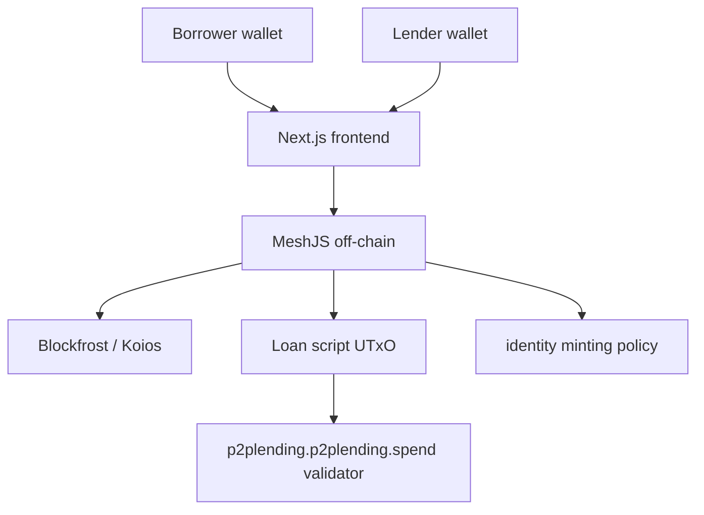

# Kiến trúc Tổng thể (System Architecture)

P2P Lending là dApp nối borrower và lender bằng một loan UTxO. UTxO giữ collateral, identity token và ADA tối thiểu; principal được chuyển trực tiếp cho borrower khi lender fund loan. Datum lưu điều khoản vay cùng trạng thái hiện tại.

## 1. Kiến trúc 3 lớp



Frontend hiển thị loan và yêu cầu ký. Off-chain tìm loan UTxO, tạo validity range và các output cho borrower/lender. Validator `p2plending.p2plending.spend` kiểm tra quyền ký, trạng thái, số tiền và thời gian; minting policy `p2plending.p2plending.mint` quản lý identity token.

## 2. Mô hình dữ liệu

```text
Datum {
  borrower, lender?, principal, interest_rate,
  collateral_policy_id, collateral_asset_name,
  collateral_amount, loan_duration, due_date?
}
```

Collateral là native asset xác định bởi `collateral_policy_id`, `collateral_asset_name` và `collateral_amount`; token này được khóa cùng identity token và ADA tối thiểu tại địa chỉ lending. Principal không nằm trong loan UTxO: khi fund, lender chuyển principal trực tiếp cho borrower. `Pending` có `lender` và `due_date` là `None`; `Active` có cả hai giá trị này là `Some`.

## 3. Luồng nghiệp vụ

1. Borrower tạo loan: mint identity token có tên duy nhất được dẫn xuất từ UTxO seed, khóa collateral cùng ADA tối thiểu và tạo datum `Pending`.
2. Lender fund: principal được chuyển trực tiếp cho borrower; loan UTxO tiếp tục giữ collateral, identity token và ADA tối thiểu. Datum chuyển sang `Active` và tính `due_date`.
3. Borrower repay: trước due date, trả principal cộng interest cho lender và nhận collateral.
4. Borrower cancel: khi còn `Pending`, borrower lấy lại collateral.
5. Liquidate: sau due date, lender ký và nhận collateral.

Mỗi hành động đều tiêu loan UTxO hiện tại. Việc cùng lúc fund hoặc repay không tạo double spend vì Cardano chỉ chấp nhận một giao dịch tiêu cùng UTxO.

## 4. Thời gian

Validator dùng `validity_range`, không dùng đồng hồ frontend. Funding tính `due_date` từ `upper_bound + loan_duration` và giới hạn validity range tối đa 10 phút; repayment phải hoàn tất không muộn hơn hạn trả; liquidation chỉ hợp lệ khi `lower_bound > due_date`.
