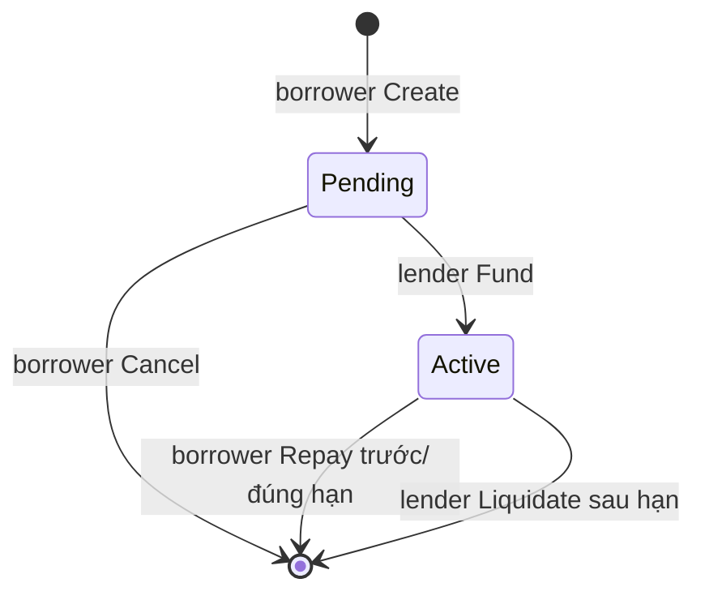
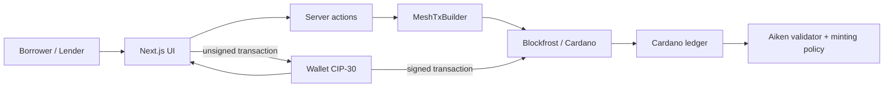

# Bài 1: Kiến trúc P2P Lending và các pattern cốt lõi

**Video:** [Building with Aiken - Bài 8.1 (P2P Lending) - Kiến trúc P2P Lending & Các Pattern Cốt lõi](https://www.youtube.com/watch?v=IB3rE-HaToY)

## Mục tiêu bài học

Sau bài này, học viên có thể:

1. Mô tả được quy trình vay ngang hàng và phân biệt borrower với lender.
2. Giải thích principal, interest rate, duration, collateral và due date.
3. Vẽ state machine của một khoản vay và nêu UTxO nào đang giữ state.
4. Giải thích vì sao dApp cần datum, redeemer và identity token.
5. Phân biệt phần việc của frontend, off-chain, wallet, provider và validator.
6. Nhận diện các giả định/giới hạn của một lending demo trước khi nghĩ đến production.

## 1. Bài toán: kết nối người cần vốn với người có vốn

P2P lending (peer-to-peer lending) kết nối trực tiếp hai vai trò:

- **Borrower** tạo yêu cầu vay, nêu số tiền và điều khoản, đồng thời khóa tài sản bảo đảm.
- **Lender** xem yêu cầu, quyết định có cấp vốn hay không, và nhận lại gốc cộng lãi nếu borrower trả đúng hạn.

Nếu borrower không trả trước hạn, lender có thể dùng hành động thanh lý được quy định trước trong hợp đồng để nhận collateral. Trước khi khoản vay được cấp vốn, borrower có thể hủy yêu cầu và lấy lại collateral.

Mô hình này khác một khoản vay do ứng dụng trung tâm quản lý. Ứng dụng web không phải nơi “giữ” trạng thái có thẩm quyền: dữ liệu về khoản vay và tài sản bảo đảm nằm trong output trên Cardano. DApp đọc output để hiển thị và đề xuất giao dịch; transaction chỉ thành công nếu thỏa validator.

### Các bên và trách nhiệm

| Bên | Vai trò trong luồng | Quyền được validator kiểm tra |
|---|---|---|
| Borrower | Tạo yêu cầu, khóa collateral, có thể hủy khi còn Pending, trả nợ khi Active | Phải ký `Create`, `Cancel`, `Repay` |
| Lender | Cấp vốn và nhận lại tiền hoặc collateral khi quá hạn | Phải ký `Fund`, `Liquidate` |
| Frontend | Thu thập dữ liệu, hiển thị loan, gọi action | Không có quyền tự quyết định transaction hợp lệ |
| Off-chain builder | Query UTxO, giải mã datum, dựng transaction theo action | Tạo transaction chưa ký; không thay validator |
| Wallet | Giữ khóa, xem và ký transaction | Cung cấp chữ ký của người dùng |
| Provider/indexer | Truy vấn UTxO, đánh giá hoặc submit transaction theo tích hợp | Là dịch vụ hạ tầng; không phải nguồn luật của hợp đồng |
| Validator | Kiểm tra transaction khi tiêu loan UTxO | Chấp nhận hoặc từ chối các điều kiện on-chain |

Một máy chủ có thể ngừng hoạt động khiến UI không query được dữ liệu, nhưng máy chủ không thể thay đổi quy tắc của validator. Ngược lại, nếu builder dựng sai transaction, validator có thể từ chối dù giao diện đã hiển thị nút thao tác.

## 2. Bốn khái niệm tài chính quan trọng

### 2.1. Principal

`principal` là số tiền lender cấp cho borrower. Trong implementation, principal được lưu bằng **lovelace** và được chuyển trực tiếp đến địa chỉ borrower ở giao dịch `Fund`. Nó không được giữ trong loan UTxO. Loan UTxO chủ yếu giữ collateral, identity token, ADA tối thiểu và datum.

Quy đổi cơ bản:

```text
1 ADA = 1_000_000 lovelace
10 ADA = 10_000_000 lovelace
```

Việc chuyển principal trực tiếp khi `Fund` làm cho output loan tiếp tục giữ vai trò state/collateral thay vì trở thành “két” lưu khoản vốn cho borrower.

### 2.2. Interest rate

Lãi suất được biểu diễn bằng basis point (bps):

```text
10_000 bps = 100%
5_000 bps  = 50%
500 bps    = 5%
100 bps    = 1%
```

Số phải hoàn trả được tính như sau:

```text
interest = principal * interest_rate / 10_000
repayment = principal + interest
```

Phép tính trên Aiken và TypeScript sử dụng số nguyên. Nếu kết quả lãi không chia hết theo lovelace, phần dư nhỏ hơn một lovelace bị cắt bỏ. Rate trong demo là tỷ lệ áp dụng một lần trên principal, không phải lãi suất APR theo thời gian; thời lượng khoản vay không được đưa vào công thức tính lãi.

### 2.3. Loan duration và due date

`loan_duration` là thời hạn tính bằng mili giây. UI hiện nhận số giờ, sau đó đổi sang mili giây trước khi tạo datum. Ví dụ:

```text
1 giờ = 60 × 60 × 1_000 = 3_600_000 ms
24 giờ = 86_400_000 ms
```

Borrower không trực tiếp đặt `due_date` khi tạo loan. Ở trạng thái Pending, lender và due date đều chưa có. Khi lender fund, validator tính hạn từ thời điểm kết thúc validity interval của giao dịch cộng với duration. Như vậy, thời hạn bắt đầu quanh thời điểm funding được đưa vào ledger, thay vì lúc borrower soạn yêu cầu.

### 2.4. Collateral

Collateral là native asset bị khóa cùng loan UTxO. Datum lưu:

- `collateral_policy_id`: policy ID của asset;
- `collateral_asset_name`: tên asset ở dạng byte/hex trong datum;
- `collateral_amount`: số lượng cần khóa.

Ở nhánh tạo loan, validator kiểm tra rằng output script chứa đúng identity token và lượng collateral đã khai báo (không tính lovelace); collateral không được là ADA và không được dùng chính policy identity của lending. Demo vì vậy hướng tới native asset làm collateral, không nhận lovelace làm tài sản bảo đảm theo trường asset này.

## 3. Khoản vay là state machine

Trạng thái khoản vay được suy ra từ datum, thay vì lưu một trường chuỗi `status` trên chain:

```text
Pending: lender == None && due_date == None
Active:  lender == Some(address) && due_date == Some(timestamp)
```

Trạng thái `Closed` không được lưu dưới dạng datum mới: khi trả nợ, hủy hoặc thanh lý, loan UTxO bị tiêu đi và identity token bị burn.



### Bảng chuyển trạng thái

| Trạng thái đầu vào | Action | Ai ký | Điều kiện chính | Kết quả |
|---|---|---|---|---|
| Chưa có loan | `Create` | Borrower | Điều khoản dương/hợp lệ; khóa collateral; có seed UTxO | Tạo Pending UTxO và mint token |
| Pending | `Fund` | Lender, không phải borrower | Lender khác borrower; validity range hữu hạn và ngắn; trả principal | Datum trở thành Active; collateral vẫn bị khóa |
| Pending | `Cancel` | Borrower | Loan chưa được fund | Trả collateral; burn token; loan đóng |
| Active | `Repay` | Borrower | Hạn trên của validity range không vượt due date; trả ít nhất tổng repayment | Trả tiền cho lender, collateral cho borrower; burn token |
| Active | `Liquidate` | Lender | Hạn dưới của validity range lớn hơn due date | Trả collateral cho lender; burn token |

### Tại sao hai transaction cạnh tranh không thể cùng tiêu loan?

Mỗi loan state được định danh bởi một UTxO cụ thể. `Fund`, `Cancel`, `Repay` và `Liquidate` đều tiêu UTxO đang đại diện cho state hiện tại. Nếu borrower gửi `Cancel` trong lúc lender gửi `Fund` từ cùng UTxO, chỉ một transaction có thể tiêu input đó trước; transaction còn lại trở nên stale vì input không còn unspent.

Đây là thuộc tính quan trọng của mô hình UTxO, nhưng UX vẫn cần xử lý xung đột: dữ liệu trên UI có thể cũ, builder phải tìm lại UTxO, và người dùng cần được thông báo khi transaction bị từ chối do input đã được tiêu.

## 4. EUTxO: state nằm trong output

Cardano dùng mô hình UTxO: giao dịch lấy các output chưa tiêu làm input và tạo output mới. Với EUTxO, output có thể chứa datum để mang state ứng dụng. Validator không phải server luôn chạy; nó được thực thi khi transaction cố gắng tiêu một script output.

Một loan UTxO của demo có thể hình dung như sau:

```text
Output tại lending script address
├── Value
│   ├── ADA (bao gồm lượng cần để duy trì output)
│   ├── collateral native asset
│   └── 1 identity token duy nhất cho loan
└── Inline datum
    ├── borrower
    ├── lender?          None ở Pending, Some(address) ở Active
    ├── principal
    ├── interest_rate
    ├── collateral policy / asset name / quantity
    ├── loan_duration
    └── due_date?        None ở Pending, Some(timestamp) ở Active
```

Transaction `Fund` tiêu loan UTxO Pending, sau đó tạo loan UTxO mới với cùng tài sản khóa nhưng datum Active. Những action đóng loan không tạo output tiếp tục ở script address. Validator là nơi kiểm tra rằng input/output đúng với luật chuyển state.

### Datum và redeemer khác nhau như thế nào?

- **Datum** mô tả state của loan: các điều khoản, hai bên, tài sản bảo đảm và hạn trả.
- **Redeemer** nói transaction đang yêu cầu hành động nào với state đó: `Fund`, `Repay`, `Cancel` hoặc `Liquidate`.
- **Mint redeemer** điều khiển policy identity: `Create(seed)` để tạo token và `Burn` để hủy token.
- **Transaction context** chứa inputs, outputs, mint, chữ ký, validity range... để validator kiểm tra.

Các kiểu này được định nghĩa trong [types.ak](../onchain/lib/types.ak). State không phải biến mutable trong hợp đồng: nó được thay bằng transaction tiêu output cũ và tạo output mới.

## 5. Identity token và cách nhận diện một loan

Một địa chỉ script có thể có nhiều loan UTxO cùng lúc. Chỉ biết lending script address chưa đủ để phân biệt loan nào là loan nào, hoặc kiểm tra output nào đang đại diện cho một khoản vay cụ thể.

Khi `Create`:

1. Builder chọn một wallet UTxO làm seed và đưa seed đó vào transaction.
2. Policy tạo một identity token với số lượng `+1`.
3. Tên token được tạo từ hash của serialization của `OutputReference` seed.
4. Token được đặt cùng collateral trong loan UTxO.

Vì một UTxO seed chỉ có thể bị tiêu một lần, output reference tạo một đầu vào duy nhất cho tên token. Cặp policy ID + asset name giúp indexer/off-chain lọc loan UTxO và theo dõi vòng đời của loan. Khi loan đóng, transaction burn token đó để biểu diễn rằng identity này không còn active.

Identity token là dấu hiệu nhận dạng, không phải collateral và cũng không đại diện cho số tiền nợ. Quy tắc về tài sản khóa và quyền chuyển tiền vẫn phải được validator kiểm tra riêng.

## 6. Kiến trúc dApp: ba lớp và mạng Cardano



### Frontend

Frontend thu thập các trường loan, hiển thị danh sách Pending/Active và chỉ hiện các action phù hợp vai trò. UI giúp ngăn lỗi phổ biến và cung cấp phản hồi, nhưng mọi giá trị vẫn phải được kiểm tra lại trong builder/validator.

### Off-chain

Off-chain kết nối wallet/provider, truy vấn UTxO, giải mã datum, chọn input cần dùng và dựng transaction. Builder có thể phát hiện loan đã thay đổi trước khi hiển thị ví ký; tuy nhiên giữa lúc query và lúc transaction được xác nhận, state vẫn có thể thay đổi.

### On-chain

Validator kiểm tra state transition thực tế. Các quy tắc không nên chỉ tồn tại trong UI: người dùng có thể gọi endpoint khác hoặc dựng transaction riêng. Quy tắc quyết định collateral, chữ ký, due date và burn identity cần được ràng buộc on-chain.

### Wallet và chữ ký

Ví là nơi người dùng kiểm soát khóa. Ứng dụng yêu cầu ví ký transaction, nhưng không cần và không được nhận private key. Chữ ký xác nhận transaction; validator vẫn kiểm tra xem chữ ký có thuộc đúng borrower/lender theo state hay không.

## 7. Ranh giới tin cậy và câu hỏi thiết kế

Khi xem kiến trúc, hãy luôn hỏi:

1. Ai được phép tạo loan? Ai ký để chứng minh quyền đó?
2. Asset nào bị khóa, và số lượng được đối chiếu ra sao?
3. Lender nhận principal từ input nào và borrower nhận tối thiểu bao nhiêu?
4. Hạn trả dựa vào trường nào của validity interval?
5. Ai được gọi action đóng loan và token identity có được burn đúng không?
6. Nếu transaction bị gửi hai lần, một trong hai bị xử lý thế nào?
7. Nếu indexer trả datum không hợp lệ hoặc API lỗi, UI có báo lỗi rõ không?
8. Nếu người dùng chuyển mạng hoặc thay ví giữa lúc tạo và ký, có kiểm tra lại không?

Mỗi câu hỏi này nên có câu trả lời ở đúng lớp. Chẳng hạn, UI có thể ẩn nút `Liquidate` trước hạn, nhưng điều kiện `lower_bound > due_date` vẫn cần ở validator.

## 8. Giới hạn của mô hình demo

Một mô hình lending production cần nhiều phân tích ngoài luồng giao dịch cơ bản. Ví dụ:

- **Giá trị collateral:** repo khóa số lượng token theo datum nhưng chưa có oracle hay định giá USD; do đó không thể kết luận loan được thế chấp đủ giá trị.
- **Biến động giá:** không có cơ chế margin call, cập nhật tỷ lệ thế chấp hoặc thanh lý theo giá.
- **Lãi suất:** công thức demo là lãi đơn cố định theo bps, không tính thời gian thực tế, phí nền tảng hay lãi kép.
- **Định danh asset:** cần quy trình kiểm chứng policy ID/asset name và rủi ro token giả/thiếu thanh khoản trong ứng dụng thực.
- **Thời gian:** validity range phải được hiểu theo đơn vị ledger và được dựng đúng giữa slot với thời điểm Unix.
- **Mức tối thiểu output:** ADA cần thiết phụ thuộc kích thước output/datum và protocol parameters; con số hard-coded của demo không nên xem là chuẩn production.
- **Kinh tế và quản trị:** cần xử lý khoản vay rủi ro, tranh chấp, thay đổi tham số, lỗi provider và vận hành nâng cấp.

Điểm cốt lõi: collateral có tồn tại không đồng nghĩa với collateral đủ giá trị; việc transaction qua validator cũng không chứng minh mô hình kinh tế an toàn.

## 9. Bài tập và câu hỏi tự kiểm tra

1. Vẽ state machine và đánh dấu UTxO/token sau mỗi action.
2. Với `principal = 20 ADA`, `interest_rate = 750 bps`, tính khoản trả nợ theo công thức hiện tại.
3. Nếu duration là 12 giờ, con số nào được lưu vào datum: `12`, `43_200_000` hay `43_200`? Vì sao?
4. Vì sao borrower không tự đặt `due_date` ngay lúc `Create`?
5. Nếu hai lender cùng fund một loan, vì sao không thể có hai loan state Active cho cùng UTxO đầu vào?
6. Nêu một việc UI có thể làm để tăng UX nhưng không thể thay validator.
7. Vì sao token identity không thể được dùng thay cho datum để lưu toàn bộ điều khoản?
8. Hãy nêu ba kiểm soát cần bổ sung trước khi biến demo thành sản phẩm có giá trị thực.

## 10. Ghi nhớ trước tình huống thực hành

P2P Lending của module là một state machine trên EUTxO. Borrower tạo Pending loan và khóa collateral; lender có thể cấp vốn để chuyển loan sang Active; khoản vay kết thúc bằng repayment, cancellation hoặc liquidation. Datum mang state, redeemer chọn action, identity token nhận diện loan, còn validator kiểm tra luật chuyển state. Frontend và off-chain giúp người dùng tương tác thuận tiện, nhưng tính đúng đắn cuối cùng phụ thuộc transaction được ledger xác minh.

## 11. Ví dụ xuyên suốt: theo dấu một khoản vay từ lúc tạo tới lúc đóng

Giả sử Alice là borrower, Bob là lender. Alice đề nghị vay `20 ADA`, lãi suất `750 bps`, thời hạn `12 giờ`, và khóa `1` đơn vị native asset làm collateral.

### 11.1. Chuẩn hóa điều khoản

Trước khi builder dựng transaction, dữ liệu người dùng nhập được chuyển về đơn vị mà datum sử dụng:

| Trường | Người dùng nhập | Giá trị lưu trên chain |
|---|---:|---:|
| Principal | 20 ADA | `20_000_000` lovelace |
| Lãi suất | 7.5% | `750` bps |
| Thời hạn | 12 giờ | `43_200_000` ms |
| Collateral | 1 token | Policy ID, asset name và quantity `1` |
| Borrower | Địa chỉ Alice | `Address` |
| Lender / due date | Chưa có lender | `None` / `None` |

Tỷ lệ được quy đổi theo `100 bps = 1%`, còn giờ được nhân với `3_600_000` để ra mili giây. Khi kiểm tra bằng tay, nên ghi riêng giá trị hiển thị và giá trị serialized để tránh lẫn ADA với lovelace hoặc phần trăm với bps.

### 11.2. Giao dịch tạo Pending loan

Alice chọn collateral và ký một transaction `Create`. Transaction đó tiêu seed UTxO để tạo identity token; loan output mới được đặt tại lending script address:

```text
Loan UTxO #1
  value: 5 ADA theo builder hiện tại + 1 collateral token + 1 identity token
  datum: borrower=Alice, lender=None, principal=20_000_000,
         rate=750, duration=43_200_000, due_date=None
```

Builder hiện đang đặt 5 ADA vào output Create. Đây là giá trị dự phòng được hard-code cho demo, không nên hiểu là mức minimum-ADA chính xác cho mọi kích thước datum hoặc mọi protocol parameters. Sau khi xác nhận, market có thể hiển thị yêu cầu này là Pending. Tuy vậy, UI không nên xem loan là hợp lệ chỉ vì Alice thấy một unsigned transaction hoặc vì ví đã mở màn hình ký; phải đợi transaction được submit và dữ liệu mạng cập nhật.

### 11.3. Giao dịch Bob cấp vốn

Bob đọc datum, xác nhận đây là yêu cầu mình muốn fund rồi ký transaction. Transaction tiêu Loan UTxO #1 và tạo Loan UTxO #2 với cùng identity token/collateral, nhưng datum đổi lender thành Bob và thêm due date. Song song, Bob trả principal cho Alice:

```text
Input:
  Loan UTxO #1 (Pending)
  Bob's wallet inputs (phí, principal, transaction collateral)

Outputs:
  Loan UTxO #2 (Active, cùng loan identity/collateral, ADA không giảm)
  Alice nhận ít nhất 20 ADA principal
  Loan output được builder tăng thêm 1 ADA trong implementation hiện tại
  Change của Bob
```

Thời hạn bắt đầu từ upper bound của validity range mà transaction Fund khai báo. Nếu giao dịch được chấp nhận, thời hạn không thể bị Alice tự đặt lại trong datum: `Fund` chỉ được thay lender và due date; validator buộc các terms còn lại giữ nguyên.

### 11.4. Repayment nếu Alice trả đúng hạn

Ở mức tính theo code hiện tại:

```text
interest       = 20_000_000 × 750 / 10_000
               = 1_500_000 lovelace = 1.5 ADA

total repayment = 20_000_000 + 1_500_000
                = 21_500_000 lovelace = 21.5 ADA
```

Alice ký `Repay`. Loan UTxO #2 bị tiêu; Bob nhận ít nhất 21.5 ADA; Alice nhận lại collateral; identity token bị burn. Loan không còn một continuing output ở lending script address, vì vậy nó đã đóng.

### 11.5. Nếu Alice không trả đúng hạn

Sau due date, Bob là lender được phép ký `Liquidate`. Giao dịch tiêu Loan UTxO #2, trả collateral cho Bob và burn identity token. Demo không tự động bán token, xác định giá thị trường hay chuyển đổi token thành ADA; “thanh lý” ở đây chỉ là chuyển collateral tới địa chỉ lender theo luật on-chain.

### 11.6. Nếu loan chưa được fund

Nếu Bob chưa fund, Alice có thể ký `Cancel`. Loan UTxO Pending bị tiêu, collateral được trả lại Alice và identity token bị burn. Không có khoản principal hay repayment vì loan chưa chuyển sang Active.

### Điều ví dụ này minh họa

- Mỗi transition tiêu state UTxO trước và tạo output mới hoặc đóng state.
- Datum Active xác định lender và due date; terms đã đề nghị vẫn được giữ nguyên.
- Principal được chuyển lúc Fund, nhưng không nằm trong loan UTxO.
- Collateral chỉ được trả khi loan đóng bằng Cancel/Repay/Liquidate.
- Chữ ký chứng minh đúng vai trò, nhưng chữ ký đơn lẻ không thay mọi điều kiện về state, asset và thời gian.
- Asset collateral được trả về lender khi liquidation, không có đảm bảo giá trị kinh tế tương đương principal.

## 12. Cách tự phân tích một transaction

Khi xem transaction trên explorer, hãy dùng thứ tự sau:

1. **Tìm input loan:** script address, tx hash và output index có khớp loan đang xem không?
2. **Đọc datum cũ:** Pending hay Active? Ai là borrower/lender? Điều khoản là gì?
3. **Nhận diện action:** redeemer nào gắn với spending input? Có mint/burn token đi kèm không?
4. **Kiểm tra signer:** chữ ký nào cần thiết cho action này và có được đưa vào transaction không?
5. **Đọc validity interval:** mốc bắt đầu/kết thúc có nằm đúng phía của due date không?
6. **Đối chiếu value:** ai nhận principal, repayment và collateral? Tổng amount qua các output có đủ không?
7. **Đọc output state:** Fund có giữ token/collateral và cập nhật đúng datum không? Action đóng loan có để lại script output không?
8. **Phân biệt gửi với xác nhận:** tx hash là dấu hiệu đã submit; trạng thái xác nhận cần được kiểm tra riêng.

Tập phân tích này giúp nối Bài 1 (mô hình) với Bài 2 (validator) và Bài 3 (builder). Mỗi giao dịch thành công là một bằng chứng cụ thể của một transition, không chỉ là một lần bấm nút trên UI.

**Đọc tiếp:** [Bài 2: On-chain code và cơ chế xử lý khoản vay](./bai_giang_2.md).
