# Module 09: Stablecoin VNDC — Hệ thống Tiền tệ Phi tập trung Thế chấp Vượt mức (CDP)

# Bài 1: CDP Stablecoin - Tổng quan và Thiết kế

> ### Mục lục bài học
> 1. [Stablecoin thế chấp vượt mức](#1-stablecoin-thế-chấp-vượt-mức)
>    - 1.1. [Tại sao hệ sinh thái cần Stablecoin?](#11-tại-sao-hệ-sinh-thái-cần-stablecoin)
>    - 1.2. [Mô hình Vị thế Nợ Thế chấp (CDP) & Các Thành phần Vận hành](#12-mô-hình-vị-thế-nợ-thế-chấp-cdp--các-thành-phần-vận-hành)
>      - 1.2.1. [Tỉ lệ Thế chấp Tối thiểu (Minimum Collateral Ratio - MCR)](#121-tỉ-lệ-thế-chấp-tối-thiểu-minimum-collateral-ratio---mcr)
>      - 1.2.2. [Các Chủ Thể Tham Gia Hệ Thống](#122-các-chủ-thể-tham-gia-hệ-thống)
>      - 1.2.3. [Nguồn Cấp Giá & Quản trị Oracle Mô Phỏng (Mock Oracle)](#123-nguồn-cấp-giá--quản-trị-oracle-mô-phỏng-mock-oracle)
>    - 1.3. [Vòng đời Vị thế & Trải nghiệm Ứng dụng (CDP Lifecycle & State Machine)](#13-vòng-đời-vị-thế--trải-nghiệm-ứng-dụng-cdp-lifecycle--state-machine)
>      - 1.3.1. [Ba Hành động Cốt lõi của dApp (MINT, BURN, LIQUIDATE)](#131-ba-hành-động-cốt-lõi-của-dapp-mint-burn-liquidate)
>      - 1.3.2. [Vòng đời Vị thế](#132-vòng-đời-vị-thế)
>    - 1.4. [Cơ chế Thanh lý (Liquidation Mechanics) & Bảo vệ Hệ thống](#14-cơ-chế-thanh-lý-liquidation-mechanics--bảo-vệ-hệ-thống)
> 2. [Năm Quyết định Thiết kế Cốt lõi](#2-năm-quyết-định-thiết-kế-cốt-lõi)
>    - 2.1. [Sử dụng State Thread Token để Nhận diện Vị thế & Oracle](#21-sử-dụng-state-thread-token-để-nhận-diện-vị-thế--oracle)
>    - 2.2. [Kiến trúc 2 Multi-Purpose Validators (`oracle.ak` & `stablecoin.ak`)](#22-kiến-trúc-2-multi-purpose-validators-oracleak--stablecoinak)
>    - 2.3. [Giữ Quyền Stake Cho Người Dùng (Franken Address)](#23-giữ-quyền-stake-cho-người-dùng-franken-address)
>    - 2.4. [Cơ chế Đọc & Cập nhật Oracle Linh hoạt (On-chain CIP-31 & Off-chain Polling)](#24-cơ-chế-đọc--cập-nhật-oracle-linh-hoạt-on-chain-cip-31--off-chain-polling)
>    - 2.5. [Nhận diện Chủ Vị thế bằng Stake Key Hash (Hỗ trợ Ví Đa Địa chỉ)](#25-nhận-diện-chủ-vị-thế-bằng-stake-key-hash-hỗ-trợ-ví-đa-địa-chỉ)

---

## 1. Stablecoin thế chấp vượt mức

### 1.1. Tại sao hệ sinh thái cần Stablecoin?

Trong thị trường tiền mã hóa, biến động giá của đồng tiền cơ sở như ADA là rào cản lớn đối với các hoạt động tài chính thường nhật như thanh toán hàng hóa, trả lương, cho vay hay lưu trữ giá trị ngắn hạn. Để giải quyết bài toán này, các hệ thống tài chính phi tập trung (DeFi) cần một đồng tiền ổn định (**Stablecoin**).

Các mô hình stablecoin trên thị trường hiện nay gồm:
1. **Fiat-backed (Bảo chứng bằng tiền pháp định - ví dụ USDT, USDC):** Được bảo chứng 1:1 bằng tiền pháp định (USD, EUR...) gửi trong các tài khoản ngân hàng truyền thống. Mô hình này có thanh khoản cao nhưng mang tính tập trung, phụ thuộc hoàn toàn vào uy tín của tổ chức phát hành và tiềm ẩn nguy cơ kiểm duyệt hoặc đóng băng tài khoản.
2. **Commodity-backed (Bảo chứng bằng hàng hóa - ví dụ PAXG, XAUT):** Được neo giá trị và bảo chứng bằng các tài sản vật chất thực tế như vàng, bạc, dầu mỏ hoặc kim loại quý (Real World Assets - RWA). Mô hình này giúp phòng hộ rủi ro lạm phát tiền giấy nhưng đòi hỏi chi phí lưu kho, bảo hiểm và hệ thống kiểm toán tài sản vật lý định kỳ.
3. **Crypto-collateralized (Thế chấp bằng tiền mã hóa - ví dụ DAI của MakerDAO, Djed trên Cardano):** Phát hành hoàn toàn phi tập trung thông qua các hợp đồng thông minh minh bạch trên blockchain. Giá trị của stablecoin được bảo đảm bằng chính tài sản mã hóa (như ADA, ETH) có giá trị thị trường lớn hơn lượng nợ phát hành (cơ chế thế chấp vượt mức - Over-collateralization).
4. **Algorithmic (Thuật toán không thế chấp - ví dụ UST của Terra):** Dựa vào cơ chế chênh lệch giá (arbitrage) và mint/burn tự động giữa stablecoin với một token biến động thứ hai để duy trì chốt giá. Mô hình này tối ưu hiệu quả vốn nhưng có rủi ro hệ thống cực lớn, dễ rơi vào "vòng xoáy tử thần" (Death Spiral) khi thanh khoản suy kiệt.

> [!NOTE]
> **VNDC thuộc loại nào?**
> Trong module này, đồng **VNDC** của chúng ta thuộc mô hình **Crypto-collateralized (Thế chấp bằng tiền mã hóa)** theo cơ chế **Vị thế Nợ Thế chấp (Collateralized Debt Position - CDP)**:
> - Tài sản bảo chứng là đồng tiền cơ sở **ADA** bị khóa trên Smart Contract của Cardano.
> - Neo giá trị $1\text{ VNDC} = 1\text{ VND}$, bảo vệ giá trị bằng tỉ lệ thế chấp vượt mức tối thiểu $\text{MCR} = 150\%$.
> - Mọi thao tác thế chấp, đúc token, hoàn nợ và thanh lý đều do logic on-chain thực thi tự động, không phụ thuộc vào bất kỳ tổ chức hay ngân hàng trung gian nào.

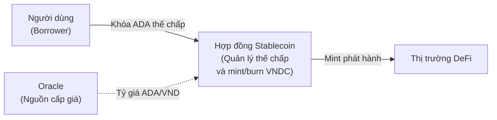

---

### 1.2. Mô hình Vị thế Nợ Thế chấp (CDP) & Các Thành phần Vận hành

Mô hình CDP cho phép người nắm giữ tài sản cơ sở (ADA) không cần phải bán tài sản của mình khi cần tiền thanh toán. Thay vào đó, họ khóa ADA vào một hợp đồng thông minh để đúc ra một lượng VNDC tương ứng với một tỉ lệ an toàn định trước, giống như việc thế chấp tài sản để vay tiền trong ngân hàng.

#### 1.2.1. Tỉ lệ Thế chấp Tối thiểu (Minimum Collateral Ratio - MCR)
Do giá trị của ADA biến động liên tục theo thị trường, hệ thống bắt buộc giá trị của tài sản thế chấp (ADA) phải luôn lớn hơn giá trị của khoản nợ phát hành (VNDC). 

Trong dự án VNDC, chúng ta quy định **MCR = 150%** (tức giá trị ADA thế chấp phải đạt ít nhất $1.5$ lần giá trị VNDC phát hành):

$$\text{Collateral Ratio (CR)} = \frac{\text{Giá trị ADA thế chấp (tính theo VND)}}{\text{Lượng VNDC đã phát hành}} \times 100\% \ge 150\%$$

---

#### 1.2.2. Các Chủ Thể Tham Gia Hệ Thống
Mô hình CDP được duy trì bởi 3 nhóm chủ thể độc lập:
1. **Người vay / Chủ vị thế (Borrower / Position Owner):** Là người dùng sở hữu ADA, muốn mở vị thế thế chấp để đúc VNDC phục vụ chi tiêu hoặc tái đầu tư mà không phải bán tài sản ADA của mình. Khi cần nhận lại ADA thế chấp, họ chỉ cần hoàn trả đủ lượng VNDC đã nợ.
2. **Người thanh lý (Liquidator):** Là bất kỳ thành viên nào trong cộng đồng (thường là các bot thanh lý tự động hoạt động 24/7). Họ liên tục quét sổ cái Cardano để phát hiện những vị thế rơi vào trạng thái nguy hiểm ($\text{CR} < 150\%$) do giá ADA sụt giảm, từ đó dùng chính VNDC của mình để hoàn nợ thay cho chủ vị thế cũ và nhận về lượng ADA bồi hoàn nợ gốc kèm phần thưởng thanh lý (tối đa 2% tổng lượng ADA thế chấp).
3. **Nguồn cấp giá (Oracle):** Là thành phần cung cấp dữ liệu tỷ giá thị trường (ADA/VND) vào sổ cái Cardano, đóng vai trò là "nguồn sự thật duy nhất" (Single Source of Truth). Nhờ Oracle, các hợp đồng thông minh mới có căn cứ khách quan để định giá tài sản thế chấp theo thời gian thực, thẩm định tỷ lệ nợ khi mở vị thế (`MINT`) và kích hoạt cơ chế bảo vệ thanh lý (`LIQUIDATE`) khi giá ADA sụt giảm.

---

#### 1.2.3. Nguồn Cấp Giá & Quản trị Oracle Mô Phỏng (Mock Oracle)

Smart contract trên Cardano không thể tự gửi request ra Internet để lấy giá ngoài đời thực. Mọi dữ liệu giá bắt buộc phải được đưa vào sổ cái thông qua một **Oracle UTxO**.

> [!NOTE]
> **Mock Oracle trong Khóa học:**
> Nhằm phục vụ mục đích học tập, thực hành và kiểm thử các kịch bản thị trường (giá tăng, giảm đột ngột hoặc rớt xuống ngưỡng thanh lý), dApp VNDC không tích hợp mạng Oracle phi tập trung bên ngoài mà triển khai một **Oracle mô phỏng (Mock Oracle)** on-chain. Oracle này được Admin/Operator vận hành và điều khiển thủ công trực tiếp từ giao diện trang quản trị của dApp.

Mock Oracle được quản lý qua một hợp đồng riêng biệt với 3 hành động cốt lõi:

| Hành động Oracle | Chủ thể thực hiện | Mục đích & Cơ chế eUTxO |
|---|---|---|
| **`Init`** (Khởi tạo) | **Oracle Operator** | Khởi tạo Oracle UTxO và khóa vào Oracle Script với tỷ giá khởi điểm `rate` (VND/ADA), đồng thời mint ra đúng một **Oracle NFT** gắn vào UTxO đó để định danh. |
| **`Update`** (Cập nhật tỷ giá) | **Oracle Operator** | Cập nhật tỷ giá mới `rate` trên Datum của Oracle UTxO để phản ánh biến động thị trường. |
| **`Delete`** (Đóng / Hủy Oracle) | **Oracle Operator** | Đóng Oracle, đốt vĩnh viễn Oracle NFT, hệ thống Stablecoin chỉ còn chức năng BURN hoạt động để borrower thoát vị thế. |

---

### 1.3. Vòng đời Vị thế & Trải nghiệm Ứng dụng

#### 1.3.1. Ba Hành động Cốt lõi của dApp (MINT, BURN, LIQUIDATE)

Trong toàn bộ vòng đời của một vị thế CDP, người dùng và các bên tham gia chỉ tương tác thông qua **3 hành động cốt lõi**:

| Hành động | Chủ thể thực hiện | Nguồn giá / Dữ liệu | Khi nào được kích hoạt? | Biến động tài sản & Token |
|---|---|---|---|---|
| **MỞ VỊ THẾ / ĐÚC<br/>(`MINT`)** | **Borrower**<br/>(Người vay) | Tham chiếu **Oracle UTxO**<br/>(CIP-31 Reference Input) | Bất kỳ lúc nào người dùng muốn đúc VNDC, miễn là lượng ADA khóa vào đảm bảo $\text{CR} \ge 150\%$. | - Khóa ADA vào Collateral Script.<br/>- Đúc (`mint`) VNDC mới chuyển vào ví Borrower.<br/>- Đúc 1 `PositionToken` làm State Thread Token định danh vị thế. |
| **TRẢ NỢ / GIẢI CHẤP<br/>(`BURN`)** | **Chỉ Chủ vị thế**<br/>(Borrower sở hữu ví) | **Không cần Oracle**<br/>(Tất toán 100% nợ) | Bất kỳ lúc nào vị thế chưa bị thanh lý và người dùng nạp đủ 100% lượng VNDC đã vay. | - Đốt (`burn`) toàn bộ lượng nợ VNDC.<br/>- Đốt `PositionToken` kết thúc vị thế.<br/>- Giải phóng toàn bộ ADA thế chấp trả về ví Borrower (-0.5% phí dev). |
| **THANH LÝ CƯỠNG CHẾ<br/>(`LIQUIDATE`)** | **Liquidator**<br/>(Bất kỳ ai / Bot) | Tham chiếu **Oracle UTxO**<br/>(CIP-31 Reference Input) | Khi giá ADA sụt giảm khiến tỉ lệ thế chấp vi phạm ngưỡng an toàn: $\text{CR} < 150\%$. | - Liquidator nạp VNDC vào đốt thay cho Borrower.<br/>- Đốt `PositionToken`.<br/>- Liquidator nhận lại ADA nợ gốc + tối đa 2% thưởng thanh lý.<br/>- Borrower nhận lại toàn bộ số dư ADA còn lại. |

> [!NOTE]
> - Hành động **`MINT`** và **`LIQUIDATE`** bắt buộc phải đọc Oracle UTxO qua CIP-31 để xác thực tỷ giá ADA/VND on-chain.
> - Hành động **`BURN`** **hoàn toàn không cần đọc Oracle** vì khi người vay đã hoàn trả và đốt đủ 100% lượng VNDC đã nợ, giao thức đã sạch nợ và không còn chịu bất kỳ rủi ro tín dụng nào từ vị thế đó. Giao dịch diễn ra nhẹ nhất và tiết kiệm chi phí tối đa.

---

#### 1.3.2. Vòng đời Vị thế

Vòng đời của một vị thế CDP từ khi khởi tạo cho đến lúc tất toán hoặc bị thanh lý được mô hình hóa thông qua máy trạng thái (State Machine) dưới đây, phản ánh sự dịch chuyển giữa các mức độ an toàn theo biến động giá thị trường:

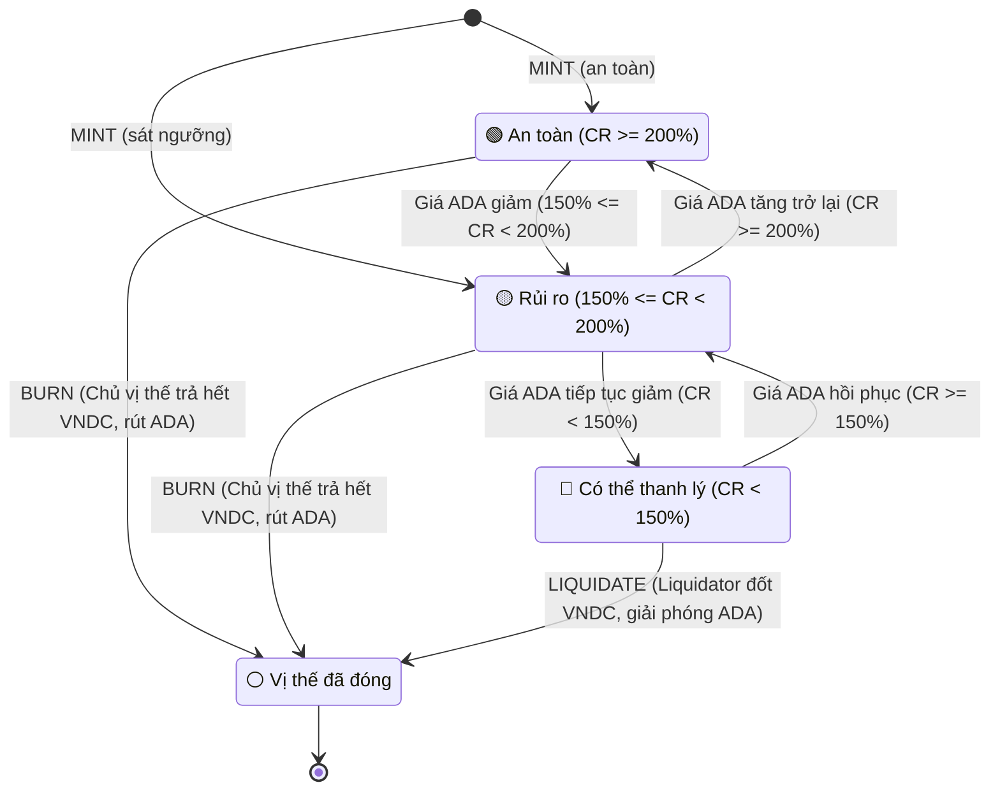

Bảng phân tích trạng thái vị thế được tính toán theo thời gian thực (Derived State):

| Mã trạng thái | Trạng thái hiển thị trên App | Điều kiện nhận diện (Frontend / Offchain) | Ý nghĩa nghiệp vụ | Hành động cho phép |
|---|---|---|---|---|
| `SAFE` | 🟢 **An toàn** | $\text{CR} \ge 200\%$ | Vị thế có đệm an toàn cao (chịu được cú sốc giảm giá tới $25\%$) | `BURN` (Chỉ chủ vị thế) |
| `AT_RISK` | 🟡 **Rủi ro** | $150\% \le \text{CR} < 200\%$ | Vị thế tiệm cận ngưỡng MCR, đối mặt nguy cơ bị thanh lý nếu ADA giảm nhẹ | `BURN` (Chủ vị thế nên hoàn nợ sớm) |
| `LIQUIDATABLE` | 🔴 **Có thể thanh lý** | $\text{CR} < 150\%$ | Vị thế vi phạm MCR ($150\%$), đe dọa an toàn thanh khoản của toàn hệ thống | `LIQUIDATE` (Bất kỳ ai trong cộng đồng) |
| `CLOSED` | Loại bỏ khỏi danh sách vị thế | UTxO thế chấp đã bị tiêu thụ | Vị thế đã hoàn tất tất toán hoặc thanh lý xong trên sổ cái | Không còn thao tác |

> [!NOTE]
> Dữ liệu on-chain không lưu riêng trường enum trạng thái. Các trạng thái trên sơ đồ trên đều do Frontend và Off-chain tính toán liên tục theo tỷ giá Oracle thời gian thực.

---

### 1.4. Cơ chế Thanh lý & Bảo vệ Hệ thống

Khi giá ADA trên thị trường giảm khiến vị thế thế chấp xuống dưới ngưỡng an toàn $150\%$, nếu không có biện pháp can thiệp, vị thế có thể rơi vào tình trạng **nợ xấu** (Under-collateralized — khi giá trị ADA tiếp tục giảm và giá trị thế chấp về nhỏ hơn giá trị nợ VNDC), gây mất chốt giá (de-peg) và đe dọa sự sống còn của toàn bộ giao thức.

#### 1.4.1. Kích hoạt Thanh lý
Bất kỳ khi nào một vị thế có:

$$\text{Collateral Ratio (CR)} < 150\%$$

Hợp đồng thông minh sẽ tự động mở quyền cho **bất kỳ người dùng nào trong cộng đồng** (được gọi là **Người thanh lý - Liquidator**) đứng ra can thiệp và thanh lý vị thế đó.

#### 1.4.2. Cơ chế Thực hiện
Người thanh lý dùng chính lượng VNDC của mình để hoàn trả toàn bộ khoản nợ thay cho chủ vị thế cũ. Lượng VNDC này lập tức bị đốt bỏ khỏi lưu thông (`burn`), giúp triệt tiêu khoản nợ xấu và bảo vệ hệ thống khỏi nguy cơ mất khả năng thanh toán. 

Đổi lại, Liquidator được nhận lại 2 khoản từ tài sản thế chấp ADA của vị thế:
1. **Bồi hoàn nợ gốc:** Quy đổi tương đương với giá trị VNDC mà Liquidator bỏ ra theo tỷ giá Oracle thời điểm đó.
2. **Thưởng thanh lý:** Định mức tối đa $2\%$ giá trị tổng lượng ADA thế chấp nhằm bù đắp rủi ro và chi phí giao dịch.

#### 1.4.3. Phân phối Tài sản Thế chấp khi Thanh lý
Hệ thống VNDC áp dụng cơ chế thanh lý công bằng và bảo vệ người vay (Borrower Protection), phân bổ tài sản thế chấp lần lượt theo 4 tầng ưu tiên (mô hình thác nước). Bên cạnh đó, với mạng lưới Cardano, hệ thống phải tuân thủ nghiêm ngặt quy định về **Min ADA UTxO** (mỗi UTxO độc lập phải chứa ít nhất ~1 ADA). Các khoản phân phối nhỏ hơn 1 ADA sẽ được tự động làm tròn hoặc dồn theo thứ tự ưu tiên.

Hãy cùng phân tích một ví dụ thực tế để nắm rõ cơ chế phân phối này:

##### Ví dụ Minh họa: Phân phối Thanh lý Thông thường ($\text{CR} \approx 143\%$)
Giả sử một vị thế đang khóa thế chấp **$1,000 \text{ ADA}$** để vay một lượng VNDC. Khi giá ADA giảm nhẹ, giá trị quy đổi của khoản nợ VNDC (theo Oracle) chạm mức tương đương **$700 \text{ ADA}$**, khiến tỉ lệ thế chấp tụt xuống:
$$\text{CR} = \frac{1,000 \text{ ADA}}{700 \text{ ADA}} \approx 142.8\% < 150\% \quad (\text{Chạm ngưỡng thanh lý})$$

Một liquidator phát hiện và thực hiện thanh lý. Toàn bộ $1,000 \text{ ADA}$ thế chấp được hợp đồng phân bổ lần lượt theo 4 tầng ưu tiên (mô hình thác đổ) như sau:

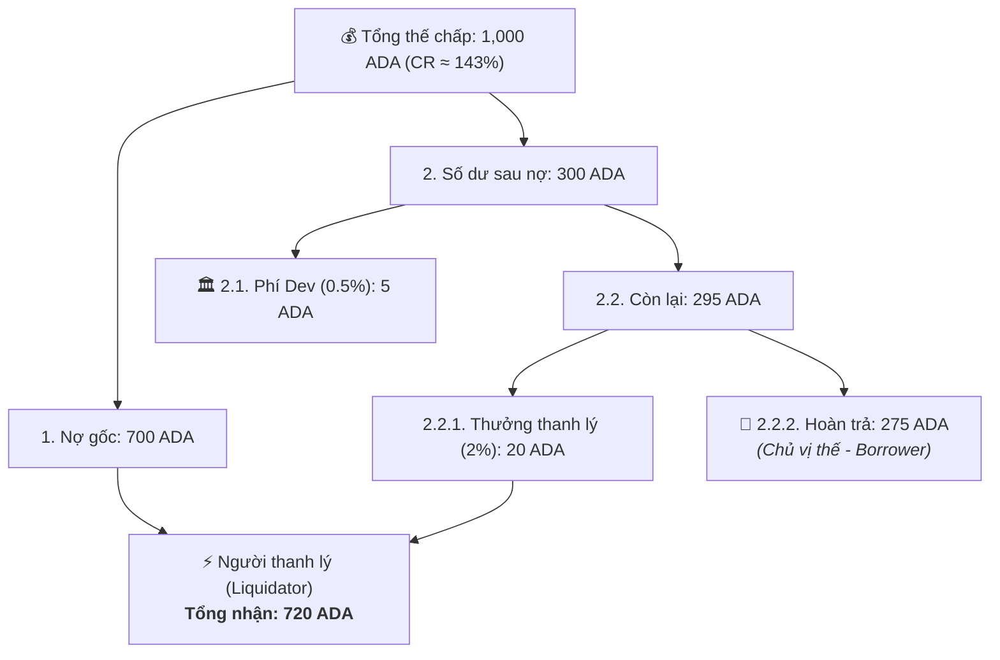

1. **Bồi hoàn nợ gốc ($700 \text{ ADA}$):** Liquidator nạp VNDC để tiêu hủy toàn bộ nợ và được nhận lại $700 \text{ ADA}$ tương ứng với giá trị nợ theo Oracle, thu hồi trọn vẹn số vốn đã bỏ ra. Số dư sau nợ còn lại là: $1,000 - 700 = 300 \text{ ADA}$.
2. **Phí Giao thức ($5 \text{ ADA}$):** Từ số dư $300 \text{ ADA}$, khấu trừ $0.5\%$ giá trị tổng thế chấp ($1,000 \times 0.5\% = 5 \text{ ADA}$) chuyển về quỹ phát triển của giao thức. Số dư còn lại tiếp tục chảy xuống tầng tiếp theo: $300 - 5 = 295 \text{ ADA}$.
3. **Thưởng Thanh lý ($20 \text{ ADA}$):** Liquidator được hưởng khoản thưởng thanh lý định mức $2\%$ tổng thế chấp ($1,000 \times 2\% = 20 \text{ ADA}$) để bù đắp rủi ro và chi phí giao dịch, nâng tổng số ADA Liquidator nhận về lên **$720 \text{ ADA}$** ($700 + 20$). Số dư còn lại sau khi trừ thưởng: $295 - 20 = 275 \text{ ADA}$.
4. **Hoàn trả cho Chủ vị thế ($275 \text{ ADA}$):** Toàn bộ số dư còn lại sau khi khấu trừ 3 khoản trên ($275 \text{ ADA}$) lớn hơn ngưỡng Min UTxO ($1\text{ ADA}$), do đó hợp đồng tạo một UTxO chuyển trả về ví của chủ vị thế (`borrower`).

> [!NOTE]
> **Quy tắc Phân phối Thực tế & Các Trường hợp Biên (Edge Cases):**
> Ví dụ trên mô tả cách phân bổ chuẩn trong phần lớn các trường hợp thông thường khi giá ADA biến động nhẹ. Trên thực tế vận hành mạng lưới Cardano, cơ chế thanh lý còn phải xử lý các kịch bản biên phức tạp hơn:
> - **Thị trường sập sâu (Flash Crash):** Khi giá ADA giảm sốc khiến tỉ lệ thế chấp rơi về sát hoặc dưới mốc nợ xấu ($\text{CR} \le 100\%$), số dư thế chấp dôi ra không đủ định mức thưởng $2\%$ hay $0.5\%$ phí Dev. Khi đó, giao thức kích hoạt cơ chế thác đổ phòng vệ: ưu tiên bồi hoàn vốn nợ trước, các khoản phí và thưởng chỉ được nhận tối đa phần dôi ra thực tế còn lại.
> - **Ràng buộc Min ADA UTxO:** Sổ cái Cardano quy định mọi UTxO độc lập phải chứa ít nhất lượng ADA tối thiểu, cỡ khoảng 1 ADA. Nếu khoản tiền hoàn trả cho chủ vị thế hoặc phí dev sau khi tính toán $< 1\text{ ADA}$, hợp đồng sẽ áp dụng quy tắc làm tròn sàn tối thiểu hoặc tự động gộp phần tiền lẻ thặng dư vào output của Liquidator (khiến tỷ lệ thực nhận của Liquidator có thể nhỉnh hơn $2\%$ một chút).
> 
> Toàn bộ các công thức toán học xử lý các trường hợp biên này sẽ được chúng ta phân tích chi tiết và trực tiếp xây dựng trong **Bài 2** khi triển khai logic validator on-chain.

---

## 2. Năm Quyết định Thiết kế Cốt lõi

Để hệ thống Stablecoin VNDC vận hành an toàn, tối ưu chi phí và mang lại trải nghiệm mượt mà trên Cardano eUTxO, kiến trúc hệ thống được xây dựng dựa trên 5 quyết định thiết kế then chốt:

### 2.1. Sử dụng State Thread Token để Nhận diện Vị thế & Oracle
Trong mô hình eUTxO, bất kỳ ai cũng có thể gửi tài sản vào một Script Address. Để hợp đồng và dApp phân biệt chính xác UTxO nào là hợp lệ và đại diện cho dữ liệu thực tế của hệ thống, chúng ta sử dụng cơ chế **State Thread Token**:
- **Oracle Token (One-shot NFT):** Một NFT duy nhất được mint lúc khởi tạo (`Init`), đính kèm vĩnh viễn vào Oracle UTxO trên địa chỉ Oracle. Nhờ đó, các hợp đồng khác chỉ cần kiểm tra sự hiện diện của NFT này để tin cậy tỷ giá trong Datum mà không sợ bị tấn công giả mạo Oracle.
- **Position token (Fungible Token):** Mỗi khi một vị thế CDP được tạo ra (`MINT`), hợp đồng yêu cầu đúc đúng `1` đơn vị `PositionToken` gắn vào UTxO thế chấp để nhận diện. Khi đóng vị thế (`BURN` hoặc `LIQUIDATE`), token này bắt buộc phải bị tiêu hủy (`-1`). Token này đóng vai trò như một "thẻ căn cước" giúp off-chain và indexer truy vấn nhanh toàn bộ danh sách vị thế đang mở trên sổ cái.

### 2.2. Kiến trúc 2 Multi-Purpose Validators ([`oracle.ak`](../../onchain/validators/oracle.ak) & [`stablecoin.ak`](../../onchain/validators/stablecoin.ak))
Thay vì tạo ra nhiều validator đơn lẻ gây phân mảnh logic và tốn kém transaction fee, hệ thống quy hoạch thành 2 validator đa mục đích (Multi-Purpose):
- [`oracle.ak`](../../onchain/validators/oracle.ak): Quản lý Mock Oracle, trong đó `mint` handler kiểm soát việc phát hành duy nhất 1 Oracle NFT lúc khởi tạo (`Init`) và đốt bỏ khi đóng Oracle (`Delete`); `spend` handler kiểm soát việc cập nhật tỷ giá `rate` mới vào Datum (`Update`) và đảm bảo Oracle NFT luôn được chuyển tiếp an toàn.
- [`stablecoin.ak`](../../onchain/validators/stablecoin.ak): Quản lý tài sản thế chấp và kiểm soát đúc/đốt VNDC, trong đó `mint` handler kiểm soát việc phát hành/tiêu hủy token VNDC cùng `PositionToken` định danh; `spend` handler bảo vệ kho lưu trữ ADA thế chấp và thực thi ủy quyền nghiệp vụ cho `mint` handler.

### 2.3. Giữ Quyền Stake Cho Người Dùng (Franken Address)
- **Điểm độc đáo của Cardano eUTxO:** Khác với các mạng EVM khi nạp tài sản vào hợp đồng thông minh thì người dùng mất quyền staking (trừ khi dùng các giải pháp LST phức tạp), Cardano hỗ trợ cấu trúc địa chỉ với 2 thành phần payment và stake độc lập và có thể lắp ghép linh hoạt payment part của chủ thể này với stake part của chủ thể khác để tạo thành địa chỉ lai (**Franken Address**).
- **Cơ chế triển khai:** Địa chỉ khóa ADA thế chấp kết hợp giữa **Script Payment Credential** của hợp đồng với **User Stake Credential** của người vay. Hợp đồng vẫn kiểm soát quyền giải chấp UTxO (`spend`), nhưng quyền ủy thác stake ADA và nhận phần thưởng staking định kỳ vẫn trọn vẹn nằm trong tay chủ vị thế.

### 2.4. Cơ chế Đọc & Cập nhật Oracle Linh hoạt (On-chain CIP-31 & Off-chain Polling)
- **On-chain (CIP-31 Reference Inputs):** Chuẩn [CIP-31 Reference Inputs](https://cips.cardano.org/cip/CIP-0031) cho phép các giao dịch `MINT` và `LIQUIDATE` đọc trực tiếp Datum từ Oracle UTxO dưới dạng dữ liệu tham chiếu thuần túy. Hợp đồng đọc được tỷ giá mới nhất mà hoàn toàn **không tiêu thụ hay làm thay đổi UTxO của Oracle**, triệt tiêu tình trạng tranh chấp giao dịch (concurrency bottleneck) và cho phép hàng trăm giao dịch cùng đọc giá trong một block mà không xảy ra xung đột.
- **Off-chain & Frontend (Smart Polling & Visibility API):**
  - **Đồng bộ thời gian thực 30 giây:** Giao diện ứng dụng tự động kích hoạt chu kỳ polling 30 giây để cập nhật tỷ giá Oracle mới nhất và tự động tính toán lại tỷ lệ $\text{CR}$ cũng như trạng thái của toàn bộ vị thế mà không bắt người dùng bấm F5 thủ công.
  - **Hỗ trợ cập nhật tức thì:** Giao diện cung cấp nút **Refresh** thủ công để người dùng có thể kích hoạt lấy giá mới ngay lập tức khi cần thao tác.
  - **Tối ưu hóa với Page Visibility API & cờ `isBusyRef`:** Trình duyệt tự động tạm dừng timer polling khi người dùng chuyển sang tab khác hoặc thu nhỏ cửa sổ để tiết kiệm quota Blockfrost, đồng thời tự động hoãn chu kỳ làm mới nếu người dùng đang mở popup ví để xác nhận hoặc ký giao dịch.

### 2.5. Nhận diện Chủ Vị thế bằng Stake Key Hash (Hỗ trợ Ví Đa Địa chỉ)
- Kế thừa từ Module 7, dApp VNDC hỗ trợ hoàn hảo cho các ví hoạt động ở chế độ đa địa chỉ (Multi-Address Mode).
- Chuẩn kết nối CIP-30 chỉ đại diện cho **account đang active**. Khi connect, dApp trích xuất Stake Key Hash từ vị thế để so khớp với danh sách stake của tài khoản ví (thông qua `getRewardAddresses()`, fallback sang stake credential từ `getChangeAddress()`).
- Mỗi vị thế lưu `owner` trong Datum. Frontend nhận diện quyền sở hữu bằng cách so khớp Stake Key Hash của `owner` với stake key hash của account đang active.
- Nhờ đó, cùng một account có thể dùng nhiều địa chỉ payment khác nhau mà vẫn thấy và thao tác đầy đủ trên các vị thế của mình một cách đơn giản và thông suốt.
- Lưu ý: Đây là cơ chế nhận diện ở UI; on-chain hành động `Burn` vẫn yêu cầu chữ ký của payment key gốc lưu trong datum. Giả định user dùng base address chuẩn (có stake credential).

---

Như vậy, chúng ta đã hoàn thành Bài 1 với bức tranh toàn cảnh về mặt kiến trúc và mảnh ghép cốt lõi của Stablecoin VNDC. Trong Bài 2, chúng ta sẽ bắt tay vào xây dựng logic on-chain bằng Aiken, khám phá cách triển khai hợp đồng thế nào để vẫn giữ quyền stake cho người dùng.

---

# Bài 2: Triển khai Stablecoin Validators & Bảo toàn quyền Stake cho User

Ở Bài 1, chúng ta đã nắm vững các nguyên lý vận hành của hệ thống CDP và kiến trúc Oracle. Trong bài này, chúng ta sẽ lần lượt xây dựng 2 Smart Contract cốt lõi bằng ngôn ngữ Aiken theo đúng mô hình phân tầng:
1. **Oracle Validator:** Quản lý Oracle NFT và cập nhật tỷ giá thị trường VND/ADA.
2. **Stablecoin Validator:** Quản lý vị thế thế chấp (CDP), đúc/đốt VNDC và thanh lý tài sản.

> ### Mục lục bài học
> 1. [Oracle Multi-Purpose Validator](#1-oracle-multi-purpose-validator)
>    - 1.1. [Phân chia Nhiệm vụ & Tham số Hợp đồng](#11-phân-chia-nhiệm-vụ--tham-số-hợp-đồng)
>    - 1.2. [Cấu trúc Dữ liệu Oracle On-chain](#12-cấu-trúc-dữ-liệu-oracle-on-chain)
>    - 1.3. [Triển khai Mã nguồn Oracle Validator (Paragraph-then-Code)](#13-triển-khai-mã-nguồn-oracle-validator-paragraph-then-code)
> 2. [Stablecoin Multi-Purpose Validator](#2-stablecoin-multi-purpose-validator)
>    - 2.1. [Toán học Số nguyên trong DeFi: Quy tắc Cốt lõi & Sức vay Tối đa](#21-toán-học-số-nguyên-trong-defi)
>    - 2.2. [Xây dựng Cơ chế Phí & Thưởng của Hệ thống (Waterfall Priority)](#22-xây-dựng-cơ-chế-phí-và-thưởng-của-hệ-thống)
>    - 2.3. [Phân chia Nhiệm vụ & Tham số Hợp đồng](#23-phân-chia-nhiệm-vụ--tham-số-hợp-đồng)
>    - 2.4. [Phân tích Hành động MINT (Checklist & Mindmap)](#24-phân-tích-hành-động-mint-checklist--mindmap)
>    - 2.5. [Triển khai Spend Handler: "Người Gác cổng" Dùng chung & Ủy quyền Trách nhiệm](#25-triển-khai-spend-handler-người-gác-cổng-dùng-chung--cơ-chế-ủy-quyền-trách-nhiệm)
>    - 2.6. [Phân tích Hành động BURN (Checklist & Mindmap)](#26-phân-tích-hành-động-burn-checklist--mindmap)
>    - 2.7. [Phân tích Hành động LIQUIDATE (Checklist & Mindmap)](#27-phân-tích-hành-động-liquidate-checklist--mindmap)
> 3. [Kiểm thử Đơn vị On-chain (Unit Testing với Aiken)](#3-kiểm-thử-đơn-vị-on-chain-unit-testing-với-aiken)

---

## 1. Oracle Multi-Purpose Validator

Hợp đồng `oracle.ak` giữ vai trò là "nguồn chân lý" cung cấp tỷ giá VND/ADA cho toàn bộ hệ thống CDP. Để hệ thống đạt mức bảo mật cao nhất và tinh gọn về mã nguồn, Oracle được thiết kế dưới dạng **Multi-Purpose Validator**: kết hợp cả vai trò Minting Policy (quản lý Oracle NFT) và Spending Script (quản lý UTxO chứa tỷ giá) vào cùng một khối logic.

Ưu điểm vượt trội của thiết kế này là: **Policy ID của Oracle NFT trùng khớp hoàn toàn với Script Hash của hợp đồng** mang lại khả năng tham chiếu chéo giữa 2 handler. Và đơn giản hóa quá trình xác minh, tìm nạp dữ liệu ở hợp đồng khác lẫn off-chain.

Mint handler về bản chất là 1 one-shot minting policy, đảm bảo tạo ra 1 Oracle NFT duy nhất trên toàn mạng lưới.

### 1.1. Phân chia Nhiệm vụ & Tham số Hợp đồng

#### Tham số Validator (Script Parameters)
Validator `oracle` nhận vào 3 tham số cố định khi biên dịch:

| Tham số | Kiểu dữ liệu | Handler sử dụng | Mục đích bảo mật & Vận hành |
|---|---|---|---|
| `utxo_ref` | `OutputReference` | `mint` | **Param UTxO - Neo định danh One-Shot (TxHash # OutputIndex):** Mỗi UTxO trên Cardano chỉ có thể bị chi tiêu duy nhất 1 lần trong toàn bộ lịch sử blockchain, việc ràng buộc giao dịch khởi tạo phải tiêu thụ `utxo_ref` này đảm bảo rằng Oracle NFT là độc bản (duy nhất trên toàn mạng), không ai có thể mint thêm lần thứ hai |
| `oracle_token_name` | `ByteArray` | `mint` & `spend` | Tên định danh của token NFT (quy ước: `"OracleNFT"`), giúp nhận diện tài sản trong danh mục Value |
| `operator_pkh` | `VerificationKeyHash` | `mint` & `spend` | Hash khóa công khai của ví Quản trị viên (Operator). Chỉ duy nhất địa chỉ nắm giữ khóa bí mật tương ứng mới có quyền thao tác với Oracle |

#### Bảng Phân chia Nhiệm vụ Từng Hành động
Oracle chỉ bao gồm 3 hành động quản trị bởi Admin (Operator):

| Hành động | Handler kích hoạt | Vai trò & Nhiệm vụ chính | Điều kiện then chốt |
|---|---|---|---|
| `Init` | `mint` | Đúc duy nhất 1 Oracle NFT và khởi tạo Oracle UTxO tại địa chỉ Script | Tiêu thụ đúng param UTxO (`utxo_ref`), output sạch chuyển về đúng `from_script(policy_id)` chứa duy nhất Oracle NFT (`has_nft_strict`), tỷ giá ban đầu `initial_rate > 0`, có chữ ký Operator |
| `Update` | `spend` | Cập nhật tỷ giá mới vào Continuing Output tại địa chỉ Script | Duy nhất 1 continuing output, bảo toàn nguyên vẹn Oracle NFT, tỷ giá mới `new_rate > 0`, có chữ ký Operator |
| `Delete` | `spend` & `mint` | Giải phóng Oracle UTxO và đốt Oracle NFT | Đốt đúng 1 Oracle NFT (`quantity == -1`), có chữ ký Operator |

---

### 1.2. Cấu trúc Dữ liệu Oracle On-chain

Các dữ liệu của Oracle rất tinh gọn:

```rust
// Trích từ onchain/validators/oracle.ak:
pub type OracleDatum {
  /// Giá ADA tính bằng VND.
  /// Ví dụ: 1 ADA = 24,000 VND -> rate = 24000
  rate: Int,
}

pub type OracleAction {
  /// Mint Oracle NFT lần đầu -> khởi tạo Oracle UTxO
  Init
  /// Cập nhật tỷ giá Oracle
  Update
  /// Tiêu thụ Oracle UTxO để đóng Oracle
  Delete
}
```

- `rate`: Lưu trữ giá trị quy đổi của 1 ADA ra tiền đồng Việt Nam (VND). Vì Plutus VM chỉ hỗ trợ số nguyên, `rate` là số nguyên dương biểu thị giá quy đổi trực tiếp (ví dụ: `24_000` nghĩa là 1 ADA = 24,000 VND). Datum chỉ chứa duy nhất trường này để giữ cấu trúc UTxO tối giản nhất có thể.
- `OracleAction`: Kiểu liệt kê biểu diễn 3 hành động quản trị, dùng chung cho cả redeemer của `mint` và `spend` handler:
  - `Init`: Chỉ sử dụng trong `mint` handler để đúc One-shot Oracle NFT và tạo UTxO ban đầu.
  - `Update`: Chỉ sử dụng trong `spend` handler khi Admin cập nhật tỷ giá mới vào Continuing Output.
  - `Delete`: Sử dụng đồng thời cho cả `spend` (giải phóng UTxO) và `mint` (đốt NFT) khi Admin muốn đóng Oracle.

---

### 1.3. Triển khai Mã nguồn Oracle Validator

Logic của Oracle không quá phức tạp, chúng ta đi thẳng vào phân tích chi tiết mã nguồn của từng handler:

#### 1.3.1. Mint Handler: Quản lý Vòng đời Oracle NFT

Handler `mint` chịu trách nhiệm xử lý 2 hành động `Init` và `Delete`:

##### Precheck trước khi phân nhánh hành động
Mọi thao tác với Oracle bắt buộc phải có chữ ký của Quản trị viên (`operator_pkh`). Đồng thời, handler kiểm tra hành động mint chỉ thao tác trên đúng 1 loại asset `oracle_token_name` thuộc policy:

```rust
// Trích từ onchain/validators/oracle.ak:
mint(redeemer: OracleAction, policy_id: PolicyId, transaction: Transaction) {
  let Transaction { inputs, outputs, mint, extra_signatories, .. } = transaction

  // Operator phải ký mọi hành động mint/burn
  expect key_signed(extra_signatories, operator_pkh)

  // Kiểm tra chỉ mint/burn đúng 1 asset duy nhất của policy này
  expect [Pair(asset_name, quantity)] = mint
    |> assets.tokens(policy_id)
    |> dict.to_pairs()
  expect asset_name == oracle_token_name
  ...
```

##### Nhánh `Init`: Đúc One-shot & Khởi tạo UTxO

Giao dịch bắt buộc phải tiêu thụ Param UTxO (One-shot Minting Proof)

```rust
// Trích từ onchain/validators/oracle.ak:
let is_utxo_consumed = list.any(
  inputs,
  fn(input) { input.output_reference == utxo_ref },
)
```

Hợp đồng gói các điều kiện kiểm tra UTxO Oracle vào biến `oracle_output_valid`: lọc danh sách outputs bằng `outputs_at` để đảm bảo duy nhất 1 UTxO chuyển về địa chỉ Script, bóc tách Inline Datum với tỷ giá ban đầu dương (`initial_rate > 0`), đồng thời dùng `has_nft_strict` kiểm tra output sạch chỉ chứa đúng ADA và 1 Oracle NFT:

```rust
// Trích từ onchain/validators/oracle.ak:
let oracle_output_valid = {
  expect [oracle_output] = outputs_at(outputs, from_script(policy_id))

  expect InlineDatum(raw_datum) = oracle_output.datum
  expect OracleDatum { rate: initial_rate } = raw_datum

  (initial_rate > 0)? && has_nft_strict(
    oracle_output.value,
    policy_id,
    oracle_token_name,
  )?
}
```

Khối `and { ... }` kết hợp các điều kiện an toàn: tiêu thụ param UTxO, số lượng mint bằng 1, và `oracle_output_valid`:

```rust
// Trích từ onchain/validators/oracle.ak:
and {
  is_utxo_consumed?,
  (quantity == 1)?,
  oracle_output_valid?,
}
```

##### Nhánh `Delete`: Đóng Oracle & Hủy Token
Khi Admin muốn giải tán Oracle, giao dịch chỉ cho phép đốt đúng 1 Oracle NFT (`quantity == -1`):

```rust
// Trích từ onchain/validators/oracle.ak:
Delete -> (quantity == -1)?

// Tất cả các hành động khác đều không được chấp nhận
_ -> fail
```

---

#### 1.3.2. Spend Handler: Cập nhật Tỷ giá & Giải phóng UTxO

Handler `spend` bảo vệ UTxO chứa tỷ giá on-chain trong suốt quá trình vận hành:

##### Precheck trước khi phân nhánh
Mọi thao tác chi tiêu Oracle UTxO đều bắt buộc chữ ký của Admin thông qua `expect key_signed(...)`. Hợp đồng tìm kiếm `own_input` thông qua `own_ref` và dùng hàm `has_nft_strict` để khẳng định UTxO đang được chi tiêu chứa đúng Oracle NFT:

```rust
// Trích từ onchain/validators/oracle.ak:
spend(
  input_datum: Option<OracleDatum>,
  redeemer: OracleAction,
  own_ref: OutputReference,
  transaction: Transaction,
) {
  let Transaction { inputs, outputs, extra_signatories, mint, .. } = transaction

  // Operator phải ký mọi hành động
  expect key_signed(extra_signatories, operator_pkh)

  expect Some(own_input) = transaction.find_input(inputs, own_ref)
  let own_address = own_input.output.address
  expect Script(oracle_policy_id) = own_address.payment_credential

  expect
    has_nft_strict(
      own_input.output.value,
      oracle_policy_id,
      oracle_token_name,
    )
  ...
```

##### Nhánh `Update` — Cập nhật Tỷ giá vào Continuing Output
Giao dịch bắt buộc phải tạo duy nhất 1 Continuing Output tại `own_address` thông qua hàm tiện ích `outputs_at`, bảo toàn nguyên vẹn Oracle NFT và đảm bảo output sạch thông qua `has_nft_strict`, đồng thời cập nhật tỷ giá mới dương (`new_rate > 0`) và khác tỷ giá cũ (`new_rate != current_rate`):

```rust
// Trích từ onchain/validators/oracle.ak:
Update -> {
  expect Some(OracleDatum { rate: current_rate }) = input_datum
  // Tìm continuing output
  expect [oracle_output] = outputs_at(outputs, own_address)

  let clean_output_with_oracle_nft = has_nft_strict(
    oracle_output.value,
    oracle_policy_id,
    oracle_token_name,
  )

  let Output { datum, .. } = oracle_output
  expect InlineDatum(raw_datum) = datum
  expect OracleDatum { rate: new_rate } = raw_datum

  and {
    clean_output_with_oracle_nft?,
    (new_rate > 0)?,
    (new_rate != current_rate)?,
  }
}
```

##### Nhánh `Delete` — Đốt NFT và Giải phóng UTxO
Khi Admin giải phóng Oracle UTxO, giao dịch bắt buộc phải tiêu hủy Oracle NFT trong trường `mint` (`quantity == -1`) để không để lại token mồ côi:

```rust
// Trích từ onchain/validators/oracle.ak:
Delete ->
  assets.quantity_of(mint, oracle_policy_id, oracle_token_name) == -1
```

---

## 2. Stablecoin Multi-Purpose Validator

Chúng ta đến với **trái tim** của toàn bộ giao thức: `stablecoin.ak`. Validator này điều phối việc mở vị thế thế chấp, quản lý nợ VNDC, tính toán tỷ lệ an toàn, thu phí giao thức và xử lý thanh lý cưỡng chế khi thị trường biến động.

---

### 2.1. Toán học Số nguyên trong DeFi

Để đảm bảo tính toán xác định tuyệt đối nhằm đạt sự đồng thuận mạng lưới, các hệ thống blockchain thường không hỗ trợ số thực dấu phẩy động (float, double) mà bắt buộc thực thi trên số nguyên (Int). Để biểu thị các giá trị mệnh giá nhỏ, blockchain thường chia nhỏ đơn vị tiền tệ và tính toán trên các đơn vị đó, ví dụ ADA có Lovelace, Bitcoin có Satoshi, Ethereum có Wei, ... Do đó trên blockchain chúng ta thường xuyên làm việc với các số nguyên lớn.

Vấn đề nan giải nhất nằm ở phép chia: kết quả chỉ được làm tròn xuống và trả về phần nguyên với phép chia có dư, ví dụ: $5 \div 10 = 0$. Một chuỗi tính toán xuất hiện nhiều phép chia liên tiếp sẽ tích lũy sai số, dẫn đến kết quả cuối cùng có thể bị sai lệch lớn so với thực tế.

#### Quy tắc Cốt lõi: Quy về biểu thức tính toán có DUY NHẤT MỘT PHÉP CHIA

Khi một công thức có nhiều phép nhân và phép chia đan xen, luôn luôn gom toàn bộ **các thừa số nhân lên tử số**, và **toàn bộ các thừa số chia xuống mẫu số**. Tính kết quả tử số và mẫu số trước và chỉ thực hiện **DUY NHẤT MỘT PHÉP CHIA** ở bước cuối cùng:

$$\frac{(A \times B \times C \times ...)}{(X \times Y \times ...)}$$

Aiken sử dụng kiểu số nguyên vô hạn độ dài (Arbitrary-precision Integer), do đó phép nhân thực hiện thoải mái mà không bao giờ lo bị tràn số (overflow).

#### Biểu thức tính mức vay tối đa (MAX_VNDC)
Giả sử:
  * Người dùng thế chấp: `COLLATERAL_LOVELACE`(= `1.000.000 * COLLATERAL_ADA`)
  * Tỷ giá Oracle: $R$ (VND / ADA)
  * Tỷ lệ thế chấp tối thiểu: $MCR = 150\%$.

Biểu thức tính mức VNDC vay tối đa:

$$\text{MAX\_VNDC} = \frac{\text{COLLATERAL\_ADA} \times \text{R}}{\text{MCR}} = \frac{\frac{\text{COLLATERAL\_LOVELACE}}{1,000,000} \times \text{R}}{\frac{150}{100}}$$

Quy về **1 phép chia duy nhất**, chúng ta thu được:

$$\text{MAX\_VNDC} = \frac{\text{COLLATERAL\_LOVELACE} \times \text{R}}{150 \times 10,000}$$

#### Hàm `max_mintable` trong code Aiken:
```rust
// Trích từ onchain/validators/stablecoin.ak:
pub const mcr_percent: Int = 150

pub fn max_mintable(collateral_lovelace: Int, rate: Int) -> Int {
  collateral_lovelace * rate / ( mcr_percent * 10_000 )
}
```

### 2.2. Cơ chế Phí & Thưởng của Hệ thống

#### 2.2.1. Zero-Fee khi gia nhập

Giao thức VNDC áp dụng chính sách **Zero-Fee khi MINT** (0% phí đúc):
1. **Khuyến khích tối đa người dùng cung cấp thanh khoản:** Người vay có thể thoải mái thế chấp ADA để phát hành VNDC chi tiêu hoặc tái đầu tư mà không bị khấu trừ bất kỳ khoản phí ban đầu nào.
2. **Lợi thế kép cùng Native Staking:** Người vay vẫn tiếp tục được nhận trọn vẹn phần thưởng Staking ADA cho khoản thế chấp của mình.

Hệ thống chỉ thực hiện thu phí khi **"thoát vị thế"**: `Burn` hay `Liquidate`.

#### 2.2.2. Phí giao thức khi BURN (`calculate_dev_fee`)

Với hành động `Burn`, hợp đồng trích lại $0.5\%$ ($1 / 200$) tổng lượng ADA thế chấp làm phí vận hành gửi về ví Dev (`dev_address`).

Tuy nhiên, sổ cái Cardano quy định: Mỗi UTxO tạo mới trên mạng lưới bắt buộc phải chứa **một lượng ADA tối thiểu** nhằm chống spam sổ cái. Lượng tối thiểu này cỡ khoảng 1 ADA với các UTxO chỉ chứa ADA. Để xử lý quy tắc này, hệ thống VNDC quy định: Với những khoản `dev_fee` tính toán < 1 ADA, sẽ được làm tròn thành 1 ADA.

Hàm trợ giúp `calculate_dev_fee` được định nghĩa như sau:

```rust
// Trích từ onchain/validators/stablecoin.ak:
// MinUTxO — Lượng lovelace tối thiểu trong một đầu ra
const min_utxo_lovelace: Int = 1_000_000
// Phí dev: 0.5% = 1/200 collateral
const dev_fee_divisor: Int = 200

pub fn calculate_dev_fee(collateral_lovelace: Int) -> Int {
  let base_dev_fee = collateral_lovelace / dev_fee_divisor
  math.max(min_utxo_lovelace, base_dev_fee)
}
```

#### 2.2.3. Cơ chế Phân phối tài sản khi Thanh lý

Khi hành động thanh lý xảy ra, số lượng ADA thế chấp của vị thế sẽ được phân bổ thành 4 khoản, theo mô hình thác nước lần lượt qua các tầng ưu tiên:

| Tầng | Khoản mục | Người nhận | Cách tính thông thường | Nguồn chi trả (Hạn mức) | Ghi chú & Trường hợp biên |
|:---:|---|---|---|---|---|
| **1** | **Nợ gốc** (`debt_lovelace`) | Liquidator | `stablecoin_amount * 1_000_000 / rate` | `collateral_lovelace` | Nếu vượt giá trị `collateral_lovelace` $\rightarrow$ Toàn bộ thế chấp chỉ dùng để trả nợ gốc, các tầng dưới nhận 0. |
| **2** | **Phí Dev** (`dev_fee`) | Dev | 0.5%: `calculate_dev_fee()` | `extra_value` | Nếu vượt giá trị`extra_value` $\rightarrow$ Giao thức miễn phí Dev, dồn trọn vẹn phần dư cho thưởng thanh lý. |
| **3** | **Thưởng Thanh lý** (`liquidator_reward`) | Liquidator | 2%: `collateral_lovelace / 50` | `after_dev_paid` | Nếu vượt giá trị `after_dev_paid` -> Liquidator nhận về toàn bộ khoản dư này, owner không nhận được gì. |
| **4** | **Hoàn trả Borrower** (`owner_refund`) | Borrower (Owner) | `after_reward_paid` | `after_reward_paid` | Nếu `after_reward_paid < 1 ADA` $\rightarrow$ Bỏ qua refund, phần dư lẻ này dồn ngược về thưởng thanh lý. Ở tình huống này, khoản thưởng liquidator thực nhận có thể lớn hơn $2\%$ một chút. |

> [!TIP]
> **Mức thế chấp tối thiểu:**
> DApp quy định mức sàn thế chấp tối thiểu cho mỗi vị thế là $10\text{ ADA}$ (`min_collateral_lovelace = 10_000_000`), nhằm ngăn chặn việc chia nhỏ khoản vay và chống spam sổ cái.
>
> **Tại sao không xét đến điều kiện Min UTxO với khoản thanh toán của Liquidator?**
> 1. **Về mặt kỹ thuật giao dịch:** Liquidator là chủ thể chủ động tạo và ký giao dịch (`liquidateTx`). Toàn bộ số ADA họ nhận về (Nợ gốc + Thưởng) được off-chain gom thẳng vào đầu ra tiền thừa (**Change Output**) của chính ví Liquidator. Nếu thiếu ADA để hình thành output, thuật toán Coin Selection của `MeshTxBuilder` sẽ tự động lấy thêm UTxO từ ví Liquidator bù vào để bảo đảm giao dịch hợp lệ.
> 2. **Về mặt kinh tế học:** Khi một vị thế rơi vào diện thanh lý ($CR < 150\%$), giá trị nợ gốc quy đổi sang Lovelace bắt buộc phải thỏa mãn:
>    $$\text{debt\_lovelace} > \frac{\text{collateral\_lovelace}}{1.5} \ge \frac{10\text{ ADA}}{1.5} \approx 6.67\text{ ADA}$$
>    Vì riêng nợ gốc thu hồi đã luôn $\ge 6.67\text{ ADA} \gg 1\text{ ADA}$, nên Change Output chảy về ví Liquidator luôn luôn thừa điều kiện tạo UTxO hợp lệ!

Để hiện thực hóa mô hình phân phối trên, hợp đồng Aiken triển khai hàm trợ giúp `calculate_liquidation_distribution`:
Hàm này trích xuất giá trị nợ gốc quy đổi theo Lovelace (`debt_lovelace`), tính toán phần thặng dư `extra_value`, tự động kích hoạt cơ chế **miễn phí Dev** nếu thị trường giảm quá sâu, và xác định khoản hoàn trả `owner_refund` tuân thủ luật Min UTxO:

```rust
// Trích từ onchain/validators/stablecoin.ak:
fn calculate_liquidation_distribution(
  collateral_lovelace: Int,
  stablecoin_amount: Int,
  current_rate: Int,
) -> (Int, Int) {
  // Nợ gốc quy đổi theo Lovelace
  let debt_lovelace = stablecoin_amount * 1_000_000 / current_rate
  if debt_lovelace >= collateral_lovelace {
    (0, 0)
  } else {
    let extra_value = collateral_lovelace - debt_lovelace
    let dev_fee = calculate_dev_fee(collateral_lovelace)

    // Nếu số dư sau nợ không đủ trả phí dev -> miễn phí dev để dồn trọn vẹn cho Liquidator
    if extra_value < dev_fee {
      (0, 0)
    } else {
      let after_dev_paid = extra_value - dev_fee

      let max_reward = collateral_lovelace / liquidator_reward_divisor
      let liquidator_reward = math.min(after_dev_paid, max_reward)
      let after_reward_paid = after_dev_paid - liquidator_reward
      let owner_refund = if after_reward_paid >= min_utxo_lovelace {
        after_reward_paid
      } else {
        0
      }

      (dev_fee, owner_refund)
    }
  }
}
```

---

### 2.3. Phân chia Nhiệm vụ & Tham số Hợp đồng

#### 2.3.1. Phân chia Nhiệm vụ giữa Mint Handler và Spend Handler

| Hành động | Handler kích hoạt | Nhiệm vụ của `spend` handler | Nhiệm vụ của `mint` handler |
|---|---|---|---|
| `Mint` | `mint` | *(Không kích hoạt)* | Kiểm tra trần dưới $\ge 10\text{ ADA}$, mint 1 PositionToken gắn vào Script UTxO, đọc Oracle rate, kiểm tra sức vay $CR \ge 150\%$, xác minh chữ ký Owner |
| `Burn` | `spend` & `mint` | Xác nhận UTxO tiêu thụ chứa đúng 1 PositionToken, đốt đúng $N$ VNDC nợ và đốt đúng 1 PositionToken | Xác minh chữ ký Owner, thu đủ phí dev $0.5\%$, xác nhận đốt 1 PositionToken |
| `Liquidate` | `spend` & `mint` | Xác nhận UTxO tiêu thụ chứa đúng 1 PositionToken, đốt đúng $N$ VNDC nợ và đốt đúng 1 PositionToken | Đọc Oracle rate, xác thực $CR < 150\%$, phân phối tài sản thác nước (phí Dev, thưởng Liquidator, hoàn trả Owner), xác nhận đốt 1 PositionToken |

> [!IMPORTANT]
> **Ủy quyền Trách nhiệm:**
> `spend` handler được thiết kế tinh gọn, nó chỉ thực hiện các kiểm tra chung của 2 hành động `Burn` và `Liquidate`: tiêu thụ đúng UTxO chứa PositionToken và xác nhận lượng đốt nợ. Toàn bộ logic nghiệp vụ quan trọng được ủy thác trọn vẹn cho `mint` handler xử lý!

#### 2.3.2. Các tham số Validator
Validator `stablecoin` nhận 3 tham số cấu hình tĩnh:

| Tham số | Kiểu dữ liệu | Vai trò & Mục đích |
|---|---|---|
| `oracle_script_hash` | `ByteArray` | Script Hash của Oracle contract (đồng thời là Policy ID của Oracle NFT). Dùng để xác thực UTxO Oracle trong Reference Inputs |
| `oracle_token_name` | `ByteArray` | Tên token của Oracle NFT (quy ước: `"ORACLE_NFT"`) |
| `dev_address` | `Address` | Địa chỉ ví nhận phí vận hành giao thức (0.5%) |

#### 2.3.3. Hằng số Hệ thống & Kiểu Dữ liệu On-chain
```rust
// Trích từ onchain/validators/stablecoin.ak:
/// MCR (Minimum Collateral Ratio) - Tỷ lệ thế chấp tối thiểu: 150%.
/// Là hạn mức vay tối đa khi Mint và là ngưỡng kích hoạt thanh lý khi Liquidate.
pub const mcr_percent: Int = 150

pub const min_collateral_lovelace: Int = 10_000_000 // Mức thế chấp tối thiểu: 10 ADA
pub const stablecoin_token_name: ByteArray = "VNDC"
pub const position_token_name: ByteArray = "PositionToken"

pub type PositionDatum {
  owner: Address,
  stablecoin_amount: Int,
}

pub type Action {
  Mint
  Burn
  Liquidate
}
```

---

### 2.4. Phân tích Hành động MINT (Checklist & Mindmap)

Hành động `Mint` cho phép người dùng nạp ADA thế chấp vào Script và phát hành số lượng token VNDC tương ứng vào ví của mình.

#### 2.4.1. Sơ đồ Mindmap Checklist MINT

Khối logic kiểm tra của hành động `Mint` kết thúc bằng một khối `and` kết hợp **8 điều kiện an toàn cốt lõi**, được đánh số thứ tự từ `(1)` đến `(8)` tương ứng ngay trong sơ đồ checklist dưới đây để các bạn dễ dàng đối chiếu trực tiếp với mã nguồn.

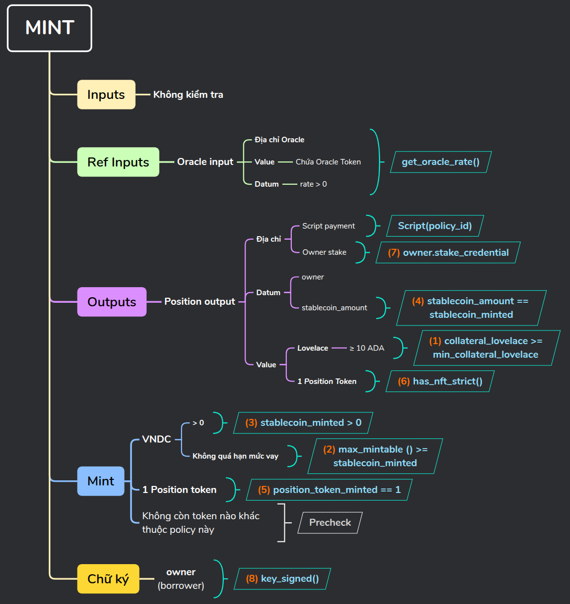

#### 2.4.2. Phân tích Chi tiết Logic Nghiệp vụ & Mã nguồn

Handler `mint` của validator chịu trách nhiệm quản lý toàn bộ vòng đời phát hành và thu hồi token nợ VNDC lẫn PositionToken. Với tính năng hiện tại của dApp, hai token này luôn được đúc hoặc đốt cùng nhau khi khởi tạo hay đóng một vị thế. Trước khi phân nhánh kiểm tra hành động, handler thiết lập bước tiền kiểm tra (precheck):

```rust
// Trích từ onchain/validators/stablecoin.ak (Precheck chung của mint handler):
mint(action: Action, policy_id: ByteArray, transaction: Transaction) {
  let
    Transaction {
      inputs,
      reference_inputs,
      outputs,
      extra_signatories,
      mint,
      ..
    } = transaction

  // Dưới policy_id này, giao dịch chỉ được phép mint/burn đúng 2 loại token ("VNDC" và "PositionToken")
  expect dict.size(assets.tokens(mint, policy_id)) == 2

  when action is { ... }
}
```

Tại đây, validator đảm bảo rằng ngoài 2 loại token này, giao dịch không thể mint/burn bất kỳ loại token nào khác dưới `policy_id` của nó.

---

Sau đó, validator phân nhánh theo redeemer `action`. Với hành động `Mint`, logic được triển khai như sau:

Trước tiên, handler trích xuất số lượng VNDC và PositionToken được đúc, đồng thời gọi hàm trợ giúp `get_oracle_rate` để quét danh sách `reference_inputs`, tìm đúng UTxO chứa Oracle NFT tại Enterprise Address của Oracle Script và trích xuất tỷ giá VND/ADA hiện thời:

```rust
// Trích từ onchain/validators/stablecoin.ak (nhánh Mint):
// Lấy số lượng token stablecoin được mint trong giao dịch này
let stablecoin_minted =
  assets.quantity_of(mint, policy_id, stablecoin_token_name)

// Lấy số lượng PositionToken được mint trong giao dịch này
let position_token_minted =
  assets.quantity_of(mint, policy_id, position_token_name)

// Đọc tỷ giá hiện tại từ Oracle
let current_rate =
  get_oracle_rate(
    reference_inputs,
    oracle_script_hash,
    oracle_token_name,
  )
```

**Bên trong hàm trợ giúp `get_oracle_rate`:**
Để quét `reference_inputs`, hợp đồng tận dụng hàm tiện ích `inputs_at_with` từ thư viện `cocktail/vodka_inputs`. Hàm này đồng thời lọc các UTxO thỏa mãn cả 3 điều kiện: thuộc địa chỉ chỉ định, mang đúng Policy ID và đúng Asset Name với số lượng bằng 1:

```rust
// Trích từ onchain/validators/stablecoin.ak:
fn get_oracle_rate(
  reference_inputs: List<Input>,
  oracle_script_hash: ByteArray,
  oracle_token_name: ByteArray,
) -> Int {
  expect [oracle_input] =
    inputs_at_with(
      reference_inputs,
      from_script(oracle_script_hash),
      oracle_script_hash,
      oracle_token_name,
    )

  expect InlineDatum(raw_datum) = oracle_input.output.datum
  expect OracleDatum { rate } = raw_datum
  expect rate > 0
  rate
}
```

Sau đó `rate` được trích xuất từ datum, để cho chắc chắn hàm kiểm tra nó phải mang giá trị dương trước khi trả về.

Tiếp theo, với thành phần `outputs`, hợp đồng cần kiểm soát UTxO vị thế trên cả 3 yếu tố: **địa chỉ**, **datum** và **value**.

Điểm mấu chốt tạo nên tính năng bảo toàn quyền staking nằm ở cách kiểm tra địa chỉ. Thay vì so sánh trực tiếp toàn bộ địa chỉ Enterprise thuần (`ScriptCredential`) như thông thường, validator chỉ lọc thành phần `payment_credential`:

```rust
// Trích từ onchain/validators/stablecoin.ak:
// Phải có đúng 1 Output gửi về script (Position UTxO)
// Chỉ lọc thành phần payment_credential thay vì full address
expect [position_output] = list.filter(
  outputs,
  fn(o) { o.address.payment_credential == Script(policy_id) },
)
```

> [!NOTE] Cơ chế Phòng vệ Theo Chiều sâu (Defense-in-Depth) với Stake Credential
> Khi chỉ lọc theo `payment_credential`, về mặt kỹ thuật hợp đồng hoàn toàn có thể không cần khống chế thành phần stake để tạo sự linh hoạt tuyệt đối (người dùng có thể ghép bất cứ stake key nào họ muốn hoặc không ghép stake). Tuy nhiên, ở điều kiện `(7)` trong khối `and`, hợp đồng vẫn chủ động so khớp:
> `(position_output.address.stake_credential == owner.stake_credential)?`
> Đây là một lớp phòng vệ theo chiều sâu (Defense-in-Depth) cực kỳ quan trọng, đề phòng trường hợp tầng off-chain hoặc phần mềm ví của người dùng bị can thiệp/tấn công và âm thầm ghép vào một địa chỉ stake lạ của hacker nhằm chiếm đoạt toàn bộ phần thưởng staking tích lũy từ lượng ADA thế chấp.

Ngay sau đó, hợp đồng bóc tách `PositionDatum` từ UTxO vị thế này để trích xuất địa chỉ `owner`, số nợ `stablecoin_amount` và lượng ADA thế chấp `collateral_lovelace`. Số nợ `stablecoin_amount` trong datum bắt buộc phải khớp tuyệt đối với số lượng VNDC mint thực tế (`(4)`):

```rust
// Trích từ onchain/validators/stablecoin.ak:
// Đọc PositionDatum từ Output đó
expect InlineDatum(raw_datum) = position_output.datum
expect PositionDatum { owner, stablecoin_amount } = raw_datum

// Khoản thế chấp khóa trong hợp đồng
let collateral_lovelace = lovelace_of(position_output.value)

// Lấy số lượng token VNDC được mint trong giao dịch này
let stablecoin_minted = assets.quantity_of(
  mint,
  policy_id,
  stablecoin_token_name,
)

// Lấy số lượng PositionToken được mint trong giao dịch này
let position_token_minted = assets.quantity_of(
  mint,
  policy_id,
  position_token_name,
)
```

Về giá trị tài sản trong output (`position_output.value`), hợp đồng bắt buộc vị thế phải chứa đúng 1 `PositionToken` định danh và lượng ADA thế chấp không dưới 10 ADA (`min_collateral_lovelace`).

> [!TIP] Bản chất Độc bản Cục bộ của PositionToken với `has_nft_strict`
> Mặc dù trên phạm vi toàn mạng Cardano, `PositionToken` là một token có thể thay thế (Fungible Token) vì mỗi khi người vay mở vị thế mới hệ thống lại đúc thêm 1 token, nhưng **trong phạm vi cục bộ của riêng một Script Output này**, việc sử dụng hàm `has_nft_strict(position_output.value, policy_id, position_token_name)` là hoàn toàn chính xác. Hàm này vừa xác nhận UTxO chứa đúng duy nhất 1 `PositionToken`, vừa bảo đảm UTxO hoàn toàn "sạch" (chỉ gồm Lovelace và 1 token định danh, không bị kẻ xấu pha trộn token rác nhằm gây tắc nghẽn giao dịch).

Cuối cùng, nhánh `Mint` kết thúc bằng khối điều kiện `and { ... }` kết hợp chặt chẽ toàn bộ **8 tiêu chí an toàn cốt lõi**, đánh số thứ tự từ `(1)` đến `(8)` khớp 1-1 với sơ đồ Checklist:

```rust
// Trích từ onchain/validators/stablecoin.ak:
and {
  // (1) Lượng collateral phải tối thiểu là 10 ADA
  (collateral_lovelace >= min_collateral_lovelace)?,
  // (2) Không mint quá hạn mức vay tối đa
  (max_mintable(collateral_lovelace, current_rate) >= stablecoin_minted)?,
  // (3) Số lượng stablecoin phải dương
  (stablecoin_minted > 0)?,
  // (4) stablecoin_amount ghi chép trong datum phải khớp với lượng mint thực tế
  (stablecoin_amount == stablecoin_minted)?,
  // (5) Mint đúng 1 PositionToken
  (position_token_minted == 1)?,
  // (6) Output sạch và chứa đúng 1 PositionToken
  has_nft_strict(position_output.value, policy_id, position_token_name)?,
  // (7) Thành phần stake của địa chỉ Output là stake của owner -> Bảo toàn quyền stake cho owner
  (position_output.address.stake_credential == owner.stake_credential)?,
  // (8) Chủ vị thế phải ký giao dịch
  key_signed(extra_signatories, address_payment_key(owner))?,
}
```

---

### 2.5. Triển khai Spend Handler

Sau khi người vay mở vị thế (`Mint`), số lượng ADA thế chấp được khóa an toàn bên trong Script UTxO kèm 1 `PositionToken`. Trước khi xem tiếp khối kiểm tra chính của 2 hành động còn lại trong `mint` handler, chúng ta chuyển qua xem `spend` handler, nó được thiết lập như bước tiền kiểm tra chung của 2 hành động còn lại này.

Tại đây, handler trích xuất `stablecoin_amount` từ Datum, tìm UTxO đang được chi tiêu (`own_input`) qua `own_ref` và kiểm tra UTxO này chứa đúng 1 PositionToken:

```rust
// Trích từ onchain/validators/stablecoin.ak:
spend(
  input_datum: Option<PositionDatum>,
  _redeemer: Data,
  own_ref: OutputReference,
  transaction: Transaction,
) {
  expect Some(datum) = input_datum
  let PositionDatum { stablecoin_amount, .. } = datum
  expect stablecoin_amount > 0
  let Transaction { inputs, mint, .. } = transaction

  expect Some(own_input) = find_input(inputs, own_ref)
  expect Script(own_policy_id) = own_input.output.address.payment_credential

  let input_has_position_token = assets.quantity_of(
    own_input.output.value,
    own_policy_id,
    position_token_name,
  ) == 1
```

Cuối cùng, nó kiểm tra giao dịch có đốt đúng số lượng VNDC nợ (`stablecoin_burn_qty == -stablecoin_amount`) và đúng 1 PositionToken (`position_burn_qty == -1`) hay không:

```rust
// Trích từ onchain/validators/stablecoin.ak:
  let stablecoin_burn_qty = assets.quantity_of(
    mint,
    own_policy_id,
    stablecoin_token_name,
  )
  let position_burn_qty = assets.quantity_of(
    mint,
    own_policy_id,
    position_token_name,
  )

  and {
    input_has_position_token?,
    (stablecoin_burn_qty == -stablecoin_amount)?,
    (position_burn_qty == -1)?,
  }
}
```

> [!NOTE]
> Việc xác minh cặp token được đốt giúp `spend` handler chắc chắn rằng 1 trong 2 nhánh `Burn` hoặc `Liquidate` ở `mint` handler sẽ được kích hoạt và yên tâm giao việc kiểm tra các nghiệp vụ riêng còn lại cho từng nhánh này.

---

### 2.6. Phân tích Hành động BURN (Checklist & Mindmap)

Hành động `Burn` cho phép chủ vị thế chủ động thanh toán toàn bộ khoản nợ VNDC để giải chấp và nhận lại toàn bộ tài sản thế chấp ADA của mình.

#### 2.6.1. Sơ đồ Mindmap Checklist BURN

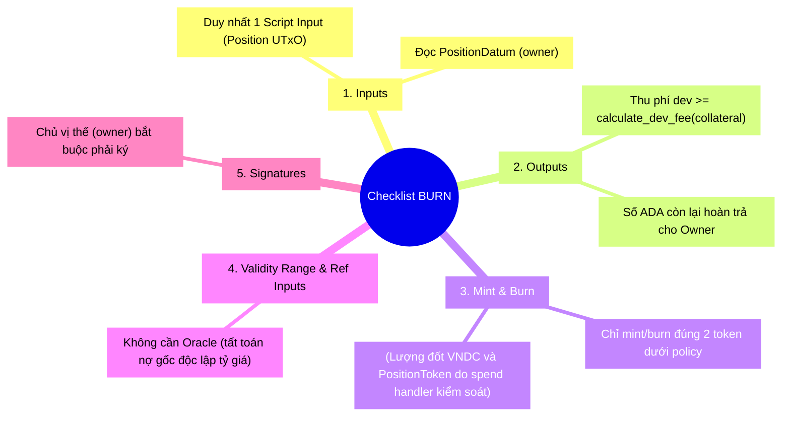

#### 2.6.2. Phân tích Chi tiết Logic Nghiệp vụ & Mã nguồn

Khi chủ vị thế tất toán nợ để thu hồi ADA, hợp đồng lọc danh sách `inputs` để đảm bảo giao dịch tiêu thị duy nhất 1 UTxO từ Script. Từ đó nó chắc chắn `spend` handler cũng được kích hoạt. Từ đó có thể bỏ qua các kiểm tra đã thực hiện ở `spend`. Tiếp theo, trích xuất địa chỉ `owner` và tính phí dev:

```rust
// Trích từ onchain/validators/stablecoin.ak:
Burn -> {
  // Phải có đúng 1 Input từ địa chỉ script (Position UTxO được giải phóng)
  expect [position_input] =
    list.filter(
      inputs,
      fn(i) { i.output.address.payment_credential == Script(policy_id) },
    )

  // Đọc datum từ Position Input
  expect InlineDatum(raw_datum) = position_input.output.datum
  expect PositionDatum { owner, .. } = raw_datum

  let collateral_lovelace = lovelace_of(position_input.output.value)
  let dev_fee = calculate_dev_fee(collateral_lovelace)

  // Kiểm tra phí dev
  let dev_paid = paid_enough(outputs, dev_address, dev_fee)
```

**Hàm trợ giúp `paid_enough`:**  
Hàm này dùng `list.foldl` duyệt toàn bộ danh sách `outputs` để tính tổng Lovelace gửi tới `recipient` và kiểm tra xem lượng Lovelace đó có đảm bảo `min_amount` hay không. Nó tự động trả về `True` ngay từ đầu nếu `min_amount <= 0` (không đòi hỏi thanh toán):

```rust
// Trích từ onchain/validators/stablecoin.ak:
fn paid_enough(
  outputs: List<Output>,
  recipient: Address,
  min_amount: Int,
) -> Bool {
  if min_amount <= 0 {
    True
  } else {
    let total =
      list.foldl(
        outputs,
        0,
        fn(output, total) {
          if output.address == recipient {
            total + lovelace_of(output.value)
          } else {
            total
          }
        },
      )
    total >= min_amount
  }
}
```

Cuối cùng, khối `and { ... }` ràng buộc chữ ký của `owner` và kiểm tra phí dev đã được chuyển khoản đầy đủ (việc đốt nợ và đốt PositionToken đã được `spend` handler đảm bảo):

```rust
// Trích từ onchain/validators/stablecoin.ak:
  and {
    // Chủ vị thế phải ký 
    key_signed(extra_signatories, address_payment_key(owner))?,
    // Phí dev phải được trả
    dev_paid?,
  }
}
```

---

### 2.7. Phân tích Hành động LIQUIDATE (Checklist & Mindmap)

Hành động `Liquidate` cho phép bất kỳ ai (Liquidator) thanh toán khoản nợ VNDC thay cho một vị thế bị thủng ngưỡng an toàn ($CR < 150\%$) để nhận phần thưởng khuyến khích bằng ADA thế chấp.

#### 2.7.1. Sơ đồ Mindmap Checklist LIQUIDATE

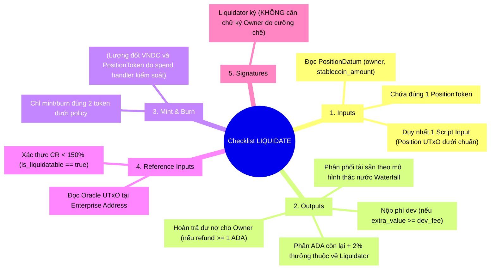

#### 2.7.2. Phân tích Chi tiết Logic Nghiệp vụ & Mã nguồn

Tương tự như `Burn`, hành động `Liquidate` cũng cần đảm bảo giao dịch tiêu thị đúng một UTxO từ Script để chắc chắn `spend` handler cũng được kích hoạt.
Điểm khác biệt là nó cần đọc tỷ giá mới nhất từ Oracle để xác nhận tình trạng vị thế và tính toán phân phối ADA:

```rust
// Trích từ onchain/validators/stablecoin.ak:
Liquidate -> {
  // Đọc tỷ giá hiện tại từ Oracle
  let current_rate =
    get_oracle_rate(
      reference_inputs,
      oracle_script_hash,
      oracle_token_name,
    )

  // Phải có đúng 1 Input từ script (vị thế bị thanh lý)
  expect [position_input] =
    list.filter(
      inputs,
      fn(i) { i.output.address.payment_credential == Script(policy_id) },
    )

  expect InlineDatum(raw_datum) = position_input.output.datum
  expect PositionDatum { owner, stablecoin_amount } = raw_datum

  let collateral_lovelace = lovelace_of(position_input.output.value)
```

Kiểm tra điều kiện kích hoạt thanh lý: sức vay tối đa hiện tại của khoản thế chấp phải nhỏ hơn khoản nợ thực tế:

$$\text{max\_mintable}(\text{collateral}, \text{current\_rate}) < \text{stablecoin\_amount} \iff CR < 150\%$$

```rust
// Trích từ onchain/validators/stablecoin.ak:
  let is_liquidatable = max_mintable(
    collateral_lovelace,
    current_rate,
  ) < stablecoin_amount
```

Hợp đồng gọi `calculate_liquidation_distribution` để tính toán phần phí dev (`dev_fee`) và tiền dôi dư hoàn trả (`owner_refund`), sau đó kiểm tra các bên liên quan có nhận đủ số Lovelace tương ứng hay không thông qua biến `all_paid`:

```rust
// Trích từ onchain/validators/stablecoin.ak:
  let (dev_fee, owner_refund) = calculate_liquidation_distribution(
    collateral_lovelace,
    stablecoin_amount,
    current_rate,
  )

  // Kiểm tra các Output phân phối đủ ADA
  let all_paid =
    if dev_address == owner {
      paid_enough(outputs, dev_address, dev_fee + owner_refund)
    } else {
      paid_enough(outputs, dev_address, dev_fee) && paid_enough(
        outputs,
        owner,
        owner_refund,
      )
    }
```

> [!WARNING] Phòng chống Lỗ hổng Double Satisfaction Attack
> Việc rẽ nhánh khi `dev_address == owner` là một biện pháp kỹ thuật kinh điển trên mô hình eUTxO nhằm ngăn chặn triệt để lỗ hổng **Double Satisfaction**.
> 
> Nếu hợp đồng kiểm tra riêng rẽ hai lần `paid_enough(outputs, dev_address, dev_fee) && paid_enough(outputs, owner, owner_refund)` trong trường hợp `dev_address` và `owner` vô tình trùng một địa chỉ ví: Kẻ thanh lý gian lận (Liquidator) chỉ cần tạo **duy nhất 1 output** gửi về địa chỉ này với số tiền bằng $\max(\text{dev\_fee}, \text{owner\_refund})$. Khi đó, cả hai hàm `paid_enough` độc lập đều cùng quét qua output đó và đều thỏa mãn trả về `True`! Kẻ thanh lý sẽ chiếm đoạt trọn vẹn khoản tiền còn lại thay vì phải thanh toán đầy đủ cả hai nghĩa vụ tài chính.
> 
> Bằng cách gom lại thành một lần kiểm tra duy nhất trên tổng số tiền:
> `paid_enough(outputs, dev_address, dev_fee + owner_refund)`
> hợp đồng bắt buộc tổng số Lovelace thực nhận tại địa chỉ đó phải đạt tối thiểu bằng tổng giá trị của cả hai khoản, loại bỏ hoàn toàn khả năng bị khai thác lỗ hổng Double Satisfaction.

Cuối cùng, khối `and { ... }` xác nhận vị thế thực sự rơi vào diện thanh lý và các output phân chia tài sản chuẩn xác:

```rust
// Trích từ onchain/validators/stablecoin.ak:
  and {
    is_liquidatable?,
    all_paid?,
  }
}
```

---

## 3. On-chain Unit Testing

Mã nguồn hợp đồng của chúng ta được kiểm thử toàn diện với **77 kịch bản kiểm thử** bao gồm cả Unit Testing (68 kịch bản) và Property-Based Testing (9 kịch bản với `aiken/fuzz`) được đặt trong thư mục `onchain/validators/tests/`.

### 3.1. Danh mục Kiểm thử Oracle Contract (28 Kịch bản)

Tệp kiểm thử: `onchain/validators/tests/oracle.test.ak` (24 Unit Tests) và `tests/oracle_property.test.ak` (4 Property Tests).

#### A. Spend Handler (12 tests)
Quản lý việc tiêu thụ Oracle UTxO để cập nhật tỷ giá mới hoặc giải phóng/đóng Oracle.

| STT | Tên hàm kiểm thử | Phân loại | Quy tắc nghiệp vụ & Bẫy bảo mật kiểm chứng |
| :---: | :--- | :---: | :--- |
| 1 | `oracle_update_succeeds_for_signed_operator` | Positive Case | Cập nhật tỷ giá hợp lệ khi Operator ký giao dịch, tỷ giá mới $R_{new} > 0$ và khác tỷ giá hiện tại. |
| 2 | `oracle_update_fails_without_operator_signature` | Negative Case | Từ chối cập nhật khi thiếu chữ ký của Operator (`key_signed`). |
| 3 | `oracle_update_fails_for_non_positive_rate` | Negative Case | Từ chối cập nhật khi tỷ giá mới $\le 0$ (`new_rate > 0`). |
| 4 | `oracle_update_fails_when_rate_unchanged` | Negative Case | Chống spam giao dịch rác: Từ chối cập nhật vô nghĩa khi tỷ giá mới trùng với tỷ giá cũ (`new_rate != current_rate`). |
| 5 | `oracle_update_fails_when_output_not_clean` | Negative Case | Chống tấn công bụi (Dust attack): Từ chối khi continuing output chứa thêm token lạ vi phạm `has_nft_strict`. |
| 6 | `oracle_spend_fails_when_own_input_missing` | Negative Case | Từ chối khi giao dịch không tìm thấy chính Oracle UTxO đầu vào (`find_input`). |
| 7 | `oracle_spend_fails_when_input_lacks_oracle_nft` | Negative Case | Chặn tiêu thụ UTxO giả mạo không chứa đúng Oracle NFT (`has_nft_strict`). |
| 8 | `oracle_update_fails_when_multiple_continuing_outputs` | Negative Case | Chống phân bản (Cloning attack): Từ chối khi kẻ tấn công cố tình tạo nhiều hơn 1 Oracle continuing output. |
| 9 | `oracle_update_fails_when_continuing_output_missing_datum` | Negative Case | Từ chối khi continuing output thiếu Inline Datum hoặc sai cấu trúc `OracleDatum`. |
| 10 | `oracle_delete_succeeds_for_signed_operator` | Positive Case | Đóng và tiêu thụ Oracle UTxO thành công khi Operator ký và đồng thời đốt Oracle NFT. |
| 11 | `oracle_delete_fails_without_burning_nft` | Negative Case | Chống tẩu tán NFT: Từ chối đóng Oracle trong `spend` nếu không đốt Oracle NFT (`quantity == -1`). |
| 12 | `oracle_delete_fails_without_operator_signature` | Negative Case | Từ chối đóng Oracle trong `spend` nếu thiếu chữ ký Operator. |

#### B. Mint Handler (12 tests)
Quản lý vòng đời phát hành One-shot và tiêu hủy Oracle NFT.

| STT | Tên hàm kiểm thử | Phân loại | Quy tắc nghiệp vụ & Bẫy bảo mật kiểm chứng |
| :---: | :--- | :---: | :--- |
| 13 | `oracle_nft_mint_succeeds_once_with_bound_utxo` | Positive Case | Đúc đúng 1 Oracle NFT lần đầu (Init) thành công khi tiêu thụ One-shot UTxO tham chiếu. |
| 14 | `oracle_nft_mint_fails_without_consuming_bound_utxo` | Negative Case | Chống đúc lậu: Thất bại khi không tiêu thụ đúng One-shot UTxO được khóa trong tham số validator. |
| 15 | `oracle_nft_mint_fails_when_rate_non_positive` | Negative Case | Thất bại khi khởi tạo Oracle NFT với tỷ giá ban đầu $\le 0$. |
| 16 | `oracle_nft_mint_fails_without_operator_signature` | Negative Case | Thất bại khi đúc Oracle NFT mà thiếu chữ ký của Operator. |
| 17 | `oracle_nft_mint_fails_when_output_not_clean` | Negative Case | Thất bại khi output nhận Oracle NFT bị pha tạp tài sản hoặc token khác. |
| 18 | `oracle_nft_mint_fails_when_multiple_assets_minted` | Negative Case | Thất bại khi mint kèm thêm bất kỳ asset nào khác trong cùng Policy ID (`dict.to_pairs`). |
| 19 | `oracle_nft_mint_fails_when_wrong_token_name` | Negative Case | Thất bại khi đúc sai tên token (phải chuẩn xác `"OracleNFT"`). |
| 20 | `oracle_nft_mint_fails_when_multiple_script_outputs` | Negative Case | Thất bại khi tạo nhiều hơn 1 script output nhận NFT. |
| 21 | `oracle_nft_mint_fails_when_missing_inline_datum` | Negative Case | Thất bại khi script output nhận NFT thiếu Inline Datum. |
| 22 | `oracle_nft_burn_succeeds_for_signed_operator` | Positive Case | Đốt Oracle NFT (Delete) thành công khi Operator ký và số lượng đốt đúng bằng -1. |
| 23 | `oracle_nft_burn_fails_without_operator_signature` | Negative Case | Thất bại khi đốt Oracle NFT mà không có chữ ký Operator. |
| 24 | `oracle_nft_burn_fails_when_quantity_not_negative_one` | Negative Case | Thất bại khi số lượng đốt khác -1 (ví dụ cố tình đốt -2 token). |

#### C. Oracle Property-Based Tests (4 tests / 400 runs)
Chứng minh tính bất biến toán học với `aiken/fuzz`:

| STT | Tên hàm kiểm thử Fuzz | Phân loại | Tính chất bất biến được chứng minh (Invariant) |
| :---: | :--- | :---: | :--- |
| 25 | `prop_oracle_update_succeeds_for_any_positive_rate` | Property Case | Mọi giá trị tỷ giá ngẫu nhiên $R > 0$ ($R \ne R_{current}$) đều cập nhật thành công nếu có chữ ký Operator. |
| 26 | `prop_oracle_update_fails_for_non_positive_rate` | Property Case | Mọi giá trị tỷ giá ngẫu nhiên $R \le 0$ luôn bị từ chối cập nhật trên mọi lượt thử. |
| 27 | `prop_oracle_update_always_fails_without_signature` | Property Case | Mọi nỗ lực cập nhật không có chữ ký Operator đều thất bại dù dữ liệu tỷ giá hợp lệ. |
| 28 | `prop_oracle_nft_mint_succeeds_with_bound_utxo` | Property Case | Mọi tham số One-shot UTxO ngẫu nhiên đều khởi tạo NFT thành công khi UTxO đó được tiêu thụ thực tế. |

---

### 3.2. Danh mục Kiểm thử Stablecoin Contract (49 Kịch bản)

Tệp kiểm thử: `onchain/validators/tests/stablecoin.test.ak` (44 Unit Tests) và `tests/stablecoin_property.test.ak` (5 Property Tests).

#### a. Nhánh Mint của Mint Handler (19 tests)
Quản lý việc mở vị thế thế chấp CDP, khóa ADA và đúc đồng thời VNDC cùng PositionToken.

| STT | Tên hàm kiểm thử | Phân loại | Quy tắc nghiệp vụ & Bẫy bảo mật kiểm chứng |
| :---: | :--- | :---: | :--- |
| 1 | `mint_stablecoin_succeeds_when_collateralized` | Positive Case | Đúc VNDC thành công khi thế chấp đủ $\ge 150\%$ MCR và tài sản $\ge 10\text{ ADA}$. |
| 2 | `mint_stablecoin_fails_without_owner_signature` | Negative Case | Từ chối mở vị thế khi thiếu chữ ký người thế chấp (`address_payment_key(owner)`). |
| 3 | `mint_stablecoin_fails_when_over_collateral_limit` | Negative Case | Chống vỡ nợ: Từ chối khi cố đúc vượt quá hạn mức vay an toàn tối đa (`max_mintable`). |
| 4 | `mint_stablecoin_fails_when_below_min_collateral` | Negative Case | Chống tấn công bụi: Từ chối khi tài sản thế chấp $< 10\text{ ADA}$ ($< 10,000,000\text{ lovelace}$). |
| 5 | `mint_stablecoin_succeeds_with_matching_stake_credential` | Positive Case | Bảo toàn quyền Staking: Thành công khi Position Output giữ nguyên Stake Credential của Owner. |
| 6 | `mint_stablecoin_fails_when_stake_credential_mismatched` | Negative Case | Chống chiếm đoạt Staking: Từ chối khi Position Output bị đổi sang Stake Credential lạ. |
| 7 | `mint_stablecoin_fails_when_policy_has_only_one_token` | Negative Case | Chống gian lận đúc: Từ chối khi giao dịch chỉ đúc 1 token (thiếu PositionToken định danh). |
| 8 | `mint_stablecoin_fails_when_policy_has_extra_token` | Negative Case | Từ chối khi đúc kèm thêm token thứ 3 trong cùng Policy ID (`dict.size == 2`). |
| 9 | `mint_stablecoin_fails_when_mint_quantity_zero` | Negative Case | Từ chối khi số lượng VNDC đúc bằng 0 (`stablecoin_minted > 0`). |
| 10 | `mint_stablecoin_fails_when_oracle_ref_missing` | Negative Case | Từ chối khi giao dịch thiếu Reference Input chứa Oracle UTxO. |
| 11 | `mint_stablecoin_fails_when_multiple_oracle_ref_inputs` | Negative Case | Chống nhiễu loạn giá: Từ chối khi đưa vào nhiều hơn 1 Oracle Reference Input (`[oracle_input]`). |
| 12 | `mint_stablecoin_fails_when_oracle_rate_zero` | Negative Case | Chống Flash Crash: Từ chối khi tỷ giá Oracle đọc được bằng 0 hoặc số âm. |
| 13 | `mint_stablecoin_fails_when_multiple_position_outputs` | Negative Case | Chống phân bản vị thế: Từ chối khi tạo nhiều hơn 1 Position Output gửi về Script. |
| 14 | `mint_stablecoin_fails_when_position_output_missing_datum` | Negative Case | Từ chối khi Position Output thiếu Inline Datum. |
| 15 | `mint_stablecoin_fails_when_datum_amount_mismatched` | Negative Case | Bẫy Datum Lệch: Từ chối khi `stablecoin_amount` ghi trong Datum khác lượng VNDC đúc thực tế. |
| 16 | `mint_stablecoin_fails_when_position_token_quantity_invalid` | Negative Case | Chống nhân bản NFT vị thế: Từ chối khi đúc khác 1 PositionToken (ví dụ đúc 2). |
| 17 | `mint_stablecoin_fails_when_position_output_not_clean` | Negative Case | Chống kẹt UTxO: Từ chối khi Position Output bị pha lẫn token lạ (`has_nft_strict`). |
| 18 | `mint_stablecoin_fails_when_oracle_at_wrong_address` | Negative Case | Chống Oracle giả mạo: Từ chối khi Oracle UTxO nằm tại ví cá nhân thay vì địa chỉ Script. |
| 19 | `mint_stablecoin_fails_when_oracle_lacks_nft` | Negative Case | Từ chối khi Oracle UTxO tại Script nhưng thiếu Oracle NFT xác thực. |

#### b. Nhánh Burn của Mint Handler (5 tests)
Quản lý việc đóng vị thế trả nợ, giải chấp ADA và nộp phí giao thức.

| STT | Tên hàm kiểm thử | Phân loại | Quy tắc nghiệp vụ & Bẫy bảo mật kiểm chứng |
| :---: | :--- | :---: | :--- |
| 20 | `burn_stablecoin_succeeds_with_dev_fee_and_signature` | Positive Case | Đóng vị thế thành công khi Owner ký, đốt đủ VNDC + 1 PositionToken và nộp phí Dev $0.5\%$. |
| 21 | `burn_stablecoin_fails_without_owner_signature` | Negative Case | Bảo vệ tài sản: Từ chối khi không có chữ ký của chủ vị thế thế chấp. |
| 22 | `burn_stablecoin_fails_without_dev_fee` | Negative Case | Từ chối khi không nộp đủ phí duy trì giao thức $0.5\%$ (tối thiểu 1 ADA) cho `dev_address`. |
| 23 | `burn_stablecoin_fails_when_policy_has_extra_token` | Negative Case | Từ chối khi đính kèm thêm token lạ thứ 3 trong trường `mint` lúc Burn (`dict.size == 2`). |
| 24 | `burn_stablecoin_fails_when_multiple_script_inputs` | Negative Case | Chống gom vị thế gộp: Từ chối khi giao dịch chi tiêu cùng lúc nhiều Position UTxO. |

#### c. Nhánh Liquidate của Mint Handler (13 tests)
Quản lý việc thanh lý các vị thế suy thoái dưới ngưỡng an toàn $150\%$ và phân phối tài sản còn lại.

| STT | Tên hàm kiểm thử | Phân loại | Quy tắc nghiệp vụ & Bẫy bảo mật kiểm chứng |
| :---: | :--- | :---: | :--- |
| 25 | `liquidate_succeeds_when_cr_low` | Positive Case | Thanh lý thành công khi vị thế rơi vào vùng nguy hiểm $\text{CR} < 150\%$, nộp đủ phí Dev và hoàn tiền Owner. |
| 26 | `liquidate_fails_when_cr_safe` | Negative Case | Chống thanh lý trộm: Từ chối khi vị thế vẫn an toàn $\text{CR} \ge 150\%$. |
| 27 | `liquidate_fails_without_dev_fee` | Negative Case | Từ chối khi thanh lý nhưng quỵt phí Dev. |
| 28 | `liquidate_fails_without_owner_refund` | Negative Case | Chống nuốt chửng tài sản: Từ chối khi không hoàn trả phần dư $\ge 1\text{ ADA}$ cho chủ vị thế. |
| 29 | `liquidate_succeeds_without_dev_fee_when_extra_value_less_than_dev_fee` | Positive Case | Miễn phí Dev khi tài sản sau nợ quá mỏng ($< \text{dev\_fee}$), dồn trọn vẹn khuyến khích Liquidator. |
| 30 | `liquidate_fails_when_policy_has_extra_token` | Negative Case | Từ chối khi trường `mint` chứa token lạ thứ 3 trong lúc thanh lý (`dict.size == 2`). |
| 31 | `liquidate_succeeds_when_under_collateralized_debt_exceeds_collateral` | Positive Case | Xử lý nợ xấu sập sâu $\text{CR} \le 100\%$ (`debt >= collateral`), phân phối `(0, 0)` an toàn không nghẽn mạng. |
| 32 | `liquidate_succeeds_when_extra_value_equals_dev_fee` | Positive Case | Điểm biên chính xác `extra_value == dev_fee`, trả đúng 1 ADA cho dev và hoàn tiền owner = 0. |
| 33 | `liquidate_succeeds_when_refund_just_reaches_one_ada` | Positive Case | Ngay ngưỡng Min-UTxO: Sau thưởng còn đúng $1.0\text{ ADA}$, hoàn trả trọn vẹn cho Owner. |
| 34 | `liquidate_succeeds_when_refund_just_below_one_ada` | Positive Case | Cận dưới Min-UTxO: Sau thưởng còn $0.9999\text{ ADA} < 1\text{ ADA}$, tự động về 0 tránh tạo output rác lỗi Min-UTxO. |
| 35 | `liquidate_succeeds_when_dev_is_owner_with_combined_payment` | Positive Case | Khi `dev_address == owner`: Thanh toán gộp thành công `dev_fee + owner_refund` vào 1 output. |
| 36 | `liquidate_fails_when_dev_is_owner_without_combining_payment` | Negative Case | Chống **Double Satisfaction**: Bắt lỗi khi `dev == owner` nhưng chỉ trả $\max(\text{dev\_fee}, \text{owner\_refund})$. |
| 37 | `liquidate_fails_when_multiple_script_inputs` | Negative Case | Từ chối thanh lý gộp nhiều vị thế cùng lúc trong một giao dịch. |

#### d. Spend Handler (7 tests)
Phối hợp xác thực với Mint handler để đảm bảo số lượng token bị đốt khớp chính xác với nợ trong UTxO vị thế.

| STT | Tên hàm kiểm thử | Phân loại | Quy tắc nghiệp vụ & Bẫy bảo mật kiểm chứng |
| :---: | :--- | :---: | :--- |
| 38 | `spend_collateral_succeeds_with_matching_burn` | Positive Case | Giải phóng UTxO vị thế thành công khi lượng đốt VNDC khớp đúng `stablecoin_amount` và đốt đúng 1 PositionToken. |
| 39 | `spend_collateral_fails_when_datum_missing` | Negative Case | Từ chối chi tiêu nếu UTxO vị thế không có Datum. |
| 40 | `spend_collateral_fails_when_stablecoin_amount_zero` | Negative Case | Chống vị thế rỗng: Từ chối nếu nợ trong Datum $\le 0$. |
| 41 | `spend_collateral_fails_when_own_input_missing` | Negative Case | Từ chối khi không xác định được own UTxO đầu vào (`find_input`). |
| 42 | `spend_collateral_fails_when_position_token_not_burned` | Negative Case | Chống tẩu tán PositionToken: Từ chối nếu không đốt đúng -1 PositionToken. |
| 43 | `spend_collateral_fails_when_burn_amount_mismatched` | Negative Case | Chống đốt thiếu: Từ chối khi lượng VNDC đốt trong trường `mint` ít hơn số nợ ghi trong Datum. |
| 44 | `spend_collateral_fails_when_minting_stablecoin_instead_of_burning` | Negative Case | Chống gian lận chiều đúc/đốt: Từ chối khi gọi spend nhưng trường `mint` lại đúc thêm VNDC dương. |

#### e. Stablecoin Property-Based Tests (5 tests / 500 runs)
Kiểm thử đặc tính ngẫu nhiên với `aiken/fuzz` để bảo chứng tính bất biến của tỷ lệ MCR $150\%$:

| STT | Tên hàm kiểm thử Fuzz | Phân loại | Tính chất bất biến được chứng minh (Invariant) |
| :---: | :--- | :---: | :--- |
| 45 | `prop_mint_at_max_amount_always_succeeds` | Property Case | Mọi lượng thế chấp ngẫu nhiên $C \ge 10\text{ ADA}$ và tỷ giá $R > 0$, đúc đúng $M = \text{max\_mintable}(C, R)$ luôn luôn thành công. |
| 46 | `prop_mint_one_above_max_always_fails` | Property Case | Chỉ cần đúc vượt quá hạn mức từ 1 đơn vị đến hàng chục nghìn VNDC ngẫu nhiên ($M + \text{extra}$), giao dịch chắc chắn bị từ chối trên mọi dải giá trị. |
| 47 | `prop_burn_with_dev_fee_always_succeeds` | Property Case | Mọi vị thế ngẫu nhiên với số nợ bất kỳ từ $1\%$ đến $100\%$ hạn mức, khi hoàn trả đủ 100% nợ và nộp đúng phí Dev đều được giải phóng an toàn. |
| 48 | `prop_liquidate_succeeds_when_liquidatable` | Property Case | Bất cứ khi nào tỷ giá suy giảm khiến $\text{CR} < 150\%$, vị thế luôn có thể được thanh lý thành công. |
| 49 | `prop_liquidate_fails_when_safe` | Property Case | Khi tỷ lệ thế chấp vẫn an toàn $\text{CR} \ge 150\%$ với số nợ bất kỳ ($1\% \rightarrow 100\%$ hạn mức), không một ai có thể thanh lý vị thế của người dùng. |

---

### 3.3. Thực thi Kiểm thử & Đo lường Tài nguyên (Benchmarking)

Để thực thi toàn bộ 77 kịch bản kiểm thử, bạn mở terminal tại thư mục gốc của dự án và chạy lệnh:

```bash
cd onchain
aiken check
```

Kết quả thực thi mẫu:
```text
Summary 968 checks, 0 errors, 0 warnings
```
> [!NOTE]
> Con số **968 checks** phản ánh: 68 bài kiểm thử đơn vị Unit Test + 9 bài kiểm thử thuộc tính Fuzzing (mỗi bài chạy tự động 100 trường hợp ngẫu nhiên độc lập).

---

## 4. Bài tập Thực hành Mở rộng

Hiện tại, khi vị thế rơi vào trạng thái rủi ro (sát ngưỡng $150\%$), người dùng chỉ có lựa chọn là trả hết nợ để đóng vị thế. Hãy nâng cấp hợp đồng để bổ sung các tính năng dưới đây.

- ### Bài tập 1: Tính năng Nạp thêm Tài sản thế chấp (Top-up Collateral)
  Nâng cấp hợp đồng để cho phép chủ vị thế nạp thêm ADA vào Position UTxO để nâng cao tỉ lệ thế chấp (CR), giúp bảo vệ vị thế khỏi rủi ro bị thanh lý khi giá ADA biến động.

- ### Bài tập 2: Tính năng Trả nợ một phần (Partial Burn / Repay)
  Nâng cấp hợp đồng cho phép người dùng trả bớt một phần nợ VNDC và tùy chọn rút bớt một lượng ADA, với điều kiện lượng ADA còn lại trong UTxO tiếp nối vẫn thỏa mãn $\ge 10 \text{ ADA}$ và $\text{CR} \ge 150\%$ tính trên giá trị nợ còn lại (phí dev được tính trên lượng ADA rút ra).

- ### Bài tập 3: Tính năng Tất toán hàng loạt nhiều vị thế (Batch Burn)
  Nâng cấp hợp đồng để chủ sở hữu có thể đóng (Burn) nhiều vị thế thế chấp khác nhau của mình trong một giao dịch duy nhất, giúp tối ưu chi phí và thao tác quản lý (Phí dev tính theo tổng lượng thế chấp giải phóng).

---

Như vậy, chúng ta đã hoàn thành Bài 2 với việc xây dựng trọn vẹn hợp đồng thông minh Aiken. Trong Bài 3 tiếp theo, chúng ta sẽ bước ra thế giới ngoài chuỗi (Off-chain) để xây dựng giao dịch với MeshJS và tích hợp giao diện quản trị vị thế trên Next.js, trước khi đi sâu vào chuyên đề kiểm thử Off-chain ở Bài 4!

---

# Bài 3: Tích hợp Frontend & Off-chain và Trải nghiệm DApp

Ở Bài 2, chúng ta đã hoàn thiện hợp đồng thông minh on-chain. Trong bài này, chúng ta sẽ tìm hiểu cách kết nối hợp đồng với giao diện người dùng Next.js thông qua tầng Off-chain SDK (MeshJS), quản lý vòng đời giao dịch đầu-cuối cho cả Người dùng lẫn Quản trị viên (Admin), và thực hành mở rộng các tính năng mới cho hệ thống Stablecoin VNDC.

> ### Mục lục bài học
> 1. [Trải nghiệm dApp (Kịch bản Demo Thực tế)](#1-trải-nghiệm-dapp-kịch-bản-demo-thực-tế)
> 2. [Tương tác Frontend & Off-chain SDK](#2-tương-tác-frontend--off-chain-sdk)
>    - 2.1. [Các Component Giao diện (Next.js)](#21-các-component-giao-diện-nextjs)
>    - 2.2. [Cấu trúc Tầng SDK Ngoài Chuỗi (MeshJS)](#22-cấu-trúc-tầng-sdk-ngoài-chuỗi-meshjs)
>    - 2.3. [Chu trình Điều phối Giao dịch & Quản trị Tiến trình (`useTxSubmit`)](#23-chu-trình-điều-phối-giao-dịch--quản-trị-tiến-trình-usetxsubmit)
> 3. [Chi tiết Triển khai Mã nguồn (Frontend ↔ SDK)](#3-chi-tiết-triển-khai-mã-nguồn-frontend--sdk)
>    - 3.1. [Query Oracle: Đọc Tỷ giá ADA/VND Thời gian thực (`getOracleInfo`)](#31-query-oracle-đọc-tỷ-giá-adavnd-thời-gian-thực-getoracleinfo)
>    - 3.2. [MINT: Mở Vị thế Thế chấp & Đúc VNDC (`mintStablecoinTx`)](#32-mint-mở-vị-thế-thế-chấp--đúc-vndc-mintstablecointx)
>    - 3.3. [Query Position: Quét Vị thế qua State Thread Token (`getAllPositions`)](#33-query-position-quét-vị-thế-qua-state-thread-token-getallpositions)
>    - 3.4. [BURN: Đóng Vị thế & Giải chấp Collateral (`burnStablecoinTx`)](#34-burn-đóng-vị-thế--giải-chấp-collateral-burnstablecointx)
>    - 3.5. [LIQUIDATE: Thanh lý Vị thế Vi phạm An toàn (`liquidateTx`)](#35-liquidate-thanh-lý-vị-thế-vi-phạm-an-toàn-liquidatetx)
>    - 3.6. [Deploy Hệ thống (Admin - `deployTx`)](#36-deploy-hệ-thống-admin---deploytx)
>    - 3.7. [Cập nhật Oracle (Admin - `updateOracleTx`)](#37-cập-nhật-oracle-admin---updateoracletx)
>    - 3.8. [Xóa Oracle & Cơ chế Đóng Hệ thống Vĩnh viễn (Admin - `deleteOracleTx`)](#38-xóa-oracle--cơ-chế-đóng-hệ-thống-vĩnh-viễn-admin---deleteoracletx)
> 4. [Bài tập Thực hành Mở rộng](#4-bài-tập-thực-hành-mở-rộng)
> 5. [Tài liệu Tham khảo](#5-tài-liệu-tham-khảo)

---

## 1. Trải nghiệm dApp

Để có trải nghiệm trực quan nhất trước khi đi vào mổ xẻ mã nguồn, các bạn hãy tự mình khởi chạy và tương tác với dApp trên mạng Preprod theo hướng dẫn chi tiết tại [README.md](../../README.md). Toàn bộ chu trình thao tác thực tế cũng được ghi hình minh họa từng bước trong video bài giảng đi kèm.

---

## 2. Tương tác Frontend & Off-chain SDK

Để hoàn thiện dApp Stablecoin, hai thành phần còn lại - Frontend và Off-chain phối hợp nhịp nhàng theo sơ đồ tương tác dưới đây:

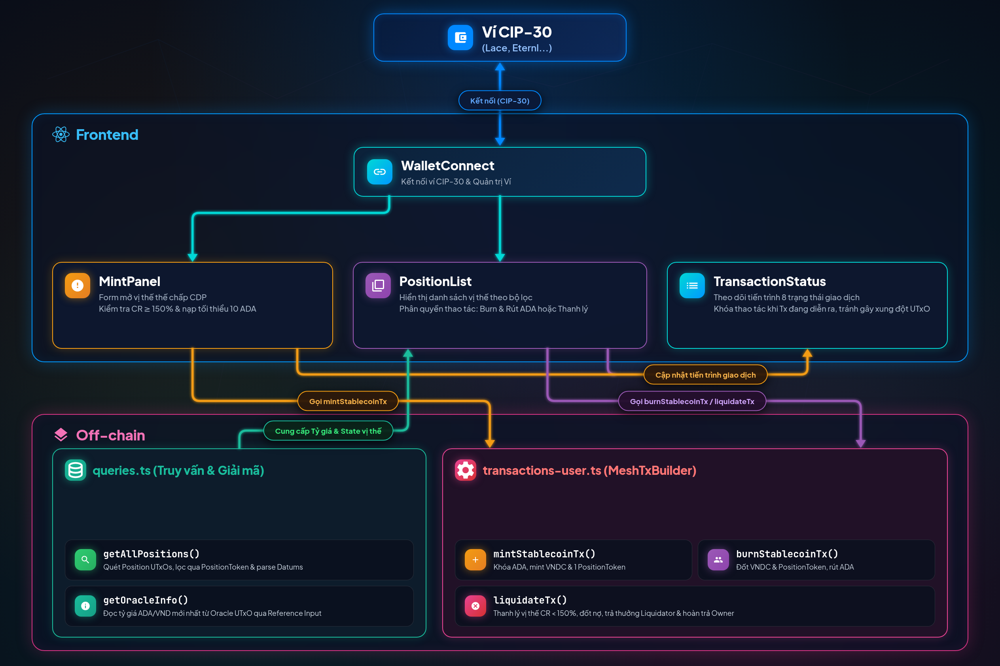

### 2.1. Các Component Giao diện (Next.js)

Giao diện dApp được module hóa thành các thành phần chuyên biệt:

1. **`WalletConnect.tsx`:** Quản lý kết nối ví CIP-30 (Lace, Eternl...), lưu trữ `wallet`, địa chỉ ví và danh sách mã băm Stake Key (`stakeKeyHashes`) vào React Context để nhận diện các vị thế thuộc sở hữu của tài khoản đang kết nối.
2. **`MintPanel.tsx`:** Thu thập số ADA muốn thế chấp và số VNDC muốn mint. Thực hiện tiền kiểm tra (client validation) tính tỉ lệ $\text{CR} \ge 150\%$ theo thời gian thực trước khi mở khóa nút bấm.
3. **`PositionList.tsx`:** Quản lý danh sách các vị thế với thanh công cụ bộ lọc (*Tất cả*, *Vị thế của bạn*, *Có thể thanh lý*). Component render các thẻ vị thế (`PositionCard`), hiển thị mức độ an toàn của tỷ lệ thế chấp (CR) trực quan bằng màu sắc và mở khóa nút thao tác tương ứng theo vai trò (Burn & Rút ADA hoặc Thanh lý).
4. **`TransactionStatus.tsx`:** Modal phản hồi tiến trình giao dịch, khóa thao tác khi Tx đang diễn ra (tránh gây xung đột UTxO) và chống mất trạng thái khi tải lại trang.

---

### 2.2. Tầng Xử lý Ngoài chuỗi (Off-chain SDK - MeshJS)

Lớp Off-chain đóng vai trò cầu nối nghiệp vụ giữa giao diện người dùng và hợp đồng thông minh on-chain, tập trung vào 2 nhóm module cốt lõi được thể hiện trên sơ đồ tương tác:

1. **`queries.ts` (Truy vấn Dữ liệu & Giải mã Datum):**
   - **`getOracleInfo()`:** Quét tìm UTxO mang `OracleNFT` tại địa chỉ Oracle và giải mã Datum để lấy tỷ giá ADA/VND mới nhất $\rightarrow$ Cung cấp dữ liệu tính toán tức thời cho cả `MintPanel` (tính hạn mức đúc tối đa) và `PositionList` (tính tỷ lệ thế chấp CR).
   - **`getAllPositions()`:** Quét toàn bộ các vị thế đang hoạt động trên blockchain thông qua State Thread Token (`PositionToken`), tự động loại trừ UTxO rác và giải mã `PositionDatum` $\rightarrow$ Cung cấp State danh sách vị thế và chỉ số an toàn cho `PositionList`.

2. **`transactions-user.ts` (Xây dựng Giao dịch với `MeshTxBuilder`):**
   - **`mintStablecoinTx()`:** Kích hoạt từ `MintPanel` khi người dùng mở vị thế. Hàm tạo địa chỉ Franken Address bảo toàn quyền staking, đúc số VNDC vay cùng đúng `1` token `PositionToken`, nạp Oracle vào Reference Input và khóa ADA cọc vào Script Output kèm `PositionDatum`.
   - **`burnStablecoinTx()`:** Kích hoạt từ nút **Burn** trong `PositionList` khi chủ vị thế muốn đóng vị thế. Hàm tiêu thụ Script UTxO, đốt đồng thời toàn bộ số nợ VNDC và `PositionToken`, khấu trừ 0.5% phí dev và giải chấp hoàn trả ADA về ví chủ sở hữu.
   - **`liquidateTx()`:** Kích hoạt từ nút **Thanh lý** trong `PositionList` khi một vị thế bị vi phạm an toàn ($\text{CR} < 150\%$). Hàm đọc tỷ giá Oracle mới nhất, đốt số VNDC nợ và `PositionToken`, giải phóng tài sản thế chấp theo mô hình dòng tiền thác đổ (thưởng 2% cho Liquidator, thu 0.5% dev fee và hoàn trả phần dư cho owner cũ).

---

### 2.3. Chu trình Điều phối Giao dịch & Quản trị Tiến trình (`useTxSubmit`)

Mọi giao dịch trong dApp đều tuân thủ chu trình 4 bước chuẩn mực thông qua custom hook `useTxSubmit.ts`:

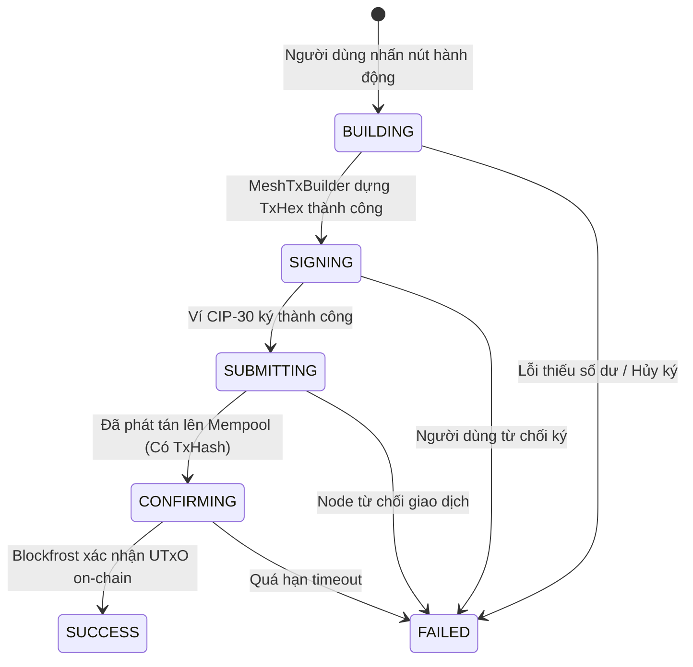

##### Giai đoạn 1: Dựng & Ký giao dịch
Chuyển trạng thái sang `building` để gọi hàm SDK dựng `unsignedTx`, sau đó mở popup ví Web3 để người dùng ký (`signing`):

```typescript
// Trích từ frontend/src/hooks/useTxSubmit.ts:
setTxStatus("building");
const txBuilder = new MeshTxBuilder({ fetcher: provider, evaluator: provider, submitter: provider });
const buildResult = await buildFn(txBuilder);
const unsignedTx = typeof buildResult === "string" ? buildResult : buildResult.unsignedTx;

setTxStatus("signing");
const signedTx = await wallet.signTx(unsignedTx);
```

##### Giai đoạn 2: Phát tán & Polling xác nhận
Gửi giao dịch đã ký lên node Cardano qua Provider (`submitting`), lưu `txHash` và kích hoạt hàm chờ xác nhận on-chain (`confirming`):

```typescript
// Trích từ frontend/src/hooks/useTxSubmit.ts:
setTxStatus("submitting");
const hash = await provider.submitTx(signedTx);
setTxHash(hash);
setTxStatus("confirming");

const isConfirmed = await waitForTxConfirmation(provider, hash);
if (isConfirmed) {
  setTxStatus("success");
}
```

#### Cơ chế Khóa Thao tác Khi Giao dịch Đang Diễn ra (Tránh Xung đột UTxO)
Khi một giao dịch đang được thực thi (`isLocked = isProcessing || isTxBusy`), toàn bộ các nút bấm tương tác trên UI đều bị vô hiệu hóa (`disabled`). Cơ chế này khóa thao tác khi Tx đang diễn ra, tránh gây xung đột UTxO (UTxO Contention) và ngăn người dùng click liên tiếp khi mạng đang xử lý.

---

## 3. Chi tiết Triển khai Mã nguồn (Frontend ↔ SDK)

Trong phần này, chúng ta sẽ đi sâu vào cấu trúc mã nguồn thực tế của từng hàm nghiệp vụ, theo đúng chu trình vận hành tự nhiên của dApp:

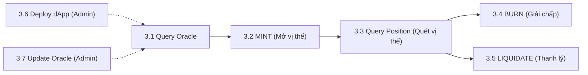

---

### 3.1. Query Oracle: Đọc Tỷ giá ADA/VND Thời gian thực (`getOracleInfo`)

Hàm `getOracleInfo` đảm nhận nhiệm vụ truy vấn trạng thái Oracle trực tiếp từ blockchain: tìm kiếm UTxO mang `OracleNFT` và giải mã Inline Datum để trích xuất tỷ giá ADA/VND thời gian thực. Dữ liệu này đóng vai trò nguồn cấp giá cốt lõi cho toàn bộ dApp: hiển thị tỷ giá thị trường trên thanh trạng thái, tính toán hạn mức vay tối đa cho `MintPanel`, đồng thời cung cấp tham số định giá để tính tỷ lệ an toàn $\text{CR}$ và lọc các vị thế rủi ro trong `PositionList`.

Logic truy vấn trong `getOracleInfo` được chia thành 2 bước:

#### Bước 1: Quét UTxO tại địa chỉ Oracle & Lọc theo Oracle NFT
Địa chỉ hợp đồng Oracle có thể chứa nhiều UTxO lịch sử, nhưng chỉ duy nhất UTxO mang đúng 1 token `OracleNFT` mới là nguồn cấp giá hợp lệ hiện tại. Ta tận dụng tham số `asset` có sẵn của `IFetcher.fetchAddressUTxOs(address, asset)` để Blockfrost lọc sẵn ở tầng API (`GET /addresses/{address}/utxos/{asset}`), tiết kiệm băng thông và trả thẳng về UTxO mang NFT:

```typescript
// Trích từ offchain/src/queries.ts:
const oracleNftUnit = oracleNftPolicyId + ORACLE_NFT_TOKEN_HEX;

// Tận dụng tham số asset của IFetcher để trả thẳng về UTxO chứa Oracle NFT
const utxos = await fetcher.fetchAddressUTxOs(oracleAddress, oracleNftUnit);
```

#### Bước 2: Kiểm tra tính độc nhất (đúng 1 UTxO), Giải mã Inline Datum & Cơ chế Retry
Do `OracleNFT` là token độc nhất (Unique NFT), kết quả trả về bắt buộc phải có đúng 1 phần tử. Hàm kiểm tra nghiêm ngặt tính toàn vẹn trạng thái này và giải mã tỷ giá:

```typescript
// Trích từ offchain/src/queries.ts:
if (utxos.length > 1) {
  throw new Error(`Trạng thái Oracle bất thường: phát hiện ${utxos.length} UTxO cùng chứa Oracle NFT`);
}

if (utxos.length === 1) {
  const oracleUtxo = utxos[0];
  if (!oracleUtxo.output.plutusData) throw new Error("Oracle UTxO không chứa Inline Datum");
  
  const datum = parseOracleDatum(oracleUtxo.output.plutusData);
  if (!datum || datum.rate <= 0n) throw new Error("Dữ liệu Datum Oracle không hợp lệ hoặc tỷ giá <= 0");

  return { utxo: oracleUtxo, rate: datum.rate };
}

// utxos.length === 0: Tự động thử lại nếu gặp độ trễ đồng bộ mạng lưới (replication lag)
if (attempt < maxRetries) {
  await new Promise((r) => setTimeout(r, initialDelayMs * attempt));
}
```

---

### 3.2. MINT: Mở Vị thế Thế chấp & Đúc VNDC (`mintStablecoinTx`)

Khi người dùng nhấn nút mở vị thế trên giao diện, hệ thống không dùng lại tỷ giá lưu tạm trong State React mà gọi trực tiếp `getOracleInfo` để truy vấn Oracle UTxO mới nhất từ mạng lưới (**Just-in-Time Oracle Fetching**). Kỹ thuật này giải quyết 2 bài toán sống còn:
- **Ngăn ngừa lỗi UTxO không hợp lệ:** Đảm bảo Reference Input (`CIP-31`) đưa vào giao dịch là UTxO Oracle đang tồn tại trên chuỗi (tránh bị tiêu thụ bởi giao dịch cập nhật giá vừa diễn ra).
- **Kiểm tra trước điều kiện an toàn (Pre-validation):** Tính toán lại hạn mức vay tối đa theo tỷ giá thời gian thực, ngăn chặn giao dịch thất bại gây lãng phí phí mạng nếu tỷ giá biến động khiến $\text{CR} < 150\%$:

```typescript
// Trích từ frontend/src/app/page.tsx (handleMint):
// 1. Just-in-Time Fetching: Truy vấn Oracle UTxO mới nhất ngay trước khi dựng giao dịch
const freshOracle = await getOracleInfo(provider, oracleConfig.ORACLE_ADDRESS, ORACLE_NFT_POLICY_ID);
if (!freshOracle) throw new Error("Không thể tìm thấy Oracle UTxO mới nhất trên mạng lưới.");

// 2. Pre-validation: Kiểm tra tức thời hạn mức vay tối đa theo tỷ giá thực tế
const maxMint = calcMaxMintable(collateralLovelace, freshOracle.rate);
if (mintAmountBigInt <= 0n || mintAmountBigInt > maxMint) {
  throw new Error(`Tỷ giá vừa cập nhật (${freshOracle.rate.toLocaleString()} VND/ADA). Tỉ lệ CR không đủ ${MCR_PERCENT}%.`);
}
```

Sau khi vượt qua bước tiền kiểm tra trên giao diện, hàm `mintStablecoinTx` sẽ xây dựng giao dịch mở vị thế CDP, các điểm đáng chú ý như sau:

#### Bảo toàn quyền Staking với Franken Address & Nạp Oracle Reference Input
Ghép Script Hash của hợp đồng với Stake Credential của chính ví người dùng để tạo địa chỉ Franken Address (`targetScriptAddress`). Sau đó, nạp Oracle UTxO mới nhất vào giao dịch dưới dạng Reference Input (`CIP-31`) để validator đọc tỷ giá mà không tiêu thụ UTxO của Oracle:

```typescript
// Trích từ offchain/src/transactions-user.ts:
const { pubKeyHash, stakeCredentialHash } = deserializeAddress(changeAddress);
const ownerAddressObj = mPubKeyAddress(pubKeyHash, stakeCredentialHash);

// Tạo địa chỉ Script kết hợp với Stake Credential của ví người dùng để nhận Staking Rewards
const targetScriptAddress = scriptHashToBech32(vndcPolicyId, stakeCredentialHash, NETWORK_ID);

txBuilder.readOnlyTxInReference(oracleUtxo.input.txHash, oracleUtxo.input.outputIndex);
```

#### Đúc đồng thời VNDC và đúng 1 PositionToken
Kích hoạt script `stablecoin.ak` qua Reference Script (`mintTxInReference`), đúc ra số VNDC người dùng vay và đúc đúng `1` token `PositionToken` với redeemer `Action::Mint` (Constructor 0):

```typescript
// Trích từ offchain/src/transactions-user.ts:
txBuilder
  .mintPlutusScriptV3()
  .mint(`${stablecoinAmount}`, vndcPolicyId, VNDC_NAME_HEX)
  .mintTxInReference(refTxHash, refIndex)
  .mintRedeemerValue(REDEEMER_MINT)
  .mintPlutusScriptV3()
  .mint("1", vndcPolicyId, POSITION_TOKEN_HEX)
  .mintTxInReference(refTxHash, refIndex)
  .mintRedeemerValue(REDEEMER_MINT);
```

#### Khóa Collateral ADA và PositionToken vào Script Output
Output gửi về địa chỉ Script bắt buộc phải chứa cả số ADA thế chấp và `PositionToken`, kèm theo `PositionDatum` (chứa Plutus Address của người vay và số nợ), đồng thời yêu cầu chữ ký của người vay:

```typescript
// Trích từ offchain/src/transactions-user.ts:
txBuilder
  .txOut(targetScriptAddress, [
    { unit: "lovelace", quantity: collateralLovelace.toString() },
    { unit: `${vndcPolicyId}${POSITION_TOKEN_HEX}`, quantity: "1" },
  ])
  .txOutInlineDatumValue(mConStr0([ownerAddressObj, stablecoinAmount]))
  .requiredSignerHash(pubKeyHash);
```

---

### 3.3. Query Position: Quét Vị thế qua State Thread Token (`getAllPositions`)

Trong dApp của chúng ta, mỗi vị thế thế chấp được khóa tại một địa chỉ Script riêng biệt. Do đó, hệ thống không thể quét theo địa chỉ script cố định như với Oracle UTxO, mà sử dụng `PositionToken`, quét theo định danh tài sản (`Asset Unit`) trên toàn blockchain.

Logic quét vị thế trong `getAllPositions` gồm 3 bước:

#### Bước 1: Quét toàn mạng chỉ với 1 HTTP Request (`GET /assets/.../utxos`)
Sử dụng endpoint chuyên dụng của Blockfrost để lấy toàn bộ UTxO đang chứa `PositionToken` trên toàn blockchain, gom đầy đủ tất cả các vị thế dù nằm ở bất kỳ Franken Address nào:

```typescript
// Trích từ offchain/src/queries.ts:
const positionTokenUnit = positionPolicyId + POSITION_TOKEN_HEX;
const res = await fetch(`${BASE_URL}/assets/${positionTokenUnit}/utxos?count=100`, {
  headers: { project_id: apiKey },
});
const rawUtxos = await res.json();
```

#### Bước 2: Ba kiểm tra nhanh loại trừ UTxO rác
Trước khi giải mã Datum tốn CPU, vòng lặp lọc bỏ ngay các UTxO không có inline datum, có số lượng token khác `1`, hoặc không thuộc Script Payment của hợp đồng:

```typescript
// Trích từ offchain/src/queries.ts:
const hasPositionToken = utxo.output.amount.some(
  (a) => a.unit === positionTokenUnit && a.quantity === "1"
);
const isScript = (() => {
  try {
    return deserializeAddress(utxo.output.address).scriptHash === positionPolicyId;
  } catch { return false; }
})();

if (!utxo.output.plutusData || !hasPositionToken || !isScript) continue;
```

#### Bước 3: Giải mã Datum, tính CR & Tối ưu hóa phân phối thanh lý
Giải mã `PositionDatum` để lấy địa chỉ chủ sở hữu và số nợ VNDC. Sau đó tính tỷ lệ thế chấp $\text{CR}$. Tính phân phối thanh lý nếu vị thế vi phạm ngưỡng an toàn (`isLiquidatable = true`). Việc tính toán phân phối ở đây chủ yếu phục vụ hiển thị trên giao diện (ước tính thưởng thanh lý và số tiền hoàn lại cho chủ vị thế); khi người dùng nhấn nút thanh lý thực tế, hệ thống sẽ tính toán lại theo tỷ giá Oracle tức thời:

```typescript
// Trích từ offchain/src/queries.ts:
const datum = parsePositionDatum(utxo.output.plutusData, NETWORK_ID);
const cr = calcCollateralRatio(collateralLovelace, datum.stablecoinAmount, oracleRate);
const isLiquidatable = oracleRate > 0n && cr < Number(MCR_PERCENT);

// Chỉ tính phân phối thanh lý khi vị thế vi phạm an toàn
const { debtLovelace, reward, ownerRefund } = isLiquidatable
  ? calcLiquidationDistribution(collateralLovelace, datum.stablecoinAmount, oracleRate)
  : { debtLovelace: 0n, reward: 0n, ownerRefund: 0n };
```

---

### 3.4. BURN: Đóng Vị thế & Giải chấp Collateral (`burnStablecoinTx`)

Khi chủ vị thế muốn trả hết nợ VNDC để thu hồi số ADA đã thế chấp, hàm `burnStablecoinTx` xây dựng giao dịch đóng vị thế với các phần sau:

#### Tiêu thụ Script UTxO
Tiêu thụ UTxO thế chấp đang khóa tại địa chỉ Script (`txIn`), khai báo Inline Datum có mặt, nạp Redeemer rỗng và liên kết Reference Script đã deploy:

```typescript
// Trích từ offchain/src/transactions-user.ts:
txBuilder
  .spendingPlutusScriptV3()
  .txIn(utxo.input.txHash, utxo.input.outputIndex, utxo.output.amount, utxo.output.address)
  .txInInlineDatumPresent()
  .txInRedeemerValue(EMPTY_REDEEMER)
  .spendingTxInReference(refTxHash, refIndex);
```

#### Đốt cặp token
Hợp đồng yêu cầu khi đóng vị thế phải đốt đồng thời cả hai token: đốt toàn bộ số VNDC nợ (`-stablecoinAmount`) và đốt đúng 1 State Thread Token `PositionToken` (`-1`). Cả hai thao tác minting âm đều sử dụng redeemer `Action::Burn`:

```typescript
// Trích từ offchain/src/transactions-user.ts:
txBuilder
  // Đốt nợ VNDC
  .mintPlutusScriptV3()
  .mint(`-${stablecoinAmount}`, vndcPolicyId, VNDC_NAME_HEX)
  .mintRedeemerValue(REDEEMER_BURN)
  .mintTxInReference(refTxHash, refIndex)
  // Đốt PositionToken
  .mintPlutusScriptV3()
  .mint("-1", vndcPolicyId, POSITION_TOKEN_HEX)
  .mintRedeemerValue(REDEEMER_BURN)
  .mintTxInReference(refTxHash, refIndex);
```

#### Output phí dev và phần còn lại
Trích nộp phí phát triển `devFee` ($0.5\%$ số ADA thế chấp, tối thiểu 1 ADA) gửi về `devAddress`, đồng thời bổ sung chữ ký bắt buộc của chủ vị thế (`requiredSignerHash`). Toàn bộ số ADA thế chấp còn lại tự động hoàn trả về ví người dùng thông qua cơ chế `changeAddress`:

```typescript
// Trích từ offchain/src/transactions-user.ts:
txBuilder
  .txOut(devAddress, [{ unit: "lovelace", quantity: devFee.toString() }])
  .requiredSignerHash(ownerPkh)
  .changeAddress(ownerAddress);
```

---

### 3.5. LIQUIDATE: Thanh lý Vị thế Vi phạm An toàn (`liquidateTx`)

Khi một vị thế có $\text{CR} < 150\%$, bất kỳ bên thứ ba nào (Liquidator) cũng có quyền thanh lý vị thế đó để bảo vệ tính thanh khoản cho hệ thống mà không cần chữ ký của chủ sở hữu vị thế.

Tương tự như Mint, thao tác thanh lý cũng tải lại dữ liệu Oracle mới nhất từ mạng lưới ngay trước khi dựng giao dịch để kiểm chứng chắc chắn vị thế đã rơi vào ngưỡng thanh lý theo tỷ giá mới nhất:

```typescript
// Trích từ frontend/src/app/page.tsx (handleLiquidate):
// 1. Just-in-Time Fetching: Lấy Oracle UTxO & tỷ giá mới nhất ngay trước khi thanh lý
const freshOracle = await getOracleInfo(provider, oracleConfig.ORACLE_ADDRESS, ORACLE_NFT_POLICY_ID);
if (!freshOracle) throw new Error("Không thể tìm thấy Oracle UTxO mới nhất trên mạng lưới.");

// 2. Pre-validation: Kiểm chứng lại điều kiện thanh lý (CR < 150%) theo tỷ giá mới nhất
const cr = calcCollateralRatio(position.collateralLovelace, position.stablecoinAmount, freshOracle.rate);
if (cr >= Number(MCR_PERCENT)) {
  throw new Error(`Tỷ giá vừa cập nhật (${freshOracle.rate.toLocaleString()} VND/ADA). Vị thế đã an toàn (CR = ${cr.toFixed(1)}%), không thể thanh lý!`);
}
```

Sau khi vượt qua bước kiểm tra tiền khả thi, hàm `liquidateTx` tiến hành xây dựng giao dịch thanh lý qua 3 công đoạn:

#### Nạp Reference Input & Chi tiêu Vị thế Vi phạm
Nạp Oracle UTxO vào Reference Input. Đồng thời chi tiêu UTxO vị thế vi phạm tại Script với Redeemer rỗng (`spend` handler không phân nhánh) và liên kết Reference Script đã deploy:

```typescript
// Trích từ offchain/src/transactions-user.ts:
txBuilder
  // Reference Input: Oracle UTxO nạp tỷ giá
  .readOnlyTxInReference(oracleInfo.utxo.input.txHash, oracleInfo.utxo.input.outputIndex)
  // Chi tiêu UTxO vị thế thế chấp tại địa chỉ Script
  .spendingPlutusScriptV3()
  .txIn(utxo.input.txHash, utxo.input.outputIndex, utxo.output.amount, utxo.output.address)
  .txInInlineDatumPresent()
  .txInRedeemerValue(EMPTY_REDEEMER)
  .spendingTxInReference(refTxHash, refIndex);
```

#### Đốt cặp token
Giao dịch kích hoạt script minting với redeemer `Action::Liquidate` để đốt toàn bộ số VNDC nợ (`-stablecoinAmount`) và đúng 1 `PositionToken` (`-1`) của vị thế bị thanh lý:

```typescript
// Trích từ offchain/src/transactions-user.ts:
txBuilder
  // Đốt toàn bộ VNDC nợ của vị thế
  .mintPlutusScriptV3()
  .mint(`-${stablecoinAmount}`, vndcPolicyId, VNDC_NAME_HEX)
  .mintRedeemerValue(REDEEMER_LIQUIDATE)
  .mintTxInReference(refTxHash, refIndex)
  // Đốt PositionToken
  .mintPlutusScriptV3()
  .mint("-1", vndcPolicyId, POSITION_TOKEN_HEX)
  .mintRedeemerValue(REDEEMER_LIQUIDATE)
  .mintTxInReference(refTxHash, refIndex);
```

#### Phân phối tài sản thanh lý
Hàm tính toán lại phân phối theo tỷ giá Oracle mới nhất (`calcLiquidationDistribution`). Trích nộp phí dev về `devAddress`, hoàn trả `ownerRefund` về ví chủ sở hữu cũ (nếu $\ge 1 \text{ ADA}$). Toàn bộ giá trị tài sản thu hồi và tiền thưởng thanh lý tự động kết chuyển về ví Liquidator qua cơ chế tiền thối (`changeAddress`):

```typescript
// Trích từ offchain/src/transactions-user.ts:
// 1. Phí Dev: nộp về devAddress (nếu devFee > 0; nếu được miễn thì dồn cho Liquidator)
if (devFee > 0n) {
  builder = builder.txOut(devAddress, [{ unit: "lovelace", quantity: devFee.toString() }]);
}

// 2. Hoàn lại cho Owner: gửi về ví chủ sở hữu cũ (nếu >= 1 ADA)
if (ownerRefund >= MIN_UTXO_LOVELACE) {
  builder = builder.txOut(ownerAddress, [{ unit: "lovelace", quantity: ownerRefund.toString() }]);
}

// 3. Thưởng Liquidator & thu hồi nợ: gom về ví Liquidator qua change address
builder.changeAddress(changeAddress);
```

---

### 3.6. Deploy Hệ thống (Admin - `deployTx`)

Trước khi dApp đi vào hoạt động, Quản trị viên (Operator) kích hoạt hàm `deployTx` để thiết lập toàn bộ hạ tầng trong cùng một giao dịch duy nhất:

#### Bước 1: Tiêu thụ UTxO tham số & Mint Oracle NFT One-shot
Chọn một UTxO cụ thể trong ví làm tham số áp vào script Oracle. Việc tiêu thụ UTxO này đảm bảo `OracleNFT` chỉ có thể được đúc duy nhất một lần (One-shot Minting Policy):

```typescript
// Trích từ offchain/src/transactions-admin.ts:
txBuilder
  .txIn(paramTxHash, paramTxIndex, paramUtxo.output.amount, paramUtxo.output.address)
  .mintPlutusScriptV3()
  .mint("1", oracleNftPolicyId, oracleNftTokenNameHex)
  .mintingScript(oracleCbor)
  .mintRedeemerValue(REDEEMER_ORACLE_INIT)
  .requiredSignerHash(pubKeyHash);
```

#### Bước 2: Khởi tạo Oracle UTxO mang Datum tỷ giá ban đầu
Khóa `OracleNFT` tại địa chỉ hợp đồng Oracle kèm Inline Datum chứa tỷ giá ADA/VND khởi điểm (ví dụ: $1 \text{ ADA} = 20.000 \text{ VND}$):

```typescript
// Trích từ offchain/src/transactions-admin.ts:
txBuilder
  .txOut(oracleAddress, [
    { unit: "lovelace", quantity: "2000000" },
    { unit: oracleNftUnit, quantity: "1" },
  ])
  .txOutInlineDatumValue(mConStr0([initialRate]));
```

#### Bước 3: Triển khai 2 Reference Script UTxOs tại địa chỉ Always-fail
Để đảm bảo 2 Reference Script tồn tại bất biến trên mạng lưới và không một ai (kể cả Admin) có thể rút trộm hoặc tiêu hủy làm hỏng dApp, hệ thống khóa chúng tại địa chỉ **Always-fail**. Địa chỉ này được khởi tạo cực kỳ nhanh gọn bằng Native Script với ràng buộc thời gian hợp lệ trước `slot 0` (`{ type: "before", slot: "0" }`) — một điều kiện vĩnh viễn không bao giờ thỏa mãn:

```typescript
// Trích từ offchain/src/transactions-admin.ts:
// Native Script "before slot 0" -> không bao giờ thỏa mãn -> UTxO bị khóa vĩnh viễn
function getAlwaysFailAddress(networkId: number): string {
  return resolveNativeScriptAddress(
    { type: "before", slot: "0" },
    networkId
  );
}
```

Sau khi tạo địa chỉ `burnAddr`, giao dịch gửi mã CBOR của 2 validator lên blockchain và gắn vào các output dưới dạng Reference Script. Nhờ đó, các giao dịch Mint/Burn/Liquidate của người dùng sau này chỉ cần tham chiếu qua `txHash#index`, giúp giảm đáng kể kích thước giao dịch.

```typescript
// Trích từ offchain/src/transactions-admin.ts:
const burnAddr = getAlwaysFailAddress(NETWORK_ID);

txBuilder
  .txOut(burnAddr, [{ unit: "lovelace", quantity: oracleRefMinAda.toString() }])
  .txOutReferenceScript(oracleCbor, "V3")
  .txOut(burnAddr, [{ unit: "lovelace", quantity: stablecoinRefMinAda.toString() }])
  .txOutReferenceScript(stablecoinCbor, "V3");
```

---

### 3.7. Cập nhật Oracle (Admin - `updateOracleTx`)

Khi giá thị trường của ADA biến động, Quản trị viên cập nhật tỷ giá mới thông qua hàm `updateOracleTx`:

#### Chi tiêu Oracle UTxO cũ qua Reference Script
Tiêu thụ UTxO hiện tại mang Oracle NFT bằng Redeemer `Action::Update` (Constructor 0), sử dụng Reference Script của Oracle để tiết kiệm phí giao dịch:

```typescript
// Trích từ offchain/src/transactions-admin.ts:
txBuilder
  .spendingPlutusScriptV3()
  .txIn(
    oracleInfo.utxo.input.txHash,
    oracleInfo.utxo.input.outputIndex,
    oracleInfo.utxo.output.amount,
    oracleInfo.utxo.output.address
  )
  .txInInlineDatumPresent()
  .txInRedeemerValue(REDEEMER_ORACLE_UPDATE)
  .spendingTxInReference(refTxHash, refIndex);
```

#### Tái tạo UTxO mới với Datum tỷ giá mới & Ký bởi Operator
Gửi trả lại đúng số lượng tài sản (ADA và Oracle NFT) về địa chỉ Oracle, nhưng đính kèm Inline Datum mang tỷ giá mới (`newRate`), đồng thời yêu cầu chữ ký của Admin (`operatorPkh`):

```typescript
// Trích từ offchain/src/transactions-admin.ts:
txBuilder
  .txOut(oracleAddress, oracleInfo.utxo.output.amount)
  .txOutInlineDatumValue(mConStr0([newRate]))
  .requiredSignerHash(operatorPkh);
```

---

### 3.8. Xóa Oracle & Đóng Hệ thống (Admin - `deleteOracleTx`)

Bên cạnh khởi tạo và cập nhật, hệ thống quản trị còn cung cấp chức năng **Xóa Oracle (`deleteOracleTx`)**. Đây là hành động **Đóng hệ thống vĩnh viễn** — một khi đã kích hoạt thì **không thể khôi phục lại**.

- Giao dịch này tiêu thụ Oracle UTxO với Redeemer `Action::Delete` và **đốt vĩnh viễn** Oracle NFT (được kiểm soát bởi chữ ký của `operatorPkh`).
- Vì Oracle NFT là **One-Shot Token** chỉ có thể đúc 1 lần duy nhất, một khi đã bị đốt thì **vĩnh viễn không thể tái tạo lại Oracle UTxO**. Hệ quả là:
  - Không còn tỷ giá tham chiếu, **toàn bộ hoạt động mở vị thế mới (`Mint`) hoặc thanh lý (`Liquidate`) đều bị vô hiệu hóa hoàn toàn**.
  - Ngược lại, hành động **`burnStablecoinTx` (giải chấp vị thế) hoàn toàn độc lập với Oracle**, chỉ cần trả đủ nợ trên Datum và phí dev. Do đó, người dùng vẫn luôn có thể chủ động trả nợ để rút lại toàn bộ tài sản thế chấp ADA về ví mà không bị giam vốn. Giao thức chuyển hoàn toàn sang trạng thái chỉ cho phép rút vốn an toàn.

```typescript
// Trích từ offchain/src/transactions-admin.ts:
const unsignedTx = await txBuilder
  .spendingPlutusScriptV3()
  .txIn(
    oracleInfo.utxo.input.txHash,
    oracleInfo.utxo.input.outputIndex,
    oracleInfo.utxo.output.amount,
    oracleInfo.utxo.output.address
  )
  .txInInlineDatumPresent()
  .txInRedeemerValue(REDEEMER_ORACLE_DELETE)
  .spendingTxInReference(refTxHash, refIndex)

  .mintPlutusScriptV3()
  .mint("-1", oracleNftPolicyId, oracleNftTokenNameHex)
  .mintRedeemerValue(REDEEMER_ORACLE_DELETE)
  .mintTxInReference(refTxHash, refIndex)

  .requiredSignerHash(operatorPkh)
  .changeAddress(operatorAddress)
  .selectUtxosFrom(utxos)
  .txInCollateral(
    collateral.input.txHash,
    collateral.input.outputIndex,
    collateral.output.amount,
    collateral.output.address
  )
  .complete();
```

---

## 4. Bài tập Thực hành Mở rộng

Hiện tại, khi vị thế rơi vào trạng thái rủi ro (sát ngưỡng $150\%$), người dùng chỉ có lựa chọn là trả hết nợ để đóng vị thế. Ở phần bài tập của bài trước, chúng ta đã nâng cấp hợp đồng để bổ sung các tính năng mới. Nhiệm vụ của bài này là hoàn thiện các nâng cấp ở tầng off-chain và giao diện.

- ### Bài tập 1: Tính năng Nạp thêm Tài sản thế chấp (Top-up Collateral)
  Cập nhật dApp để cho phép chủ vị thế nạp thêm ADA vào Position UTxO để nâng cao tỉ lệ thế chấp (CR), giúp bảo vệ vị thế khỏi rủi ro bị thanh lý khi giá ADA biến động.

- ### Bài tập 2: Tính năng Trả nợ một phần (Partial Burn / Repay)
  Cập nhật dApp cho phép người dùng trả bớt một phần nợ VNDC và tùy chọn rút bớt một lượng ADA, với điều kiện lượng ADA còn lại trong UTxO tiếp nối vẫn thỏa mãn $\ge 10 \text{ ADA}$ và $\text{CR} \ge 150\%$ tính trên giá trị nợ còn lại (phí dev được tính trên lượng ADA rút ra).

- ### Bài tập 3: Tính năng Tất toán hàng loạt nhiều vị thế (Batch Burn)
  Cập nhật dApp để chủ sở hữu có thể đóng (Burn) nhiều vị thế thế chấp khác nhau của mình trong một giao dịch duy nhất, giúp tối ưu chi phí và thao tác quản lý (Phí dev tính theo tổng lượng thế chấp giải phóng).

---

## 5. Tài liệu Tham khảo

- **[CIP-31 — Reference Inputs](https://cips.cardano.org/cip/CIP-31):** Cơ chế tham chiếu dữ liệu đầu vào mà không tiêu thụ UTxO, giúp nhiều người dùng đồng thời đọc tỷ giá từ Oracle UTxO mà không gây tranh chấp trạng thái (State Contention).
- **[CIP-33 — Reference Scripts](https://cips.cardano.org/cip/CIP-33):** Cơ chế lưu trữ sẵn bytecode validator trên một Reference UTxO giúp giảm mạnh kích thước và phí giao dịch khi tương tác với smart contract.
- **[CIP-19 — Cardano Addresses](https://cips.cardano.org/cip/CIP-19):** Đặc tả cấu trúc hai thành phần độc lập của địa chỉ Cardano - nền tảng của địa chỉ lai, bảo toàn quyền Staking của người dùng.

---

Như vậy, chúng ta đã hoàn thành Bài 3 với toàn bộ mã nguồn tích hợp Frontend Next.js và Off-chain SDK MeshJS cho dApp Stablecoin VNDC. Trong Bài 4 tiếp theo, chúng ta sẽ đi sâu vào **Kỹ thuật kiểm thử Off-chain** với **Vitest**, `OfflineFetcher`, `TxTester`, `OfflineEvaluatorScalus` và **Property-Based Testing** bằng `fast-check`.

---

# Bài 4: Off-chain Unit Testing & Property-Based Testing

Ở Bài 3, chúng ta đã hoàn chỉnh các hàm xây dựng giao dịch bằng MeshJS SDK và kết nối lên giao diện Next.js. Trong bài học cuối cùng của Module 9, chúng ta sẽ học cách kiểm tra chất lượng và độ an toàn của toàn bộ mã nguồn off-chain ngay trên môi trường phát triển cục bộ mà không phụ thuộc vào mạng Testnet hay Blockfrost API.

Toàn bộ hệ thống kiểm thử ngoài chuỗi trong dự án được tổ chức và điều phối bởi **Vitest** — test runner thế hệ mới xây dựng trên nền tảng Vite/ESM với tốc độ thực thi in-memory siêu tốc, tương thích tự nhiên với TypeScript và cung cấp bộ công cụ mocking toàn diện (`vi`). Vitest đóng vai trò khung điều phối trung tâm, kết hợp chặt chẽ cùng bộ ba kiểm thử ngoại tuyến của Cardano MeshJS (`OfflineFetcher`, `TxTester`, `OfflineEvaluatorScalus`) và framework kiểm thử thuộc tính toán học `fast-check` để mang lại quy trình kiểm chứng toàn diện từ Unit Test nghiệp vụ đến Property-Based Test toán học.

> ### Mục lục bài học
> 1. [Kiểm thử Off-chain cục bộ với Vitest & MeshJS](#1-kiểm-thử-off-chain-cục-bộ-với-vitest--meshjs)
>    - 1.1. [Tổng quan Kiến trúc: Vitest, `OfflineFetcher`, `TxTester` & `OfflineEvaluatorScalus`](#11-tổng-quan-kiến-trúc-vitest-offlinefetcher-txtester--offlineevaluatorscalus)
>    - 1.2. [Unit Test chức năng Query với `OfflineFetcher`](#12-unit-test-chức-năng-query-với-offlinefetcher)
>    - 1.3. [Nền tảng Khởi tạo & Quy trình Kiểm thử Giao dịch Off-chain](#13-nền-tảng-khởi-tạo--quy-trình-kiểm-thử-giao-dịch-off-chain)
> 2. [Property-Based Testing Ngoài Chuỗi với `fast-check`](#2-property-based-testing-ngoài-chuỗi-với-fast-check)
>    - 2.1. [Sự khác biệt giữa Unit Testing và Property-Based Testing](#21-sự-khác-biệt-giữa-unit-testing-và-property-based-testing)
>    - 2.2. [Hiện thực Hóa 10 Thuộc tính Bất biến Toán học (Properties P1 → P10)](#22-hiện-thực-hóa-10-thuộc-tính-bất-biến-toán-học-properties-p1--p10)
> 3. [Tổng kết Module 09](#3-tổng-kết-module-09)
> 4. [Tài liệu Tham khảo](#4-tài-liệu-tham-khảo)

---

## 1. Kiểm thử Off-chain cục bộ với Vitest & MeshJS

Trong phát triển dApp, các bài kiểm thử đơn vị (unit test) đòi hỏi môi trường chạy **nhanh, gọn nhẹ, độc lập và có tính lặp lại tuyệt đối** — tránh việc chờ block xác nhận, nghẽn giới hạn truy vấn API ngoài hay phụ thuộc vào số dư tADA trên Testnet. 

Quy trình kiểm thử ngoài chuỗi của chúng ta được chia thành hai tầng rõ rệt:
- **Tầng Điều phối & Mocking (Test Runner):** Sử dụng **Vitest** làm khung điều phối trung tâm. Vitest chịu trách nhiệm khám phá test suites, thực thi mã nguồn TypeScript trực tiếp trong bộ nhớ (in-memory execution), cung cấp cấu trúc `describe`/`it`, các hàm so khớp `expect`, và cơ chế mock môi trường (`vi.stubGlobal`, `vi.fn`) để cô lập mã nguồn khỏi các dịch vụ bên ngoài.
- **Tầng Giả lập Blockchain Cardano:** Sử dụng bộ ba công cụ offline của MeshJS (`OfflineFetcher`, `TxTester`, `OfflineEvaluatorScalus`) để mô phỏng hoàn chỉnh sổ cái eUTxO, cấu trúc giao dịch và máy ảo Plutus V3 mà không cần khởi chạy một Cardano Node thực tế.

### 1.1. Tổng quan Kiến trúc: Vitest, `OfflineFetcher`, `TxTester` & `OfflineEvaluatorScalus`

Trước khi đi vào các test case, cần phân biệt rõ vai trò của từng công cụ trong kiến trúc kiểm thử:

| Thành phần | Gói cung cấp | Vai trò chính | Phạm vi sử dụng trong Module 09 |
| :--- | :--- | :--- | :--- |
| **`Vitest`** | `vitest` | **Test Runner & Mocking Framework** trung tâm thế hệ mới (Vite/ESM). Điều phối thực thi in-memory siêu tốc, tổ chức cấu trúc test suite (`describe`, `it`), cung cấp assertion (`expect`) và mock toàn cục API ngoài (`vi.stubGlobal`). | Đóng vai trò **khung thực thi trung tâm** cho toàn bộ 57 test case (Queries, Transactions, Properties) của module thông qua lệnh `npm test`. |
| **`OfflineFetcher`** | `@meshsdk/core` | Cài đặt giao diện `IFetcher`, giả lập sổ cái gồm tập `UTxO`, `ProtocolParameters` và `CostModels` ngay trong bộ nhớ RAM mà không cần kết nối Blockfrost. | Dùng ở **cả test query** (lập UTxO giả cho `getOracleInfo`) **lẫn test transaction** (cung cấp đầu vào, Reference Script UTxO và tham số cho `MeshTxBuilder` / Evaluator). |
| **`TxTester`** | `@meshsdk/core` | Kiểm chứng **cấu trúc off-chain** của `txBuilder.meshTxBuilderBody` bằng các assertion khai báo (`keySigned`, `tokenMinted`, `outputsAt`, `outputsValue`, `checkPolicyOnlyBurn`). | Xác nhận hàm dựng giao dịch (`mintStablecoinTx`, `deployTx`...) gắn đúng người ký, đúng số lượng token mint/burn và đúng giá trị tại địa chỉ nhận. |
| **`OfflineEvaluatorScalus`** | `@meshsdk/core-cst` | Cài đặt `IEvaluator` tích hợp trực tiếp **Scalus VM** (chạy trên JS/Node qua Scala.js, không cần gọi API ngoài), thực thi bytecode Plutus V1/V2/V3 gắn trong giao dịch hoặc Reference Script UTxO và trả về ExUnits hoặc ném lỗi khi validator từ chối. | **Được dùng làm Evaluator chính** cho toàn bộ giao dịch có tương tác với hợp đồng. |

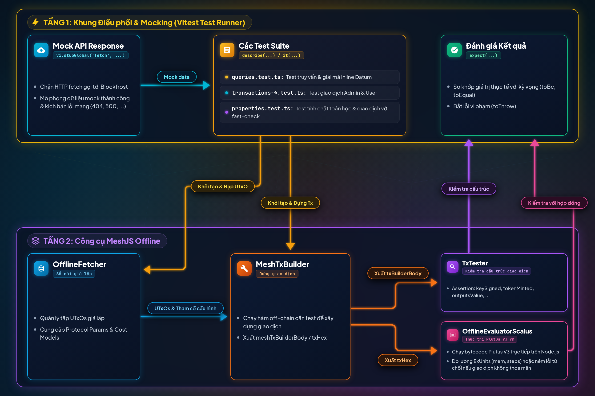

> [!TIP]
> Ngoài 3 thành phần cốt lõi trên, MeshJS còn cung cấp **`OfflineEvaluator`** (gói `@meshsdk/core-csl`, cài đặt `IEvaluator` thay thế dựa trên Cardano Serialization Lib / WASM), **`TxParser`** (parse ngược raw `txHex` thành `MeshTxBuilderBody` để dùng với `TxTester`) và **`ScalusEmulator`** (mô phỏng sổ cái nhiều block nối tiếp qua `submitTx` cho các kịch bản đa bước liên hoàn như Mint $\rightarrow$ Admin hạ giá Oracle $\rightarrow$ Bot Liquidate).

---

### 1.2. Unit Test chức năng Query với `OfflineFetcher` và Mock Blockfrost REST API

Các hàm truy vấn ở `offchain/src/queries.ts` chỉ đọc UTxO và giải mã Inline Datum — không dựng giao dịch và không chạy Plutus script. Vì vậy, bài test trong `offchain/tests/queries.test.ts` **chỉ cần khởi tạo một `OfflineFetcher` tối giản** và nạp danh sách UTxO giả lập (không cần `ProtocolParameters`, `CostModels`, Mock Wallet hay `OfflineEvaluatorScalus`).

#### Các hàm Helper Giả lập Dữ liệu
Trước, chúng ta xây dựng 3 hàm helper phục vụ việc giả lập dữ liệu:

1. **`makeUtxo`**: Tạo đối tượng `UTxO` chuẩn MeshJS:
```typescript
// Trích từ offchain/tests/queries.test.ts:
function makeUtxo({
  txHash, outputIndex, address, lovelace, unit, quantity, plutusData,
}: {
  txHash: string; outputIndex: number; address: string;
  lovelace: bigint; unit?: string; quantity?: bigint; plutusData?: string;
}): UTxO {
  const amount = [{ unit: "lovelace", quantity: lovelace.toString() }];
  if (unit && quantity !== undefined) {
    amount.push({ unit, quantity: quantity.toString() });
  }
  return {
    input: { txHash, outputIndex },
    output: { address, amount, plutusData },
  };
}
```

2. **`makeOracleDatum` & `makePositionDatum`**: Đóng gói các trường dữ liệu TypeScript thành chuỗi Inline Datum CBOR Hex:
```typescript
// Trích từ offchain/tests/queries.test.ts:
function makeOracleDatum(rate: bigint) {
  return serializeData(mConStr0([rate]));
}

function makePositionDatum(address: string, stablecoinAmount: bigint) {
  return serializeData(
    mConStr0([makeAddressData(address), stablecoinAmount])
  );
}
```

3. **`createFetcher`**: Khởi tạo nhanh `OfflineFetcher` và nạp tập UTxO giả lập:
```typescript
// Trích từ offchain/tests/queries.test.ts:
function createFetcher(allUtxos: UTxO[]) {
  const fetcher = new OfflineFetcher();
  if (allUtxos.length > 0) {
    fetcher.addUTxOs(allUtxos);
  }
  return fetcher;
}
```

#### Demo Test Case: Tìm Đúng Oracle UTxO (`getOracleInfo`)
Trong test case đầu tiên của `getOracleInfo`, ta nạp cả UTxO không mang NFT lẫn UTxO Oracle hợp lệ (`oracleUnit`, `ORACLE_RATE = 25_000n`) để chứng minh hàm query lọc đúng State Thread NFT và giải mã tỷ giá:

```typescript
// Trích từ offchain/tests/queries.test.ts:
it("tìm đúng Oracle UTxO mang NFT và có tỷ giá dương", async () => {
  const oracleUnit = ORACLE_NFT_POLICY_ID + ORACLE_NFT_TOKEN_HEX;
  const fetcher = createFetcher([
    makeUtxo({
      txHash: "00".repeat(32),
      outputIndex: 0,
      address: ORACLE_ADDRESS,
      lovelace: 5_000_000n, // UTxO nhiễu 1: thuần ADA, không có NFT và không có datum
    }),
    makeUtxo({
      txHash: "01".repeat(32),
      outputIndex: 0,
      address: ORACLE_ADDRESS,
      lovelace: 2_000_000n,
      plutusData: makeOracleDatum(ORACLE_RATE), // UTxO nhiễu 2: có datum nhưng không có NFT
    }),
    makeUtxo({
      txHash: "02".repeat(32),
      outputIndex: 0,
      address: ORACLE_ADDRESS,
      lovelace: 2_000_000n,
      unit: oracleUnit,
      quantity: 1n,
      plutusData: makeOracleDatum(ORACLE_RATE), // Oracle UTxO hợp lệ
    }),
  ]);

  const oracle = await getOracleInfo(fetcher, ORACLE_ADDRESS, ORACLE_NFT_POLICY_ID);

  expect(oracle).not.toBeNull();
  expect(oracle?.rate).toBe(ORACLE_RATE);
  expect(oracle?.utxo.input.txHash).toBe("02".repeat(32));
});
```

Chỉ với vài dòng thiết lập cục bộ, test xác nhận đồng thời hai điều kiện: bỏ qua UTxO giả mạo không mang State Thread NFT và giải mã chính xác tỷ giá từ Inline Datum.

#### Demo Mock Blockfrost REST API với `vi.stubGlobal` (Test Case 2)

Với các hàm gọi trực tiếp REST API như `getAllPositions`, chúng ta dùng `vi.stubGlobal("fetch", ...)` của Vitest để giả lập payload JSON từ Blockfrost mà không cần kết nối mạng. Test case dưới đây kiểm tra cơ chế lọc vị thế hợp lệ: nhận 4 UTxO giả lập nhưng chỉ giữ lại 2 vị thế hợp lệ (loại bỏ UTxO thiếu `PositionToken` và UTxO nằm ở ví cá nhân thay vì Script), đồng thời tính toán chính xác tỷ lệ thế chấp ($\text{CR}$) và cờ thanh lý (`isLiquidatable`):

```typescript
// Trích từ offchain/tests/queries.test.ts:
it("phân tích danh sách vị thế, tính đúng các chỉ số và lọc bỏ UTxO rác", async () => {
  const rawBlockfrostUtxos = [
    {
      tx_hash: "11".repeat(32), output_index: 0, address: STABLECOIN_ADDRESS,
      amount: [{ unit: "lovelace", quantity: "3000000" }, { unit: POSITION_TOKEN_UNIT, quantity: "1" }],
      inline_datum: makePositionDatum(OWNER_ADDRESS, 10_000n), // Vị thế 1: CR = 750% (An toàn)
    },
    {
      tx_hash: "22".repeat(32), output_index: 0, address: STABLECOIN_ADDRESS, // Bẫy 1: Thiếu PositionToken
      amount: [{ unit: "lovelace", quantity: "2000000" }],
      inline_datum: makePositionDatum(OTHER_OWNER_ADDRESS, 40_000n),
    },
    {
      tx_hash: "33".repeat(32), output_index: 0, address: STABLECOIN_ADDRESS,
      amount: [{ unit: "lovelace", quantity: "2000000" }, { unit: POSITION_TOKEN_UNIT, quantity: "1" }],
      inline_datum: makePositionDatum(OTHER_OWNER_ADDRESS, 40_000n), // Vị thế 2: CR = 125% < 150% (Bị thanh lý)
    },
    {
      tx_hash: "44".repeat(32), output_index: 0, address: OWNER_ADDRESS, // Bẫy 2: Nằm ở ví thường, không phải Script
      amount: [{ unit: "lovelace", quantity: "5000000" }, { unit: POSITION_TOKEN_UNIT, quantity: "1" }],
      inline_datum: makePositionDatum(OWNER_ADDRESS, 10_000n),
    },
  ];

  // Giả lập hàm fetch toàn cục trả về danh sách UTxO của Blockfrost
  vi.stubGlobal("fetch", vi.fn().mockResolvedValue({
    ok: true,
    json: async () => rawBlockfrostUtxos,
  }));

  const positions = await getAllPositions("test_api_key", ORACLE_RATE, POSITION_TOKEN_POLICY_ID);

  // Khẳng định: Chỉ giữ 2 UTxO hợp lệ ("11" và "33"), loại bỏ 2 UTxO bẫy ("22" và "44")
  expect(positions).toHaveLength(2);
  expect(positions[0].collateralRatioPct).toBe(750); // 3 ADA thế chấp / 10k VNDC nợ (rate 25k) -> CR = 750%
  expect(positions[1].isLiquidatable).toBe(true);    // 2 ADA thế chấp / 40k VNDC nợ -> CR = 125% < 150% (Thanh lý)
});
```

> [!TIP]
> Trong hook `afterEach` của Vitest, chúng ta gọi `vi.restoreAllMocks()` và `vi.unstubAllGlobals()` để hoàn trả `fetch` về trạng thái ban đầu, tránh việc dữ liệu mock bị rò rỉ sang các test case khác.

#### Danh mục Toàn bộ 14 Test Cases của Queries (`offchain/tests/queries.test.ts`)
Test suite `queries` bao phủ toàn bộ 14 kịch bản kiểm thử nhằm bảo chứng tính toàn vẹn của dữ liệu đọc từ sổ cái và khả năng chịu lỗi mạng của dApp, được phân loại thành 3 nhóm nghiệp vụ chính:

| STT | Kịch bản kiểm thử (`it`) | Nhóm hàm | Kỹ thuật Giả lập | Quy tắc & Bẫy lỗi kiểm chứng |
| :---: | :--- | :--- | :--- | :--- |
| 1 | `tìm đúng Oracle UTxO mang NFT và có tỷ giá dương` | `getOracleInfo` | Mock Fetcher nạp 3 UTxO giả lập | Lọc đúng UTxO mang Oracle NFT giữa các UTxO rác (thuần ADA, có datum không NFT) và giải mã tỷ giá dương. |
| 2 | `tự động thử lại và thành công khi lần đầu rỗng do độ trễ đồng bộ node` | `getOracleInfo` | Mock Fetcher (Lần 1 rỗng, lần 2 có dữ liệu) | Giả lập độ trễ đồng bộ (replication lag) giữa các Cardano node, tự động thử lại theo backoff và thành công ở lần 2. |
| 3 | `trả về null khi không tìm thấy Oracle UTxO hợp lệ sau toàn bộ số lần thử lại` | `getOracleInfo` | Mock Fetcher (Không tìm thấy Oracle UTxO) | Trả về `null` an toàn và sạch sẽ khi không tìm thấy Oracle UTxO hợp lệ sau toàn bộ các lần thử lại. |
| 4 | `ném lỗi khi phát hiện nhiều hơn 1 UTxO chứa Oracle NFT` | `getOracleInfo` | Mock Fetcher nạp 2 UTxO cùng mang NFT | Ném lỗi bảo vệ khi phát hiện nhiều hơn 1 UTxO chứa Oracle NFT (vi phạm bất biến One-Shot NFT). |
| 5 | `ném lỗi khi Oracle UTxO thiếu Plutus Data (Inline Datum)` | `getOracleInfo` | Mock Fetcher (UTxO không có datum) | Ném lỗi rõ ràng phát hiện Oracle UTxO thiếu Inline Datum. |
| 6 | `ném lỗi khi tỷ giá trong Oracle Datum không dương` | `getOracleInfo` | Mock Fetcher (Oracle Datum `rate <= 0`) | Ném lỗi từ chối tỷ giá Oracle không dương (`rate <= 0`). |
| 7 | `ném thông báo lỗi mạng rõ ràng sau khi fetcher liên tục thất bại` | `getOracleInfo` | Mock `fetchAddressUTxOs` lỗi 503 | Ném thông báo lỗi mạng rõ ràng sau khi hết số lần retry, ngăn chặn lỗi nuốt ngoại lệ làm treo ứng dụng. |
| 8 | `phân tích danh sách vị thế, tính đúng các chỉ số và lọc bỏ UTxO rác` | `getAllPositions` | Mock fetch Blockfrost API (`vi.stubGlobal`) | Phân tích danh sách UTxO từ Blockfrost, tính đúng các chỉ số tài chính và lọc bỏ UTxO rác thiếu token hoặc sai địa chỉ script. |
| 9 | `hỗ trợ Franken address với Stake Key của người dùng và lọc bỏ thế chấp rác hoặc nợ bằng không` | `getAllPositions` | Mock Blockfrost với Franken Address | Nhận diện đúng vị thế của người dùng qua Stake Key Hash, đồng thời lọc bỏ UTxO có thế chấp rác (< 1 ADA) hoặc nợ `<= 0`. |
| 10 | `tự động phân trang các vị thế cho đến khi gặp trang ngắn` | `getAllPositions` | Mock Blockfrost (Trang 1: 100, Trang 2: 1) | Tự động phân trang qua REST API và dừng lại khi trang trả về < 100 phần tử, gộp đủ 101 vị thế. |
| 11 | `cảnh báo khi chạm giới hạn maxPages mà vẫn còn dữ liệu` | `getAllPositions` | Mock Blockfrost chạm ngưỡng `maxPages = 1` | Dừng tải ở trang 1 và kích hoạt cảnh báo qua `console.warn` khi dữ liệu vượt ngưỡng phân trang tối đa. |
| 12 | `trả về danh sách rỗng khi token vị thế chưa từng được mint (mã 404)` | `getAllPositions` | Mock Blockfrost trả HTTP 404 | Trả về mảng rỗng `[]` khi token vị thế chưa từng được mint trên mạng thay vì ném ngoại lệ sập giao diện. |
| 13 | `ném lỗi chi tiết khi Blockfrost trả về mã lỗi khác 404` | `getAllPositions` | Mock Blockfrost trả HTTP 500 | Tự động retry theo backoff và ném lỗi chi tiết chỉ rõ số trang và mã HTTP 500 khi server gặp sự cố. |
| 14 | `giải mã PositionDatum và OracleDatum chuẩn xác theo mô hình Module 7` | `parsePositionDatum`<br/>`parseOracleDatum` | Decode chuỗi CBOR thô | Giải mã chuẩn xác cấu trúc Constr Data sang TypeScript objects (`ownerAddress`, `stablecoinAmount`, `rate`). |

---

### 1.3. Nền tảng Khởi tạo & Quy trình Kiểm thử Giao dịch Off-chain

Khác với các hàm query chỉ đọc UTxO và giải mã Datum, việc kiểm thử một hàm dựng giao dịch (như `mintStablecoinTx`, `burnStablecoinTx`, `deployTx`...) phức tạp hơn nhiều. Để kiểm thử một giao dịch tương tác với hợp đồng thông minh trên môi trường offline, chúng ta cần mô phỏng đầy đủ **hai thành phần cốt lõi**:

1. **Ví giả lập (`Mock Wallet`):** Đóng vai trò ví người dùng CIP-30, cung cấp địa chỉ nhận tiền thừa (`changeAddress`), danh sách UTxO nguồn chi trả tài sản/phí mạng, Collateral UTxO và chữ ký giao dịch giả lập.
2. **Môi trường Blockchain mô phỏng (`Offline Environment`):** Tái lập toàn bộ trạng thái và quy tắc của mạng lưới Cardano, bao gồm:
   - **Sổ cái eUTxO:** Lưu trữ các UTxO nguồn của ví, Collateral UTxO, Reference Script UTxO của hợp đồng và các Script UTxO.
   - **Tham số Giao thức (`ProtocolParameters`):** Quy định công thức tính phí giao dịch (`minFeeA/B`), trần kích thước giao dịch (`maxTxSize = 16KB`), và ngưỡng ADA tối thiểu của UTxO (`coinsPerUtxoByte`).
   - **Mô hình Chi phí (`CostModels`):** Đầy đủ tham số chi phí của các máy ảo Plutus để bộ tuần tự hóa tính toán chính xác mã băm toàn vẹn `scriptDataHash`.
   - **Cấu hình Thời gian mạng (`SlotConfig`):** Ánh xạ giữa số Slot và thời gian thực POSIX (milliseconds) để thẩm định các khoảng hiệu lực giao dịch (`validity_range`).
   - **Máy ảo Plutus Cục bộ (`OfflineEvaluatorScalus`):** Thực thi trực tiếp bytecode của Smart Contract để thẩm định tính hợp lệ của giao dịch và đo lường ngân sách tài nguyên (CPU steps, Memory).

Toàn bộ thiết lập hạ tầng được đóng gói tại `offchain/tests/helpers/offline-env.ts` với hai hàm cốt lõi: `createMockWallet` và `createOfflineEnv`.

#### a. Chi tiết Khởi tạo Môi trường: `createMockWallet` & `createOfflineEnv`
##### Giả lập Ví Trình duyệt (`createMockWallet`)
Hàm `createMockWallet` giả lập một ví CIP-30 tối giản, cung cấp 4 phương thức mà `MeshTxBuilder` cần:

```typescript
// Trích từ offchain/tests/helpers/offline-env.ts:
export function createMockWallet(
  walletUtxos: UTxO[],
  collateralUtxos: UTxO[],
  changeAddress: string
): BrowserWallet {
  return {
    getChangeAddress: async () => changeAddress,
    getUtxos: async () => walletUtxos,
    getCollateral: async () => collateralUtxos,
    signTx: async (tx: string) => tx,
  } as unknown as BrowserWallet;
}
```

##### Giả lập Sổ cái & Máy ảo Plutus (`createOfflineEnv`)
```typescript
// Trích từ offchain/tests/helpers/offline-env.ts:
export function createOfflineEnv(extraUtxos: UTxO[] = [], includeRefScripts = true) {
  const fetcher = new OfflineFetcher("preprod");
  fetcher.addProtocolParameters(DEFAULT_PROTOCOL_PARAMETERS);
  fetcher.fetchCostModels = async () => [
    DEFAULT_V1_COST_MODEL_LIST,
    DEFAULT_V2_COST_MODEL_LIST,
    DEFAULT_V3_COST_MODEL_LIST,
  ];
  const initialUtxos = [
    ...(includeRefScripts ? [ORACLE_REF_SCRIPT_UTXO, STABLECOIN_REF_SCRIPT_UTXO] : []),
    ...extraUtxos,
  ];
  if (initialUtxos.length > 0) {
    fetcher.addUTxOs(initialUtxos);
  }

  const evaluator = new OfflineEvaluatorScalus(fetcher, "preprod");
  const createTxBuilder = () => new MeshTxBuilder({ fetcher });

  return { fetcher, evaluator, createTxBuilder };
}
```

Mỗi thành phần trong hàm khởi tạo trên đảm nhiệm một nhiệm vụ trọng yếu nhằm mô phỏng mạng Cardano trong bộ nhớ:

- **`OfflineFetcher("preprod")` — Sổ cái Cardano giả lập:**
  - Thay thế hoàn toàn các dịch vụ API bên ngoài (Blockfrost/Kupo) giúp bài test chạy nhanh tức thì và độc lập không cần Internet.
  - Nhận tham số `"preprod"` để nạp cấu hình mạng Preprod (`SLOT_CONFIG_NETWORK`, `zeroTime`, `slotLength`), bảo đảm các phép tính quy đổi thời gian thực và slot hoàn toàn đồng bộ với mạng thử nghiệm. Có thể tùy ý thay đổi tham số mạng bạn muốn sử dụng: "testnet" | "preview" | "preprod" | "mainnet". 
  - Quản lý kho UTxO của bài test thông qua phương thức `addUTxOs`.

- **Nạp Tham số Giao thức (`fetcher.addProtocolParameters`):**
  Cung cấp các hằng số giao thức Cardano chuẩn (`DEFAULT_PROTOCOL_PARAMETERS`) để tính toán phí giao dịch (`minFeeA/B`), trần kích thước giao dịch (`maxTxSize`), và giới hạn trần ngân sách ExUnits mạng (`maxTxExMem`, `maxTxExSteps`).

- **Cung cấp các phiên bản Cost Models (`fetchCostModels`):**
  Giúp `CardanoSDKSerializer` tính toán chuẩn xác mã băm `scriptDataHash` (băm của Redeemer, Datum và Cost Models) trong Transaction Witness Set.

- **Nạp sẵn Reference Scripts (`ORACLE_REF_SCRIPT_UTXO` & `STABLECOIN_REF_SCRIPT_UTXO`):**
  Cờ `includeRefScripts = true` tự động nạp sẵn 2 Reference Script UTxO thật (biên dịch từ `oracle.ak` và `stablecoin.ak`) vào `fetcher`.

- **`OfflineEvaluatorScalus(fetcher, "preprod")` — Máy ảo Plutus V3 cục bộ:**
  - Sử dụng Scalus VM biên dịch sang JavaScript để thực thi bytecode Plutus V3 ngay trên tiến trình Node.js.
  - Thẩm tra toàn bộ logic on-chain của validator và đo lường chính xác ngân sách Execution Units (`mem` và `steps`).

- **Factory `createTxBuilder()` — Đồng nhất quy trình tạo giao dịch cho cả Positive & Negative:**
  - Không truyền `evaluator` vào `MeshTxBuilder({ fetcher })`. Khi không có evaluator, phương thức `.complete()` của builder sẽ sinh chuỗi `txHex` nhanh chóng với ExUnits danh nghĩa mà không chạy ngầm Plutus VM.
  - Giải pháp này mang lại hai lợi ích vượt trội:
    1. **Loại bỏ việc chạy Plutus VM thừa thãi 2 lần:** Ở các ca Positive, nếu gắn evaluator vào builder thì Plutus VM sẽ chạy 1 lần lúc build để ước lượng phí, rồi lại chạy lần 2 khi gọi `evaluator.evaluateTx(txHex)`. Bằng cách chỉ chạy 1 lần ở bước thẩm định cuối, test suite chạy nhanh và thanh thoát hơn.
    2. **Đồng nhất quy trình cho cả ca vi phạm (Negative On-chain):** Builder luôn xuất ra được chuỗi `txHex` bất kể giao dịch đúng hay sai logic hợp đồng. Sau đó, chuỗi `txHex` được đưa vào `evaluator.evaluateTx(txHex)` để Plutus VM trực tiếp thẩm tra và ném lỗi từ chối, giúp test case kiểm chứng bằng `await expect(evaluator.evaluateTx(txHex)).rejects.toThrow()`.

- **`createMockWallet(...)` — Giả lập Ví trình duyệt CIP-30:**
  Thay thế các tiện ích mở rộng ví, cung cấp 4 phương thức tối thiểu mà `MeshTxBuilder` yêu cầu: `getChangeAddress` (địa chỉ nhận tiền thừa), `getUtxos` (nguồn tài sản), `getCollateral` (UTxO thế chấp phí) và `signTx` (ký giao dịch giả lập).

---

#### b. Quy trình 4 Bước Chuẩn (Standard 4-Step Pipeline) để Xây dựng Test Case Giao dịch

Dựa trên nền tảng khởi tạo ở trên, mọi test case kiểm thử giao dịch off-chain trong Module 09 đều tuân theo đúng quy trình 4 bước chuẩn mực:

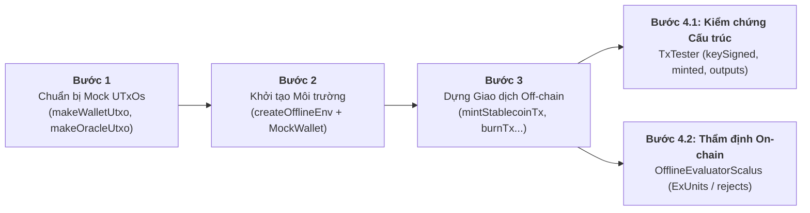

#### c. Minh họa Chi tiết: Demo Test Case `mintStablecoinTx` (Positive & Negative)
Trong Positive case của `mintStablecoinTx` (thế chấp `30 ADA`, đúc lượng `VNDC` tối đa kèm `1 PositionToken` về Franken Address):
- **Bước 1 & 2**: Chuẩn bị các mock UTxO thông qua các hàm tiện ích (`makeOracleUtxo` tạo Oracle UTxO mang NFT và Inline Datum tỷ giá, `makeWalletUtxo` cấp 50 ADA cho ví và `makeCollateralUtxo` tạo 5 ADA ký quỹ script), sau đó nạp vào `createOfflineEnv` và khởi tạo `createMockWallet`.
- **Bước 3**: Gọi hàm nghiệp vụ ngoài chuỗi `mintStablecoinTx` để dựng giao dịch và nhận về chuỗi `txHex`.
- **Bước 4**: Kích hoạt cơ chế kiểm tra kép — dùng **`TxTester`** thẩm tra cấu trúc ngoài chuỗi (`keySigned`, `tokenMinted`, `outputsValue`, `outputsEvaluating = 1`), đối chiếu Inline Datum bằng `getOutputInlineDatumsAt`, sau đó nộp `txHex` vào **`evaluator.evaluateTx(txHex)`** để `OfflineEvaluatorScalus` thực thi bytecode `stablecoin.ak` và xác nhận chi phí nằm trong trần ngân sách Cardano:

```typescript
// Trích từ offchain/tests/transactions-user.test.ts:
const collateral = 30_000_000n;
const mintAmount = calcMaxMintable(collateral, ORACLE_RATE);

const oracleUtxo = makeOracleUtxo(ORACLE_RATE, "1");
const walletUtxo = makeWalletUtxo(OWNER_ADDRESS, 50_000_000n, [], "c", 0);
const collateralUtxo = makeCollateralUtxo(OWNER_ADDRESS, "d");

const { evaluator, createTxBuilder } = createOfflineEnv([
  oracleUtxo,
  walletUtxo,
  collateralUtxo,
]);
const wallet = createMockWallet([walletUtxo], [collateralUtxo], OWNER_ADDRESS);
const txBuilder = createTxBuilder();

const txHex = await mintStablecoinTx(
  txBuilder,
  wallet,
  VNDC_POLICY_ID,
  oracleUtxo,
  collateral,
  mintAmount
);

const tester = new TxTester(txBuilder.meshTxBuilderBody)
  .keySigned(OWNER_PKH)
  .tokenMinted(VNDC_POLICY_ID, VNDC_NAME_HEX, Number(mintAmount))
  .tokenMinted(VNDC_POLICY_ID, POSITION_TOKEN_HEX, 1)
  .outputsAt(OWNER_SCRIPT_ADDRESS)
  .outputsValue(
    MeshValue.fromAssets([
      { unit: "lovelace", quantity: collateral.toString() },
      { unit: POSITION_TOKEN_UNIT, quantity: "1" },
    ])
  );

expect(tester.success(), tester.errors()).toBe(true);
expect(tester.outputsEvaluating).toHaveLength(1);

const positionDatums = getOutputInlineDatumsAt(txHex, OWNER_SCRIPT_ADDRESS);
expect(positionDatums).toEqual([makePositionDatumCbor(OWNER_ADDRESS, mintAmount)]);

const actions = await evaluator.evaluateTx(txHex);
console.log(
  "Script execution costs:",
  actions.map(({ tag, budget }) => ({ tag, budget }))
);
expect(actions).toHaveLength(1);
expect(actions[0].tag).toBe("MINT");
for (const action of actions) {
  expect(action.budget.mem).toBeLessThanOrEqual(Number(DEFAULT_PROTOCOL_PARAMETERS.maxTxExMem));
  expect(action.budget.steps).toBeLessThanOrEqual(Number(DEFAULT_PROTOCOL_PARAMETERS.maxTxExSteps));
}
```

> [!IMPORTANT]
>
> **`outputsValue` so khớp TỔNG CỘNG DỒN tài sản:** Lệnh này cộng dồn toàn bộ tài sản của tất cả các output trên đối tượng txTester hiện tại (chứ không kiểm tra riêng rẽ từng output). Ví dụ: nếu địa chỉ nhận có 2 UTxO (1 cái 10 ADA, 1 cái 20 ADA), `outputsValue` sẽ tính tổng là `30 ADA`. Do đó, `outputsAt(OWNER_SCRIPT_ADDRESS)` được sử dụng trước đó để tách biệt địa chỉ hợp đồng (`OWNER_SCRIPT_ADDRESS`) khỏi địa chỉ nhận tiền thừa của ví (`OWNER_ADDRESS`) để tiền thừa không bị cộng dồn vào làm sai lệch kết quả.
>
> **Kiểm tra số lượng output với `tester.outputsEvaluating`:** Thuộc tính `outputsEvaluating` lưu trữ mảng các output sau khi lọc bởi `outputsAt(OWNER_SCRIPT_ADDRESS)`. Lệnh `expect(tester.outputsEvaluating).toHaveLength(1)` khẳng định chắc chắn tại địa chỉ script chỉ tồn tại đúng duy nhất 1 output vị thế.
>
> **Cú pháp `expect(tester.success(), tester.errors()).toBe(true)`:** Tham số thứ nhất `tester.success()` là giá trị boolean để so khớp với `.toBe(true)`. Tham số thứ hai `tester.errors()` là thông điệp lỗi tùy chỉnh — chỉ được hiển thị khi test bị fail nhằm chỉ rõ chính xác điều kiện nào trong chuỗi kiểm tra chưa được thỏa mãn (thay vì chỉ báo chung chung `expected true, received false`).
>
> **Kiểm tra Script Execution Costs & Tag On-chain:** Gọi trực tiếp `evaluator.evaluateTx(txHex)` và in ra log `console.log("Script execution costs:", actions)`. Khẳng định đúng hành động on-chain mong đợi (`tag === "MINT"` khi đúc token vị thế/VNDC, hoặc `tag === "SPEND"` khi tiêu thụ UTxO tại script), đồng thời xác nhận ExUnits tiêu thụ thực tế không vượt trần giao thức Cardano (`DEFAULT_PROTOCOL_PARAMETERS.maxTxExMem` và `maxTxExSteps`).

Bên cạnh case hợp lệ, `OfflineEvaluatorScalus` còn cho phép viết các case vi phạm Smart Contract **Negative On-chain** (dựng giao dịch vi phạm rồi khẳng định validator Plutus V3 từ chối khi chạy `evaluator.evaluateTx(txHex)`):

```typescript
// Trích từ offchain/tests/transactions-user.test.ts:
const overMintAmount = calcMaxMintable(collateral, ORACLE_RATE) + 1n;
const txHex = await mintStablecoinTx(
  createTxBuilder(),
  wallet,
  VNDC_POLICY_ID,
  oracleUtxo,
  collateral,
  overMintAmount
);

await expect(evaluator.evaluateTx(txHex)).rejects.toThrow();
```

#### d. Danh mục 20 Test Cases Giao dịch Off-chain (Admin & User)

Toàn bộ 20 kịch bản kiểm thử giao dịch ngoài chuỗi được chia thành hai file riêng biệt, sử dụng phối hợp `OfflineFetcher` (giả lập sổ cái eUTxO), `TxTester` (kiểm chứng cấu trúc TX) và `OfflineEvaluatorScalus` (thực thi validator Plutus V3 offline):

##### Giao dịch Quản trị (`offchain/tests/transactions-admin.test.ts` — 10 tests)
Thực thi bytecode Plutus V3 của validator `oracle.ak`:

| STT | Hàm TX | Phân loại | Kịch bản kiểm thử (`it`) | Mục tiêu & Quy tắc kiểm chứng |
| :---: | :--- | :---: | :--- | :--- |
| 1 | `deployTx` | Positive | `[Positive] khởi tạo Oracle NFT, Inline Datum và 2 Reference Script UTxO thành công` | Tạo Oracle UTxO mang NFT, gắn Inline Datum chứa tỷ giá khởi điểm và deploy 2 Reference Scripts lên chuỗi. |
| 2 | `deployTx` | Negative Off-chain | `[Negative Off-chain] ném lỗi khi ví Operator không có UTxO` | Ném lỗi `"No UTxOs found in wallet"` khi ví thiếu nguồn trả phí. |
| 3 | `deployTx` | Negative Off-chain | `[Negative Off-chain] ném lỗi khi ví Operator thiếu Collateral UTxO` | Ném lỗi `"No collateral found"` khi ví thiếu UTxO ký quỹ thực thi script. |
| 4 | `deployTx` | Negative On-chain | `[Negative On-chain] validator oracle.ak từ chối deploy khi initialRate <= 0` | Validator `oracle.ak` từ chối khởi tạo Oracle khi tỷ giá ban đầu $\le 0$. |
| 5 | `updateOracleTx` | Positive | `[Positive] cập nhật tỷ giá mới thành công và giữ nguyên Oracle NFT` | Cập nhật tỷ giá mới vào Datum của Oracle UTxO và bảo toàn Oracle NFT. |
| 6 | `updateOracleTx` | Negative On-chain | `[Negative On-chain] validator từ chối khi newRate <= 0` | Validator từ chối cập nhật khi tỷ giá mới $\le 0$. |
| 7 | `updateOracleTx` | Negative On-chain | `[Negative On-chain] validator từ chối khi newRate trùng với currentRate` | Validator từ chối cập nhật khi tỷ giá mới không đổi so với hiện tại. |
| 8 | `updateOracleTx` | Negative On-chain | `[Negative On-chain] validator từ chối khi người không phải Operator cập nhật Oracle` | Validator từ chối khi giao dịch thiếu chữ ký của Operator. |
| 9 | `deleteOracleTx` | Positive | `[Positive] giải phóng Oracle UTxO và burn vĩnh viễn Oracle NFT thành công` | Xóa Oracle UTxO và đốt vĩnh viễn Oracle NFT cho kịch bản đóng hệ thống. |
| 10 | `deleteOracleTx` | Negative On-chain | `[Negative On-chain] validator từ chối khi người không phải Operator xóa Oracle` | Validator từ chối khi kẻ mạo danh cố tình xóa Oracle UTxO. |

##### Giao dịch Người dùng (`offchain/tests/transactions-user.test.ts` — 10 tests)
Thực thi bytecode Plutus V3 của validator `stablecoin.ak`:

| STT | Hàm TX | Phân loại | Kịch bản kiểm thử (`it`) | Mục tiêu & Quy tắc kiểm chứng |
| :---: | :--- | :---: | :--- | :--- |
| 11 | `mintStablecoinTx` | Positive | `[Positive] mint VNDC + 1 Position NFT vào địa chỉ hợp đồng kèm Inline Datum thành công` | Đúc VNDC + 1 PositionToken vào địa chỉ hợp đồng và đính kèm Inline Datum chuẩn. |
| 12 | `mintStablecoinTx` | Negative Off-chain | `[Negative Off-chain] từ chối khi tài sản thế chấp < 10 ADA` | Ném lỗi khi kiểm tra hợp lệ trước khi tạo giao dịch: người dùng nhập lượng thế chấp dưới mức sàn 10 ADA. |
| 13 | `mintStablecoinTx` | Negative Off-chain | `[Negative Off-chain] từ chối khi ví không có UTxO hoặc thiếu Collateral` | Ném lỗi bảo vệ khi ví không đủ số dư hoặc thiếu Collateral UTxO. |
| 14 | `mintStablecoinTx` | Negative On-chain | `[Negative On-chain] validator từ chối khi over-mint vượt MCR 150%` | Validator `stablecoin.ak` từ chối khi người dùng đúc nợ vượt quá tỷ lệ thế chấp tối thiểu. |
| 15 | `mintStablecoinTx` | Negative On-chain | `[Negative On-chain] validator từ chối khi mint lượng VNDC = 0 hoặc dùng Oracle giả` | Validator từ chối khi lượng mint bằng 0 hoặc tham chiếu sai Oracle UTxO. |
| 16 | `burnStablecoinTx` | Positive | `[Positive] burn thành công ngay cả khi không có Oracle UTxO trong OfflineFetcher` | Thoát vị thế an toàn (đốt VNDC + PositionToken, rút ADA) ngay cả khi Oracle đã đóng/xóa. |
| 17 | `burnStablecoinTx` | Negative On-chain | `[Negative On-chain] validator từ chối khi burn ít hơn số nợ trên Datum hoặc trả sai Dev Address` | Validator từ chối khi người dùng trả thiếu nợ hoặc không thanh toán phí dev $0.5\%$. |
| 18 | `liquidateTx` | Positive | `[Positive] thanh lý thành công khi CR < 150% và hoàn trả ownerRefund >= 1 ADA` | Thanh lý vị thế nợ dưới $150\%$, thu nợ, nhận thưởng thanh lý và hoàn trả phần dư $\ge 1\text{ ADA}$ cho Owner. |
| 19 | `liquidateTx` | Positive | `[Positive] thanh lý khi ownerRefund < 1 ADA thì không tạo output dưới ngưỡng Min UTxO` | Khi phần dư $< 1\text{ ADA}$, đặt `ownerRefund = 0` dồn thưởng cho Liquidator để tránh vi phạm Min UTxO. |
| 20 | `liquidateTx` | Negative On-chain | `[Negative On-chain] validator từ chối thanh lý khi vị thế vẫn an toàn (CR >= 150%)` | Validator từ chối thanh lý khi vị thế có tỷ lệ $\text{CR} \ge 150\%$, bảo vệ tài sản người vay. |

---

## 2. Off-chain Property-Based Testing với `fast-check`

### 2.1. Sự khác biệt giữa Unit Testing và Property-Based Testing (PBT)

- **Unit Testing truyền thống:** Lập trình viên tự nghĩ ra 2–3 trường hợp test với số liệu cụ thể và kiểm tra kết quả mong đợi. Cách làm này có thể bỏ lọt các edge cases mà con người không lường trước được.
- **Property-Based Testing (Kiểm thử dựa trên đặc tính):** Thay vì kiểm tra từng giá trị cố định, chúng ta định nghĩa các **Đặc tính Bất biến (Invariants)** — những tính chất luôn đúng với **mọi dữ liệu đầu vào** — và để thư viện fast-check tự sinh hàng trăm bộ dữ liệu ngẫu nhiên đa dạng nhằm "phá vỡ" hệ thống.

---

### 2.2. Kiến trúc & Cú pháp Cốt lõi của `fast-check`

`fast-check` là framework Property-Based Testing hàng đầu cho TypeScript/JavaScript. Mọi bài PBT với fast-check đều xoay quanh một vòng lặp: **Sinh ngẫu nhiên → Kiểm tra bất biến → Phát hiện lỗi thì Thu gọn**. Các thành phần dưới đây tương ứng với các khâu của vòng lặp đó:

| # | Thành phần | Vai trò | Cú pháp |
| :-: | :--- | :--- | :--- |
| **1** | `fc.assert` | Vòng lặp điều phối: chạy N lần, throw exception khi fail, tự động kích hoạt shrinking | `fc.assert(property, { numRuns: 200 })` |
| **2** | `fc.property` | Kết nối arbitraries với predicate | `fc.property(arb1, arb2, (x, y) => ...)` |
| **3** | `Arbitraries` | Sinh dữ liệu ngẫu nhiên có định hướng về edge cases | `fc.bigInt({ min, max })`<br/> `fc.integer({ min, max })` |
| **4** | `Predicate` | Hàm kiểm tra invariant, trả về boolean | `(x, y) => invariant(x, y)` |
| **5** | `numRuns` | Số bộ dữ liệu được sinh (mặc định 100) | `{ numRuns: 200 }` |

Chi tiết chức năng của từng thành phần:

1. **Bộ điều phối thực thi (`fc.assert`)**: Vòng lặp điều khiển tiến trình kiểm thử. `fc.assert` chạy bài test lặp đi lặp lại nhiều lần với các tập dữ liệu ngẫu nhiên độc lập. Đặc biệt, khi phát hiện một trường hợp gây lỗi (counter-example), `fc.assert` sẽ tự động kích hoạt cơ chế **Shrinking (Thu gọn lỗi)**.
2. **Khai báo Đặc tính Bất biến (`fc.property`)**: Kết nối các bộ sinh dữ liệu ngẫu nhiên với hàm kiểm tra logic (predicate).
3. **Bộ sinh Dữ liệu Ngẫu nhiên có Định hướng (Arbitraries - `fc.bigInt`, `fc.integer`,...)**: Sinh dữ liệu đầu vào ngẫu nhiên trong một miền giá trị cho trước (`{ min, max }`). Khác với hàm ngẫu nhiên thông thường (`Math.random`), Arbitrary của `fast-check` luôn chủ động ưu tiên kiểm tra các **giá trị biên cực đoan (Edge Cases)** - như cận dưới `min`, cận trên `max`, `0`, `1`, `-1`, các giá trị gần biên — xen kẽ với random values trong suốt quá trình sinh. Nhờ đó, edge cases được kiểm tra sớm và thường xuyên.
4. **Hàm Kiểm tra - Predicate Function**: Nhận các giá trị do Arbitrary sinh ra, gọi hàm nghiệp vụ cần kiểm thử và trả về giá trị kiểu `boolean` (hoặc dùng `expect()` để ném exception). Nếu trả về `true`, ca kiểm thử vượt qua; nếu trả về `false` hoặc ném ra exception, `fast-check` xác định bất biến đã bị phá vỡ và bắt đầu thu gọn lỗi.
5. **Cấu hình Số lần Thực thi (`{ numRuns: 200 }`)**: Số bộ dữ liệu ngẫu nhiên được sinh và kiểm chứng. Trong bài này, đối với các hàm toán học thuần túy chạy rất nhanh, chúng ta cấu hình `numRuns: 200`, đối với các hàm tạo giao dịch phải chạy máy ảo Scalus, chúng ta cấu hình `numRuns: 50` để cân bằng giữa độ bao phủ (coverage) và thời gian thực thi.

> [!WARNING]
> Nếu kiểm thử các hàm `async`, phải dùng `fc.asyncProperty` và bắt buộc có `await fc.assert(...)` — nếu quên `await`, test runner sẽ báo pass giả mà không thực sự chờ các assertions hoàn tất. Đây là lỗi phổ biến nhất khi mới làm quen với `fast-check`.

**Cơ chế Thu gọn (Shrinking)**: Khi phát hiện lỗi, `fast-check` không dừng lại và báo lỗi ngay. Thay vào đó, nó tự động thu gọn counter-example (trường hợp lỗi) về dạng đơn giản nhất có thể mà vẫn fail — gọi là minimal reproducible case, giúp lập trình viên định vị nguyên nhân mà không phải mò qua hàng trăm case. Ví dụ:

Giả sử test case [P3] bị fail. Không có shrinking, bạn sẽ thấy:
```text
✗ Property failed
Counter-example: collateral=87_654_321_987n, debt=6_543_210_987n, rate=71_234n
```
Con số này vô nghĩa — không giúp bạn hình dung bug ở đâu. Nhưng với shrinking, output thực tế là:
```text
✗ Property failed
Shrunk 47 time(s)
Counter-example: collateral=10_000_001n, debt=10_000_000_000n, rate=1n
```

**Đọc output shrinking thế nào?**
- **`Shrunk 47 time(s)`**: `fast-check` đã thử thu gọn 47 lần để tìm ra ca lỗi tối giản nhất.
- **`Counter-example` cuối cùng**: Là minimal reproducible case — ca nhỏ nhất vẫn vi phạm bất biến.

**Khi nào nên dùng Property-Based Testing?**
- Bất biến nghiệp vụ phải đúng trên toàn miền dữ liệu (ví dụ: MCR, bảo toàn tài sản khi thanh lý);
- Kiểm tra tính đồng nhất giữa hai code path có quy trình ngược nhau (ví dụ: `serialize ↔ parse`);
- Test end-to-end với input ngẫu nhiên.

### 2.3. Triển khai Property-Based Testing

Trong kiểm thử phần mềm phi tập trung (dApp), **Property-Based Testing (PBT)** được chia làm nhiều tầng cấp độ tùy theo đối tượng được kiểm chứng. Bộ test `offchain/tests/properties.test.ts` của Module 9 gồm 7 bài test được phân loại rõ ràng:

| Phân Loại PBT | Mã Test | Tên Thuộc Tính Bất Biến (Property) | Mô Tả & Mục Tiêu |
| :--- | :---: | :--- | :--- |
| **Hàm Toán học thuần & Nghiệp vụ Tài chính** *(Pure Functions & Economic Invariants)* | **[P1]** | `calcMaxMintable thỏa mãn MCR >= 150%` | Đảm bảo lượng VNDC mint ra không bao giờ vi phạm trần MCR 150% với mọi giá trị thế chấp và tỷ giá. |
| | **[P2]** | `calcLiquidationDistribution: các khoản chi không âm, tuân thủ sàn Min UTxO và bảo toàn tài sản` | Mọi khoản chi trả khi thanh lý không bao giờ âm, bảo toàn tổng tài sản và tuân thủ sàn Min UTxO 1 ADA. |
| | **[P3]** | `Thưởng liquidator luôn > 0 khi 101% <= CR < 150%` | Đảm bảo động lực kinh tế cho người thanh lý để giải cứu vị thế trước khi rơi vào nợ xấu. |
| **Toàn vẹn Dữ liệu Chuỗi** *(Data Serialization Round-Trip)* | **[P4]** | `Datum serialize → parse: bảo toàn toàn vẹn dữ liệu` | Mã hóa Datum thành CBOR rồi giải mã ngược lại giữ nguyên 100% dữ liệu. |
| **Giao dịch Tích hợp Máy ảo Scalus** *(Transaction & VM Integration)* | **[P5]** | `mintStablecoinTx luôn hợp lệ với thế chấp 10-100,000 ADA, và số lượng mint đảm bảo MCR` | Sinh ngẫu nhiên số lượng thế chấp, số lượng VNDC mint, dựng TX hoàn chỉnh và thực thi giao dịch trên máy ảo. |
| | **[P6]** | `burnStablecoinTx luôn hợp lệ qua OfflineEvaluatorScalus với 10-100,000 ADA` | Kiểm tra giao dịch tất toán nợ/đốt stablecoin hợp lệ với mọi mức trả nợ ngẫu nhiên. |
| | **[P7]** | `liquidateTx luôn hợp lệ qua OfflineEvaluatorScalus khi vị thế CR < 150%` | Kiểm tra giao dịch thanh lý với các vị thế vi phạm MCR ngẫu nhiên. |

Dưới đây là phân tích chi tiết **2 test case tiêu biểu** đại diện cho hai loại chính:

---

#### Test Case `[P2]`: Kiểm chứng `calcLiquidationDistribution` với `fast-check`

Hàm `calcLiquidationDistribution` là xương sống của cơ chế thanh lý nợ. Bất kể giá ADA biến động bao nhiêu, lượng nợ hay tỷ giá ngẫu nhiên đến đâu, thuật toán chia tài sản buộc phải thỏa mãn 3 bất biến cốt lõi:
1. **Không có khoản chi âm**: Các phần giá trị nợ thu hồi (`debtLovelace`), tiền thưởng thanh lý (`reward`), tiền hoàn trả chủ vị thế (`ownerRefund`) và phí nhà phát triển (`devFee`) phải luôn $\ge 0$.
2. **Bảo toàn tài sản**: Tổng tài sản phân phối không bao giờ được vượt quá tài sản thế chấp ban đầu:
   $$\text{debtLovelace} + \text{reward} + \text{ownerRefund} + \text{devFee} \le \text{collateralLovelace}$$
3. **Tuân thủ quy tắc Min UTxO của Cardano**: Nếu `ownerRefund > 0`, nó buộc phải $\ge 1,000,000$ lovelace (1 ADA), nếu không đủ 1 ADA thì phải dứt khoát bằng $0$. Tương tự với `devFee`.

```typescript
// Trích nguyên văn từ offchain/tests/properties.test.ts:
it("[P2] calcLiquidationDistribution: các khoản chi không âm, tuân thủ sàn Min UTxO và bảo toàn tài sản", () => {
  fc.assert(
    fc.property(
      fc.bigInt({ min: MIN_COLLATERAL_LOVELACE, max: 100_000_000_000n }),
      fc.bigInt({ min: 1n, max: 10_000_000_000n }),
      fc.bigInt({ min: 1n, max: 100_000n }),
      (collateral, debt, rate) => {
        const { debtLovelace, reward, ownerRefund, devFee } = calcLiquidationDistribution(collateral, debt, rate);

        return (
          debtLovelace >= 0n &&
          reward >= 0n &&
          (ownerRefund === 0n || ownerRefund >= MIN_UTXO_LOVELACE) &&
          (devFee === 0n || devFee >= MIN_UTXO_LOVELACE) &&
          debtLovelace + reward + ownerRefund + devFee <= collateral
        );
      }
    ),
    { numRuns: 200 }
  );
});
```

- **Các Arbitraries đầu vào:**
  - `fc.bigInt({ min: MIN_COLLATERAL_LOVELACE, max: 100_000_000_000n })`: Sinh lượng tài sản thế chấp ngẫu nhiên từ mức sàn hợp lệ `MIN_COLLATERAL_LOVELACE = 10_000_000n` (10 ADA) đến $100,000\text{ ADA}$ ($100 \times 10^9\text{ Lovelace}$).
  - `fc.bigInt({ min: 1n, max: 10_000_000_000n })`: Sinh lượng nợ VNDC ngẫu nhiên từ $1$ đến $10\text{ tỷ VNDC}$.
  - `fc.bigInt({ min: 1n, max: 100_000n })`: Sinh tỷ giá Oracle ngẫu nhiên từ $1\text{ VND/ADA}$ đến $100,000\text{ VND/ADA}$.

---

#### Test Case [P5]: `mintStablecoinTx` hợp lệ trên máy ảo Scalus

Framework sẽ sinh ngẫu nhiên số lượng Lovelace thế chấp ($10 \rightarrow 100,000$ ADA) và tỷ lệ mint `mintPercent` (1% đến 100% hạn mức `maxMintable`). Tính `mintAmount` theo tỷ lệ này giúp lượng mint vẫn ngẫu nhiên nhưng không bao giờ vượt hạn mức an toàn. Sau đó dựng giao dịch và đưa vào `evaluateTx` — chính là flow Positive Test ở phần Unit Test, nhưng với hàng chục bộ tham số ngẫu nhiên khác nhau:

```typescript
// Trích từ offchain/tests/properties.test.ts:
it("[P5] mintStablecoinTx luôn hợp lệ với thế chấp 10-100,000 ADA, và số lượng mint đảm bảo MCR", async () => {
  await fc.assert(
    fc.asyncProperty(
      // Sinh ngẫu nhiên từ 10 ADA đến 100,000 ADA theo từng Lovelace đơn lẻ
      fc.bigInt({ min: MIN_COLLATERAL_LOVELACE, max: 100_000_000_000n }),
      fc.bigInt({ min: 1n, max: 100n }),
      async (collateral, mintPercent) => {
        const maxMintable = calcMaxMintable(collateral, ORACLE_RATE);
        const mintAmount = (maxMintable * mintPercent) / 100n;

        const walletUtxos = [makeWalletUtxo(OWNER_ADDRESS, collateral + 10_000_000n, [], "c", 0)];
        const collateralUtxo = makeCollateralUtxo(OWNER_ADDRESS, "d");
        const oracleUtxo = makeOracleUtxo(ORACLE_RATE, "1");

        const { evaluator, createTxBuilder } = createOfflineEnv([
          ...walletUtxos,
          collateralUtxo,
          oracleUtxo,
        ]);
        const wallet = createMockWallet(walletUtxos, [collateralUtxo], OWNER_ADDRESS);

        const txHex = await mintStablecoinTx(
          createTxBuilder(),
          wallet,
          VNDC_POLICY_ID,
          oracleUtxo,
          collateral,
          mintAmount
        );

        // Thực thi bytecode on-chain trong máy ảo Plutus Scalus cục bộ
        const actions = await evaluator.evaluateTx(txHex);
        expect(actions).toHaveLength(1);
        expect(actions[0].tag).toBe("MINT");
        expect(actions[0].budget.mem).toBeLessThanOrEqual(Number(DEFAULT_PROTOCOL_PARAMETERS.maxTxExMem));
        expect(actions[0].budget.steps).toBeLessThanOrEqual(Number(DEFAULT_PROTOCOL_PARAMETERS.maxTxExSteps));
      }
    ),
    { numRuns: 50 } // Chạy 50 giao dịch ngẫu nhiên qua máy ảo Plutus
  );
});
```

> [!NOTE]
> Để cho gọn, phần kiểm tra cấu trúc giao dịch bằng `TxTester` đã được lược bỏ khỏi P5–P7. Bạn hoàn toàn có thể gắn thêm `TxTester` vào predicate nếu muốn đồng thời kiểm chứng chi tiết cấu trúc off-chain của từng giao dịch sinh ra ngẫu nhiên.

---

Để chạy toàn bộ bài kiểm thử ngoài chuỗi:
```bash
# Cách 1: Chạy trực tiếp ngay từ thư mục gốc dự án (npm workspace)
npm test

# Chạy chế độ tự động theo dõi khi sửa code (watch mode)
npm run test:watch

# Cách 2: Hoặc di chuyển vào thư mục offchain
cd offchain && npm test
```
> [!NOTE]
> Lưu ý rằng, Offline test là lớp bảo vệ đầu tiên, không phải duy nhất. Nó không thay thế được integration test trên Testnet vì: không kiểm tra được hành vi thực của node, không phát hiện được vấn đề về index replication lag thực tế, không kiểm tra được tương tác với các thành phần mạng khác (ví, explorer), ...

---

## 3. Tài liệu Tham khảo

- **[Vitest — Next Generation Testing Framework](https://vitest.dev/)**
- **[MeshJS — OfflineFetcher](https://meshjs.dev/providers/offline-fetcher)**
- **[MeshJS — TxTester & TxParser](https://meshjs.dev/apis/txparser/txtester)**
- **[MeshJS — OfflineEvaluator](https://meshjs.dev/providers/offline-evaluator)**
- **[MeshJS — ScalusEmulator](https://meshjs.dev/providers/scalus-emulator)**
- **[fast-check — Property-Based Testing Framework](https://fast-check.dev/)**

---

## 4. Tổng kết Module 09

Qua Module 09, chúng ta đã chinh phục hoàn toàn bài toán xây dựng một hệ thống Stablecoin thế chấp vượt mức (CDP) chuẩn công nghiệp trên blockchain Cardano:

1. **Về Tư duy Kiến trúc (Bài 1):**
   - Thấu hiểu bản chất của mô hình CDP, cơ chế thanh lý bảo vệ người vay và phân phối tài sản công bằng.
   - Nắm vững kiến trúc Oracle chống giả mạo thông qua State Thread Token (One-Shot NFT).
   - Làm chủ kỹ thuật đọc dữ liệu không tiêu thụ UTxO với **CIP-31 Reference Inputs**, giải quyết triệt để vấn đề nghẽn mạng (State Contention).
   - Thiết kế mô hình **State Thread Token (`PositionToken`)** định danh vị thế và tận dụng **Franken Address (CIP-19)** để bảo toàn quyền Staking cho người dùng.
2. **Về Kỹ năng Smart Contract Aiken (Bài 2):**
   - Thiết kế Multi-Purpose Validator phối hợp nhịp nhàng giữa `mint` và `spend` handler.
   - Làm chủ nghệ thuật toán học số nguyên trong DeFi: quy tắc nhân trước chia sau và kỹ thuật phòng chống tấn công làm tròn số.
3. **Về Kỹ năng Off-chain & Frontend MeshJS / Next.js (Bài 3):**
   - Xây dựng quy trình quản lý giao dịch 4 bước an toàn với cơ chế khóa toàn cục chống double-click.
   - Tối ưu hóa truy vấn siêu tốc (< 100ms) bằng cách lọc trực tiếp qua `PositionToken`, loại bỏ sự phụ thuộc vào API lịch sử và giải phóng bộ nhớ đệm phức tạp.
4. **Về Kiểm thử Off-chain & Bảo chứng Chất lượng (Bài 4):**
   - Nâng tầm kiểm thử phần mềm với **Vitest**, **MeshJS Offline Testing** (`OfflineFetcher`, `TxTester`, `OfflineEvaluatorScalus`) và **Property-Based Testing** (`fast-check`), kiểm chứng từ cấu trúc giao dịch đến chi phí thực thi Plutus V3 hoàn toàn cục bộ mà không cần mạng Internet.

Chúc mừng các bạn đã hoàn thành xuất sắc Module 09! Hãy tiếp tục vận dụng những kiến thức này vào các dự án DeFi thực chiến tiếp theo trên Cardano.

